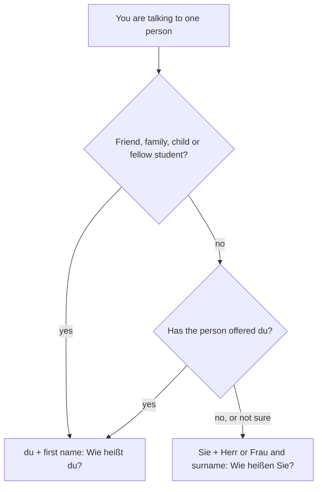

## What this lesson is for

In the last lesson you learned to say hello, thank you and goodbye, and to spell your name. Now
you'll hold a first real conversation: say who you are, where you're from and where you live,
ask the same of someone else, and ask how they are. To do that you need four verbs (*sein*,
*heißen*, *kommen*, *wohnen*), four question words, and one decision German makes you take in
every conversation: *du* or *Sie*?

## du or Sie?

English has one word for "you". German has two for talking to one person:

| | Use it with | Example |
|---|---|---|
| *du* | friends, family, children, classmates, people your age in casual settings, pets | *Wie heißt du?* |
| *Sie* | adults you don't know, shop and office staff, your boss, older people, anyone you call *Herr* or *Frau* | *Wie heißen Sie?* |

*du* is the **informal** "you"; *Sie* is the **formal** "you". *Sie* is always written with a
capital S, even in the middle of a sentence; that's how you tell it apart from *sie* (she,
they), which you'll meet in Lesson 4.

The two go with different ways of naming people. With *du*, people use first names: *Hallo,
Lena!* With *Sie*, they use *Herr* (Mr) or *Frau* (Mrs or Ms) and the surname: *Guten Tag,
Frau Schulz.* *Frau* is used for every adult woman, married or not; there's no German
equivalent of "Miss" in everyday use.

When in doubt, start with *Sie*. Switching from *Sie* to *du* is a small social step, and
usually the older person or the one in a senior position offers it: *Wir können gern du
sagen.* (We can say *du* to each other, if you like.) Among students, young people and in many workplaces, *du* is normal from
the first minute.

The chart sums up the choice for one person (customs vary by region, age and workplace, so
treat it as a guide, not a law):

You learned the greetings for each time of day in Lesson 1. Here they are on a clock; the
borders are rough, and *Hallo* works at any time of day with people you'd say *du* to, and in
many casual places with *Sie* too.

## The verb sein (to be)

A **verb** is a word for an action or state, like *to be*, *to live* or *to come*. The form
you find in a dictionary is the **infinitive**: *sein* (to be), *wohnen* (to live). In a
sentence, the verb changes its ending to match its **subject**, the person or thing doing it.
*sein* is irregular, as "to be" is in English, so learn these forms by heart:

| | sein |
|---|---|
| ich (I) | *bin* |
| du (you, informal) | *bist* |
| Sie (you, formal) | *sind* |
| er (he) / sie (she) | *ist* |

*Ich bin Paul.* — I'm Paul.
*Bist du Lena?* — Are you Lena?
*Sind Sie Herr Fischer?* — Are you Mr Fischer?
*Frau Ahmadi ist sehr nett.* — Ms Ahmadi is very nice.

You'll see the full table (we, you all, they) in Lesson 4.

## heißen, kommen, wohnen

Most German verbs are regular. You take the infinitive, remove *-en* to get the stem, and add
an ending. For now you need three forms:

| | heißen (to be called) | kommen (to come) | wohnen (to live) |
|---|---|---|---|
| ich | *heiße* | *komme* | *wohne* |
| du | *heißt* | *kommst* | *wohnst* |
| Sie | *heißen* | *kommen* | *wohnen* |

The *du* form ends in *-st*. *heißen* is the exception you can already see: its stem ends in
*ß*, so *du* adds only *-t* (*du heißt*, not *du heißst*). The *Sie* form is always the same as
the infinitive, which makes formal German easy.

*heißen* is how Germans give their name. Literally *Ich heiße Anna* is "I am called Anna". You
can also say *Ich bin Anna* or *Mein Name ist Anna* (my name is Anna).

*kommen* goes with *aus* (from) for where you come from:
*Ich komme aus Deutschland.* — I'm from Germany.
*Kommst du aus Österreich?* — Are you from Austria?
*Herr Meier kommt aus der Schweiz.* — Mr Meier is from Switzerland.

*wohnen* goes with *in* for where you live now:
*Ich wohne in Hamburg.* — I live in Hamburg.
*Wohnen Sie in der Stadt?* — Do you live in the city?

Most country names, like *Deutschland* and *Österreich*, have no article. A few do, and *die
Schweiz* is the one you need now: say *aus der Schweiz* and *in der Schweiz* as fixed chunks.
The *der* is explained when you learn the dative in Lesson 18.

One more verb is useful straight away, *sprechen* (to speak), though you'll study it properly
in Lesson 7. Notice the *du* form changes its vowel: *Ich spreche Englisch. Sprichst du
Deutsch? Sprechen Sie Englisch?*

## Asking questions with wer, wie, woher, wo

A **W-question** starts with a question word, and in German almost all of them begin with *w*.
The verb comes straight after the question word, and the subject follows the verb:

| Question word | Meaning | Example |
|---|---|---|
| *wer* | who | *Wer ist das?* — Who is that? |
| *wie* | how; what (with names) | *Wie heißt du?* — What's your name? |
| *woher* | where from | *Woher kommen Sie?* — Where are you from? |
| *wo* | where | *Wo wohnst du?* — Where do you live? |

Careful: *wer* means "who" and *wo* means "where". English speakers constantly swap them
because *wer* looks like "where". And *wie* is "how", even where English uses "what": *Wie
heißen Sie?* is "What's your name?", literally "How are you called?"

*woher* asks about origin and needs *aus* in the answer; *wo* asks about location and needs
*in*:
*Woher kommst du? — Aus Kanada.* — Where are you from? — From Canada.
*Wo wohnst du? — In Berlin.* — Where do you live? — In Berlin.

## How are you?

| Informal | Formal |
|---|---|
| *Wie geht's?* | *Wie geht es Ihnen?* |
| *Gut, danke. Und dir?* | *Gut, danke. Und Ihnen?* |

*Wie geht's?* is short for *Wie geht es?* (literally "How goes it?"). *Ihnen* and *dir* mean
"to you"; for now, learn the questions and answers as whole chunks. Possible answers, from
best to worst:

*Sehr gut, danke!* — Very well, thanks!
*Gut.* — Fine / good.
*Auch gut.* — Fine too (after the other person has said they're fine and asked *Und dir?*).
*Es geht.* — So-so.
*Nicht so gut.* — Not so good.

*Wie geht's?* is a real question between friends, not just "hi": Germans may tell you how
they actually are. In a shop or with strangers, people say *Guten Tag* and skip it.

When you meet someone, say *Freut mich* (nice to meet you), literally "pleases me". The other
person often answers *Mich auch* (me too).

## Introducing someone else

Use *Das ist …* (this is …) to introduce a third person: *Das ist Jonas. Er kommt aus Bremen.*
(This is Jonas. He's from Bremen.) *er* means he, *sie* means she; both take *ist*, *kommt*,
*wohnt*, *heißt*. Lesson 4 covers these forms in full.

## Dialogue 1: at a language course (du)

> Mia: Hallo! Ich bin Mia. Wie heißt du?
>
> Ben: Hallo, Mia. Ich heiße Ben. Freut mich!
>
> Mia: Freut mich auch. Woher kommst du, Ben?
>
> Ben: Ich komme aus Irland. Und du?
>
> Mia: Ich komme aus Österreich, aus Graz. Aber ich wohne jetzt in Leipzig.
>
> Ben: Leipzig ist eine schöne Stadt!

Hi! I'm Mia. What's your name? — Hi, Mia. I'm Ben. Nice to meet you! — Nice to meet you too.
Where are you from, Ben? — I'm from Ireland. And you? — I'm from Austria, from Graz. But I live
in Leipzig now. — Leipzig is a beautiful city!

## Dialogue 2: at a hotel (Sie)

> Herr Wolf: Guten Abend! Wie geht es Ihnen, Frau Novak?
>
> Frau Novak: Danke, sehr gut. Und Ihnen, Herr Wolf?
>
> Herr Wolf: Auch gut, danke. Wer ist das?
>
> Frau Novak: Das ist Herr Costa. Er kommt aus Portugal.
>
> Herr Wolf: Guten Abend, Herr Costa. Freut mich. Wo wohnen Sie?
>
> Herr Costa: In Lissabon. Lissabon ist eine Stadt in Portugal.

Good evening! How are you, Ms Novak? — Very well, thank you. And you, Mr Wolf? — Fine too,
thanks. Who is that? — This is Mr Costa. He's from Portugal. — Good evening, Mr Costa. Pleased
to meet you. Where do you live? — In Lisbon. Lisbon is a city in Portugal.

(*aber* means "but", *jetzt* means "now", *schön* means "beautiful" and *eine* means "a"; you'll
learn these properly later.)

## Countries and places

*das Land* (country) and *die Stadt* (city, town) are your first two nouns with articles. Every
German noun has one of three articles, *der*, *die* or *das*, and you'll learn why in Lesson 5.
For now, learn each noun together with its article as one unit.

*Deutschland ist ein Land.* — Germany is a country.
*Wien ist eine Stadt in Österreich.* — Vienna is a city in Austria.
*Die Schweiz ist klein.* — Switzerland is small.

## Pronunciation

- *heißen*: *ei* as in "eye", *ß* as a sharp *s*: "HY-sen".
- *wohnen*: *w* = v, long *o*, silent *h*: "VOH-nen".
- *woher*: stress on the second syllable, "vo-HAIR".
- *Österreich*: stress on *Ö*; *eich* ends with the soft *ch* of *ich*.
- *die Schweiz*: "shvites", one syllable, *z* = ts.
- *Wie geht's?*: "vee gates".

## Common mistakes

- Mixing *du* and *Sie* in one conversation (*Wie heißen du?*). Pick one and keep its forms:
  *Wie heißt du?* or *Wie heißen Sie?*
- *Wer* for "where". *Wer* is who, *wo* is where.
- *Wie ist dein Name?* is fine, but *Was ist dein Name?* sounds like a translation from English.
- *Ich komme von Deutschland.* Origin takes *aus*: *Ich komme aus Deutschland.*
- *Ich bin gut* for "I'm fine". Say *Mir geht's gut* or just *Gut, danke*. *Ich bin gut* means
  "I'm good at something" or "I'm a good person".
- Writing the formal *Sie* in lowercase. It's always *Sie*.
- *Du heißst*. The stem ends in *ß*, so it's *du heißt*.

## Key points

- *du* for friends, family and children; *Sie* (capital S) for adults you don't know and
  anyone you call *Herr* or *Frau*.
- *sein*: *ich bin, du bist, Sie sind, er/sie ist*.
- Regular verbs: *ich -e, du -st, Sie -en*; *du heißt* is the exception.
- *kommen aus* for origin, *wohnen in* for where you live now.
- *wer* = who, *wie* = how, *woher* = where from, *wo* = where; the verb follows the question word.
- *Wie geht's?* (informal), *Wie geht es Ihnen?* (formal); *Freut mich* when you meet someone.

The words from this lesson are listed below; they join your vocabulary reviews when you
complete the lesson.
