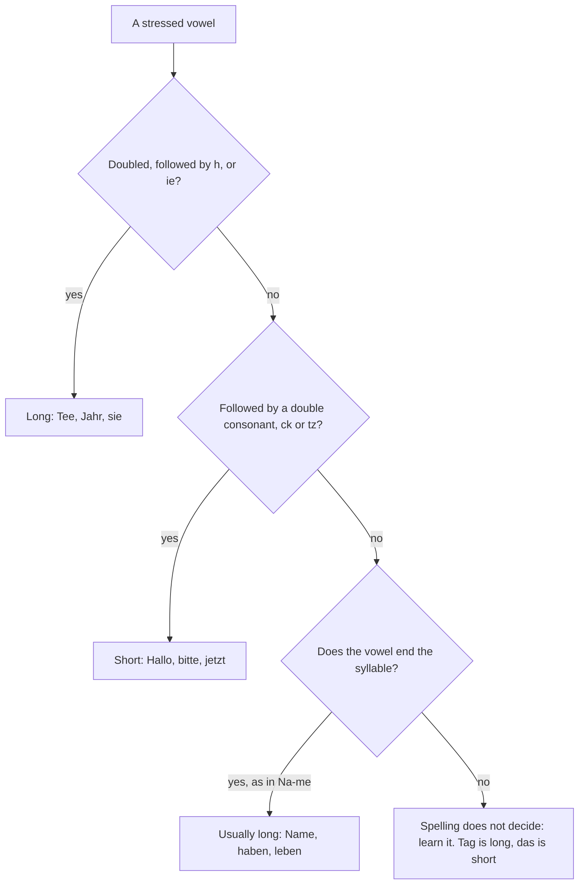

## What this lesson is for

Lesson 1 gave you the sounds of the German letters. This honors lesson goes one step further,
to the things that make the difference between "readable" and "sounds
German": how to tell long and short vowels apart from the spelling alone, what happens to *-e*
and *-er* at the end of a word, the small catch in the throat that Germans put before words
starting with a vowel, how a sentence rises and falls, and how the sounds differ between
regions. At the end you'll see why *daß* became *dass* in 1996.

The new words for talking about pronunciation are *die Aussprache* (pronunciation), *aussprechen* (to pronounce), *der Laut*
(a sound of speech), *die Silbe* (syllable) and *der Akzent* (accent).

## Long or short? Reading vowel length from the spelling

Lesson 1 said a vowel is long before *h*, when doubled, and in *ie*, and short before a double
consonant. Two more patterns cover most of the rest.

First, a vowel at the end of a syllable is usually long. Such a syllable is called an
**open syllable**: *Na-me*, *ha-ben*, *le-ben*, *Ta-ge*. A syllable that ends in a consonant is closed,
and the vowel there is often short: *Stadt*, *Wort*, *jetzt*.

Second, a one-syllable word often "borrows" its length from a longer form of the same word.
*Tag* is closed, but its plural *Tage* has an open syllable *Ta-*, so the *a* is long in both.
The same goes for *Weg* (way, plural *Wege*) and *gut* (good, *gute*). This is why you can't
always tell from one form: you need to know the family.

Short everyday words are the exception you just have to learn. These have short vowels even
though only one consonant follows: *das*, *was*, *es*, *in*, *mit*, *an*, *um*, *bis*, *man*,
*hat*. A few others look short but are long: *der*, *wir*, *mir*.

### Example 1: Name, Stadt, Bett, Boot, Jahr, das

Work through the chart for each word.

1. *Name*: no doubling, no *h*, no double consonant. Split it: *Na-me*. The *a* ends the
   syllable, so it's long: "NAH-meh".
2. *Stadt*: *dt* is two different consonants, not a double one, and the *a* doesn't end a
   syllable. The chart says "learn it": it's short, as Lesson 1's table showed.
3. *Bett* (bed): double *t*, so short.
4. *Boot* (boat): doubled vowel, so long.
5. *Jahr*: vowel plus *h*, so long; the *h* is silent.
6. *das*: one of the short everyday words; the *a* is short and clipped.

## The schwa and the vocalic r

An unstressed *e*, as in *bitte*, *Name* or the ending *-en*, is a weak, relaxed sound called
**schwa**. Your mouth is half open and nothing is tense: it sounds like the *a* in English
*about*. Lesson 1 said a final *e* is never silent; the schwa is what you say.

The letters *-er* at the end of a word sound different again. The *r* doesn't appear as an
*r* at all; *-er* becomes a short, open sound close to the *u* in English *but*. This is
called the **vocalic r**. Compare:

| schwa (-e) | vocalic r (-er) |
|---|---|
| *bitte* (please) | *bitter* (bitter) |
| *Lehre* (training, apprenticeship) | *Lehrer* (teacher) |
| *eine* (a) | *einer* (one of them) |

Words like *bitte* and *bitter* that differ in a single sound are a **minimal pair**, and they
are the best way to train your ear. The same melting happens after a long vowel: *der*, *wir*,
*hier* (here) and *Bier* (beer) end in a short "uh" glide, and *aber* (but) and *oder* (or)
end like *Lehrer*. A hard English *r* here is the clearest sign of an English accent.

## The glottal stop: the catch before a vowel

Say English "uh-oh". The tiny break in the middle, where your throat closes for a moment, is a
**glottal stop**. In English it's rare; in German it's everywhere. In careful standard German
of Germany, a word or word part that begins with a vowel usually starts with this small catch
instead of being joined to the word before it.

English links words: "an egg" can sound like "a-negg". German keeps them apart: *ein Ei* (an
egg) is said "ein | Ei", with a fresh start on *Ei*. That's part of why German sounds "choppy"
to English ears.

The glottal stop also works inside words, at the border between two parts:

- *das Spiegelei* (fried egg) is *Spiegel* (mirror) + *Ei*, said "SHPEE-gel | ei". Without the
  catch it would sound like *Spie-ge-lei*, which isn't a word.
- *verreisen* (to go away on a trip) is *ver-* + *reisen* (to travel): "fer-RY-zen", with an
  *r* sound. *vereisen* (to ice over) is *ver-* + *eisen*: "fer | EYE-zen", with a catch and no
  *r*. Only the glottal stop tells them apart.
- *beantworten* (to answer something) is *be-* + *antworten*: "be | ANT-vor-ten".

In the south, in Austria and in Switzerland the catch is often softer or left out, so take it
as a feature of northern and careful speech rather than a strict rule.

## More letter groups

Lesson 1 covered the groups you meet every day. These come up as your vocabulary grows:

| Spelling | Sound | Examples |
|---|---|---|
| *pf* | both letters: *p* then *f* | *der Apfel* (apple), *der Kopf* (head) |
| *chs* | usually *ks* | *sechs*, *der Fuchs* (fox) |
| *ng* | *ng* as in *singer*, never *ng-g* | *singen* (to sing), *Entschuldigung*, *der Finger* |
| *-tion* | *tsion*, stressed | *die Information* (in-for-ma-TSION) |
| *v* in borrowed words | English *v* | *das Klavier*, *die Universität*, *November* |
| *y* in Greek words | like *ü* | *der Typ* (type, guy) |
| *y* in English words | as in English | *das Handy* ("HEN-dee") |

A **loanword** is a word taken from another language, and loanwords often keep some of their
old pronunciation and stress. That's why *v* is an *f* in old German words (*Vater*, *vier*,
*Vogel*) but a *v* in *Klavier* and *Universität*, and why *Information* and *Universität* are
stressed at the end. *Finger* is a nice trap: in English the *g* is heard, in German it isn't.

## Sentence melody

**Intonation** is the rise and fall of your voice across a sentence. German uses it much as
English does, which makes it one of the easier parts:

- A statement falls at the end: *Du wohnst in Berlin.*
- A yes/no question usually rises at the end: *Wohnst du in Berlin?*
- A W-question usually falls, because the question word already marks it as a question:
  *Wo wohnst du?* A rising W-question sounds extra friendly or surprised.

### Example 2: Reading a long word aloud

Take *das Mittagessen* (lunch), a word you'll meet in Lesson 9, and apply everything so far.

1. Find the parts: *Mittag* (midday) + *Essen* (food, meal). In a compound, the first part
   carries the main stress: "MIT-tag-essen".
2. *Mit-*: double *t*, so the *i* is short.
3. *-tag*: the *g* ends the syllable, so final devoicing makes it a *k*: "-tahk".
4. *essen* starts with a vowel and is a new part, so put a glottal stop before it: "MIT-tahk |
   es-sen". Double *s*: short *e*.
5. *-en* at the end is a schwa plus *n*, very light.

Result: "MIT-tahk | ess-en", with the stress at the start and a clean catch in the middle.

### Example 3: A tongue twister

Germans practise sounds with tongue twisters (*Zungenbrecher*, literally "tongue
breakers"). This one is traditional:

> Fischers Fritz fischt frische Fische, frische Fische fischt Fischers Fritz.

(Fisher's Fritz fishes fresh fish.) Go through it slowly. Every *sch* is English *sh*. Every *i*
before *sch* or *tz* is short. *Fritz* ends in *tz*, one quick "ts". *fischt* has *sch* and
then *t* at once: "fisht". The *-e* in *frische* and *Fische* is a schwa, not silent. Say it
slowly three times, then faster.

## One language, many accents

German has several standard forms (you'll learn more about this in the next honors lesson),
and the pronunciation of educated speakers differs by region. None of these is "wrong":

- The ending *-ig*: *zwanzig* ends with the *ich* sound in most of Germany, but with a *k*
  ("-tsik") in the south, in Austria and in Switzerland, where that counts as standard.
- *ch* at the start of a word, as in *China*: in standard German of Germany it's the soft *ich*
  sound, in the south and in Austria and Switzerland it's a *k* ("Kina"), and in everyday
  speech in much of central and northern Germany you'll often hear "Schina".
- The *r*: the throat *r* is usual in most of Germany, but many speakers in the south, in
  Austria and in Switzerland roll it with the tip of the tongue.

For your own speaking, pick one model and stay with it; this course follows the standard of
Germany.

## Spelling reform: dass, Fluss and the capital ẞ

In 1996 Germany, Austria and Switzerland agreed on a **spelling reform**, which came into
schools in 1998 and was revised in 2004 and 2006. Its best-known change is the rule you learned
in Lesson 1: *ß* after a long vowel or diphthong, *ss* after a short one. Before the reform,
*ß* was also written after short vowels at the end of a word or before a consonant. So:

| Before 1996 | Now | Why |
|---|---|---|
| *daß* | *dass* (that) | short *a* |
| *Fluß* | *Fluss* (river) | short *u* |
| *muß* | *muss* (must) | short *u* |
| *Straße* | *Straße* (no change) | long *a* |
| *heißen* | *heißen* (no change) | diphthong *ei* |

You'll still see *daß* on old signs and in older books. Now the spelling tells you the vowel
length, which helps when reading aloud.

Text in capitals used to be a problem: *ß* had no capital, so *STRASSE* was written with *SS*.
Since 2017 the official rules also allow a capital *ẞ* (*STRAẞE*), though *SS* is still the
usual choice. Swiss Standard German has done without *ß* for decades and writes *Strasse*.

## Reading: a voice message

Kemal, a learner, sends a voice message to his tandem partner Jana. Read it aloud, using
everything in this lesson.

> Hallo Jana, hier ist Kemal! Ich lerne jetzt jeden Tag Aussprache. Das ist nicht leicht! Mein
> "r" in "Bier" ist noch sehr englisch. Und "Spiegelei" ist ein Problem: ich sage
> "Spie-ge-lei". Mein Lehrer sagt: "Ei" ist ein Wort, und ein Wort mit Vokal am Anfang beginnt
> neu, mit Stopp. Wir machen jetzt oft Zungenbrecher. "Fischers Fritz" mache ich schon gut! Aber
> "Blaukraut bleibt Blaukraut" ist sehr schwer. Verreist du im Sommer? Ich verreise nicht, ich
> lerne. Bis bald!

Hi Jana, it's Kemal! I'm practising pronunciation every day now. It isn't easy! My "r" in
*Bier* is still very English. And *Spiegelei* is a problem: I say "Spie-ge-lei". My teacher
says: *Ei* is a word, and a word with a vowel at the beginning starts fresh, with a stop. We
often do tongue twisters now. I can already do "Fischers Fritz" well! But "Blaukraut bleibt
Blaukraut" is very hard. Are you going away in the summer? I'm not going away, I'm studying.
See you soon!

(*jeden Tag* means every day, *leicht* easy, *noch* still, *schwer* hard, *am Anfang* at the
beginning and *im Sommer* in the summer. The full twister *Blaukraut bleibt Blaukraut und Brautkleid bleibt
Brautkleid* means "red cabbage stays red cabbage and a wedding dress stays a wedding dress".)

## Common mistakes

- Saying the *r* in *-er* like English *r*. *Lehrer*, *aber*, *oder* end in a short "uh".
- Joining words the English way: *ein Ei* as "ei-nei". Make a clean new start on the vowel.
- Treating every single-consonant vowel as long. *das*, *was*, *mit*, *in*, *hat* are short.
- Hearing *g* in *ng*: *Finger* is "FING-uh", *singen* is "ZING-en", with no hard *g*.
- Reading *v* as *f* in borrowed words: *Klavier* and *Universität* have a real *v*.
- Raising the voice at the end of every question. W-questions usually fall.
- Writing *daß* or *muß*. Since the reform it's *dass* and *muss*.

## Key points

- A vowel that ends its syllable is usually long (*Na-me*); short everyday words like *das,
  mit, in* are short.
- Unstressed *-e* is a schwa; final *-er* is a vocalic *r*, close to a short "uh".
- Germans put a glottal stop before a word or word part that starts with a vowel: *ein | Ei*,
  *Spiegel | ei*, *ver | eisen*.
- *pf* = both letters, *chs* = ks, *ng* has no *g*, *-tion* = tsion, *v* = v in many loanwords.
- Statements and W-questions usually fall; yes/no questions rise.
- Regional standards differ (*-ig* as *-ik*, rolled *r*), and all are correct where they're used.
- Since the 1996 reform: *ss* after a short vowel (*dass*), *ß* after a long one (*Straße*); a
  capital *ẞ* has been allowed since 2017.

The words from this lesson are listed below; they join your vocabulary reviews when you
complete the lesson.
