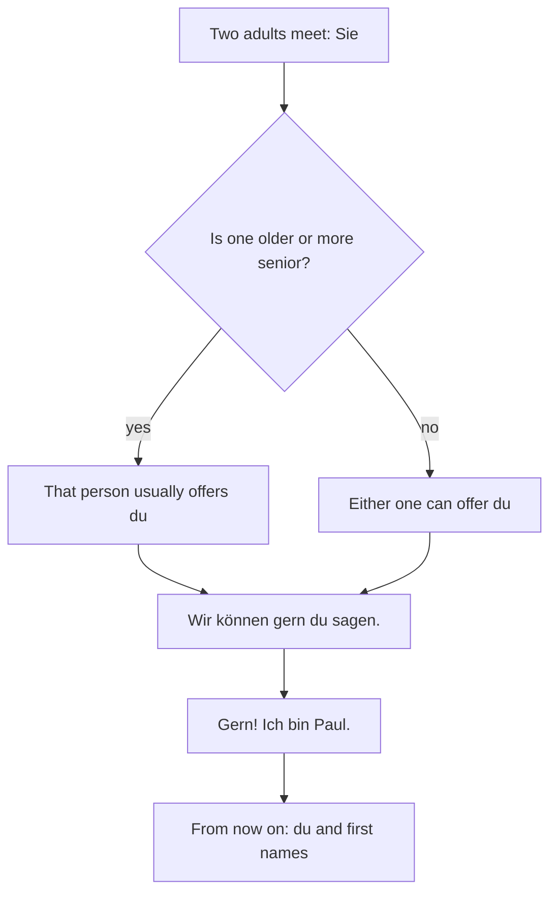

## What this lesson is for

In Lesson 2 you learned to greet people, to choose between *du* and *Sie*, and to say where
you're from. That's enough for a first conversation, but real conversations happen in real
places: a bakery in Hamburg, an office in Vienna, a train in Zurich. This honors lesson shows
you where German is spoken, why a Swiss and a Bavarian may greet you with words you've never
seen, and how *du* and *Sie* work in everyday life, including how people switch from one to the
other. You'll also learn two useful verbs, *duzen* and *siezen*, and practise the present tense
from Lesson 4 with them.

## Where German is spoken

German is the main language of Germany, Austria and Liechtenstein, and of most of Switzerland.
It's an **official language**, a language the state uses for laws, schools and offices, in
several more places:

| Country or region | German there |
|---|---|
| *Deutschland* | the official language |
| *Österreich* | the official language |
| *die Schweiz* | one of four national languages, with French, Italian and Romansh; the language of most of the population |
| *Liechtenstein* | the only official language |
| *Luxemburg* | one of three official languages, with Luxembourgish and French |
| *Belgien* (Belgium) | one of three official languages; spoken in a small area in the east, home to about 80,000 people |
| *Südtirol* (South Tyrol, Italy) | official alongside Italian; the first language of most people there |

German is the most widely spoken first language in the European Union. You'll also hear the
short form *DACH* for the three big German-speaking countries: *D* (Deutschland), *A*
(Austria, from its Latin name) and *CH* (Switzerland, from Latin *Confoederatio Helvetica*).
Those letters are also the countries' international car codes.

## Standard German and dialects

When you learn German, you learn **standard German**, in German *Hochdeutsch*. The word means
"High German", but "high" is about geography, not quality: the standard grew mainly out of the
dialects of the higher, hilly middle and south of the German-speaking area, as opposed to the
flat north (where *Plattdeutsch*, "Low German", is spoken). Standard German is what you read in
newspapers, hear on the news and use in school and at work.

Alongside it, many people speak a **dialect**, a regional form of the language with its own
sounds, words and some grammar. Bavarian, Swabian and Low German are well-known examples. Most
Germans and Austrians can switch between their dialect and standard German, and the standard is
always understood.

Switzerland is a special case. In everyday speech, German-speaking Swiss people of every
background use **Swiss German** (*Schweizerdeutsch*), a family of dialects that can be hard for
Germans to follow. In writing, at school and on the news, they use Swiss Standard German. As a
learner, you speak standard German in Switzerland too, and people will answer you in it.

German is a **pluricentric language**: it has more than one standard. Germany, Austria and
Switzerland each have their own standard form, with small differences in words, spelling and
pronunciation. A few examples:

| Germany | Austria | Switzerland | Meaning |
|---|---|---|---|
| *Januar* | *Jänner* | *Januar* | January |
| *Fahrrad* | *Fahrrad* | *Velo* | bicycle |
| *Straße* | *Straße* | *Strasse* | street |
| *Tschüss* | *Servus*, *Baba* (casual) | *Tschüss*, *Ciao* | bye |

None of these is "better German". If you live in Vienna, *Jänner* is correct; on a German exam,
either is accepted.

## Hello and goodbye around the region

Lessons 1 and 2 gave you *Hallo*, *Guten Tag* and *Tschüss*, which work everywhere. Here are
greetings you'll hear in particular regions:

| Greeting | Where | How it's used |
|---|---|---|
| *Moin* | northern Germany | hello, at any time of day, even in the evening |
| *Grüß Gott* | southern Germany, Austria | hello; polite, fine with *Sie* |
| *Grüß dich* | southern Germany, Austria | hello to one person you say *du* to |
| *Servus* | Bavaria, Austria | hello and goodbye, informal |
| *Grüezi* | Switzerland | hello to people you say *Sie* to |
| *Hoi* | Switzerland | hi, informal |

Most experts trace *Moin* to a Low German word for "nice" rather than to *Morgen* (the origin
is debated), and either way it works in the evening too. *Grüß dich* literally means "(God) greet you", and its *dich* is the *du* form, so it's
only for people you'd say *du* to. In Switzerland, *Grüezi* is the safe choice in shops and
offices. You don't have to use these greetings yourself, but you should recognise them. A
learner who answers *Moin!* in Hamburg or *Servus!* among friends in Munich is doing well.

## du and Sie in real life

Two verbs name the choice: *duzen* (to say *du* to someone) and *siezen* (to say *Sie*). They're
regular, and their stems end in *-z*, so they follow the rule from Lesson 4: the *du* form adds
only *-t*.

| | duzen | siezen |
|---|---|---|
| ich | *duze* | *sieze* |
| du | *duzt* | *siezt* |
| er / sie / es | *duzt* | *siezt* |
| wir | *duzen* | *siezen* |
| ihr | *duzt* | *siezt* |
| sie / Sie | *duzen* | *siezen* |

*Im Büro duzen wir alle.* — In the office we all say *du*.
*Ich sieze meine Chefin.* — I say *Sie* to my boss.
*Duzt du deine Lehrerin?* — Do you say *du* to your teacher?

When people move from *Sie* to *du*, someone offers it, often with *Wir können gern du sagen*
or *Wollen wir uns duzen?* (Shall we say *du* to each other?). The offer is usually made by the
older person, the person in the higher position, or, between equals, simply by whoever thinks
of it first. Accepting is easy: *Gern! Ich bin Paul.* It's polite to accept; going back to
*Sie* afterwards would feel cold. The chart shows the usual pattern, which is a custom, not a
fixed rule:

Some patterns from everyday life, with the usual hedge that families, regions and companies
differ:

- Many workplaces, especially young companies, use *du* for everyone, sometimes including the
  boss. Banks, offices and older firms often keep *Sie*.
- Online, in sports clubs and among students, *du* is the norm.
- In shops, restaurants and offices, staff and customers say *Sie*, though some shops with a
  young image address customers with *du* on purpose.
- For a group, use *ihr* if you'd say *du* to each person (*Kommt ihr mit?*), and *Sie* if
  you'd say *Sie* to them. When a group is mixed, *Sie* is the safe choice in formal settings.
- Titles: a doctor may be addressed as *Frau Doktor* or *Herr Doktor*. In Austria, academic
  titles are used more often than in Germany, also in everyday address.

### Example 1: Choosing the form of address

For each situation, decide *du*, *ihr* or *Sie*, and say how you'd greet the person.

1. Your new neighbour, about 60, in Graz, in the morning. An adult you don't know: *Sie*.
   Austria, morning: *Grüß Gott!* or *Guten Morgen!*, then *Wie geht es Ihnen?*
2. Two children at a playground in Berlin. Children, two of them: *ihr*. *Hallo! Wie heißt
   ihr?*
3. A colleague in a Hamburg start-up who said *Ich bin Lea* on your first day. She has given
   you her first name in a *du* setting: *du*. *Moin, Lea!*
4. A shop assistant in Zurich. A stranger at work: *Sie*. *Grüezi!*

### Example 2: Forms of duzen and siezen

Fill in: *Wir ___ uns.* (duzen) — *Lisa ___ Frau Klein.* (siezen) — *___ du Frau Klein?*
(duzen)

1. *wir* takes the infinitive form: *Wir duzen uns.* (We say *du* to each other.)
2. *Lisa* is *sie* (she); the ending is *-t*. The stem *siez-* ends in *z*, but *-t* is added
   anyway: *Lisa siezt Frau Klein.*
3. *du*: the stem *duz-* ends in *-z*, so add only *-t*, not *-st*: *Duzt du Frau Klein?* It's
   a yes/no question, so the verb comes first.

## Reading: new in Vienna

Nadia, from Canada, writes to her German teacher in Toronto.

> Liebe Frau Becker,
>
> viele Grüße aus Wien! Ich wohne jetzt hier und arbeite in einem Büro. Das Deutsch hier ist ein
> bisschen anders. Am Morgen sagen die Leute nicht "Guten Morgen", sie sagen "Grüß Gott", und im
> Büro sagt mein Kollege Florian immer "Servus". Er sagt auch "Servus" am Abend, für "Tschüss"!
> Ich duze Florian, er ist sehr nett. Meine Chefin sieze ich. Sie heißt Frau Magistra Huber.
> Magistra ist ein Titel, und in Österreich sind Titel wichtig. Der Januar heißt hier "Jänner".
> Ich verstehe viel, aber nicht alles!
>
> Viele Grüße
> Nadia

Dear Mrs Becker, Many greetings from Vienna! I live here now and work in an office. The German
here is a bit different. In the morning people don't say *Guten Morgen*, they say *Grüß Gott*,
and in the office my colleague Florian always says *Servus*. He also says *Servus* in the
evening, for "bye"! I say *du* to Florian; he's very nice. I say *Sie* to my boss. She's called
Frau Magistra Huber. *Magistra* is a title, and in Austria titles are important. January is
called *Jänner* here. I understand a lot, but not everything! Best wishes, Nadia

(*ein bisschen* means a bit, *anders* different, *die Leute* people, *der Kollege* the
colleague, *die Chefin* the boss, *der Titel* the title and *alles* everything. *in einem Büro*
uses the dative from Lesson 18; read it as "in an office". Notice *Meine Chefin sieze ich*: the
object comes first and the verb stays in position 2.)

### Example 3: Reading between the lines

What can you work out from Nadia's message?

1. *Grüß Gott* in the morning: Nadia expected *Guten Morgen*, but in Austria *Grüß Gott* works
   at any time of day.
2. *Servus* in the evening, "for *Tschüss*": *Servus* means both hello and goodbye.
3. *Ich duze Florian* but *Meine Chefin sieze ich*: the office is mixed; colleagues use *du*,
   the boss keeps *Sie*.
4. *Frau Magistra Huber*: *Magistra* is the female form of the Austrian academic title
   *Magister*, and using it shows respect.

## Common mistakes

- *Grüß dich* to someone you say *Sie* to. *dich* is a *du* form; say *Grüß Gott* or *Guten Tag*.
- *du duzst*, *du siezst*. The stems end in *-z*: *du duzt*, *du siezt*.
- Thinking *Moin* is only for the morning. It works all day.
- Thinking *Hochdeutsch* means "posh German" or that dialect speakers speak "bad German".
  Dialects are full languages of everyday life; the standard is simply shared by everyone.
- Calling Austrian or Swiss forms mistakes. *Jänner* and *Strasse* are correct in their countries.
- Saying *du* to a group of adults you'd call *Sie* (*Wie heißt ihr?* to two business
  clients). Use *Sie*: *Wie heißen Sie?*
- Switching back to *Sie* after someone has offered *du*. Once you've agreed, stay with *du*.

## Key points

- German is official in Germany, Austria, Switzerland, Liechtenstein, Luxembourg, Belgium (east)
  and South Tyrol (Italy).
- Standard German (*Hochdeutsch*) is understood everywhere; dialects live alongside it, and in
  Switzerland everyday speech is Swiss German.
- German is pluricentric: Germany, Austria and Switzerland each have their own standard
  (*Jänner*, *Velo*, *Strasse*).
- Regional greetings: *Moin* (north), *Grüß Gott* and *Servus* (south, Austria), *Grüezi* (Switzerland).
- *duzen* / *siezen*: *du duzt*, *du siezt*. The older or more senior person usually offers *du*.
- Groups: *ihr* for people you'd say *du* to, *Sie* for people you'd say *Sie* to.

The words from this lesson are listed below; they join your vocabulary reviews when you
complete the lesson.
