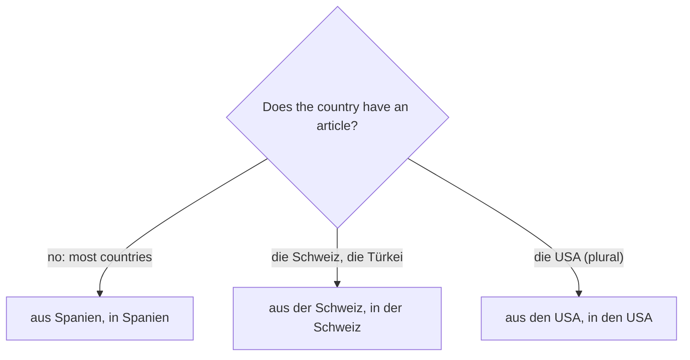

## What this lesson is for

After your name, where you're from and your family, the next thing people ask is what you do
and which languages you speak. This lesson gives you the words for common jobs, workplaces,
languages and countries, and three grammar points:

- how to say your job — with no article: *Ich bin Lehrerin*;
- how German makes a woman's job title from a man's with *-in*;
- the full forms of *sprechen*, your first **stem-changing verb**.

## Asking about jobs

The standard question, formal and informal:

- *Was sind Sie von Beruf?* — What do you do (for a living)? Literally "What are you by
  profession?"
- *Was bist du von Beruf?* — the same, informal.
- *Was machst du beruflich?* — a relaxed alternative (*beruflich* = for work).

And the answer:

- *Ich bin Lehrer.* — I'm a teacher. (a man)
- *Ich bin Ärztin.* — I'm a doctor. (a woman)
- *Mein Bruder ist Koch.* — My brother is a cook.
- *Sie ist Studentin.* — She's a student.

Notice what's missing: there's no *ein* or *eine*. English says "I'm *a* teacher"; German
says *Ich bin Lehrer*. With jobs (and *Student*, *Schüler*) after *sein*,
German leaves the article out. ~~Ich bin ein Lehrer~~ isn't wrong grammar, but it
sounds odd — like stressing "I'm a teacher (and not something else)".

Other useful patterns:

- *Ich arbeite als Kellner.* — I work as a waiter. (*als* = as)
- *Ich studiere Englisch.* — I'm studying English (at university).
- *Meine Firma ist in Hamburg.* — My company is in Hamburg.

If you don't work, you can say *Ich arbeite nicht* (I don't work) or *Ich bin Schüler* (I'm a
school pupil). Note the difference: a *Student* or *Studentin* is at university; a *Schüler*
or *Schülerin* is at school.

## Jobs for men and women: the -in ending

Most job nouns have a masculine form and a feminine form. The feminine is made by adding
*-in*, and some words also take an umlaut:

| Masculine (der) | Feminine (die) | English |
|---|---|---|
| der Lehrer | die Lehrerin | teacher |
| der Student | die Studentin | (university) student |
| der Schüler | die Schülerin | pupil, school student |
| der Verkäufer | die Verkäuferin | salesperson, shop assistant |
| der Kellner | die Kellnerin | waiter / waitress |
| der Ingenieur | die Ingenieurin | engineer |
| der Polizist | die Polizistin | police officer |
| der Arzt | die Ärztin | doctor |
| der Koch | die Köchin | cook, chef |

The feminine forms are always *die* and always form the plural with *-nen*: *die Lehrerin →
die Lehrerinnen*. The masculine plurals follow the patterns from lesson 5: *die Lehrer, die
Studenten, die Ärzte, die Köche, die Polizisten, die Ingenieure*.

When you talk about yourself, choose the form that fits you: a woman says *Ich bin Ingenieurin*,
a man *Ich bin Ingenieur*. Your vocabulary cards ask for the masculine form unless the prompt
says "female".

## Places of work

- *das Büro* — office: *Ich arbeite im Büro.* — I work in an office. (*im* = in the; a short
  form explained in lesson 19.)
- *die Firma* (plural *die Firmen*) — company, firm.
- *die Schule* — school; *die Universität* — university, often shortened to *die Uni*.
- *die Arbeit* — work, the job: *Die Arbeit ist interessant.* — The work is interesting.
- *der Beruf* — profession, occupation.

## Countries and languages

Most country names are neuter and are used without an article: *Ich komme aus Spanien. Ich
wohne in Frankreich.*

A few countries always take an article. You'll meet them in fixed phrases:

| Country | "I come from …" | "I live in …" |
|---|---|---|
| die Schweiz | Ich komme aus der Schweiz. | Ich wohne in der Schweiz. |
| die Türkei | Ich komme aus der Türkei. | Ich wohne in der Türkei. |
| die USA (plural) | Ich komme aus den USA. | Ich wohne in den USA. |

(After *aus* and *in*, *die* turns into *der* or *den*. That's the dative case, taught in lesson
18 — for now learn these as set phrases.)

One question decides which pattern you need:

Many language names end in *-isch* and are written with a capital letter when they name the
language. They're used without an article:

| Country | Language |
|---|---|
| Deutschland, Österreich, die Schweiz | Deutsch |
| England, die USA | Englisch |
| Spanien | Spanisch |
| Frankreich | Französisch |
| Italien | Italienisch |
| Polen | Polnisch |
| die Türkei | Türkisch |

The Swiss also speak French, Italian and Romansh, and Austria is German-speaking, so
*Deutsch* covers three countries. Something that crosses borders is *international*:
*Meine Firma ist international.*

## sprechen: a verb that changes its vowel

*sprechen* (to speak) has regular endings, but in the *du* and *er/sie/es* forms the vowel of
the stem changes from *e* to *i*:

| | sprechen |
|---|---|
| ich | spreche |
| du | sprichst (changed) |
| er / sie / es | spricht (changed) |
| wir | sprechen |
| ihr | sprecht |
| sie / Sie | sprechen |

The stem is the part of the verb before the ending: *sprech-*. In a stem-changing verb, only
*du* and *er/sie/es* change; *ich*, *wir*, *ihr* and *sie/Sie* stay regular. You'll meet more
verbs like this in lesson 13 (*essen → isst*, *lesen → liest*, *fahren → fährt*), always in
the same two places.

- *Welche Sprachen sprichst du?* — Which languages do you speak? (*welche* = which)
- *Ich spreche Englisch und ein bisschen Deutsch.* — I speak English and a bit of German.
- *Mein Vater spricht Polnisch.* — My father speaks Polish.
- *Sprechen Sie Französisch?* — Do you speak French?
- *Wir sprechen hier Deutsch.* — We speak German here.

## Dialogue: at a language café

Two people meet at a conversation evening in Munich.

> Mia: *Hallo, ich bin Mia. Woher kommst du?*
>
> Daniel: *Ich komme aus den USA, aus Chicago. Und du?*
>
> Mia: *Ich komme aus Polen, aber ich wohne jetzt hier in München. Was bist du von Beruf?*
>
> Daniel: *Ich bin Ingenieur. Meine Firma ist international. Und du?*
>
> Mia: *Ich bin Lehrerin. Ich arbeite an einer Schule. Welche Sprachen sprichst du?*
>
> Daniel: *Englisch, Spanisch und ein bisschen Deutsch. Du sprichst sehr gut Deutsch!*
>
> Mia: *Danke! Ich spreche Polnisch, Deutsch und Englisch. Mein Mann spricht auch Italienisch.*
>
> Daniel: *Toll! Ist er auch Lehrer?*
>
> Mia: *Nein, er ist Koch.*

Translation:

> Mia: Hi, I'm Mia. Where are you from?
>
> Daniel: I'm from the USA, from Chicago. And you?
>
> Mia: I'm from Poland, but I live here in Munich now. What do you do for a living?
>
> Daniel: I'm an engineer. My company is international. And you?
>
> Mia: I'm a teacher. I work at a school. Which languages do you speak?
>
> Daniel: English, Spanish and a bit of German. You speak German very well!
>
> Mia: Thanks! I speak Polish, German and English. My husband speaks Italian too.
>
> Daniel: Great! Is he a teacher too?
>
> Mia: No, he's a cook.

(*aber* = but; *ein bisschen* = a bit; *an einer Schule* = at a school, another dative set
phrase.)

## Pronunciation

- *Ingenieur* is a French loanword: in-zhe-NYÖR, with *g* like the *s* in "measure".
- *Arzt* ends in *-tst*: ARTST. *Ärztin*: AIRTS-tin.
- *Polizist*, *Universität*, *Büro*, *international* are stressed on the last syllable:
  po-li-TSIST, u-ni-ver-si-TÄT, bü-RO, in-ter-na-tsio-NAL. *z* and *-ti-* sound like *ts*.
- *Koch*: the throaty *ach*-sound. *Köchin* and *sprichst*: the soft *ich*-sound.
- *Spanien*, *sprechen*, *Sprache*, *Student*: *sp* and *st* at the start of a word sound like
  *shp* and *sht*: SHPAH-nyen, shtu-DENT (*Student* is stressed on the second syllable).
- *Türkei* is stressed at the end: tür-KAI.

## Common mistakes

- Adding an article to a job: ~~Ich bin eine Ärztin~~ → *Ich bin Ärztin*.
- Forgetting the feminine *-in*. A woman says *Ich bin Studentin*, not ~~Ich bin Student~~.
- Using the English names: ~~Ich spreche German~~ → *Ich spreche Deutsch*; ~~Ich komme aus
  Germany~~ → *aus Deutschland*.
- Writing languages in lower case: *Ich spreche Englisch* (capital *E*).
- Keeping the *e* in the *du/er* forms: ~~er sprecht~~ → *er spricht*; ~~du sprechst~~ → *du
  sprichst*. And don't change *ich*: ~~ich spriche~~ → *ich spreche*.
- Leaving out the article with *die Schweiz*, *die Türkei* and *die USA*: *aus der Türkei*, not
  ~~aus Türkei~~.

## Key points

- *Was sind Sie von Beruf?* — *Ich bin Lehrer / Lehrerin.* No article before a job.
- Feminine job titles add *-in* (sometimes with an umlaut): *der Arzt → die Ärztin*. Plural
  *-innen*.
- Most countries need no article; *die Schweiz, die Türkei, die USA* do.
- Languages: *Deutsch, Englisch, Spanisch, Französisch …*, capitalized, no article.
- *sprechen*: *spreche, sprichst, spricht, sprechen, sprecht, sprechen* — the stem vowel
  changes only for *du* and *er/sie/es*.

The words from this lesson are listed below; they join your vocabulary reviews when you
complete the lesson.
