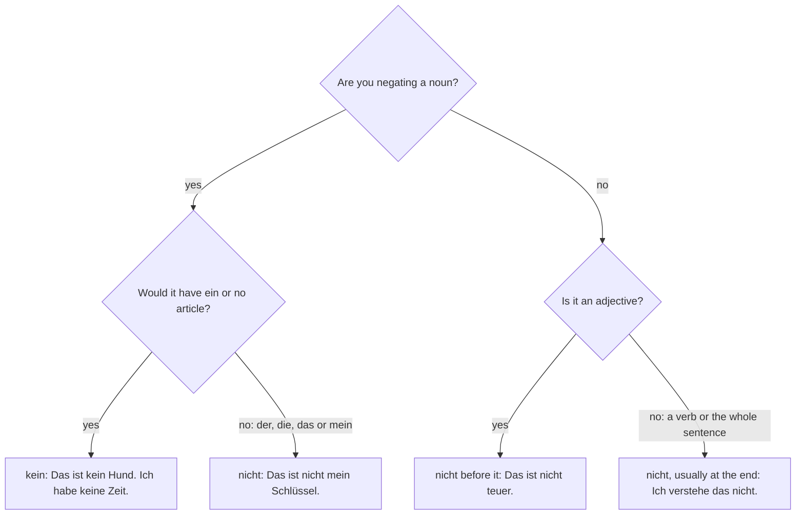

## What this lesson is for

You can now name things (*die Tasche*), say whose they are (*meine Tasche*) and say what
people do. This lesson lets you describe them — big or small, new or old, cheap or too
expensive, red or blue — and say what something is *not*. You'll learn:

- **adjectives** after *sein*: *Die Tasche ist neu.*
- words that make adjectives stronger or weaker: *sehr, ziemlich, zu*;
- colours;
- the two ways German says "not": *nicht* and *kein*;
- *doch*, the little word that says "yes" to a negative question.

## Adjectives after sein: no endings

An adjective describes a noun. When it comes after *sein* (to be), it never changes. It's the
same for every gender and in the plural:

- *Der Tisch ist neu.* — The table is new.
- *Die Lampe ist neu.* — The lamp is new.
- *Das Handy ist neu.* — The phone is new.
- *Die Stühle sind neu.* — The chairs are new.

That's all you need for A1. (When an adjective stands *before* a noun — "a new table" — it
does take endings. That comes at A2; for now, put your adjectives after *ist* and *sind*.)

You can also refer back to a noun with a pronoun. Germans use *er*, *sie* or *es* by the
noun's gender, even for things:

- *Wie ist der Film?* — *Er ist interessant.* — How's the film? — It's interesting.
- *Und die Zeitung?* — *Sie ist langweilig.* — And the newspaper? — It's boring.
- *Das Buch? Es ist toll.* — The book? It's great.

*Wie ist …?* (What's … like? / How is …?) is the question for a description.

## Opposites

Adjectives are easiest to learn in pairs:

| Adjective | Opposite |
|---|---|
| groß (big, tall) | klein (small, short) |
| neu (new) | alt (old) |
| gut (good) | schlecht (bad) |
| lang (long) | kurz (short) |
| teuer (expensive) | billig (cheap) |
| richtig (right, correct) | falsch (wrong) |
| leicht (easy; light) | schwer (difficult; heavy) |
| schnell (fast, quick) | langsam (slow) |
| interessant (interesting) | langweilig (boring) |
| schön (beautiful, nice) | — |
| toll (great) | — |
| kaputt (broken) | — |

Some adjectives have two meanings. *leicht* is "easy" and "light (not heavy)"; *schwer* is
"difficult" and "heavy". *groß* is "big" for things and "tall" for people: *Mein Bruder ist
sehr groß.* *schön* is "beautiful" for a place or person and "nice" in general: *Das ist
schön!* — That's nice!

*kaputt* is the everyday word for "broken": *Mein Handy ist kaputt.* In casual speech *Ich bin
kaputt* means "I'm exhausted".

## sehr, ziemlich, zu

Put these directly before the adjective:

| Word | Meaning | Example |
|---|---|---|
| sehr | very | *Die Uhr ist sehr schön.* — The watch is very beautiful. |
| ziemlich | quite, fairly, rather | *Der Test ist ziemlich leicht.* — The test is fairly easy. |
| zu | too (more than you want) | *Die Tasche ist zu teuer.* — The bag is too expensive. |
| nicht so | not so, not very | *Der Film ist nicht so gut.* — The film isn't that good. |

*zu* is always negative: something is too much for you. *Das Auto ist zu teuer* means you
won't buy it. Don't use *zu* to mean "very".

## Colours

*die Farbe* (plural *die Farben*) means "the colour". Colours work like any other adjective
after *sein*:

| | | |
|---|---|---|
| rot — red | blau — blue | grün — green |
| gelb — yellow | schwarz — black | weiß — white |
| grau — grey | braun — brown | |

- *Welche Farbe hat dein Handy?* — *Es ist schwarz.* — What colour is your phone? — It's black.
  (Literally "Which colour has your phone?")
- *Die Tür ist rot und das Fenster ist weiß.* — The door is red and the window is white.
- *Meine Katze ist grau.* — My cat is grey.

Here are the eight colours with their names:

## Two ways to say "not": nicht and kein

English uses "not" for almost everything. German has two words, and the choice depends on
what you're negating. This is called **negation**.

### kein: "not a", "no"

Use *kein* to negate a noun that would have *ein/eine* or no article at all. It's the
**negative article**, and it takes the same endings as *ein* — plus a plural form, like
*mein*:

| | masculine | feminine | neuter | plural |
|---|---|---|---|---|
| positive | ein Stift | eine Uhr | ein Buch | Bücher |
| negative | kein Stift | keine Uhr | kein Buch | keine Bücher |

- *Das ist kein Heft, das ist ein Buch.* — That's not a notebook, that's a book.
- *Das ist keine Katze!* — That's not a cat!
- *Das sind keine Fotos.* — Those aren't photos.
- *Ich habe keine Zeit.* — I don't have (any) time. (*die Zeit* = time)
- *Wir haben keine Kinder.* — We don't have any children.

Think of *kein* as "not + ein" glued together: never say ~~nicht ein~~.

As with *ein*, a masculine noun after *haben* gets *-en*: *Ich habe keinen Hund* (I don't have
a dog). Lesson 9 explains this.

### nicht: everything else

Use *nicht* to negate a verb, an adjective, or a noun with *der/die/das* or a possessive:

- *Ich arbeite heute nicht.* — I'm not working today.
- *Das Buch ist nicht interessant.* — The book isn't interesting.
- *Das ist nicht mein Schlüssel.* — That isn't my key.
- *Das ist nicht die Tür, das ist das Fenster!* — That's not the door, that's the window!

### Where does nicht go?

Two basic rules for now:

1. To negate the whole sentence, *nicht* usually goes at the end: *Ich verstehe das nicht.* —
   I don't understand that. *Er kommt heute nicht.* — He's not coming today.
2. To negate an adjective or one part, *nicht* goes right before it: *Der Kaffee ist nicht
   teuer. Das ist nicht mein Handy.*

German never uses a helper like English "do" in negation: ~~Ich nicht verstehe~~, ~~Ich
tue nicht verstehen~~ → *Ich verstehe nicht.*

To choose between *kein* and *nicht*, ask what you are negating:

## Doch: yes, to a negative

English answers a negative question with "yes" or "no" and hopes the listener understands.
German has a special word. If someone asks or says something *negative* and you want to
contradict it, answer *doch* instead of *ja*:

- *Ist das nicht dein Handy?* — *Doch, das ist mein Handy.* — Isn't that your phone? — Yes, it
  is.
- *Du hast keine Brille, oder?* — *Doch!* — You don't have glasses, do you? — Yes, I do! (*oder*
  at the end = right?)
- *Das ist nicht richtig.* — *Doch, das ist richtig!* — That's not right. — Yes, it is!

To agree with a negative, use *nein*: *Ist das nicht dein Handy?* — *Nein, das ist nicht mein
Handy.* *Doch* is a small word called a **particle**; you'll hear it constantly.

## Dialogue: buying a second-hand bike

Jonas looks at a second-hand bike that Frau Weber is selling.

> Jonas: *Guten Tag! Ist das das Fahrrad?*
>
> Frau Weber: *Ja. Es ist ziemlich neu und sehr schnell.*
>
> Jonas: *Es ist schön. Ist es nicht zu klein für mich?*
>
> Frau Weber: *Nein, es ist groß. Sie sind ja auch groß!*
>
> Jonas: *Und das Licht hier? Ist das kaputt?*
>
> Frau Weber: *Nein, nein, das ist nicht kaputt. Es ist nur alt.*
>
> Jonas: *Hm. Die Farbe ist toll — grün und schwarz. Aber 300 Euro? Das ist zu teuer.*
>
> Frau Weber: *Zu teuer? Nein, das ist billig!*
>
> Jonas: *Ich habe leider nicht so viel Geld. 250?*
>
> Frau Weber: *Na gut, 250.*

Translation:

> Jonas: Good afternoon! Is that the bike?
>
> Frau Weber: Yes. It's quite new and very fast.
>
> Jonas: It's nice. Isn't it too small for me?
>
> Frau Weber: No, it's big. You're tall too, after all!
>
> Jonas: And the light here? Is that broken?
>
> Frau Weber: No, no, that's not broken. It's just old.
>
> Jonas: Hmm. The colour is great — green and black. But 300 euros? That's too expensive.
>
> Frau Weber: Too expensive? No, that's cheap!
>
> Jonas: Unfortunately I don't have that much money. 250?
>
> Frau Weber: Oh, all right, 250.

(*das Fahrrad* = bicycle; *das Licht* = light; *für mich* = for me; *nur* = only, just;
*leider* = unfortunately; *viel Geld* = much money; *na gut* = oh, all right. The *ja* in
*Sie sind ja auch groß* means "after all, as we can see".)

## Pronunciation

- *teuer*: *eu* sounds like English "oy": TOY-er.
- *weiß*: like English "vice" — *w* is a *v* sound, *ß* a sharp *s*.
- *grün*: long *ü*; *schwarz* ends in *-rts*.
- *billig*, *richtig*, *langweilig*, *ziemlich*: final *-ig* is pronounced like *-ich* (soft
  *ich*-sound) in standard German: BIL-lich, RICH-tich.
- *interessant* is stressed at the end: in-te-res-SANT. *kaputt* too: ka-PUTT.
- *doch* has the throaty *ach*-sound and is said short and firmly.

## Common mistakes

- Adding endings after *sein*: ~~Das Auto ist roter~~ → *Das Auto ist rot.*
- Saying ~~nicht ein~~: ~~Das ist nicht ein Hund~~ → *Das ist kein Hund.*
- Doubling the negative: ~~Ich habe nicht keine Zeit~~ → *Ich habe keine Zeit.*
- Answering *ja* to contradict a negative question: *Hast du keinen Hund?* — *Doch!* (not
  *Ja!*)
- Using *zu* for "very": ~~Das Essen ist zu gut~~ sounds like a complaint. Say *sehr gut*.
- Saying ~~Ich bin langweilig~~ for "I'm bored". It means "I'm boring"! Say *Mir ist
  langweilig* — a fixed phrase meaning "I'm bored".
- *billig* can sound like "cheap and nasty". For a good price Germans often say *günstig*
  (good value).

## Key points

- After *sein*, adjectives never change: *Der Tisch / Die Lampe / Die Stühle … ist/sind neu.*
- *sehr* = very, *ziemlich* = quite, *zu* = too (negative), *nicht so* = not very.
- Colours: *rot, blau, grün, gelb, schwarz, weiß, grau, braun*.
- *kein/keine* negates nouns with *ein* or no article; *nicht* negates everything else.
- *nicht* goes at the end to negate a whole sentence, and before an adjective or a specific part.
- *Doch!* says "yes" to contradict a negative question or statement.

The words from this lesson are listed below; they join your vocabulary reviews when you
complete the lesson.
