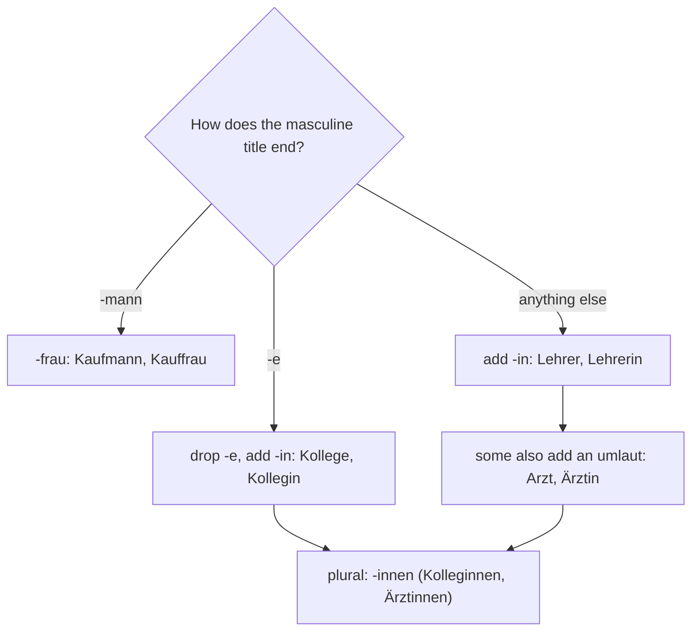

## Where grammar meets people

In lesson 5 you learned that gender is a label on a word, not a fact about the thing: a table
isn't male because it's *der Tisch*. In lesson 7 you met the ending *-in*, which turns *der
Lehrer* into *die Lehrerin*. With words for people, though, the two kinds of gender meet, and
that raises real questions. Is a girl *er*, *sie* or *es*? What is the female form of *der
Kaufmann*? And when a school writes to all its teachers, men and women, which word does it use?

This honors lesson answers those questions. It also prepares you for something you will see on
almost every German website, job advert and school letter: the different ways Germans write
about mixed groups of people. That topic is debated in German-speaking countries, and this
lesson presents it as a debate.

## When the word and the person don't match

Three words for people that you already know are neuter: *das Kind* (child), *das Baby* and
*das Mädchen* (girl). *Mädchen* is neuter because of its ending: it began as a "little" form of
an old word for a young woman, and nouns made with the "little" ending *-chen* are always neuter,
whatever they mean. (Not every noun that happens to end in *-chen* is a "little" form: *der
Kuchen*, cake, is masculine.)

Which pronoun do you use after *das Mädchen*? The grammar rule says the pronoun follows the
noun's gender, so the textbook form is *es*:

- *Das Mädchen heißt Lea. Es ist zehn Jahre alt.* — The girl is called Lea. She's ten.

In everyday speech, many speakers switch to *sie* once they think of the real person,
especially after her name: *Das Mädchen heißt Lea. Sie ist zehn.* You will hear and read both.
This is a point where usage varies, so neither is a mistake you need to worry about; in a test,
*es* directly after *das Mädchen* is the safe answer.

The opposite happens too. *die Person* is feminine for everyone, and *der Mensch* (human
being, person) is masculine for everyone:

- *Wer ist die Person auf dem Foto?* — *Das ist mein Vater.* (The article stays *die*.)

Grammatical gender belongs to the word. When the word and the person don't match, the article
always follows the word.

## Making the female job title

You know the main rule from lesson 7: add *-in*. Here are all the patterns you will meet, so you
can work out a female job title yourself:

| Pattern | Masculine | Feminine | English |
|---|---|---|---|
| add *-in* | der Lehrer, der Ingenieur | die Lehrerin, die Ingenieurin | teacher, engineer |
| umlaut + *-in* | der Arzt, der Koch | die Ärztin, die Köchin | doctor, cook |
| drop *-e*, add *-in* | der Kollege, der Kunde | die Kollegin, die Kundin | colleague, customer |
| *-mann* becomes *-frau* | der Kaufmann, der Feuerwehrmann | die Kauffrau, die Feuerwehrfrau | businessman / businesswoman, firefighter |

(*der Kollege* and *der Kunde* come in a later course; they're here to show the pattern.)

Which words take an umlaut is not predictable, so learn those with the word. The plural is
easy: every *-in* word adds *-nen*, so it has a double *n*: *die Ärztinnen, die Köchinnen, die
Kolleginnen*. Words in *-frau* add *-en*: *die Kauffrauen*. For *-mann* words, the plural that
covers a whole group usually uses *-leute* (people): *die Kaufleute*, *die Feuerwehrleute*.

*der Kaufmann* and *die Kauffrau* are more than "businessman" and "businesswoman": in Germany
they are also the official names of trained office and retail jobs, as in *Kauffrau im
Einzelhandel* (trained retail saleswoman).

Some job titles have changed with the times. A female nurse was traditionally *die
Krankenschwester* ("sick-sister"), and many people still say it. Since 2020 the official
training title in Germany has been *Pflegefachfrau* or *Pflegefachmann*, and in everyday
speech you also hear *der Krankenpfleger* and *die Krankenpflegerin*.

## Talking about a mixed group

Here is the real question. Ten teachers work at a school: six women and four men. What are
they together?

For a long time the answer was simply the masculine plural: *die Lehrer*. Grammar books call
this the **generic masculine**: the masculine form used for a group of any gender, or for a
person whose gender doesn't matter (*Ich brauche einen Arzt*, "I need a doctor"). It is still
very common, especially in speech.

Critics point out that the masculine form makes many readers picture men first; several
psychology studies have found this effect. Supporters of the generic masculine answer that
grammatical gender is not the same as sex, and that the alternatives make texts longer and
harder to read. Both sides are well represented in German society, and the debate is about
style and politics as much as grammar.

As a result, German now has several ways to write about mixed groups. Using them is called
**gender-fair language** (*geschlechtergerechte Sprache*; the everyday verb is *gendern*):

| Way | Example | Where you often see it |
|---|---|---|
| generic masculine | *die Lehrer* | everyday speech, many newspapers and books |
| **paired form** | *Lehrerinnen und Lehrer*, *Liebe Kolleginnen und Kollegen* | speeches, letters, official texts |
| slash | *Lehrer/-innen* | forms and adverts |
| neutral word | *die Lehrkräfte* (teaching staff), *die Studierenden* (those studying), *das Team* | universities, official texts |
| **gender star** and similar signs | *Lehrer\*innen*, *Lehrer:innen*, *Lehrer_innen*, *LehrerInnen* | universities, some cities, companies and media |

The star, the colon and the underscore are meant to include people who are neither male nor
female; the older capital *I* (*LehrerInnen*) was made to name women and men. When people read them aloud, they make a tiny break before *-innen*: *Lehrer … innen*.
That break matters: without it you would be saying *Lehrerinnen*, which means female teachers
only.

What is official? The Council for German Orthography (*Rat für deutsche Rechtschreibung*), which
sets the spelling rules for Germany, Austria, Switzerland and other German-speaking areas,
decided in 2023 not to make the star and similar signs part of official spelling. In 2024
Bavaria told its state offices and schools not to use them, and Hesse did the same for its
schools. At the same time many universities, cities and companies do use them. So the honest
answer is: it depends on who is writing, and the debate is still going on.

What should you do as a learner? Recognise all of these forms when you read. In your own
writing, the paired form (*Liebe Kolleginnen und Kollegen*, *Sehr geehrte Damen und Herren*,
"Dear Sir or Madam") is accepted everywhere and is the safe choice for letters and exams.

## Job adverts: (m/w/d)

German job adverts almost always add three letters after the job title:

*(m/w/d)* stands for *männlich, weiblich, divers*: male, female, diverse. Since the end of 2018,
German civil registers have allowed *divers* as a third entry for people who are neither male
nor female, and German law says a job advert must not shut anyone out because of their
gender. Adding *(m/w/d)* shows
that it is. You'll also see *(w/m/d)* or *(m/w/x)*. A *Bäckerei* is a bakery and *der Bäcker*
a baker; *Wir suchen* means "we are looking for"; *im Laden* means "in the shop".

## Reading: a letter from school

> Liebe Eltern, liebe Schülerinnen und Schüler,
>
> wir haben drei neue Kolleginnen und Kollegen! Frau Demir ist Lehrerin für Englisch und Spanisch. Herr Wolf ist Lehrer für Mathe. Er spricht auch Polnisch. Frau Kim ist unsere neue Schulärztin.
>
> Unsere Lehrkräfte sind international: Sie kommen aus sieben Ländern. Zusammen sprechen sie zwölf Sprachen!
>
> Viele Grüße
>
> Ihre Schulleitung

Translation:

> Dear parents, dear pupils,
>
> we have three new colleagues! Ms Demir is a teacher of English and Spanish. Mr Wolf is a maths teacher. He also speaks Polish. Ms Kim is our new school doctor.
>
> Our teaching staff are international: they come from seven countries. Together they speak twelve languages!
>
> Best wishes,
>
> Your school management

(*für* = for; *Mathe* = maths; *aus sieben Ländern* = from seven countries, a dative plural you
learn in lesson 18; *zusammen* = together; *Viele Grüße* = best wishes. *die Schulleitung* is
feminine because of *-ung*, so "your" is *Ihre*.)

Notice the choices: the letter uses paired forms for people (*Schülerinnen und Schüler*,
*Kolleginnen und Kollegen*) and a neutral word for the staff (*Lehrkräfte*). For each single
person it uses the right form: *Lehrerin* for Frau Demir, *Lehrer* for Herr Wolf.

## Worked examples

### Example 1: from the masculine to the female form and the plural

Give the female form and its plural of *der Koch*, *der Kollege* and *der Kaufmann*.

1. *der Koch* ends in neither *-mann* nor *-e*, so add *-in*. It is one of the umlaut words:
   *die Köchin*. Plural: add *-nen*, giving *die Köchinnen*.
2. *der Kollege* ends in *-e*: drop it and add *-in*: *die Kollegin*. Plural: *die
   Kolleginnen*.
3. *der Kaufmann* ends in *-mann*, which becomes *-frau*: *die Kauffrau*. Plural: *die
   Kauffrauen*. (A mixed group: *die Kaufleute*.)

### Example 2: greeting a mixed group

You write an e-mail to your German course: men and women. Three correct greetings:

1. *Liebe Kursteilnehmer* (generic masculine; *der Kursteilnehmer* = course participant). Short
   and traditional; some readers find it excludes the women.
2. *Liebe Kursteilnehmerinnen und Kursteilnehmer* (paired form). Longer, accepted everywhere.
3. *Liebe Kursteilnehmer\*innen* (gender star). Common at universities and in some companies;
   not part of official spelling.

Answer: all three occur. For a formal letter or an exam, choose 2.

### Example 3: which pronoun?

Fill the gap: *Das ist das Mädchen aus Polen. ___ spricht Deutsch und Polnisch.*

1. The noun is *das Mädchen*, neuter, so the grammar rule gives *Es*.
2. In everyday speech *Sie* is also common, because the speaker is thinking of the girl.
3. In a test that checks the grammar rule, write *Es*.

## Common mistakes

- Reading *Lehrerinnen* as a mixed group. *die Lehrerinnen* are female teachers only. A mixed
  group is *die Lehrer*, *Lehrerinnen und Lehrer* or *Lehrer\*innen*.
- Writing one *n*: ~~die Ärztinen~~ → *die Ärztinnen*.
- Adding *-in* to *-mann*: ~~die Kaufmännin~~ → *die Kauffrau*.
- Using an article with a job, as in lesson 7: ~~Ich bin eine Kauffrau~~ → *Ich bin Kauffrau*.
- Thinking *das Mädchen* is feminine: ~~die Mädchen ist neu~~ → *das Mädchen ist neu*. (*die
  Mädchen* is the plural: the girls.)
- Reading *(m/w/d)* as part of the job name. It just means the job is open to everyone.

## Key points

- Words for people can have a gender that doesn't match the person: *das Mädchen*, *das Kind*,
  *die Person*, *der Mensch*. The article always follows the word.
- After *das Mädchen* the textbook pronoun is *es*; *sie* is common in speech.
- Female job titles: add *-in* (some with an umlaut), drop a final *-e* first, or change
  *-mann* to *-frau*. Plural *-innen* with double *n*.
- The generic masculine (*die Lehrer*) is traditional; the paired form (*Lehrerinnen
  und Lehrer*), neutral words (*Lehrkräfte*) and signs like the gender star
  (*Lehrer\*innen*) are the main kinds of gender-fair language. Their use is debated; the
  paired form is accepted everywhere.
- *(m/w/d)* in job adverts means *männlich, weiblich, divers*.

The words from this lesson are listed below; they join your vocabulary reviews when you
complete the lesson.
