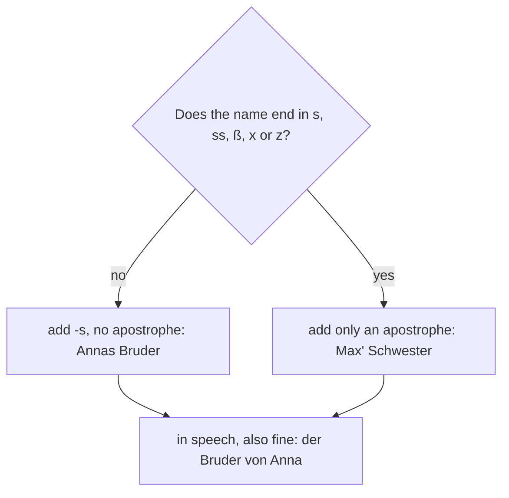

## Beyond Mutter and Vater

In lesson 6 you learned the core family words and the possessive articles: *meine Mutter, sein
Bruder, ihre Eltern*. Real families are often bigger and more varied than a textbook family
tree. Many children in German-speaking countries grow up with a stepfather, a half-sister or
two homes. And when you talk about families, you constantly say *whose* someone is: Anna's
brother, Jonas's dog.

This honors lesson gives you the words for modern families, explains how German first names and
surnames work, and teaches the quickest way to say "Anna's": *Annas*. It ends with a longer
text, written by a teenager about his family, that puts everything together.

## Mama, Papa and the wider family

Children call their parents *Mama* and *Papa* (stress on the first syllable: MA-ma, PA-pa),
and adults often keep using these words: *Meine Mama wohnt in Graz.* As nouns they are *die
Mama* and *der Papa*. Grandparents are *Oma* and *Opa*, as you know.

You will also hear the words for the wider family. Recognise them now; you practise them in a
later course:

| Masculine | Feminine | English |
|---|---|---|
| der Onkel | die Tante | uncle, aunt |
| der Cousin | die Cousine | cousin |
| der Neffe | die Nichte | nephew, niece |
| der Enkel | die Enkelin | grandson, granddaughter |

*die Großeltern* are the grandparents, and *die Verwandten* are your relatives. *Cousin* and
*Cousine* come from French and keep a French sound: koo-ZANG (with a nasal ending) and
koo-ZEE-ne.

## Patchwork families

When parents separate and find new partners, the result is often called *die Patchworkfamilie*
(patchwork family, a word taken from English). Its members have their own words:

| Word | Meaning |
|---|---|
| der Stiefvater / die Stiefmutter | stepfather / stepmother: your parent's new husband or wife |
| der Halbbruder / die Halbschwester | half-brother / half-sister: you share one parent |
| der Zwilling (plural die Zwillinge) | twin |
| das Einzelkind | only child: a child with no brothers or sisters |
| getrennt | separated (a couple that no longer lives together) |
| geschieden | divorced (lesson 6) |

*der Zwilling* is masculine even for a girl, like *die Person* for a man. To say "twin sister",
German builds a compound: *der Zwilling* + *die Schwester* = *die Zwillingsschwester*. The last
part decides the gender, as you learned in lesson 5, so it's *die*. Notice the *s* in the
middle: many compounds put a **linking s** between the parts (*Zwilling-s-schwester*,
*Geburt-s-tag*, "birthday"). It has no meaning of its own; it just joins the words.

Here is Ben's family. Ben is *ich*:

## Names

Every German has at least one *Vorname* (first name) and a *Nachname* (last name). *Nachname* is
the everyday word; *Familienname* (lesson 1) is the word on forms. Many people also have a
*Spitzname* (nickname): *Alexander* becomes *Alex*, *Katharina* becomes *Kathi*.

Many of the most common German surnames are old job titles. *Müller* (miller) is the most
common surname in Germany, and *Schmidt* (smith) comes second. Others you will meet everywhere:
*Schneider* (tailor), *Fischer* (fisher), *Weber* (weaver), *Becker* (baker), *Wagner* (cart
maker) and *Meyer* (originally a farm manager). So when you meet a *Frau Müller*, she is not
a miller: the name is hundreds of years old.

What happens to names when people marry? This is a question of law, and each country has its
own rules. In Germany, a married couple can choose one shared surname, the surname of one of
the two, or each can keep their own. Double names such as *Müller-Schmidt* have long been
possible for one partner; since a reform in May 2025, both partners can use one, and children
can be given a double name from both parents' surnames. Names with more than two parts, such
as *Müller-Schmidt-Weber*, are still not allowed. Austria and Switzerland have their
own rules.

Inside a family everyone uses *du*: children say *du* to their parents and grandparents, and
stepparents are usually *du* too.

## Whose? Annas Bruder

English adds *'s* to show whose something is: Anna's brother. German does almost the same with
names, but writes no apostrophe:

- *Annas Bruder* — Anna's brother
- *Peters Mutter* — Peter's mother
- *Lenas Familie* — Lena's family

This *-s* is a form of the **genitive**, the fourth German case (you know the nominative, and
you will learn the accusative and dative in lessons 9 and 18). At A1 you only need this one
use: *-s* after a name.

Three rules make it work:

1. The name with *-s* comes first, and the noun after it has no article: *Annas Bruder*, never
   ~~der Annas Bruder~~ or ~~Annas der Bruder~~.
2. If the name already ends in an *s* sound (*-s, -ss, -ß, -x, -z*), add only an apostrophe:
   *Jonas' Hund* (Jonas's dog), *Max' Schwester*, *Felix' Vater*.
3. In everyday speech, Germans often say *von* + name instead: *der Bruder von Anna*, *der Hund
   von Jonas*. This is especially common with names that end in *s*. Both are correct.

You will see shop signs like *Andrea's Café* with an apostrophe. The official rules allow this
only in a few cases, mainly to make the base form of a name clear, so in your own writing use
*Annas*, *Peters*, *Lenas*.

## Reading: Ben's family

Ben, fourteen, writes about his family for a school project.

> Hallo! Ich heiße Ben und ich bin vierzehn. Meine Familie ist eine Patchworkfamilie.
>
> Meine Eltern sind geschieden. Meine Mutter heißt Julia, mein Vater heißt Markus. Lisa ist meine Zwillingsschwester. Wir sind Zwillinge, aber wir sind sehr verschieden: Lisa ist groß und spricht sehr schnell. Ich bin klein und spreche langsam.
>
> Wir wohnen bei Mama und Tom. Tom ist mein Stiefvater. Er ist Koch und er kocht super! Mama und Tom haben eine Tochter, Emma. Sie ist zwei Jahre alt. Emma ist meine Halbschwester.
>
> Papa ist wieder verheiratet. Seine Frau heißt Anja. Sie ist meine Stiefmutter, aber ich sage einfach Anja. Anja hat keine Kinder.
>
> Ist das kompliziert? Ein bisschen. Aber ich bin kein Einzelkind! Und Emmas Lieblingsperson? Das bin ich!

Translation:

> Hello! My name is Ben and I'm fourteen. My family is a patchwork family.
>
> My parents are divorced. My mother is called Julia, my father is called Markus. Lisa is my twin sister. We're twins, but we're very different: Lisa is tall and speaks very fast. I'm short and speak slowly.
>
> We live with Mum and Tom. Tom is my stepfather. He's a cook and he cooks brilliantly! Mum and Tom have a daughter, Emma. She's two years old. Emma is my half-sister.
>
> Dad is married again. His wife is called Anja. She's my stepmother, but I just say Anja. Anja doesn't have any children.
>
> Is that complicated? A bit. But I'm not an only child! And Emma's favourite person? That's me!

(*verschieden* = different; *bei Mama und Tom* = at Mum and Tom's place, a set phrase with the
dative of lesson 18; *kochen* = to cook; *wieder* = again; *einfach* = simply, just;
*kompliziert* = complicated; *die Lieblingsperson* = favourite person.)

Look at how the possessives work in the text. Ben says *mein Stiefvater* and *meine
Halbschwester* (feminine, so *-e*). About his father he says *Seine Frau*: the owner is a man,
so *sein*; *Frau* is feminine, so *-e*. And *Emmas Lieblingsperson* uses the name *-s*.

## Worked examples

### Example 1: who is who?

Use the picture of Ben's family. Who is Emma to Lisa, and who is Anja to Emma?

1. Emma's parents are Julia and Tom. Lisa's parents are Julia and Markus. They share one parent,
   Julia, so Emma is Lisa's half-sister: *Emma ist Lisas Halbschwester.*
2. Anja is married to Markus. Markus is not Emma's father, so Anja is not Emma's stepmother;
   the two aren't related at all. A German speaker might say: *Anja ist die Frau von Bens
   Vater.* (Anja is the wife of Ben's father.)

### Example 2: three ways to say "Jonas's dog"

1. Is the owner a name? Yes: *Jonas*.
2. Does it end in an *s* sound? Yes, so add only an apostrophe: *Jonas' Hund*.
3. In speech the *von* form is very natural here: *der Hund von Jonas*.

Wrong: ~~Jonass Hund~~, ~~Jonas's Hund~~, ~~der Jonas' Hund~~.

### Example 3: choosing the possessive

Complete from Ben's family: *Tom ist ___ Stiefvater* (Lisa speaking); *Markus und ___ Frau
Anja*; *Julia und ___ Töchter*.

1. Lisa speaks about herself, so "my": *Tom ist mein Stiefvater* (*Stiefvater* is masculine,
   no ending).
2. The owner is Markus, a man, so *sein*; *Frau* is feminine, so *-e*: *Markus und seine Frau
   Anja*.
3. The owner is Julia, a woman, so *ihr*; *Töchter* is plural, so *-e*: *Julia und ihre
   Töchter*.

## Common mistakes

- Adding an English apostrophe: ~~Anna's Bruder~~ → *Annas Bruder*.
- Keeping an article: ~~die Annas Mutter~~ → *Annas Mutter*.
- Adding *-s* to a name in *s*: ~~Jonass Hund~~ → *Jonas' Hund* or *der Hund von Jonas*.
- Treating *Zwilling* as feminine for a girl: *Lisa ist ein Zwilling* (masculine *der
  Zwilling*), or *Lisa ist meine Zwillingsschwester*.
- Mixing up *Stief-* and *Halb-*: a stepfather is your parent's partner, a half-sister shares one
  of your parents.
- Confusing *getrennt* and *geschieden*: separated couples are not necessarily divorced.
- Reading *Müller* as a job: as a surname it's just a name, like English *Smith*.

## Key points

- Modern families: *der Stiefvater, die Stiefmutter, der Halbbruder, die Halbschwester, der
  Zwilling, das Einzelkind, die Patchworkfamilie*; couples can be *getrennt* or *geschieden*.
- Recognise *Onkel, Tante, Cousin, Cousine, Neffe, Nichte, Enkel, Enkelin*.
- *Vorname*, *Nachname* (= *Familienname*), *Spitzname*. Many surnames are old jobs: *Müller,
  Schmidt, Schneider*.
- Whose: name + *-s*, no apostrophe, no article: *Annas Bruder*. Names in *s, ss, ß, x, z* take
  only an apostrophe: *Max' Schwester*. In speech: *der Bruder von Anna*.
- Compounds often have a linking *s*: *die Zwillingsschwester*.

The words from this lesson are listed below; they join your vocabulary reviews when you
complete the lesson.
