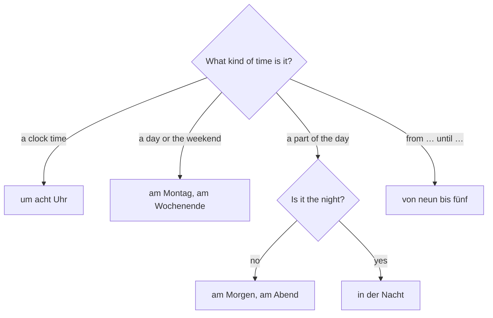

## What this lesson is for

You can count, order food and pay. Now you need to say when things happen: what time it is, when the shop opens, on which day you work, and how often you do something. This lesson teaches the clock (the official 24-hour way and the everyday way), the days of the week and the parts of the day, the little prepositions *um*, *am*, *von … bis* that go with them, and a few words for how often. The numbers you need are 0 to 59, which you know from lesson 3.

## What time is it?

There are two ways to ask, and both are everyday German:

- *Wie spät ist es?* — What time is it? (literally "How late is it?")
- *Wie viel Uhr ist es?* — What time is it? (literally "How much clock is it?")

The answer always starts with *Es ist …*: *Es ist acht Uhr.* — It's eight o'clock.

*die Uhr* is the clock or watch from lesson 5. In times it means "o'clock", and it never takes a plural: *Es ist zehn Uhr*, not *zehn Uhren*.

## The official time

Timetables, radio, shops, appointments and anything written use the 24-hour clock. You say the hour, then *Uhr*, then the minutes:

| Written | Said | English |
|---|---|---|
| 7:00 | sieben Uhr | 7 a.m. |
| 8:15 | acht Uhr fünfzehn | 8:15 a.m. |
| 12:30 | zwölf Uhr dreißig | 12:30 p.m. |
| 14:05 | vierzehn Uhr fünf | 2:05 p.m. |
| 19:45 | neunzehn Uhr fünfundvierzig | 7:45 p.m. |
| 0:20 | null Uhr zwanzig | 12:20 a.m. |

*Uhr* sits between the hours and the minutes, where English writes the colon. Germans often write *14.05 Uhr* with a point, or *14:05 Uhr*.

## The everyday time

When people talk, they normally use the 12-hour clock and count minutes *nach* (after, past) and *vor* (before, to) the hour.

| Time | Said |
|---|---|
| 3:00 | drei (Uhr) |
| 3:05 | fünf nach drei |
| 3:10 | zehn nach drei |
| 3:15 | Viertel nach drei |
| 3:20 | zwanzig nach drei |
| 3:30 | halb vier |
| 3:40 | zwanzig vor vier |
| 3:45 | Viertel vor vier |
| 3:50 | zehn vor vier |
| 3:55 | fünf vor vier |

*das Viertel* is a quarter. *Viertel nach drei* is a quarter past three and *Viertel vor vier* a quarter to four, just like English.

### The famous trap: halb

*halb vier* does not mean half past four. It means "half (of the way) to four", so 3:30. Think of the hour you are moving towards: at 3:30 you are halfway to four. *halb eins* is 12:30, *halb acht* is 7:30.

The clock below shows the whole system for the hour between three and four. The right half counts *nach drei*, the left half counts *vor vier*, and the bottom is *halb vier*:

People also count from *halb*: *fünf vor halb vier* is 3:25 and *fünf nach halb vier* is 3:35. You don't have to say these yourself, but you will hear them.

In parts of southern and eastern Germany and in Austria you may also hear *viertel vier* for 3:15 and *drei viertel vier* (also written *dreiviertel vier*) for 3:45, counting quarters towards the next hour like *halb*. Everyone understands *Viertel nach* and *Viertel vor*, so use those.

### One o'clock

With *Uhr*, one is *ein*: *Es ist ein Uhr.* Without *Uhr*, it is *eins*: *Es ist eins.* Never say *eins Uhr*.

### Uhr or Stunde?

*Uhr* tells you the time on the clock. *die Stunde* is an hour as a length of time, and *die Minute* a minute.

- *Es ist zwei Uhr.* — It's two o'clock.
- *Der Film ist zwei Stunden lang.* — The film is two hours long.
- *Ich warte zehn Minuten.* — I'm waiting ten minutes. (*warten* = to wait)

To ask how long, say *Wie lange?*: *Wie lange arbeitest du heute?* — *Acht Stunden.*

## Days, parts of the day and the week

All days are masculine and capitalized, because they are nouns.

| Day | Short | Memory hook |
|---|---|---|
| der Montag | Mo | moon day, like Monday |
| der Dienstag | Di | |
| der Mittwoch | Mi | *Mitte* = middle: mid-week |
| der Donnerstag | Do | *Donner* = thunder: Thor's day, like Thursday |
| der Freitag | Fr | like Friday |
| der Samstag | Sa | in northern Germany also *der Sonnabend* |
| der Sonntag | So | *Sonne* = sun: Sunday |

*die Woche* is the week and *das Wochenende* the weekend (*Ende* = end). *der Tag* is the day.

The parts of the day are masculine too, except the night:

| German | Roughly | English |
|---|---|---|
| der Morgen | 5 to 9 | the morning |
| der Vormittag | 9 to 12 | the late morning, before noon |
| der Mittag | 12 to 14 | noon, midday |
| der Nachmittag | 14 to 18 | the afternoon |
| der Abend | 18 to 23 | the evening |
| die Nacht | 23 to 5 | the night |

*vor* means before and *nach* means after, so *Vormittag* is "before midday" and *Nachmittag* "after midday".

On a 24-hour line the parts of the day look like this:

### Today, tomorrow, yesterday

*heute* (today, lesson 4), *morgen* (tomorrow) and *gestern* (yesterday) combine with the parts of the day: *heute Abend* (this evening), *gestern Abend* (last night, yesterday evening), *morgen Nachmittag* (tomorrow afternoon). Careful: *morgen* in small letters is tomorrow, *der Morgen* with a capital is the morning. Tomorrow morning is *morgen früh*, not *morgen Morgen* (*früh* = early).

## When? um, am, von … bis

| Preposition | Used with | Example |
|---|---|---|
| um | clock times | *um acht Uhr* — at eight o'clock |
| am | days, parts of the day, the weekend | *am Montag, am Abend, am Wochenende* — on Monday, in the evening, at the weekend |
| in der | the night | *in der Nacht* — at night |
| von … bis | from … until | *von neun bis fünf* — from nine to five |

*am* is short for *an dem*, but you can learn it as one word. Notice that the night is the exception: not *am Nacht* but *in der Nacht*.

To pick the right word, ask what kind of time you mean:

- *Der Kurs beginnt um halb neun.* — The course starts at half past eight. (*beginnen* = to begin)
- *Am Freitag arbeite ich nicht.* — I don't work on Friday.
- *Am Nachmittag lerne ich Deutsch.* — In the afternoon I study German.
- *Die Bäckerei ist von sieben bis achtzehn Uhr offen.* — The bakery is open from 7 a.m. to 6 p.m. (*offen* = open)
- *Ich arbeite bis fünf.* — I work until five.
- *Wann kommst du? — Um sieben.* — When are you coming? — At seven.

When a time phrase comes first, the verb stays in second place and the subject moves after it: *Am Freitag arbeite ich nicht.* You met verb-second word order in lesson 4; lesson 12 practises it in detail.

## How often?

A **frequency adverb** says how often something happens. You know *immer* (always) and *oft* (often) from lesson 4; add *manchmal* (sometimes) and *nie* (never).

| immer | oft | manchmal | nie |
|---|---|---|---|
| always | often | sometimes | never |

They usually come straight after the verb, or after the subject when the subject follows the verb:

- *Am Morgen trinke ich immer Kaffee.* — In the morning I always drink coffee.
- *Wir essen oft Nudeln.* — We often eat pasta.
- *Am Sonntag schlafe ich manchmal bis zehn.* — On Sundays I sometimes sleep until ten. (*schlafen* = to sleep)
- *Er kommt nie zu spät.* — He's never late. (*zu spät* = too late)

*nie* is already negative, so never add *nicht* to it. *früh* (early) and *spät* (late) are the opposites you need here: *Es ist schon spät.* — It's already late.

For "every day" German uses the accusative from lesson 9: *jeden Tag* (der Tag → jeden), *jede Woche*, *jedes Wochenende*.

## Dialogue: Do you have time on Saturday?

> Anna: Hallo Tom! Hast du am Samstag Zeit?
>
> Tom: Am Samstag? Am Vormittag arbeite ich. Aber am Nachmittag habe ich Zeit.
>
> Anna: Super! Möchtest du einen Kaffee trinken?
>
> Tom: Gern! Wann denn? Um zwei?
>
> Anna: Um zwei habe ich noch Deutschkurs. Der Kurs ist von zehn bis halb drei.
>
> Tom: Dann um drei?
>
> Anna: Ja, um drei. Und ich habe Zeit bis sechs. Am Abend kommt meine Schwester.
>
> Tom: Gut. Dann bis Samstag um drei!
>
> Anna: Bis Samstag! Tschüss!

In English:

> Anna: Hi Tom! Do you have time on Saturday?
>
> Tom: On Saturday? In the morning I work. But in the afternoon I have time.
>
> Anna: Great! Would you like to have a coffee?
>
> Tom: I'd love to! When? At two?
>
> Anna: At two I still have my German course. The course is from ten until half past two.
>
> Tom: At three, then?
>
> Anna: Yes, at three. And I have time until six. In the evening my sister is coming.
>
> Tom: Good. See you on Saturday at three, then!
>
> Anna: See you Saturday! Bye!

*die Zeit* means time in general: *Hast du Zeit?* — Do you have time? *denn* in *Wann denn?* just makes the question sound friendlier. *Bis Samstag!* (until Saturday) is how you say "see you on Saturday".

## Pronunciation

- *Viertel*: the *v* is an *f* and the *ie* is short here: FIR-tel.
- *Uhr* sounds like "oor" with a long *u*.
- *Abend* and *Tag* end in a *t* and a *k* sound: AH-bent, tahk. That's the final devoicing from lesson 1.
- *Mittwoch* is stressed on the first syllable: MIT-voch, with the *ch* of *Bach*. *Nacht* has the same *ch*.
- *Dienstag*: long *ie*, DEENS-tahk. Don't confuse it with *Donnerstag*, DON-ners-tahk.
- *gestern*: GES-tern, with a hard *g*.

## Common mistakes

- *halb drei* is 2:30, not 3:30. Count towards the next hour.
- *am acht Uhr* — Clock times take *um*: *um acht Uhr*.
- *in Montag*, *an Montag* — Days take *am*: *am Montag*.
- *am Nacht* — The exception: *in der Nacht*.
- *Ich lerne zwei Uhr.* — For a length of time use *Stunden*: *Ich lerne zwei Stunden.*
- *Es ist eins Uhr.* — Say *ein Uhr* or just *eins*.
- *morgen Morgen* — Say *morgen früh*.
- *Ich nicht nie esse Fisch.* — *nie* is enough, and the verb is second: *Ich esse nie Fisch.*

## Key points

- Ask *Wie spät ist es?* or *Wie viel Uhr ist es?* and answer *Es ist …*.
- Official time: hours + *Uhr* + minutes (*vierzehn Uhr zehn*). Everyday time: *nach*, *vor*, *Viertel*, *halb*.
- *halb* points to the next hour: *halb vier* = 3:30.
- *um* + clock time, *am* + day or part of the day, *in der Nacht*, *von … bis*.
- *Uhr* = o'clock, *Stunde* = an hour of time.
- Days and parts of the day are masculine nouns (except *die Nacht*); *morgen* = tomorrow, *der Morgen* = morning.
- Frequency: *immer, oft, manchmal, nie*, usually after the verb.

The words from this lesson are listed below; they join your vocabulary reviews when you complete the lesson.
