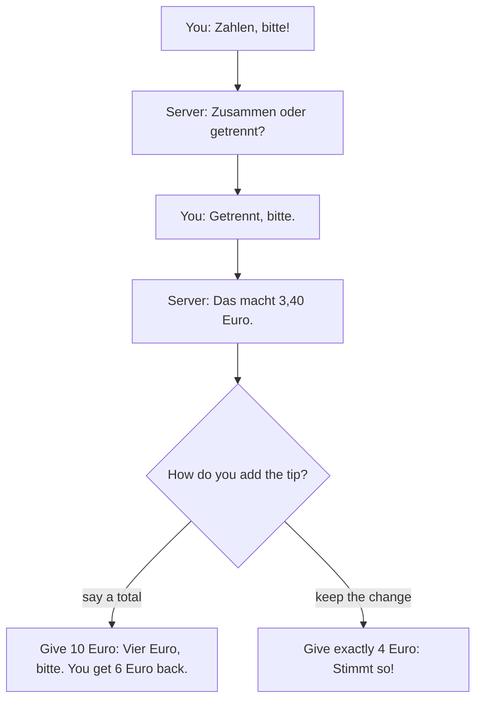

## What this lesson is for

In lesson 9 you ordered in a café with *möchten* and the accusative, and in lesson 10 you shopped at the market and paid. This honors lesson looks at the culture around those words: when Germans eat what, why the bread roll has five names, and how people pay and tip. You'll also learn the politest way to order, *Ich hätte gern …*, and how to ask for another one with *noch ein*.

Everything here builds on grammar you already know. Descriptions of "how Germans eat" are generalizations: habits differ between families, regions and generations.

## A day of meals

The picture shows a traditional day of meals. It is simplified, but you'll meet all four ideas in German life and texts.

- ***das Frühstück*** — breakfast. On weekdays it is often quick. On weekends many families sit down to fresh *Brötchen* with butter, jam (*die Marmelade*), honey (*der Honig*), cheese, cold meat and a boiled egg.
- ***das Mittagessen*** — lunch. Traditionally the main warm meal of the day, and many people still eat warm at midday, for example in a work canteen (*die Kantine*). At work, colleagues often greet each other at lunchtime with ***Mahlzeit!*** — literally "mealtime!" — which works as both "hello" and "enjoy your lunch".
- ***Kaffee und Kuchen*** — coffee and cake, around three or four in the afternoon, especially on Sundays and birthdays.
- ***das Abendbrot*** — "evening bread": a cold supper of bread, butter, cheese, cold meat and maybe a salad. The word is used mostly in northern and eastern Germany; everyone also says *das Abendessen*. Many working families now eat their warm meal in the evening instead.

Before a meal, people say ***Guten Appetit!*** (enjoy your meal), and the answer is *Danke, gleichfalls!* (thanks, you too). When you've had enough, say *Ich bin satt* — I'm full. Don't translate "I'm full" word for word: *Ich bin voll* can sound like "I'm drunk" in casual speech.

## The bakery and the bread roll

Germany is a bread country. Even small towns usually have a bakery, and in 2014 "German bread culture" (*die deutsche Brotkultur*) was added to Germany's national list of intangible cultural heritage. A typical bakery sells dark rye breads, wholegrain breads with seeds, white rolls, pretzels (*die Brezel*) and cakes. You buy bread by the loaf or ask for it sliced; a slice is *eine Scheibe*, and it works like the quantities in lesson 10: *eine Scheibe Brot*, *zwei Scheiben Käse* (no "of", and feminine *Scheibe* takes the plural).

The plain bread roll is the star, and its name changes as you travel. This is a **regional variant**: a word that is normal in one region but not everywhere. The map in people's heads looks roughly like this (simplified: the borders are fuzzy, and *Brötchen* is understood everywhere):

| Word | Where you'll hear it |
|---|---|
| das Brötchen | most of northern and central Germany; the standard word |
| die Semmel | Bavaria and Austria, and also parts of eastern Germany such as Saxony |
| die Schrippe | Berlin and around it |
| der Weck, das Weckle | the southwest (for example Baden-Württemberg) |
| das Rundstück | Hamburg and the far north |

In Bavaria the pretzel is also called *die Breze* or *die Brezn*. Recognize these words on a bakery sign; you don't need to use them.

### Same food, different words

German is the language of Germany, Austria, much of Switzerland and some other places, and each has its own food words. **Standard German** (*Hochdeutsch*), the form taught in this course, is understood everywhere, but in Austria you'll see these on menus and in shops:

| Germany | Austria | English |
|---|---|---|
| die Kartoffel | der Erdapfel (die Erdäpfel) | potato |
| die Tomate | der Paradeiser | tomato |
| die Sahne | das Schlagobers, das Obers | cream, whipped cream |
| der Quark | der Topfen | quark (a soft fresh cheese) |
| das Brötchen | die Semmel | bread roll |

*Erdapfel* means "earth apple", like French *pomme de terre*. Learn the standard word actively; recognize the others.

## Polite orders: Ich hätte gern …

*Ich möchte einen Kaffee* is perfectly polite. Many Germans, especially at a bakery counter or in a shop, say ***Ich hätte gern …*** instead: "I would have, gladly …" — in English, "I'd like …". *hätte* is a form of *haben* called the **subjunctive** (in German grammar, *Konjunktiv II*): the "would" form that makes a request softer. *möchte* is actually the same kind of form, from *mögen*, which is why both sound polite.

You only need four forms, and they follow the pattern of *möchte*:

| | hätte gern |
|---|---|
| ich | hätte gern |
| du | hättest gern |
| er / sie / es | hätte gern |
| wir / sie / Sie | hätten gern |

What you'd like is the object of *hätte*, so it is in the accusative, exactly as after *haben*: *Ich hätte gern einen Kaffee* (der → einen), *eine Brezel*, *ein Brötchen*, *zwei Semmeln*.

### Example 1: making an order polite

You want a coffee and a pretzel at a bakery counter. Build the sentence step by step.

1. Start with the polite frame: *Ich hätte gern …*
2. *Kaffee* is masculine (*der Kaffee*) and it is the object, so the article becomes *einen*: *einen Kaffee*.
3. *Brezel* is feminine (*die Brezel*); feminine doesn't change: *eine Brezel*.
4. Join them with *und* and add *bitte*: ***Ich hätte gern einen Kaffee und eine Brezel, bitte.***

With *möchte* the accusative is the same: *Ich möchte einen Kaffee und eine Brezel, bitte.*

### Another one: noch ein

To ask for one more, put *noch* in front of the article: *noch ein*, "another one". The article still follows the accusative rule.

- *Noch einen Kaffee, bitte!* — Another coffee, please! (der Kaffee)
- *Ich hätte gern noch ein Brötchen.* — I'd like another roll. (das Brötchen)
- *Möchtest du noch eine Brezel?* — Would you like another pretzel? (die Brezel)

The opposite is *kein … mehr*, "no more": *Ich möchte keinen Kaffee mehr, danke.* — I don't want any more coffee, thanks. You met *mehr* in *Es gibt keinen Reis mehr* in lesson 10.

### Example 2: another one, or no more?

Your host asks *Möchtest du noch ein Stück Kuchen?* (Would you like another piece of cake?)

- To say yes: *Ja, gern!* or *Ja, noch ein Stück, bitte.* *das Stück* is neuter, so *ein* stays *ein*.
- To say no: *Nein danke, ich bin satt.* Or with *kein … mehr*: *Nein danke, ich möchte keinen Kuchen mehr.* *der Kuchen* is masculine and the object, so *kein* becomes *keinen*.

## Paying and tipping

In a café or restaurant you pay at the table. You call *Zahlen, bitte!* (or *Die Rechnung, bitte!*, "the bill, please"), and the server often asks *Zusammen oder getrennt?* — together or separately? Splitting the bill, with each person paying for what they had, is completely normal.

A tip (*das Trinkgeld*, "drink money") isn't added to the bill. In cafés and restaurants people usually round up or add about 5 to 10 percent, and they don't leave it on the table: they tell the server the total they want to pay. There are two ways:

***Stimmt so*** literally means "it's right like that": the money you handed over is the right amount, so keep the change.

Cash (*das Bargeld*) is still more common in Germany than in many other countries. Cards are now widely accepted, but some small bakeries, market stands and cafés take only cash: look for *Nur Barzahlung* or *Nur bar* (cash only).

### Example 3: working out what to say

Your coffee and cake cost 7,60 €. You want to give a tip of about 10 percent, and you have a 10-euro note.

1. Ten percent of 7,60 € is 0,76 €, so about 8,36 €. Round to a friendly number: 8,40 €.
2. Hand over the note and say the total: ***Acht Euro vierzig, bitte.***
3. The server keeps 8,40 € and gives you back 10,00 − 8,40 = 1,60 €: *Und eins sechzig zurück.* (In quick speech people often drop *Euro*: *eins sechzig* = 1,60 €.)

## Reading: Sonntag bei Oma

> Am Sonntag sind mein Bruder Jonas und ich oft bei Oma in Lübeck. Wir kommen um halb drei an. Oma hat immer zwei Kuchen: einen Apfelkuchen und eine Torte mit Sahne. Um drei Uhr gibt es Kaffee und Kuchen. Jonas trinkt keinen Kaffee, er nimmt einen Kakao. Oma fragt: „Möchtest du noch ein Stück Kuchen?" Ich sage: „Nein danke, Oma, ich bin satt!" Aber Jonas isst noch ein Stück, und dann noch eins.
>
> Um sieben Uhr gibt es Abendbrot: Brot, Butter, Käse, Wurst und ein bisschen Salat. Oma kauft das Brot immer in der Bäckerei am Markt, nie im Supermarkt. Am Abend essen wir nicht warm, das ist bei Oma normal. Wir sagen „Guten Appetit!" und essen zusammen. Um neun fahren wir nach Hause. Jonas ist müde und satt, und ich bin auch satt.

In English:

> On Sundays my brother Jonas and I are often at Grandma's in Lübeck. We arrive at half past two. Grandma always has two cakes: an apple cake and a gateau with cream. At three o'clock there's coffee and cake. Jonas doesn't drink coffee; he has a hot chocolate. Grandma asks: "Would you like another piece of cake?" I say: "No thanks, Grandma, I'm full!" But Jonas eats another piece, and then another one.
>
> At seven o'clock there's Abendbrot: bread, butter, cheese, sausage and a little salad. Grandma always buys the bread at the bakery by the market, never at the supermarket. In the evening we don't eat a warm meal; that's normal at Grandma's. We say "Enjoy your meal!" and eat together. At nine we drive home. Jonas is tired and full, and I'm full too.

(*bei Oma* = at Grandma's; *die Torte* = gateau; *der Kakao* = hot chocolate; *noch eins* = another one, without a noun; *in der Bäckerei am Markt* = at the bakery by the market; *nach Hause* = home. Lübeck is in northern Germany, where *Abendbrot* is the natural word.)

## Dialogue: An der Bäckerei in München

> Verkäuferin: Grüß Gott! Was hätten Sie gern?
>
> Kunde: Grüß Gott! Ich hätte gern vier Semmeln und eine Breze, bitte.
>
> Verkäuferin: Gern. Sonst noch etwas?
>
> Kunde: Ja, noch zwei Stück Apfelkuchen.
>
> Verkäuferin: Das macht zusammen 7,10 €.
>
> Kunde: Nehmen Sie auch Karte?
>
> Verkäuferin: Leider nein, nur bar.
>
> Kunde: Kein Problem. Hier sind zehn Euro.
>
> Verkäuferin: Und 2,90 € zurück. Schönen Sonntag noch!

In English:

> Shop assistant: Hello! What would you like?
>
> Customer: Hello! I'd like four rolls and a pretzel, please.
>
> Shop assistant: Sure. Anything else?
>
> Customer: Yes, two more pieces of apple cake.
>
> Shop assistant: That's 7.10 altogether.
>
> Customer: Do you take cards too?
>
> Shop assistant: No, I'm afraid not, cash only.
>
> Customer: No problem. Here's ten euros.
>
> Shop assistant: And 2.90 back. Have a nice Sunday!

*Grüß Gott* is the everyday greeting in Bavaria and Austria, and in Munich the customer naturally says *Semmeln* and *Breze*. *Sonst noch etwas?* means "anything else?". Many bakeries open for a few hours on Sunday mornings, when most other shops are closed.

## Pronunciation

- *Semmel*: ZEM-mel; *s* before a vowel sounds like English *z*. *Brezel*: BRAY-tsel.
- *Mahlzeit*: MAAL-tseit; the *h* only makes the *a* long.
- *Appetit*: stressed at the end, a-pe-TEET.
- *hätte*: short *ä* like the *e* in "bet": HET-te. *Stimmt so*: SHTIMMT zo.

## Common mistakes

- *Ich hätte gern ein Kaffee.* — The object of *hätte* is accusative: *einen Kaffee*.
- *Noch ein Kaffee, bitte!* — After *noch*, the accusative rule still applies: *Noch einen Kaffee, bitte!*
- *Ich bin voll.* — Say *Ich bin satt* for "I'm full".
- Leaving coins on the table as a tip. Tell the server the total, or say *Stimmt so*.
- *zwei Scheibe Brot* — *Scheibe* is feminine and takes the plural after a number: *zwei Scheiben Brot*.
- Thinking *Semmel* or *Schrippe* is wrong German. They are regional variants, correct where they're used.

## Key points

- Traditional meals: *Frühstück*, a warm *Mittagessen*, *Kaffee und Kuchen* in the afternoon (especially on Sundays) and a cold *Abendbrot* — a simplified picture that many families vary.
- *Guten Appetit!* before eating; *Ich bin satt* when you've had enough; *Mahlzeit!* as a lunchtime greeting at work.
- The bread roll has regional names: *Brötchen*, *Semmel*, *Schrippe*, *Weck*, *Rundstück*. Austria has its own food words (*Erdapfel*, *Paradeiser*, *Topfen*).
- *Ich hätte gern* + accusative is the most polite way to order: *Ich hätte gern einen Kaffee.*
- *noch ein(en)* = another one; *kein(en) … mehr* = no more.
- Pay at the table, say the total including the tip or say *Stimmt so*; some small shops take only cash.

The words from this lesson are listed below; they join your vocabulary reviews when you complete the lesson.
