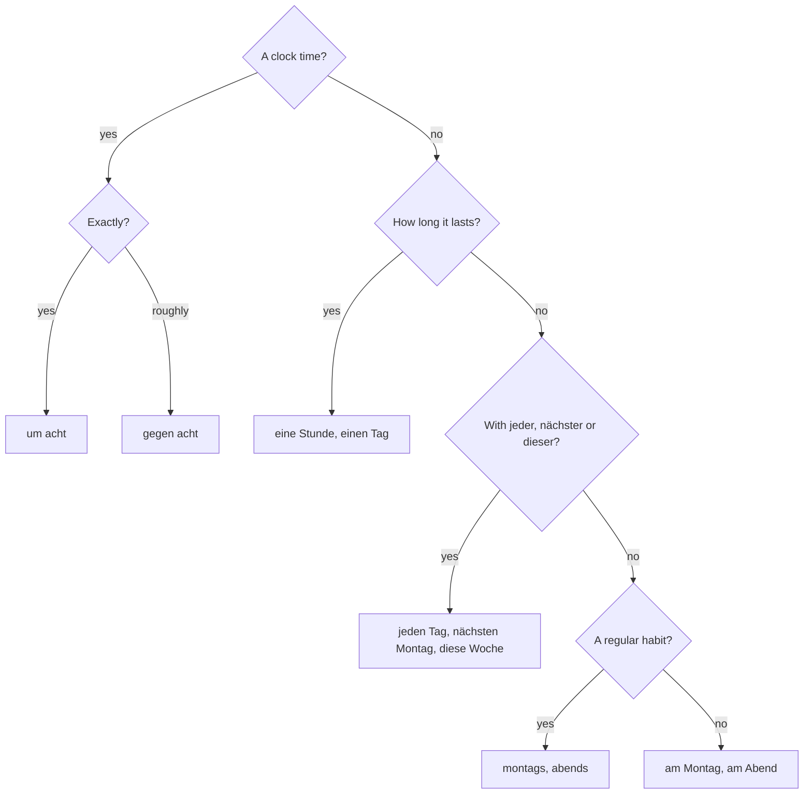

## What this lesson is for

In lesson 11 you learned the clock and the little words *um*, *am* and *von … bis*, and in lesson 12 you described a day with separable verbs and a time phrase in position 1. This honors lesson takes you from one day to a whole week. You'll read real-style opening hours, say what you do regularly (*montags*, *abends*), and use a neat piece of grammar: time phrases with no preposition at all, in the accusative (*jeden Tag*, *nächsten Montag*, *eine Stunde*). You'll also learn to say "around eight" and "shortly after eight", and how to put two time phrases in one sentence.

## Reading opening hours

Every shop, bakery, doctor's practice and café has a sign with its *Öffnungszeiten* (opening hours). They use short forms for the days: *Mo, Di, Mi, Do, Fr, Sa, So*, and a dash means *bis*.

To read a line aloud, join the days with *bis* (or *von … bis*) and say the times with *von … bis*:

- *Mo–Fr 6:30–18:00* → *Montag bis Freitag von sechs Uhr dreißig bis achtzehn Uhr* (in conversation also *von halb sieben bis sechs*).
- *Sa 7:00–13:00* → *Samstag von sieben bis dreizehn Uhr*.

Three more words you'll see on signs:

- *geöffnet* — open; *geschlossen* — closed. *Heute geschlossen!* — Closed today!
- *der Ruhetag* — the "rest day": a restaurant's or café's fixed day off each week. *Montag Ruhetag* means it is closed every Monday.
- *feiertags* — on public holidays (*der Feiertag*, public holiday). *feiertags geschlossen* = closed on public holidays.

A cultural note, simplified: in Germany most shops are closed on Sundays and public holidays. The exact rules are set by each federal state, and there are exceptions: bakeries may open for a few hours on Sunday morning, and shops at petrol stations, big train stations and airports stay open. So the bakery on the sign opening *So 8:00–11:00* is completely normal.

### Example 1: Questions about the signs

Use the two signs above.

1. *Kann ich am Sonntag um halb elf Brötchen kaufen?* — Can I buy rolls on Sunday at 10:30? The bakery is open on Sunday from 8:00 to 11:00, and 10:30 is inside that time: yes.
2. *Ist das Café am Montag geöffnet?* — No: *Montag Ruhetag*. It's closed every Monday.
3. *Wie lange ist die Bäckerei am Samstag geöffnet?* — From 7:00 to 13:00: *sechs Stunden*.
4. How many hours a week is the bakery open? Monday to Friday 6:30–18:00 is 11½ hours a day, so 5 × 11,5 = 57,5 hours; plus 6 on Saturday and 3 on Sunday: 66,5 hours (*sechsundsechzigeinhalb Stunden*).

## Habits: montags, abends

In lesson 11 you said *am Montag* (on Monday) and *am Abend* (in the evening). For something you do regularly, German has a short **adverb of time** made from the noun plus *-s*, written with a small letter:

| am … (one time, or from context) | regularly: every … |
|---|---|
| am Montag | *montags* — on Mondays |
| am Sonntag | *sonntags* — on Sundays |
| am Morgen | *morgens* — in the mornings |
| am Nachmittag | *nachmittags* — in the afternoons |
| am Abend | *abends* — in the evenings |
| in der Nacht | *nachts* — at night |

Every day works the same way: *dienstags, mittwochs, donnerstags, freitags, samstags*, and also *vormittags* and *mittags*.

- *Montags arbeite ich bis sieben.* — On Mondays I work until seven.
- *Abends sehe ich oft fern.* — In the evenings I often watch TV.
- *Die Bäckerei ist sonntags geöffnet.* — The bakery is open on Sundays.

*am Montag* can also describe a habit when the context makes it clear (*Am Montag arbeite ich nicht* in lesson 12), but *montags* always means "every Monday". Remember the capital letter only at the start of a sentence: *Montags …*, but *Ich arbeite montags.*

## Time without a preposition: the accusative

Some time phrases have no preposition at all. With *jeder* (every), *nächster* (next), *dieser* (this) and *ganz* (whole), German puts the time word in the accusative. This is the **accusative of time**. You already know the endings: they are the endings of *der/den, die, das*, and as always only the masculine changes.

| | masculine | feminine | neuter |
|---|---|---|---|
| every | jeden Tag, jeden Morgen | jede Woche | jedes Jahr, jedes Wochenende |
| next | nächsten Montag, nächsten Monat | *nächste Woche* | nächstes Jahr |
| this | diesen Freitag, diesen Sommer | diese Woche | dieses Wochenende |
| the whole | den ganzen Tag | die ganze Woche | das ganze Wochenende |

(*das Jahr* = year from lesson 3; *der Monat* = month and *der Sommer* = summer, words you'll meet in lesson 16.)

- *Nächsten Montag habe ich frei.* — Next Monday I've got the day off.
- *Ich jogge jeden Morgen.* — I go jogging every morning. (*joggen* = to jog)
- *Am Samstag schlafe ich den ganzen Vormittag.* — On Saturday I sleep the whole morning.

You can also say *am nächsten Montag*, with *am*, but the short accusative form is more common.

### How long: dauern and the accusative

The same accusative says how long something lasts. The verb for "to last, to take (time)" is *dauern*: *Wie lange dauert der Film?* — How long is the film?

- *Der Film dauert zwei Stunden.* — The film lasts two hours. (plural: no change)
- *Der Kurs dauert einen Tag.* — The course takes one day. (*der Tag* → *einen Tag*)
- *Ich bleibe eine Woche in Wien.* — I'm staying in Vienna for a week. (*bleiben* = to stay)

English often adds "for"; German usually needs no word at all. (*Ich bleibe für eine Woche* is also heard, but after *dauern* the accusative always stands alone.)

### Example 2: building the phrase

Say "I go shopping every Saturday" and "The appointment takes an hour".

1. "every Saturday": *der Samstag* is masculine, *jeder* takes the masculine accusative ending *-en*: *jeden Samstag*. The verb is *einkaufen*, separable: *Ich kaufe jeden Samstag ein.* (Or with the time first: *Jeden Samstag kaufe ich ein.*)
2. "an hour": *die Stunde* is feminine, so it stays *eine Stunde*. *Der Termin* (appointment) *dauert* … : *Der Termin dauert eine Stunde.*

## Around eight, shortly after eight

| German | English |
|---|---|
| um acht | at eight |
| *gegen* acht | around eight, at about eight |
| kurz nach acht | shortly after eight |
| kurz vor acht | shortly before eight |
| Punkt acht | at eight on the dot |

*gegen* replaces *um*: *Ich komme gegen sieben* — I'll come at around seven. Never *um gegen*.

## How often: a longer scale

Lesson 11 gave you *immer, oft, manchmal, nie*. Add *meistens* (mostly, usually) and *selten* (rarely):

immer → meistens → oft → manchmal → selten → nie

To count, use *einmal* (once), *zweimal* (twice), *dreimal* … with *pro* (per) or with the accusative: *einmal pro Woche* or *einmal die Woche* — once a week; *dreimal am Tag* — three times a day.

- *Ich gehe zweimal pro Woche schwimmen.* — I go swimming twice a week.
- *Wir essen selten im Restaurant.* — We rarely eat in a restaurant.

## Two time phrases in one sentence

When a sentence has two time phrases, the general one comes before the specific one: day before clock time.

- *Ich komme morgen um acht.* — I'm coming tomorrow at eight.
- *Am Freitag gegen sieben gehen wir ins Kino.* — On Friday at around seven we're going to the cinema.
- *Der Kurs ist dienstags von sechs bis acht.* — The course is on Tuesdays from six to eight.

A time phrase usually comes before a place: *Ich bin um acht im Büro* (*im Büro* = at the office). Both time phrases can stand together in position 1, since they count as one element: *Morgen um acht rufe ich dich an* (*dich* = you).

### Example 3: putting the pieces in order

Words: *ich*, *spiele*, *Fußball*, *samstags*, *um zehn*.

1. The verb goes second: *spiele*.
2. Two time phrases: general (*samstags*) before specific (*um zehn*).
3. Start with the subject: *Ich spiele samstags um zehn Fußball.* Or start with the time: *Samstags um zehn spiele ich Fußball.*

The whole choice of time words fits in one chart:

## Reading: Unsere Woche

> Wir sind Familie Yilmaz: Mama, Papa, Ela und ich, Can. Unsere Woche ist voll. Papa arbeitet morgens in der Bäckerei, er steht jeden Tag um vier auf. Mama arbeitet nachmittags im Büro, meistens bis halb sieben. Ela hat dienstags und donnerstags Fußball, das dauert anderthalb Stunden. Ich spiele montags Gitarre. Nächste Woche haben wir viele Termine: Am Mittwoch gegen drei kommt Oma, und am Freitag kurz nach fünf holen wir Tante Ayşe am Bahnhof ab. Samstags kaufen wir zusammen ein, aber sonntags sind die Geschäfte geschlossen. Dann schlafen wir lange, nur Papa nicht: Die Bäckerei ist sonntags bis elf geöffnet. Abends essen wir alle zusammen. Das ist selten in der Woche, und deshalb ist der Sonntag mein Lieblingstag.

In English:

> We're the Yilmaz family: Mum, Dad, Ela and me, Can. Our week is full. Dad works mornings at the bakery; he gets up at four every day. Mum works afternoons at the office, usually until half past six. Ela has football on Tuesdays and Thursdays, which takes an hour and a half. I play guitar on Mondays. Next week we have lots of appointments: on Wednesday at around three Grandma is coming, and on Friday shortly after five we're picking up Aunt Ayşe from the station. On Saturdays we go shopping together, but on Sundays the shops are closed. Then we sleep in, except Dad: the bakery is open until eleven on Sundays. In the evening we all eat together. That's rare during the week, and that's why Sunday is my favourite day.

(*anderthalb* = one and a half; *nur Papa nicht* = except Dad; *die Gitarre* = guitar; *die Tante* = aunt; *am Bahnhof* = at the station; *deshalb* = that's why; *der Lieblingstag* = favourite day.)

## Pronunciation

- *montags*, *abends*: the final *-gs* and *-ds* sound like *ks* and *ts* (final devoicing): MOHN-tahks, AH-bents.
- *nachts*: the *ch* of *Bach*, then *ts*: nahkhts.
- *geöffnet*: three syllables, ge-ÖFF-net, with a tiny break before the *ö*.
- *gegen*: GAY-gen, both *g*s hard.

## Common mistakes

- *Montags* in the middle of a sentence. The adverb is small: *Ich arbeite montags.*
- *am nächste Woche*, *in nächste Woche* — Use the plain accusative: *nächste Woche*.
- *nächste Montag*, *jede Tag* — Masculine needs *-en*: *nächsten Montag, jeden Tag*.
- *für zwei Stunden* — In "it takes two hours" use the accusative alone: *Es dauert zwei Stunden.*
- *um gegen acht* — *gegen* replaces *um*: *gegen acht*.
- *um acht morgen* — General before specific: *morgen um acht*.
- *Das Café ist am Montag Ruhetag geöffnet.* — *Ruhetag* means it's closed: *Montag ist Ruhetag* / *Montags ist das Café geschlossen.*

## Key points

- Opening hours: *Mo–Fr 8–18 Uhr* is read *Montag bis Freitag von acht bis achtzehn Uhr*; *geöffnet* = open, *geschlossen* = closed, *Ruhetag* = weekly closing day. Most German shops are closed on Sundays (rules vary by state).
- *montags, abends, nachts* (small letter, *-s*) mean every Monday, every evening, every night.
- With *jeder, nächster, dieser, ganz* the time phrase is in the accusative with no preposition: *jeden Tag, nächsten Montag, diese Woche, den ganzen Tag*.
- How long: *dauern* + accusative: *Es dauert eine Stunde / einen Tag.*
- *gegen acht* = around eight; *kurz nach / kurz vor acht*; *Punkt acht*.
- Frequency: *immer, meistens, oft, manchmal, selten, nie*; *einmal pro Woche*.
- Two time phrases: general before specific (*morgen um acht*), time before place.

The words from this lesson are listed below; they join your vocabulary reviews when you complete the lesson.
