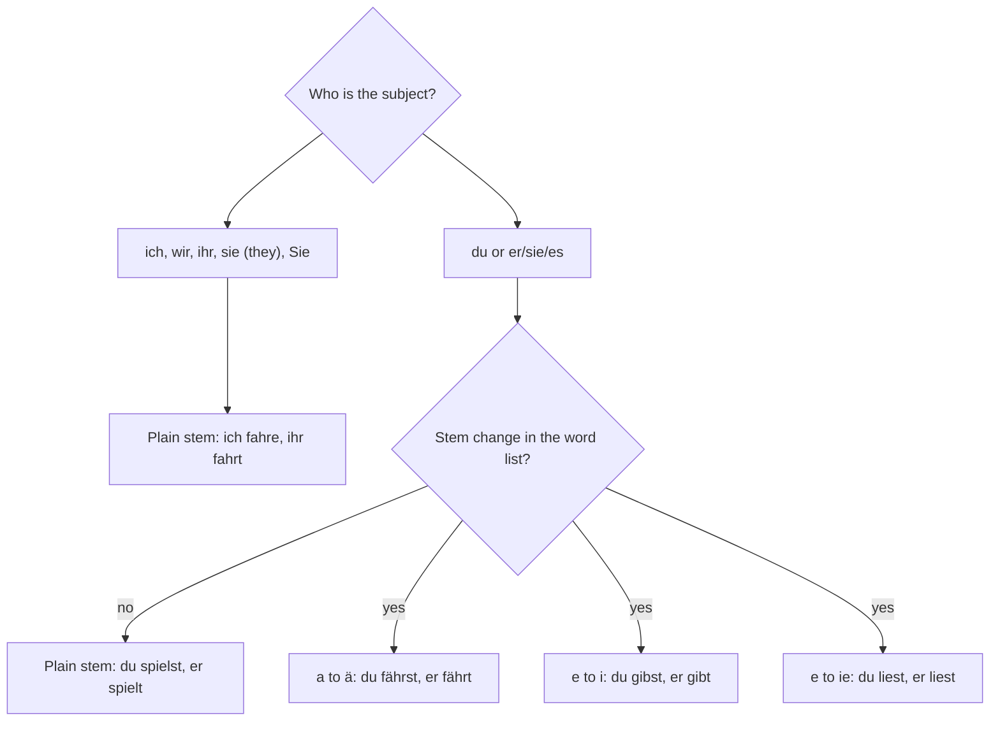

## What this lesson is for

Module 4 is about free time and plans. In this first lesson you learn to talk about your
hobbies: what you do in your free time, what you like, what you like more, and what you like
most of all.

On the way you meet an important group of verbs. In lesson 4 you learned the regular present
tense endings (-e, -st, -t, -en, -t, -en), and you have already seen a few verbs that change
their vowel, such as *sprechen* (du sprichst) in lesson 7 and *essen* and *nehmen* in lesson 9.
Here that pattern gets a name and a full explanation, because many of the most common German
verbs, including several hobby verbs, behave this way.

## Talking about hobbies

The easiest way to ask about free time is with *gern*, which you know from lesson 4. *Gern*
goes right after the verb (after a short pronoun like *das* if there is one: *Ich mache das
gern*) and before the rest: *Ich spiele gern Gitarre.* It means that you like doing it.

- *Was machst du gern?* — What do you like doing?
- *Was machen Sie in der Freizeit?* — What do you do in your free time?
- *Hast du ein Hobby?* — Do you have a hobby?
- *Mein Hobby ist Musik.* — My hobby is music.
- *Ich lese gern.* — I like reading.
- *Ich tanze nicht gern.* — I don't like dancing.

*In der Freizeit* means "in (your) free time". Learn it as a fixed chunk for now; the
grammar behind *der* after *in* comes in lesson 18.

Many hobbies are just verbs: *lesen* (to read), *schwimmen* (to swim), *tanzen* (to dance),
*singen* (to sing), *reisen* (to travel), *wandern* (to hike), *joggen* (to jog), *malen* (to
paint), *fotografieren* (to take photos). Others use *spielen* or *fahren* with a noun:

| German | English |
|---|---|
| *Fußball spielen* | to play football (soccer) |
| *Gitarre spielen* | to play the guitar |
| *Fahrrad fahren* | to ride a bike, to cycle |
| *Musik hören* | to listen to music |
| *Filme sehen* | to watch films |
| *Freunde treffen* | to meet friends |
| *spazieren gehen* | to go for a walk |
| *ins Kino gehen* | to go to the cinema |

Here are six of these hobbies as pictures. Say each one aloud as a sentence: *Ich lese gern.
Ich fahre gern Fahrrad.*

Two small notes. German drops the article with sports and instruments here: *Ich spiele
Fußball* (no *den*), *Ich spiele Gitarre*. And *ins Kino*, *ins Theater* and *ins Konzert* are
fixed chunks for going somewhere; you will see why in later lessons.

## Stem-changing verbs

The **stem** of a verb is the infinitive without *-en*: *mach-en*, *lern-en*, *fahr-en*. In
regular verbs the stem never changes. A **stem-changing verb** changes the vowel of its stem,
but only in the du form and the er/sie/es form. Every other form is regular. There are
three patterns at A1.

### Pattern 1: a → ä

| | fahren (to go by vehicle) | schlafen (to sleep) |
|---|---|---|
| ich | fahre | schlafe |
| du | *fährst* | *schläfst* |
| er/sie/es | *fährt* | *schläft* |
| wir | fahren | schlafen |
| ihr | fahrt | schlaft |
| sie/Sie | fahren | schlafen |

*Waschen* (du wäschst, er wäscht) follows the same pattern.

### Pattern 2: e → i

| | sprechen | geben (to give) | helfen (to help) | treffen (to meet) |
|---|---|---|---|---|
| ich | spreche | gebe | helfe | treffe |
| du | *sprichst* | *gibst* | *hilfst* | *triffst* |
| er/sie/es | *spricht* | *gibt* | *hilft* | *trifft* |
| wir | sprechen | geben | helfen | treffen |
| ihr | sprecht | gebt | helft | trefft |
| sie/Sie | sprechen | geben | helfen | treffen |

*Essen* (du isst, er isst) and *nehmen* (du nimmst, er nimmt) belong here too. *Nehmen* also
changes its consonants (*du nimmst, er nimmt*), so learn those two forms by heart; *treffen*
keeps its double *f* (*du triffst, er trifft*).

### Pattern 3: e → ie

| | lesen (to read) | sehen (to see) |
|---|---|---|
| ich | lese | sehe |
| du | *liest* | *siehst* |
| er/sie/es | *liest* | *sieht* |
| wir | lesen | sehen |
| ihr | lest | seht |
| sie/Sie | lesen | sehen |

*Lesen* has one more twist: its stem ends in -s, so du gets only -t (*du liest*, not
"du liesst"), just like *heißen* (du heißt) in lesson 4.

### A memory hook

Think of the change as a "spotlight" on the two singular persons you talk to or about: *du*
and *er/sie/es*. The plural forms, and *ich*, stay in the dark and keep the plain vowel. If you
know the er form, you know the du form: *er fährt → du fährst*, *er liest → du liest*.

You can't see from the infinitive whether a verb changes, so the vocabulary list notes every
stem change. Many common verbs with *e* or *a* do not change: *gehen*, *lernen*, *machen*,
*spielen*, *wandern*, *malen*, *tanzen*.

This chart sums up the decision you make each time you conjugate a verb in the present tense:

Examples:

- *Mein Vater fährt am Wochenende Fahrrad.* — My father cycles at the weekend.
- *Liest du gern?* — Do you like reading?
- *Anna sieht jeden Abend einen Film.* — Anna watches a film every evening.
- *Wann triffst du deine Freunde?* — When are you meeting your friends?
- *Er hilft oft im Garten.* — He often helps in the garden.
- *Was gibt es heute im Kino?* — What's on at the cinema today? (*es gibt*, lesson 10)
- *Wir fahren zusammen, und ihr fahrt allein.* — We're going together, and you're going alone.

## gern, lieber, am liebsten

*Gern* has two more forms for comparing. *Lieber* is its **comparative** ("rather, prefer")
and *am liebsten* its **superlative** ("most of all, like best").

| | | |
|---|---|---|
| *gern* | like doing | *Ich schwimme gern.* — I like swimming. |
| *lieber* | prefer, would rather | *Ich jogge lieber.* — I prefer jogging. |
| *am liebsten* | like most of all | *Am liebsten tanze ich.* — Most of all I like dancing. |

Picture them as three steps, each one higher than the last:

They all sit where *gern* sits, after the verb:

- *Ich sehe gern Filme, aber ich lese lieber.* — I like watching films, but I prefer reading.
- *Trinkst du lieber Kaffee oder Tee?* — Do you prefer coffee or tea?
- *Ich höre am liebsten Musik.* — Most of all I like listening to music.

When *am liebsten* comes first in the sentence, remember the rule from lesson 4: the verb stays
in position 2 and the subject moves behind it. *Am liebsten wandere ich* (not "Am liebsten ich
wandere").

*Lieber* also works for choosing between things: *Ich sehe gern Filme, aber ich gehe lieber
ins Konzert.* — I like watching films, but I'd rather go to a concert. (For liking a thing
itself, German uses *mögen*, which you meet properly in the next lesson.)

## Dialogue: Was machst du gern?

Jonas and Mia are new in a German course and chat in the break.

> Jonas: Was machst du gern in der Freizeit, Mia?
>
> Mia: Ich lese viel, und ich male gern. Und du?
>
> Jonas: Ich spiele gern Fußball, aber am liebsten fahre ich Fahrrad.
>
> Mia: Fährst du allein?
>
> Jonas: Nein, mein Bruder fährt auch gern. Wir fahren am Sonntag immer zusammen.
>
> Mia: Ich fahre nicht so gern Fahrrad. Ich wandere lieber.
>
> Jonas: Siehst du auch gern Filme?
>
> Mia: Ja! Ich treffe am Freitag Freunde, und wir gehen ins Kino. Kommst du mit?
>
> Jonas: Gern! Wann fängt der Film an?
>
> Mia: Um acht. Und danach singen wir Karaoke!

Translation:

> Jonas: What do you like doing in your free time, Mia?
>
> Mia: I read a lot, and I like painting. And you?
>
> Jonas: I like playing football, but most of all I like cycling.
>
> Mia: Do you ride alone?
>
> Jonas: No, my brother likes cycling too. We always ride together on Sundays.
>
> Mia: I don't like cycling so much. I prefer hiking.
>
> Jonas: Do you like watching films too?
>
> Mia: Yes! I'm meeting friends on Friday and we're going to the cinema. Are you coming?
>
> Jonas: I'd love to! When does the film start?
>
> Mia: At eight. And afterwards we're singing karaoke!

Notice *Fährst du …?* and *mein Bruder fährt* with ä, but *wir fahren* without it.

## Pronunciation

- *fährt, schläft*: ä is pronounced like the e in English "bed" (long here: "fairt").
- *liest, sieht*: ie is a long "ee". The h in *sieht* is silent; it only shows that the vowel
  is long.
- *Theater*: the th is a plain t, and the stress is on the second syllable: the-A-ter.
- *fotografieren*: verbs ending in -ieren are stressed on *-ie-*: fo-to-gra-FIE-ren.
- *Konzert*: the z sounds like "ts"; stress on the second syllable: kon-ZERT.
- *joggen* is an English loanword, but the j is said like English "dj" by most speakers and the
  -en is German.

## Common mistakes

- Putting the change in the wrong person. *Ich fähre* and *wir sprichen* are wrong: only
  du and er/sie/es change. *Ich fahre, wir sprechen.*
- Adding the umlaut to ihr. *Ihr fahrt* (no ä), *ihr lest*, *ihr seht*.
- Using the English word order with gern. Not "Ich gern lese" but *Ich lese gern*.
- Saying "mehr gern" for "more". The comparative of *gern* is *lieber*: *Ich schwimme
  lieber* (not "Ich schwimme mehr gern").
- "I play the guitar" with an article. In German: *Ich spiele Gitarre*.
- Using *gehen* for travel by vehicle. *Gehen* is on foot. For bikes, cars, trains and so
  on use *fahren*: *Ich fahre nach Berlin.* — I'm going to Berlin.

## Key points

- A stem-changing verb changes its vowel only in the du and er/sie/es forms: a → ä (*fahren,
  schlafen*), e → i (*sprechen, essen, geben, helfen, treffen, nehmen*), e → ie (*lesen,
  sehen*).
- Learn the er form with each verb: *er fährt, er gibt, er liest*.
- *gern* = like doing, *lieber* = prefer, *am liebsten* = like most of all; all go after the
  verb.
- With sports and instruments there's no article: *Ich spiele Fußball / Gitarre.*
- Ask *Was machst du gern?* or *Hast du ein Hobby?*

The words from this lesson are listed below; they join your vocabulary reviews when you
complete the lesson.
