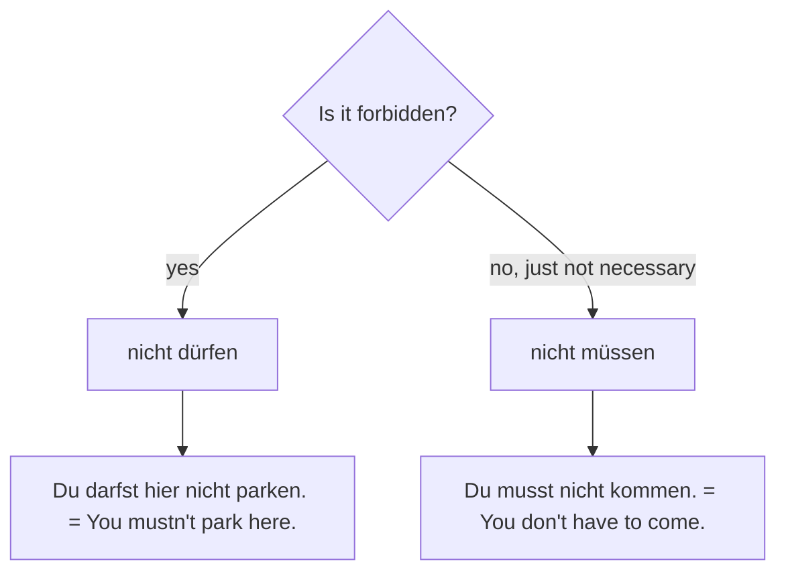

## What this lesson is for

In lesson 14 you met the modal verbs *können, wollen, mögen* and *möchten* and the sentence
bracket (modal in position 2, infinitive at the end). This lesson adds the other three modal
verbs: *müssen* (must, have to), *dürfen* (may, be allowed to) and *sollen* (should, be supposed
to). With them you can talk about rules, signs, appointments and paperwork, which is exactly
what you meet when you live in a German-speaking country, and you can ask politely for
permission.

## The forms

The pattern is the one you already know: ich and er/sie/es are the same with no ending, the
singular has its own vowel, and the plural is regular.

| | müssen (must) | dürfen (may) | sollen (should) |
|---|---|---|---|
| ich | muss | darf | soll |
| du | musst | darfst | sollst |
| er/sie/es | muss | darf | soll |
| wir | müssen | dürfen | sollen |
| ihr | müsst | dürft | sollt |
| sie/Sie | müssen | dürfen | sollen |

Watch the spelling: *muss* and *musst* have ss (short u), and the umlaut disappears in the
singular: *müssen → ich muss*, *dürfen → ich darf*. *Sollen* doesn't change its vowel at all.

The word order is the same as in lesson 14:

| Position 1 | Position 2 (modal) | middle | end |
|---|---|---|---|
| Ich | muss | morgen früh | arbeiten. |
| Hier | darf | man nicht | parken. |
| Sie | müssen | das Formular | ausfüllen. |
| | Soll | ich das Fenster | öffnen? |

*Ausfüllen* (to fill in) is separable, so it stays together at the end, as you saw with
*mitkommen* in lesson 14. *Unterschreiben* (to sign) is not separable: *Sie unterschreibt
hier* and *Sie muss hier unterschreiben.*

## müssen: necessity

*Müssen* says that something is necessary, because of a rule, a situation or your own
feeling:

- *Ich muss um sieben aufstehen.* — I have to get up at seven.
- *Du musst pünktlich sein. Der Termin ist um neun.* — You have to be on time. The
  appointment is at nine.
- *Wir müssen leider warten.* — Unfortunately we have to wait.
- *Musst du heute noch die Hausaufgabe machen?* — Do you still have to do the homework today?

## dürfen: permission

*Dürfen* says that something is allowed:

- *Darf ich hier rauchen?* — May I smoke here?
- *Kinder dürfen hier spielen.* — Children are allowed to play here.
- *Im Kurs dürfen wir Englisch sprechen.* — In the course we're allowed to speak English.

## nicht müssen vs nicht dürfen

This is the most important trap of the lesson. In English, "must not" means "it's forbidden".
In German, *nicht müssen* only means "not necessary". For "forbidden" you need *nicht dürfen*.

| German | Meaning | English |
|---|---|---|
| *Du musst nicht kommen.* | not necessary, you choose | You don't have to come. |
| *Du darfst nicht kommen.* | forbidden | You mustn't come. / You're not allowed to come. |
| *Man muss hier nicht warten.* | no need to wait | You don't need to wait here. |
| *Man darf hier nicht parken.* | parking is forbidden | You mustn't park here. |

Memory hook: *müssen* is about need. Take the need away (*nicht müssen*) and you are free.
*Dürfen* is about permission. Take the permission away (*nicht dürfen*) and it is forbidden.

When you want to say "not", ask one question first:

## sollen: what someone else wants

*Sollen* passes on an instruction, advice or expectation that comes from another person:

- *Der Arzt sagt, ich soll viel Wasser trinken.* — The doctor says I should drink a lot of
  water.
- *Wir sollen das Formular bis Freitag ausfüllen.* — We're supposed to fill in the form by
  Friday.

In questions with *ich* or *wir*, *sollen* is a friendly offer or a request for instructions:

- *Soll ich das Fenster öffnen?* — Shall I open the window?
- *Wo soll ich unterschreiben?* — Where should I sign?
- *Sollen wir zusammen warten?* — Shall we wait together?

## man: rules for everyone

*Man* is an **indefinite pronoun**: it means people in general, like English "one", "you" or
"they" in "they say…". It always takes the er/sie/es form of the verb, and it goes very well
with modal verbs when you talk about rules:

- *Hier darf man nicht rauchen.* — You can't smoke here. / Smoking isn't allowed here.
- *Im Kino muss man leise sein.* — In the cinema you have to be quiet.
- *Was muss man hier machen?* — What does one have to do here?
- *Wie schreibt man das?* — How do you spell that? (lesson 1)

Don't confuse *man* (one, people) with *der Mann* (the man): one n, small m.

## Signs and rules

Signs (*das Schild*, plural *die Schilder*) are often very short. Many use *verboten*
(forbidden) or *erlaubt* (allowed) with a verb used as a noun:

| Sign | Meaning | With man + modal |
|---|---|---|
| *Rauchen verboten* | No smoking | *Hier darf man nicht rauchen.* |
| *Parken erlaubt* | Parking allowed | *Hier darf man parken.* |
| *Bitte leise sein!* | Please be quiet! | *Hier muss man leise sein.* |
| *Bitte Ausweis zeigen* | Please show ID | *Man muss den Ausweis zeigen.* |
| *Heute geschlossen* | Closed today | *Man kann heute nicht einkaufen.* |

Many signs use only a picture. A red ring with a red bar across means "not allowed":

*Geschlossen* (closed) comes from *schließen* (to close); its opposite on a door is *geöffnet*
(open), from *öffnen*.

## Polite requests

Modal verbs are the normal way to ask for something politely:

- *Kann ich hier warten?* — Can I wait here?
- *Darf ich das Fenster öffnen?* — May I open the window? (a little more polite)
- *Können Sie das bitte wiederholen?* — Could you repeat that, please?
- *Können Sie mir helfen?* — Can you help me? (*mir* = me, lesson 20)

Possible answers: *Ja, natürlich.* — Yes, of course. *Ja, gern.* — Yes, sure. *Nein, leider
nicht.* — No, I'm afraid not.

## Dialogue: Im Bürgeramt

Ana Silva is new in Leipzig and must register her address at the *Bürgeramt* (citizens'
office).

> Herr Krüger: Guten Tag. Haben Sie einen Termin?
>
> Ana: Ja, um zehn Uhr. Ich bin ein bisschen früh. Darf ich hier warten?
>
> Herr Krüger: Natürlich. Aber Sie müssen zuerst dieses Formular ausfüllen.
>
> Ana: Okay. Muss ich alles ausfüllen?
>
> Herr Krüger: Nein, Sie müssen nicht alles ausfüllen. Name, Adresse und Geburtsdatum sind
> wichtig. Und Sie müssen hier unten unterschreiben.
>
> Ana: Gut. Brauchen Sie auch meinen Ausweis?
>
> Herr Krüger: Ja, bitte. Ach, und Sie dürfen hier leider nicht telefonieren. Das ist eine Regel.
>
> Ana: Kein Problem. Soll ich die Tür schließen? Es ist ziemlich laut.
>
> Herr Krüger: Ja, gern. Vielen Dank!

Translation:

> Herr Krüger: Hello. Do you have an appointment?
>
> Ana: Yes, at ten o'clock. I'm a bit early. May I wait here?
>
> Herr Krüger: Of course. But you have to fill in this form first.
>
> Ana: Okay. Do I have to fill in everything?
>
> Herr Krüger: No, you don't have to fill in everything. Name, address and date of birth are
> important. And you have to sign down here.
>
> Ana: Fine. Do you need my ID too?
>
> Herr Krüger: Yes, please. Oh, and I'm afraid you're not allowed to make phone calls here.
> That's a rule.
>
> Ana: No problem. Shall I close the door? It's quite loud.
>
> Herr Krüger: Yes, please. Thanks a lot!

Notice *Sie müssen nicht alles ausfüllen* (no need) next to *Sie dürfen nicht telefonieren*
(not allowed). *Geburtsdatum* (date of birth) and *Problem* come up again in lesson 23.

## Pronunciation

- *müssen, dürfen*: ü is "ee" with rounded lips. Without the umlaut, *muss* has a short u as in
  "put".
- *muss*: the double s after a vowel tells you the vowel is short.
- *schließen*: ie is a long "ee" and ß is a sharp s: "shlee-sen".
- *Ausweis*: both syllables have a diphthong: au as in "how", ei as in "eye": "OWS-vice".
- *unterschreiben*: the stress is on *schrei*: un-ter-SCHREI-ben, because *unter-* here is not
  a separable prefix. Compare *AUS-füllen*, stressed on the separable prefix.
- *Information*: -tion is said "tsyohn" and carries the stress: in-for-ma-TSYOHN.

## Common mistakes

- Using *nicht müssen* for "must not". *Du musst nicht rauchen* means "you don't have to
  smoke". For a ban: *Du darfst nicht rauchen.*
- Adding endings to ich and er: "ich musse", "er darft". Correct: *ich muss, er darf.*
- Keeping the umlaut in the singular: "ich müss", "ich dürf". Correct: *ich muss, ich darf.*
- Using *man* with a plural verb: "man müssen". *Man* takes the er form: *man muss.*
- Spelling the pronoun with two n's. *Der Mann* is a man; *man* is "one, people".
- Splitting *unterschreiben*: "Ich schreibe unter". It is not separable: *Ich unterschreibe.*

## Key points

- *müssen* = must, have to; *dürfen* = may, be allowed to; *sollen* = should, be supposed to.
- ich and er/sie/es forms: *muss, darf, soll*; no umlaut in the singular.
- *nicht müssen* = don't have to; *nicht dürfen* = mustn't, not allowed.
- *man* + modal for rules: *Hier darf man nicht parken.* *Man* takes the er form.
- Polite requests: *Kann ich …? Darf ich …? Können Sie …?* Offers: *Soll ich …?*
- Signs: *verboten* (forbidden), *erlaubt* (allowed), *geschlossen* (closed).

The words from this lesson are listed below; they join your vocabulary reviews when you
complete the lesson.
