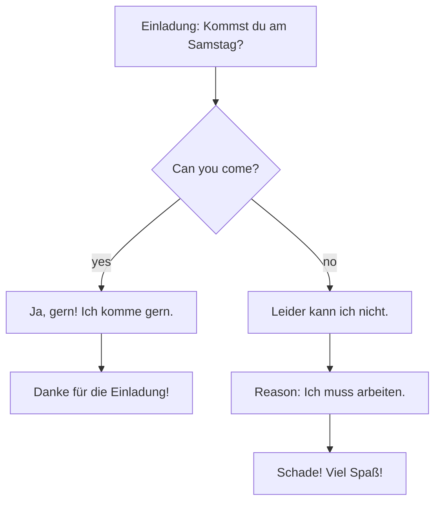

## What this lesson is for

In lessons 14 and 15 you learned to make plans and talk about what you can, want and have to
do. To make real plans you also need dates (*am dritten Oktober*), months and seasons
(*im Sommer*), and a way to talk about the weather, which in German conversation is almost as
popular as in English. You will also learn four short prepositions that always take the
accusative, and how to accept or turn down an invitation politely.

## Months and seasons

All months are masculine (*der Januar*) and, like all nouns, written with a capital letter.

| | | | |
|---|---|---|---|
| *Januar* | *Februar* | *März* | *April* |
| *Mai* | *Juni* | *Juli* | *August* |
| *September* | *Oktober* | *November* | *Dezember* |

The seasons (*die Jahreszeiten*) are masculine too: *der Frühling* (spring), *der Sommer*
(summer), *der Herbst* (autumn, fall), *der Winter* (winter).

The year wheel shows which months belong to which season. It uses whole months, the way weather
services count; by the calendar, spring starts around 20 March, summer around 21 June, autumn
around 22 or 23 September and winter around 21 December.

To say "in" a month or season, use *im*: *im Mai* (in May), *im Winter* (in winter). *Im* is
short for *in dem*; for now just learn *im* + month or season as a chunk.

- *Im Sommer fahre ich gern Fahrrad.* — In summer I like cycling.
- *Mein Bruder hat im Januar Geburtstag.* — My brother's birthday is in January.
- *Ein Jahr hat zwölf Monate.* — A year has twelve months.

In Austria January is *Jänner*. On the phone or over a loudspeaker, some people say *Juno*
for *Juni* and *Julei* for *Juli*, so the two aren't confused.

## Ordinal numbers and dates

An **ordinal number** says the position in a row: first, second, third. German makes them from
the normal numbers you learned in lesson 3:

| Number | Rule | Ordinal |
|---|---|---|
| 1–19 | number + -te | *zweite, vierte, fünfte, zehnte, zwölfte, neunzehnte* |
| 20 and up | number + -ste | *zwanzigste, einundzwanzigste, dreißigste* |
| irregular | learn these | *erste* (1st), *dritte* (3rd), *siebte* (7th), *achte* (8th) |

*Achte* has just one t, because *acht* already ends in t.

In writing, an ordinal is a number with a full stop: *der 3. Oktober* is read *der dritte
Oktober*. Dates are written day first, then month: *3.10.* or *03.10.2026* is the 3rd of
October, never March 10th.

There are two patterns to learn, and the ending tells them apart:

| Use | Pattern | Example |
|---|---|---|
| What's the date? | *der* + ordinal with -e | *Heute ist der erste Mai.* — Today is the first of May. |
| On which day? | *am* + ordinal with -en | *Am ersten Mai habe ich frei.* — On the first of May I'm off. |

To ask: *Welches Datum ist heute?* or, more colloquially, *Der Wievielte ist heute?* — What's
the date today? To ask "when": *Wann …?* and answer with *am*:

- *Wann hast du Geburtstag?* — When is your birthday?
- *Ich habe am zwölften März Geburtstag.* — My birthday is on the twelfth of March.
- *Der Kurs fängt am einundzwanzigsten September an.* — The course starts on the twenty-first of
  September.

German says "I have birthday": *Ich habe Geburtstag* (no article). And on the day itself, you
say *Herzlichen Glückwunsch zum Geburtstag!* — Happy birthday!

Years up to 1999 are read in hundreds: 1995 is *neunzehnhundertfünfundneunzig*. From 2000 on
they are read as thousands: 2026 is *zweitausendsechsundzwanzig*. Don't put *in* before a
year: say just *2026* or *im Jahr 2026*.

## The weather

*Das Wetter* is talked about with *es*. With weather verbs, *es* doesn't stand for anything;
it is just a placeholder subject, like "it" in "it's raining". These verbs are called
**impersonal verbs**, and they are used only with *es*.

- *Es regnet.* — It's raining. (*regnen*)
- *Es schneit.* — It's snowing. (*schneien*)
- *Die Sonne scheint.* — The sun is shining. (*scheinen*)
- *Es ist warm / kalt / heiß / kühl.* — It's warm / cold / hot / cool.
- *Es ist windig.* — It's windy. (from *der Wind*)
- *Es sind 25 Grad.* — It's 25 degrees (Celsius).

To ask: *Wie ist das Wetter heute?* — What's the weather like today?

Nouns for the weather: *die Sonne* (sun), *der Regen* (rain), *der Schnee* (snow), *der Wind*
(wind). *Im Winter gibt es oft Schnee.* — In winter there's often snow.

Remember inversion when you start with a time phrase: *Im Herbst regnet es oft* (not "Im
Herbst es regnet").

## Four accusative prepositions: für, ohne, durch, um

A preposition is a little word like "for" or "through" that links a noun to the rest of the
sentence. In German each preposition decides the case of the noun after it. An
**accusative preposition** is always followed by the accusative, which you know from lesson 9: only the
masculine changes (*der → den*, *ein → einen*, *mein → meinen*).

| Preposition | Meaning | Example |
|---|---|---|
| *für* | for | *Das Geschenk ist für meinen Bruder.* — The present is for my brother. |
| *ohne* | without | *Ich gehe nie ohne einen Schirm.* — I never go without an umbrella. |
| *durch* | through | *Wir gehen durch den Park.* — We walk through the park. |
| *um* | at (a time), around | *Die Party fängt um acht an.* — The party starts at eight. |

With feminine, neuter and plural nouns nothing changes: *für die Party, ohne das Auto, für
meine Eltern*. *Ohne* is often used with no article at all: *ohne Jacke* (without a jacket).
You also know a fixed phrase with *für*: *Danke für die Einladung!*

## Invitations

An invitation is *die Einladung* (from *einladen*, lesson 14). Here are ways to answer.

Saying yes:

- *Ja, gern! Ich komme gern.* — Yes, I'd love to. I'd be glad to come.
- *Super, danke für die Einladung!* — Great, thanks for the invitation!

Saying no politely, with a reason:

- *Leider kann ich nicht. Ich muss arbeiten.* — Unfortunately I can't. I have to work.
- *Schade, da habe ich keine Zeit.* — What a pity, I don't have time then.

The whole conversation follows one of two paths:

## A message and two answers

> Hallo Sophie, hallo Tom,
>
> ich habe am 14. Juni Geburtstag. Das ist ein Samstag! Ich möchte im Garten feiern und lade
> euch ein. Die Party fängt um 18 Uhr an. Hoffentlich regnet es nicht! Kommt ihr?
>
> Paula

> Hallo Paula,
>
> danke für die Einladung! Ich komme sehr gern. Ich habe auch schon ein Geschenk für dich.
> Bis Samstag!
>
> Sophie

> Hallo Paula,
>
> leider kann ich nicht kommen. Ich muss am 14. Juni zu meiner Oma fahren. Schade! Aber
> herzlichen Glückwunsch schon jetzt und viel Spaß!
>
> Tom

Translation:

> Hi Sophie, hi Tom, my birthday is on the 14th of June. It's a Saturday! I'd like to
> celebrate in the garden and I'm inviting you. The party starts at 6 p.m. Hopefully it won't
> rain! Are you coming? Paula

> Hi Paula, thanks for the invitation! I'd love to come. I've already got a present for you
> too. See you on Saturday! Sophie

> Hi Paula, unfortunately I can't come. On the 14th of June I have to go to my grandma's. What a
> pity! But happy birthday in advance and have fun! Tom

New in passing: *euch* (you, plural object), *dich* (you, object) — both in lesson 20;
*hoffentlich* (hopefully); *zu meiner Oma* (to my grandma's, lesson 18); *schade* (what a
pity); *bis* (until) from lesson 11.

## Pronunciation

- *Juni* and *Juli*: the J is like English y: "YOO-nee", "YOO-lee".
- *März*: ä as in "bed", and z is "ts": "mehrts".
- *Herbst*: say every consonant: "hairpst" (the b sounds like p at the end of a syllable).
- *August* as a month is stressed on the second syllable: au-GUST.
- *Geburtstag*: stress on *-burts-*: ge-BURTS-tag.
- *regnet*: g before n stays a hard g: "RAYG-net".
- *Schnee* is a long "ay": "shnay"; *schneit* has ei as in "eye": "shnite".

## Common mistakes

- Using *in* with months: "in Mai". Correct: *im Mai*.
- Forgetting the ending after *am*: "am drei Oktober" or "am dritte Oktober". Correct: *am
  dritten Oktober*.
- Saying "erste" for 3rd or "dreite". The irregular ones are *erste, dritte, siebte, achte*.
- Reading 3.10. as March 10th. Germans write day.month.
- Dropping *es*: "Regnet." Weather verbs need *es*: *Es regnet.*
- Using the nominative after *für*: "für der Bruder". *Für* takes the accusative: *für den
  Bruder*.
- "Mein Geburtstag ist im 5. Mai." Use *am* with a date: *Mein Geburtstag ist am 5. Mai.*

## Key points

- Months and seasons are masculine; use *im* with them: *im Juli, im Herbst*.
- Ordinals: 1–19 + -te, 20+ + -ste; irregular *erste, dritte, siebte, achte*.
- Date: *Heute ist der dritte Mai.* On a date: *am dritten Mai*. Written *3. Mai* or *3.5.*
- *Wann hast du Geburtstag? — Am …* and *Herzlichen Glückwunsch zum Geburtstag!*
- Weather with *es*: *es regnet, es schneit, es ist kalt*; *die Sonne scheint*.
- *für, ohne, durch, um* always take the accusative: *für den Vater, durch den Park*.
- Accept with *Ich komme gern*, decline with *Leider kann ich nicht …* and a reason.

The words from this lesson are listed below; they join your vocabulary reviews when you
complete the lesson.
