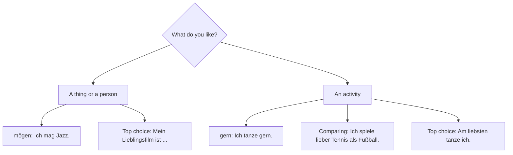

## What this lesson is for

In lessons 13 to 15 you learned to say what you like doing (*Ich spiele gern Fußball*), what
you can and want to do (*Ich kann schwimmen, ich will reisen*) and what the rules are (*Hier
darf man nicht rauchen*). This honors lesson puts all of that to work in real German life. You
will read three longer texts of the kind you meet when you live in Germany: a notice from a
sports club, the house rules of a block of flats and an e-mail from a friend. On the way you
learn two things that make your German sound more natural: the *Lieblings-* words (*mein
Lieblingsfilm*, my favourite film) and comparisons with *lieber … als …* (*Ich spiele lieber
Tennis als Fußball*).

## Vereine: free time in a club

A *Verein* is a club or association. Germans organize a great deal of their free time in
clubs: football and tennis, choirs and brass bands, chess, gardening, hiking, carnival and
much more. A club that is entered in the official register adds the letters *e. V.* to its
name, short for *eingetragener Verein* (registered club): *TC Rotbuche e. V.* (TC is short
for *Tennisclub*).

The numbers are large. In March 2026 there were about 629,000 registered clubs in Germany,
according to the research group ZiviZ, and the German Olympic Sports Confederation (DOSB)
counted about 86,000 sports clubs with about 29.3 million memberships in 2025. (Memberships,
not people: one person can belong to two or three clubs.) In a small town, the *Sportverein*
(sports club) is often the centre of social life, with its own pitch, a hall and a small
restaurant.

Members usually pay a yearly fee, and many clubs are run by volunteers. To say that you are in
a club, use the chunk *im Verein*:

- *Ich spiele im Verein Fußball.* — I play football in a club.
- *Meine Tochter singt im Chor.* — My daughter sings in a choir.
- *Spielst du im Verein?* — Do you play for a club?

Here is a notice (*der Aushang*) of the kind you find on the board at a sports hall:

> **TC Rotbuche e. V. — Tennis für alle!**
>
> Möchtest du Tennis spielen? Dann komm zu uns!
>
> Training für Kinder (ab 8 Jahren): Montag und Mittwoch, 16 bis 17:30 Uhr.
>
> Training für Erwachsene: Dienstag und Donnerstag, 19 bis 21 Uhr.
>
> Du musst nicht Mitglied sein: Das erste Training ist kostenlos.
>
> Du hast keinen Schläger? Kein Problem, wir haben Schläger für dich.
>
> Wichtig: In der Halle darf man nur mit Hallenschuhen spielen.
>
> Information und Anmeldung: Frau Becker (nach dem Training in der Halle)

Translation:

> TC Rotbuche (registered tennis club). Tennis for everyone! Would you like to play tennis?
> Then come to us! Training for children (from age 8): Monday and Wednesday, 4 to 5:30 p.m.
> Training for adults: Tuesday and Thursday, 7 to 9 p.m. You don't have to be a member: the
> first training session is free. You haven't got a racket? No problem, we have rackets for
> you. Important: in the hall you may only play in indoor shoes. Information and registration:
> Ms Becker (after training, in the hall).

New words: *das Mitglied* (member), *kostenlos* (free of charge), *der Schläger* (racket),
*die Halle* (hall, sports hall), *die Hallenschuhe* (indoor sports shoes: shoes that don't
leave marks on the floor), *die Anmeldung* (registration), *Erwachsene* (adults), *ab* (from, with an age or a time).

### Example 1: Reading the notice

Question: *Muss ich Mitglied sein?*

1. Find the sentence with *Mitglied*: *Du musst nicht Mitglied sein.*
2. Look at the modal verb: *musst nicht*. From lesson 15, *nicht müssen* means "not necessary",
   not "forbidden".
3. Answer: *Nein, ich muss nicht Mitglied sein.* — No, I don't have to be a member. The next
   sentence even tells you why it's easy to try: the first session is free.

Question: *Was darf man in der Halle nicht machen?*

1. Find *Halle*: *In der Halle darf man nur mit Hallenschuhen spielen.*
2. *Nur* means "only". So playing in other shoes (for example *Straßenschuhe*, outdoor shoes) is
   not allowed.
3. Answer: *Man darf nicht mit Straßenschuhen spielen.* — You mustn't play in outdoor shoes.

## Ruhezeiten: quiet times

The second thing that surprises many newcomers is how quiet a German Sunday is. Sundays and
public holidays are protected as days of rest by the German constitution (Article 140 of the
Basic Law, which takes over Article 139 of the Weimar Constitution of 1919). In practice this
means that most shops are closed on Sundays. Bakeries may open for a few hours, and shops at
large railway stations, airports and petrol stations stay open; the exact rules are made by
each of the 16 states.

There are also quiet times (*Ruhezeiten*) for noise:

- *Die Nachtruhe* (night quiet) usually runs from 22:00 to 6:00. It comes from state noise laws
  and local rules.
- *Die Mittagsruhe* (midday quiet), often 13:00 to 15:00, is not a general law. Whether it
  applies depends on the town and, above all, on the house rules of your building.
- On Sundays and public holidays, noisy work such as mowing the lawn with a motor mower is not
  allowed in residential areas at all, under a federal noise regulation.

Treat this picture as a simplified guide, not as law: details differ between states, towns
and buildings.

Most blocks of flats have a *Hausordnung* (house rules), usually hanging in the entrance. Here
is a short original example:

> **Hausordnung — Lindenstraße 12**
>
> Von 22 bis 6 Uhr ist Nachtruhe. Dann darf man keine laute Musik hören.
>
> Von 13 bis 15 Uhr ist Mittagsruhe. Bitte leise sein!
>
> Am Sonntag soll man nicht laut arbeiten.
>
> Fahrräder darf man nicht im Treppenhaus parken.
>
> Kinder dürfen im Hof spielen.
>
> Den Müll muss man trennen: Papier, Glas und Restmüll.

Translation:

> House rules, Lindenstraße 12. From 10 p.m. to 6 a.m. is night quiet time. Then you mustn't
> listen to loud music. From 1 to 3 p.m. is midday quiet time. Please be quiet! On Sundays you
> shouldn't do noisy work. You mustn't park bicycles in the stairwell. Children may play in the
> courtyard. You have to sort your rubbish: paper, glass and general waste.

New in passing: *das Treppenhaus* (stairwell, from *die Treppe*), *der Hof* (courtyard),
*der Müll* (rubbish), *trennen* (to separate, sort). Notice that every rule uses *man* with a
modal verb in the er form (*darf, soll, muss*), and one rule uses the plural *dürfen* because
the subject is *Kinder*. Notice also the word order in *Fahrräder darf man nicht … parken* and
*Den Müll muss man trennen*: the object comes first for emphasis, the modal verb stays in
position 2, and *man* moves behind it, just as a time phrase does in *Am Sonntag soll man …*.

### Example 2: Turning a rule into your own sentence

A neighbour asks: *Kann ich um 23 Uhr Klavier spielen?* Build the answer step by step.

1. Check the time: 23:00 is between 22:00 and 6:00, so it is *Nachtruhe*.
2. Decide the meaning: it is not allowed, so you need *nicht dürfen* (not *nicht müssen*, which
   would mean "you don't have to").
3. Use *man* for a general rule and give it the er form: *man darf*.
4. Build the bracket: *darf* in position 2, *spielen* at the end, *nicht* just before
   *Klavier spielen*.
5. Answer: *Nein, leider nicht. Um 23 Uhr ist Nachtruhe. Da darf man nicht Klavier spielen.*

## Favourites: the Lieblings- words

German has no separate word for "favourite". Instead it puts *Lieblings-* in front of a noun
and writes the two as one word. *Lieblings-* works as a **prefix**: a piece added to the front
of a word to change its meaning. The result is a **compound noun**, and as you know from
lesson 5, a compound takes its gender from the last noun:

| Noun | Favourite … |
|---|---|
| *der Film* | *der Lieblingsfilm* — favourite film |
| *das Essen* | *das Lieblingsessen* — favourite food |
| *die Farbe* | *die Lieblingsfarbe* — favourite colour |
| *das Buch* | *das Lieblingsbuch* — favourite book |
| *der Sport* | *der Lieblingssport* — favourite sport |
| *die Musik* | *die Lieblingsmusik* — favourite music |

With a possessive (lesson 6), the ending follows the gender as usual:

- *Mein Lieblingsfilm ist „Lola rennt".* — My favourite film is "Run Lola Run".
- *Meine Lieblingsfarbe ist Grün.* — My favourite colour is green.
- *Was ist dein Lieblingsessen?* — What's your favourite food?

*Lieblings-* comes from *der Liebling* (darling, favourite person). It always has the *-s*,
even before a word that starts with s: *der Lieblingssport* has a double s.

## Comparing two things: lieber … als …

In lesson 13 you used *lieber* to say what you prefer. To name the thing you are comparing
with, add *als* (than) and put it after the preferred thing:

- *Ich spiele lieber Tennis als Fußball.* — I prefer playing tennis to football.
- *Ich trinke lieber Tee als Kaffee.* — I prefer tea to coffee.
- *Ich gehe lieber ins Kino als ins Theater.* — I'd rather go to the cinema than to the
  theatre.

The verb is in position 2 as always, *lieber* stays right after it (or after a short
pronoun), and the *als* part goes at the end. If a sentence has a sentence bracket, the *als*
part usually comes after the infinitive: *Ich möchte lieber Tennis spielen als Fußball.*

You can now say how much you like something on a whole scale:

| German | English |
|---|---|
| *Ich tanze gar nicht gern.* | I don't like dancing at all. |
| *Ich tanze nicht so gern.* | I don't really like dancing. |
| *Ich tanze gern.* | I like dancing. |
| *Ich tanze sehr gern.* | I really like dancing. |
| *Ich tanze lieber als …* | I prefer dancing to … |
| *Am liebsten tanze ich.* | Most of all I like dancing. |

### Example 3: Building a comparison

Say in German: "My brother prefers chess to football."

1. Subject and verb: the activity is a game, so use *spielen*. *Mein Bruder* is er:
   *Mein Bruder spielt*.
2. Preference: *lieber* goes right after the verb: *Mein Bruder spielt lieber …*
3. The preferred thing comes next: *Schach* (chess, no article, like *Fußball*).
4. The comparison goes last with *als*: *als Fußball*.
5. Result: *Mein Bruder spielt lieber Schach als Fußball.*

This chart brings together every way of saying what you like from lessons 13 and 14 and this
lesson:

## An e-mail: Mein Wochenende

> Liebe Mia,
>
> wie geht's? Ich bin jetzt seit zwei Monaten in Freiburg, und ich bin schon in zwei Vereinen!
> Am Dienstag spiele ich Tennis, und am Donnerstag singe ich im Chor. Am liebsten singe ich,
> aber Tennis macht auch Spaß. Ich spiele lieber Tennis als Fußball!
>
> Am Wochenende ist es hier sehr ruhig. Am Sonntag sind die Geschäfte geschlossen, und man darf
> nicht laut sein. Am Anfang war das komisch, aber jetzt finde ich es schön. Am Sonntag wandere
> ich oft im Schwarzwald. Das ist mein Lieblingshobby!
>
> Kommst du mal nach Freiburg? Dann können wir zusammen wandern.
>
> Viele Grüße
>
> Jana

Translation:

> Dear Mia, how are you? I've been in Freiburg for two months now, and I'm already in two
> clubs! On Tuesdays I play tennis, and on Thursdays I sing in a choir. Most of all I like
> singing, but tennis is fun too. I prefer tennis to football! At the weekend it's very quiet here. On Sundays the
> shops are closed and you mustn't be loud. At first that was strange, but now I think it's
> nice. On Sundays I often go hiking in the Black Forest. That's my favourite hobby! Will you
> come to Freiburg some time? Then we can go hiking together. Best wishes, Jana

Two forms here are beyond A1 and are only for reading: *seit zwei Monaten* (for two months;
*seit* + dative comes in lesson 18) and *war* (was; lesson 22). Also new: *am Anfang* (at
first), *komisch* (strange, funny), *mal* (some time) and *der Schwarzwald* (the Black Forest,
the hills around Freiburg).

## Pronunciation

- *Verein*: the v sounds like f and the stress is on the second syllable: fer-EIN.
- *Chor*: the ch sounds like k here: "kohr" (as in English "chorus").
- *Lieblings-*: the b is said like p because it ends a syllable: "LEEP-lings".
- *Ruhe, Ruhezeit*: the h is silent and only shows that the u is long: "ROO-e".
- *e. V.*: say the letter names, "eh fau", or the full words *eingetragener Verein*.
- *Schach*: the ch is the throaty ach sound after a: "shahkh".

## Common mistakes

- Writing *Lieblings-* as a separate word: "mein Lieblings Film". It is one word with a
  capital L: *mein Lieblingsfilm*.
- Taking the gender from *Liebling*: "der Lieblingsfarbe". The last noun decides: *die Farbe →
  die Lieblingsfarbe*, so *meine Lieblingsfarbe*.
- Using *wie* or *dann* for "than": "lieber Tee wie Kaffee". In standard German it is *als*:
  *lieber Tee als Kaffee*. (You may hear *wie* in some regions; it is informal.)
- Saying "mehr gern" instead of *lieber*, or putting *lieber* at the end: "Ich spiele Tennis
  lieber als Fußball" is possible, but the normal place for *lieber* is right after the verb.
- Reading *nicht müssen* in a rule as a ban: *Du musst nicht Mitglied sein* means you don't have
  to be a member, so you are free to join or not.
- Expecting to shop on Sunday. Plan your shopping for Saturday.
- Treating the *Mittagsruhe* as a national law. It is common in house rules, but the night
  quiet and the Sunday rest are the firm rules.

## Key points

- A *Verein* is a club; *e. V.* means a registered club. *Ich spiele im Verein Fußball.*
- Sundays and public holidays are protected days of rest; most shops are closed.
- *Nachtruhe* usually runs from 22 to 6 Uhr; *Mittagsruhe* depends on the town and the house
  rules.
- Rules in a *Hausordnung* use *man* + modal: *Hier darf man nicht …, man muss …, man soll …*
- *Lieblings-* + noun = favourite: *der Lieblingsfilm, die Lieblingsfarbe*. Gender from the
  last noun.
- *lieber … als …* compares: *Ich trinke lieber Tee als Kaffee.*

The words from this lesson are listed below; they join your vocabulary reviews when you
complete the lesson.
