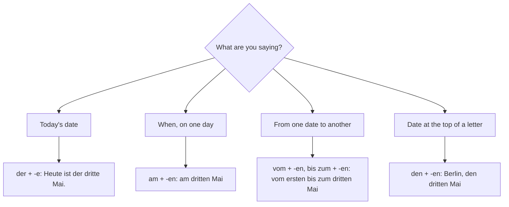

## What this lesson is for

Lesson 16 taught you months, seasons, ordinal numbers (*der dritte Oktober, am dritten
Oktober*) and how to answer an invitation. This honors lesson takes you through the German
year: which days are public holidays, what people do on the big days from New Year's Eve to
Christmas, and how birthdays are celebrated. You also learn to read and say date ranges (*vom
24. bis zum 26. Dezember*) and the date at the top of a letter (*Berlin, den 3. Oktober*),
which means learning one small grammar idea: ordinal numbers take endings just like
adjectives.

## Public holidays: who decides?

A public holiday is *ein Feiertag* (from *feiern*, to celebrate, and *der Tag*). On a public
holiday most people don't work, schools are closed and shops are shut, just as on a Sunday.

In Germany, most holidays are set by the 16 states, not by the national government. Nine of
them are holidays in every state:

| Date | Holiday | English |
|---|---|---|
| 1 January | *Neujahr* | New Year's Day |
| moves (March or April) | *Karfreitag* | Good Friday |
| moves (March or April) | *Ostermontag* | Easter Monday |
| 1 May | *Tag der Arbeit* | Labour Day (May Day) |
| moves (Thursday, May or June) | *Christi Himmelfahrt* | Ascension Day |
| moves (May or June) | *Pfingstmontag* | Whit Monday |
| 3 October | *Tag der Deutschen Einheit* | Day of German Unity |
| 25 December | *1. Weihnachtsfeiertag* | Christmas Day |
| 26 December | *2. Weihnachtsfeiertag* | Boxing Day, St Stephen's Day |

The Day of German Unity remembers the reunification of East and West Germany on 3 October 1990.
It is the only public holiday fixed by national law (the Unification Treaty of 1990). Other
holidays exist only in some states, for example 6 January (Epiphany) in Bavaria,
Baden-Württemberg and Saxony-Anhalt, or 31 October (Reformation Day) in several northern and
eastern states. Bavaria has the most: 12 to 14, depending on the town. Austria's national day
is 26 October and Switzerland's is 1 August.

Easter moves every year. It falls on a Sunday between 22 March and 25 April, and several
holidays are counted from it: Good Friday is two days before, Ascension Day is always a
Thursday, 39 days after Easter Sunday, and Whit Monday is 50 days after it. In 2027, Easter
Sunday is on 28 March.

Some of the best-known days are not public holidays at all: *Heiligabend* (Christmas Eve,
24 December), *Silvester* (New Year's Eve, 31 December), *Rosenmontag* (the Monday of carnival),
*Sankt Martin* (11 November) and the *Nikolaustag* (6 December). On 24 and 31 December, shops
usually close in the early afternoon.

## Customs through the year

Here is the German year in short A1 sentences. Read the German first, then check the English.

- **Silvester and Neujahr.** *Am 31. Dezember feiert man mit Freunden. Um Mitternacht gibt es
  Feuerwerk. Man sagt: „Frohes neues Jahr!"* — On 31 December people celebrate with friends.
  At midnight there are fireworks. People say "Happy New Year!" (Before midnight people wish
  each other *Guten Rutsch!*, "a good slide" into the new year.)
- **Karneval or Fasching.** *Im Februar tragen viele Leute Kostüme, vor allem im Rheinland
  (Köln, Düsseldorf, Mainz).* — In February many people wear costumes, especially in the
  Rhineland. The carnival season officially opens on 11 November at 11:11, and its high point
  is the week before Ash Wednesday, with big parades on *Rosenmontag*. *Karneval* is the usual
  word in the Rhineland; in the south and in Austria people say *Fasching*.
- **Ostern.** *Zu Ostern suchen Kinder Ostereier im Garten.* — At Easter children look for
  Easter eggs in the garden.
- **Sankt Martin.** *Am 11. November gehen Kinder mit Laternen durch die Straßen und singen.* —
  On 11 November children walk through the streets with lanterns and sing.
- **Advent.** *Im Dezember gibt es Weihnachtsmärkte. Auf dem Adventskranz brennen vier Kerzen:
  jeden Sonntag eine mehr.* — In December there are Christmas markets. On the Advent wreath four
  candles burn: one more every Sunday. Many families bake *Plätzchen* (Christmas biscuits).
- **Nikolaus.** *Am Abend vor dem 6. Dezember stellen Kinder Schuhe vor die Tür. Am Morgen sind
  Süßigkeiten drin.* — On the evening before 6 December children put their shoes outside the
  door. In the morning there are sweets in them.
- **Weihnachten.** *Am 24. Dezember, am Abend, gibt es die Geschenke.* — On 24 December, in the
  evening, there are the presents. In Germany most families open their presents on Christmas
  Eve (this is called *die Bescherung*), not on the morning of the 25th.

New in passing: *die Leute* (people), *tragen* (to wear; er trägt), *vor allem* (above all),
*brennen* (to burn), *stellen* (to put, stand something up), *Süßigkeiten* (sweets), *drin*
(inside it). Christmas greetings: *Frohe Weihnachten!* or *Fröhliche Weihnachten!*; at Easter,
*Frohe Ostern!*

## Birthdays

Birthdays are important in German-speaking countries, and a few customs differ from the
English-speaking world:

- Say *Alles Gute zum Geburtstag!* (all the best for your birthday) or *Herzlichen Glückwunsch
  zum Geburtstag!* (lesson 16).
- Many people think it brings bad luck to congratulate someone before the birthday. This is a
  superstition, and not everyone follows it, but to be safe, wait for the day itself. (Tom in
  lesson 16 congratulates Paula early; many Germans would wait.)
- At work or in a course, the person who has a birthday often brings a cake for everyone, and
  may invite friends to a party themselves.
- Big birthdays such as 30, 40 or 50 (*runde Geburtstage*, "round" birthdays) are often
  celebrated with a large party.

## Ordinal numbers take adjective endings

In lesson 16 you learned two patterns: *der erste Mai* and *am ersten Mai*. The reason the
ending changes is that an ordinal number behaves like an adjective. An **adjective ending** is
the short ending (*-e, -en, …*) that an adjective takes in front of a noun; it depends on the
word before it and the case. You will learn the whole system at A2. For dates you need only
two endings:

| Word before the ordinal | Ending | Example | Read as |
|---|---|---|---|
| *der* | -e | *Heute ist der 3. Oktober.* | *der dritte Oktober* |
| *am* (= an dem) | -en | *am 3. Oktober* | *am dritten Oktober* |
| *vom* (= von dem) | -en | *vom 24. Dezember* | *vom vierundzwanzigsten Dezember* |
| *zum* (= zu dem) | -en | *bis zum 26. Dezember* | *bis zum sechsundzwanzigsten Dezember* |
| *den* | -en | *Berlin, den 3. Oktober* | *den dritten Oktober* |

The rule of thumb: only *der* gives -e; every other word in the table gives -en. *Am, vom* and
*zum* are short forms of a preposition plus *dem*; you learn them properly in lesson 18 (the
dative), so for now treat them as chunks.

### Date ranges

To say "from … to …" with dates, use *vom … bis zum …*:

- *Der Weihnachtsmarkt ist vom 27. November bis zum 23. Dezember geöffnet.* — The Christmas
  market is open from 27 November to 23 December.
- *Die Ferien dauern vom 1. bis zum 14. August.* — The holidays last from 1 to 14 August.
  (*dauern* = to last, take time)

In writing you will often see the shorter *vom 1. bis 14. August* or *1.–14.8.*; read them
aloud with *vom … bis zum …*. With days of the week there are no articles: *von Montag bis
Freitag* (lesson 11).

### The date in a letter

At the top of a letter or card, the place comes first, then *den* and the date: *Hamburg, den
6. Dezember 2026* (read *den sechsten Dezember zweitausendsechsundzwanzig*). The *den* is
accusative, which is why the ordinal ends in -en. The same pattern appears after a weekday:
*Freitag, den 6. November*. Many modern letters leave out *den* and write just *Hamburg,
6. Dezember 2026* or *Hamburg, 06.12.2026*; both styles are correct.

This chart helps you choose the pattern:

### Example 1: Reading a notice aloud

A sign says: *Weihnachtsmarkt: 27.11. bis 23.12., täglich 11–21 Uhr.* (*täglich* = daily.)
Read it as a full sentence.

1. Turn the numbers into months: 27.11. is the 27th of the 11th month, November; 23.12. is the
   23rd of December. Remember: day first, then month.
2. A range needs *vom … bis zum …*, and both words want -en.
3. 27th: 27 is above 19, so add -ste: *siebenundzwanzigste*, with -n: *siebenundzwanzigsten*.
   23rd: *dreiundzwanzigste*, so *dreiundzwanzigsten*.
4. Times: *von elf bis einundzwanzig Uhr* (official clock, lesson 11).
5. Result: *Der Weihnachtsmarkt ist vom siebenundzwanzigsten November bis zum
   dreiundzwanzigsten Dezember geöffnet, jeden Tag von elf bis einundzwanzig Uhr.*

### Example 2: Working out Easter Monday

*Ostern 2027 ist am 28. März. Wann ist Ostermontag? Und wann ist Karfreitag?*

1. Easter Monday is the day after Easter Sunday: 28 + 1 = 29, so the 29th of March.
2. Ordinal: 29 is above 19, so *neunundzwanzigste*; after *am* add -n: *am neunundzwanzigsten
   März*.
3. Good Friday is two days before Easter Sunday: 28 − 2 = 26, *am sechsundzwanzigsten März*.
4. Answer: *Ostermontag ist am neunundzwanzigsten März, und Karfreitag ist am
   sechsundzwanzigsten März.*

### Example 3: Writing a greeting card

You want to write to your German friend Lukas on 20 December 2026: you wish him a merry
Christmas and a happy new year, and you'll visit from the 2nd to the 5th of January.

1. Place and date at the top: *Toronto, den 20. Dezember 2026* (read *den zwanzigsten*).
2. Greeting: *Lieber Lukas,* (lesson 23: *lieber* for a man, *liebe* for a woman).
3. Wishes: *Frohe Weihnachten und einen guten Rutsch!* It's before New Year, so *Guten Rutsch*
   fits, not *Frohes neues Jahr*. *Einen* is accusative because the phrase is short for "I wish
   you a good slide".
4. The visit: *Ich komme vom 2. bis zum 5. Januar.* (read *vom zweiten bis zum fünften*).
5. Closing: *Viele Grüße* and your name.

## Text: A card from Oma

> Kassel, den 18. Dezember 2026
>
> Liebe Emma, lieber Paul,
>
> bald ist Weihnachten! Kommt ihr vom 22. bis zum 27. Dezember zu uns? Am 24. Dezember gibt es
> am Abend die Bescherung, und am 25. Dezember essen wir zusammen. Der Weihnachtsmarkt in Kassel
> ist toll: Wir können am 23. noch hingehen, er ist bis zum 23. geöffnet. Opa backt schon
> Plätzchen!
>
> Frohe Weihnachten und bis bald!
>
> Eure Oma

Translation:

> Kassel, 18 December 2026. Dear Emma, dear Paul, it will soon be Christmas! Are you coming to
> stay with us from 22 to 27 December? On 24 December, in the evening, we'll open the presents,
> and on 25 December we'll eat together. The Christmas market in Kassel is great: we can still go
> on the 23rd, it's open until the 23rd. Grandpa is already baking Christmas biscuits! Merry
> Christmas and see you soon! Love, Grandma

New in passing: *bald* (soon), *zu uns* (to our place), *hingehen* (to go there), *backen* (to
bake), *eure* (your, plural: a possessive from lesson 6). Notice *am 23.* and *bis zum 23.*:
the ordinal is read *am dreiundzwanzigsten* and *bis zum dreiundzwanzigsten*.

## Pronunciation

- *Weihnachten*: ei as in "eye", ch as in Scottish "loch": "VYE-nakh-ten".
- *Silvester*: here the v sounds like English v and the s like z: "zil-VES-ter".
- *Feiertag*: "FYE-er-tahk"; the final g sounds like k.
- *vierundzwanzigsten*: stress the first number: VIER-und-zwan-zig-sten; the g before s is a
  soft "ch" in standard pronunciation (as in *ich*), though many speakers say k.
- *Fasching*: "FAH-shing"; *Karneval*: "KAR-ne-val", with a v sound.

## Common mistakes

- Forgetting the -en after *vom* and *bis zum*: "vom vierundzwanzigste". Correct: *vom
  vierundzwanzigsten bis zum sechsundzwanzigsten*.
- Using *der* in the letter date: "Berlin, der 3. Oktober". The traditional form is *den*: *Berlin,
  den 3. Oktober* (or no article at all).
- Thinking Christmas Eve or New Year's Eve are public holidays. They aren't, but shops close
  early.
- Expecting presents on the morning of 25 December. In Germany they usually come on the evening
  of the 24th.
- Saying *Frohes neues Jahr* on 30 December. Before New Year, say *Guten Rutsch!*
- Wishing someone happy birthday the day before. Many Germans consider it bad luck; wait for the
  day.

## Key points

- Nine public holidays apply in all of Germany; the states set the rest. 3 October is the
  only one fixed by national law.
- Heiligabend, Silvester, Rosenmontag, Sankt Martin and Nikolaus are not public holidays.
- Presents come on the evening of 24 December (*die Bescherung*).
- Ordinals take adjective endings: *der* + -e; *am, vom, zum, den* + -en.
- Date ranges: *vom 1. bis zum 14. August* = *vom ersten bis zum vierzehnten August*.
- Letter date: *Hamburg, den 6. Dezember 2026*.
- *Frohe Weihnachten! Guten Rutsch! Frohes neues Jahr! Frohe Ostern! Alles Gute zum
  Geburtstag!*

The words from this lesson are listed below; they join your vocabulary reviews when you
complete the lesson.
