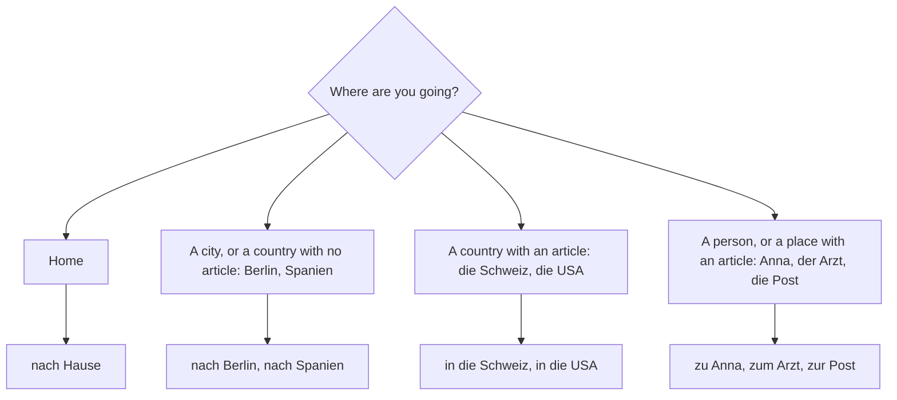

## What this lesson is for

In lesson 17 you asked *Wie komme ich zum Museum?* and heard *an der Ampel* and *bis zur Ecke*, and
you were told to treat them as chunks. This lesson explains them. They use the **dative**, the
third German case after the nominative (the subject) and the accusative (the direct object, lesson
9). At A1 you meet the dative mostly after certain prepositions, and those prepositions are exactly
the ones you need for travelling: *mit dem Zug* (by train), *zum Bahnhof* (to the station), *nach
Wien* (to Vienna), *seit einem Jahr* (for a year).

Along the way you learn the words for trains, buses, planes, tickets and timetables.

## Getting around

| German | English | German | English |
|---|---|---|---|
| *der Bahnhof* | station | *die Fahrkarte* | ticket (bus, train) |
| *der Zug* | train | *das Ticket* | ticket (also plane, concert) |
| *der Bus* | bus | *der Fahrplan* | timetable |
| *die U-Bahn* | underground, subway | *das Gleis* | platform, track |
| *die S-Bahn* | suburban train | *die Abfahrt* | departure |
| *die Straßenbahn* | tram, streetcar | *die Ankunft* | arrival |
| *das Auto* | car | *die Verspätung* | delay |
| *das Taxi* | taxi | *die Reise* | trip, journey |
| *das Flugzeug* | plane | *der Urlaub* | holiday, vacation |
| *der Flughafen* | airport | *der Koffer* | suitcase |

The picture puts eight of these words in one scene (blue labels for *der*, pink for *die*, green for
*das*):

Five useful verbs. All except *fliegen* are separable:

- *abfahren* — to leave, to depart: *Der Zug fährt um 8 Uhr ab.* — The train leaves at 8.
  (Stem change like *fahren*: *du fährst ab, er fährt ab*.)
- *einsteigen* — to get on, to get in: *Bitte schnell einsteigen!* — Please get on quickly!
- *aussteigen* — to get off, to get out: *Wir steigen hier aus.* — We're getting off here.
- *umsteigen* — to change (trains, buses): *Sie müssen in Köln umsteigen.* — You have to change in
  Cologne.
- *fliegen* — to fly: *Ich fliege nach Rom.* — I'm flying to Rome.

## The dative articles

After a dative preposition, the article changes. Compare the nominative (lesson 5) and the dative:

| | masculine | feminine | neuter | plural |
|---|---|---|---|---|
| nominative | *der / ein* | *die / eine* | *das / ein* | *die / –* |
| dative | *dem / einem* | *der / einer* | *dem / einem* | *den / –* (+ *n*) |

The same endings appear on *kein* and on the possessives (lesson 6): *keinem, keiner, keinen*;
*meinem Bruder*, *meiner Schwester*, *meinem Kind*, *meinen Eltern*.

Three memory hooks:

1. Masculine and neuter are the same in the dative: both end in *-m*: *dem, einem, meinem*.
   Think "m for masculine and the middle gender".
2. Feminine dative ends in *-r*: *der, einer, meiner*. Yes, *der* is also the masculine nominative;
   the preposition in front tells you which one you have.
3. Plural is *den*, and the noun itself takes an extra *-n* if it doesn't already end in *-n* or *-s*:
   *mit den Kindern*, *seit zwei Jahren*, *zu meinen Freunden*; but *mit den Eltern* (already *-n*)
   and *mit den Autos* (plural in *-s*).

## Prepositions that always take the dative

Seven common prepositions always take the dative, whatever the verb. Learn them as a chant:
*aus, bei, mit, nach, seit, von, zu*. (*Gegenüber* from lesson 17 is one too.)

| Preposition | Meaning | Example |
|---|---|---|
| *aus* | out of, from (origin) | *Er kommt aus dem Bahnhof.* — He's coming out of the station. |
| *bei* | at (someone's place), at (a company), near | *Ich wohne bei meinen Eltern.* — I live with my parents. |
| *mit* | with, by (transport) | *Ich fahre mit dem Bus.* — I go by bus. |
| *nach* | to (cities, countries); after | *Wir fliegen nach Spanien.* — We're flying to Spain. |
| *seit* | since, for (time up to now) | *Ich lerne seit einem Monat Deutsch.* — I've been learning German for a month. |
| *von* | from, of | *Ich komme von der Arbeit.* — I'm coming from work. |
| *zu* | to (people, buildings, places) | *Ich gehe zu meiner Freundin.* — I'm going to my girlfriend's. |

You already know *aus* (*Ich komme aus Kanada*) and *von … bis* (lesson 11), and *nach* meaning
"after" (*nach dem Frühstück* — after breakfast). Same word, same dative.

### Contractions: zum, zur, vom, beim

Some preposition + article pairs are almost always fused into one word, a **contraction**:

| Long form | Contraction | Example |
|---|---|---|
| *zu dem* | *zum* | *zum Bahnhof, zum Flughafen, zum Hotel* |
| *zu der* | *zur* | *zur Haltestelle, zur Post, zur Arbeit* |
| *von dem* | *vom* | *vom Bahnhof, vom Hotel* |
| *bei dem* | *beim* | *beim Arzt, beim Frühstück* (at breakfast) |

So *Wie komme ich zum Museum?* is really *zu dem Museum*, and *zur Post* is *zu der Post*. Use the
contraction in normal speech; the long form only stresses "that particular one". There is no
contraction for *mit dem* or *aus dem*.

### mit for transport

*Mit* + dative is how you say how you travel:

- *mit dem Zug / Bus / Auto / Taxi / Fahrrad* — by train / bus / car / taxi / bike
- *mit der U-Bahn / S-Bahn / Straßenbahn* — by underground / suburban train / tram
- *mit dem Flugzeug* — by plane (but usually just *fliegen*)

On foot is different: *zu Fuß* (no article). *Ich gehe zu Fuß.* — I'm walking.

### nach, zu or in?

English uses "to" for everything; German chooses:

- *nach* + towns, cities and countries without an article: *nach Berlin*, *nach Österreich*, *nach
  Italien*. And the set phrase *nach Hause* — (to) home: *Ich gehe jetzt nach Hause.*
- *zu* + people and places with an article: *zu Anna*, *zum Arzt*, *zur Bank*, *zum Bahnhof*.
- Countries that have an article (*die Schweiz*, *die Türkei*, *die USA*) take *in* + accusative:
  *in die Schweiz*, *in die USA*. Learn these as chunks for now.

When you're not sure which "to" you need, ask yourself where you're going:

This table shows "where to", "where" and "where from" side by side. *Wohin?* means "where to?":

| *Wohin?* (where to) | *Wo?* (where) | *Woher?* (where from) |
|---|---|---|
| *zum Arzt* | *beim Arzt* | *vom Arzt* |
| *zu Anna* | *bei Anna* | *von Anna* |
| *nach Berlin* | *in Berlin* | *aus Berlin* |
| *nach Hause* | *zu Hause* | *von zu Hause* |

*Aus* is for coming out of somewhere or for where you are from; *von* is for the place or person
you've just left: *Ich komme aus Berlin* (I'm from Berlin) but *Ich komme vom Bahnhof* (I've just
come from the station).

### seit with the present tense

*Seit* describes something that started in the past and is still going on. German uses the present
tense here, where English uses "have been":

- *Ich wohne seit zwei Jahren in Köln.* — I've been living in Cologne for two years.
- *Wir warten seit zehn Minuten.* — We've been waiting for ten minutes.
- *Er ist seit Montag im Urlaub.* — He's been on holiday since Monday.

## A text: Marks Weg zur Arbeit

> Ich heiße Mark und wohne seit drei Jahren in Köln. Ich arbeite bei einer Firma im Zentrum. Jeden
> Morgen fahre ich mit dem Fahrrad zum Bahnhof. Dort nehme ich die S-Bahn. Ich steige am Neumarkt aus
> und gehe zu Fuß zum Büro. Nach der Arbeit gehe ich oft zu meinen Freunden. Am Wochenende fahre ich
> mit dem Zug nach Bonn, zu meinen Eltern.

*My name is Mark and I've been living in Cologne for three years. I work for a company in the town
centre. Every morning I cycle to the station. There I take the S-Bahn. I get off at Neumarkt and walk
to the office. After work I often go to my friends' place. At the weekend I take the train to Bonn,
to my parents'.* (*jeden Morgen* — every morning.)

## Dialogue: Am Bahnhof

Anna is at the ticket counter in Stuttgart.

> Anna: Guten Tag. Eine Fahrkarte nach Salzburg, bitte.
>
> Mitarbeiter: Einfach oder hin und zurück?
>
> Anna: Hin und zurück, bitte. Für heute.
>
> Mitarbeiter: Der nächste Zug fährt um 10:15 Uhr ab, von Gleis 7.
>
> Anna: Muss ich umsteigen?
>
> Mitarbeiter: Ja, Sie steigen in München um. Die Ankunft in Salzburg ist um 13:40 Uhr.
>
> Anna: Hat der Zug heute Verspätung?
>
> Mitarbeiter: Nein, im Moment nicht. Das macht 96 Euro, bitte.
>
> Anna: Kann ich mit Karte bezahlen?
>
> Mitarbeiter: Natürlich. Hier ist Ihre Fahrkarte. Gute Reise!

*Anna: Hello. A ticket to Salzburg, please. — Clerk: Single or return? — Anna: Return, please. For
today. — Clerk: The next train leaves at 10:15, from platform 7. — Anna: Do I have to change? —
Clerk: Yes, you change in Munich. Arrival in Salzburg is at 13:40. — Anna: Is the train delayed
today? — Clerk: No, not at the moment. That's 96 euros, please. — Anna: Can I pay by card? — Clerk:
Of course. Here's your ticket. Have a good trip!*

*Hin und zurück* means "there and back" (a return ticket); *einfach* here means "one way";
*nächste* means "next". *Gute Reise!* is what you wish anyone who is setting off.

## Pronunciation

- *Zug*: the *z* is always *ts*, and the final *g* sounds like *k*: [tsuːk].
- *Bahnhof*: the *h* after *a* is silent and only makes the vowel long; the stress is on BAHN.
- *Flughafen*: *Flug* ends in a *k* sound; stress on *Flug*.
- *U-Bahn* and *S-Bahn*: say the letters the German way: "oo-bahn", "ess-bahn".
- *Gleis*: *ei* rhymes with English "rice": [glaɪs].
- Separable verbs are stressed on the prefix: UM-steigen, AUS-steigen, AB-fahren.

## Common mistakes

- Using the nominative after a dative preposition: *mit der Bus* is wrong; *Bus* is masculine, so
  it's *mit dem Bus*.
- Using the accusative because English has no case: *mit den Zug* is wrong; it's *mit dem Zug*.
- Forgetting the plural *-n*: *mit den Freunde* should be *mit den Freunden*.
- Saying *zu Berlin* or *nach dem Arzt*. Cities and countries take *nach*; people and places with an
  article take *zu*: *nach Berlin*, *zum Arzt*.
- Saying *Ich gehe zu Hause*. Going home is *nach Hause*; being at home is *zu Hause*.
- Translating "for" with *für* for time up to now: *Ich wohne hier für zwei Jahre* is English word
  for word. Say *Ich wohne seit zwei Jahren hier.*
- Writing *zu dem* and *bei dem* in ordinary sentences. Use *zum* and *beim*.

## Key points

- The dative articles: *dem/einem* (masculine and neuter), *der/einer* (feminine), *den* + *-n*
  (plural). *Kein* and possessives follow the same pattern.
- Always dative: *aus, bei, mit, nach, seit, von, zu* (and *gegenüber*).
- Contractions: *zum* (*zu dem*), *zur* (*zu der*), *vom* (*von dem*), *beim* (*bei dem*).
- Travel: *mit dem Zug*, *mit der U-Bahn*, but *zu Fuß*.
- To: *nach* + cities and countries, *zu* + people and places, *nach Hause*. At home: *zu Hause*.
- *Seit* + present tense: *Ich wohne seit einem Jahr hier.*

The words from this lesson are listed below; they join your vocabulary reviews when you complete
the lesson.
