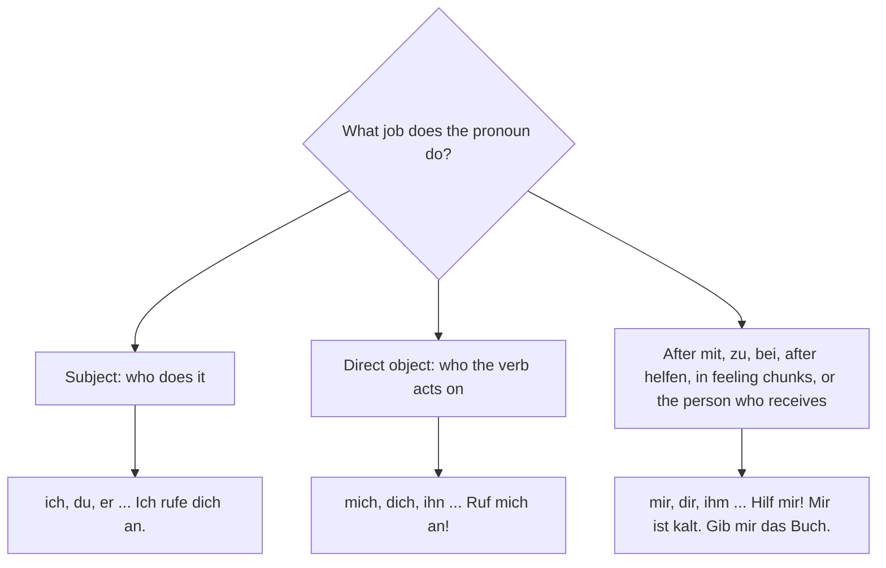

## What this lesson is for

Sooner or later every traveller needs a pharmacy or a doctor. This last lesson of module 5 gives
you the parts of the body, ways to say what hurts (*Ich habe Kopfschmerzen. Mein Rücken tut weh.*),
and the phone call for a doctor's appointment.

It also completes the personal pronouns. You know the subject pronouns (*ich, du, er …*) from
lesson 4 and met *ihn* for things in lesson 19. Here you get the full set of object pronouns: *mich,
dich, ihn …* in the accusative and *mir, dir, ihm …* in the dative, the dative ones mostly as
ready-made chunks like *Wie geht es dir?* and *Kannst du mir helfen?*

## The body

| German | English | Plural |
|---|---|---|
| *der Körper* | body | *die Körper* |
| *der Kopf* | head | *die Köpfe* |
| *das Auge* | eye | *die Augen* |
| *das Ohr* | ear | *die Ohren* |
| *die Nase* | nose | *die Nasen* |
| *der Mund* | mouth | *die Münder* |
| *der Zahn* | tooth | *die Zähne* |
| *der Hals* | neck, throat | *die Hälse* |
| *der Arm* | arm | *die Arme* |
| *die Hand* | hand | *die Hände* |
| *der Bauch* | stomach, belly | *die Bäuche* |
| *der Rücken* | back | *die Rücken* |
| *das Bein* | leg | *die Beine* |
| *der Fuß* | foot | *die Füße* |

Many body parts come in pairs, so learn the plurals too: *zwei Augen, zwei Ohren, zwei Hände, zwei
Füße*. Note *der Hals*: it is both the outside (neck) and the inside (throat).

## Saying what's wrong

There are three common patterns. Learn them as chunks.

### 1. Ich habe … Schmerzen / Fieber

*Die Schmerzen* means pain or pains. Put a body part in front and you get a compound noun, which is
almost always plural:

- *Ich habe Kopfschmerzen.* — I have a headache.
- *Ich habe Bauchschmerzen.* — I have a stomach ache.
- *Er hat Rückenschmerzen.* — He has back pain.
- *Sie hat Halsschmerzen.* — She has a sore throat.
- *Ich habe Zahnschmerzen.* — I have toothache.
- *Das Kind hat Fieber.* — The child has a temperature.

### 2. … tut weh / … tun weh

*Wehtun* (to hurt) is a separable verb: *weh* goes to the end. Use *tut* for one body part and
*tun* for several:

- *Mein Kopf tut weh.* — My head hurts.
- *Meine Füße tun weh.* — My feet hurt.
- *Tut dein Arm noch weh?* — Does your arm still hurt?

You'll often hear the same idea with a dative pronoun: *Mir tut der Rücken weh.* — My back hurts
(literally "To me the back hurts").

### 3. Mir geht es … / Mir ist …

How you feel uses the dative *mir* (to me), not *ich*:

- *Mir geht es nicht gut.* — I'm not well.
- *Mir ist kalt.* — I'm cold. (*Ich bin kalt* would describe your character.)
- *Mir ist schlecht.* — I feel sick.

And the simple adjectives: *Ich bin krank.* — I'm ill. *Ich bin wieder gesund.* — I'm healthy
again. When someone is ill, say *Gute Besserung!* — Get well soon!

## Personal pronouns in the accusative

When a person is the direct object, use an **accusative pronoun**:

| Nominative | Accusative | Example |
|---|---|---|
| *ich* | *mich* | *Verstehen Sie mich?* — Do you understand me? |
| *du* | *dich* | *Ich rufe dich morgen an.* — I'll call you tomorrow. |
| *er* | *ihn* | *Kennst du ihn?* — Do you know him? |
| *sie* | *sie* | *Ich sehe sie jeden Tag.* — I see her every day. |
| *es* | *es* | *Das Radio ist laut. Hörst du es?* — The radio is loud. Can you hear it? |
| *wir* | *uns* | *Holst du uns ab?* — Will you pick us up? |
| *ihr* | *euch* | *Ich lade euch ein.* — I'm inviting you. |
| *sie* | *sie* | *Die Kinder sind krank. Ich bringe sie zum Arzt.* — The children are ill. I'm taking them to the doctor. |
| *Sie* | *Sie* | *Ich verstehe Sie nicht.* — I don't understand you. |

Only four are new words: *mich, dich, uns, euch*, plus *ihn*, which you know. The others look the same
as the nominative.

## Personal pronouns in the dative

A **dative pronoun** is used after dative prepositions (*mit mir*, *zu dir*, *bei uns*), with some
verbs, and for the person who receives something:

| Nominative | Dative | Example |
|---|---|---|
| *ich* | *mir* | *Kannst du mir helfen?* — Can you help me? |
| *du* | *dir* | *Wie geht es dir?* — How are you? |
| *er* | *ihm* | *Wie geht es ihm?* — How is he? |
| *sie* | *ihr* | *Ich fahre mit ihr.* — I'm going with her. |
| *es* | *ihm* | *Das Baby hat Fieber. Wie geht es ihm?* — The baby has a temperature. How is it? |
| *wir* | *uns* | *Kommst du zu uns?* — Are you coming to our place? |
| *ihr* | *euch* | *Ich fahre mit euch.* — I'm going with you. |
| *sie* | *ihnen* | *Wir wohnen bei ihnen.* — We live with them. |
| *Sie* | *Ihnen* | *Wie geht es Ihnen?* — How are you? (formal) |

*Uns* and *euch* are the same in both cases. *Helfen* always takes the dative: *Hilf mir!* — Help
me!

The person who receives something is the **indirect object**, and it is in the dative. The thing
given is the direct object, in the accusative:

- *Gib mir bitte das Medikament.* — Please give me the medicine.
- *Zeig mir deine Hand.* — Show me your hand.
- *Ich gebe dir eine Tablette.* — I'll give you a tablet.

At A1 you don't need to master the dative. Learn these chunks well: *Wie geht es dir/Ihnen?*, *Mir
geht es gut*, *Kannst du mir helfen?*, *Mir ist kalt*, *Mir tut … weh*, *Gib mir …*, *mit mir*.

To choose between *ich*, *mich* and *mir* (or *du*, *dich*, *dir*), ask what job the pronoun does in
the sentence:

## Dialogue: Einen Termin machen

Leon calls a doctor's practice (*die Praxis*).

> Praxis: Praxis Dr. Weber, guten Morgen.
>
> Leon: Guten Morgen, mein Name ist Leon Brandt. Mir geht es nicht gut. Kann ich heute kommen?
>
> Praxis: Was fehlt Ihnen denn?
>
> Leon: Ich habe seit gestern Fieber, und mein Hals tut sehr weh.
>
> Praxis: Haben Sie auch Kopfschmerzen?
>
> Leon: Ja, ein bisschen.
>
> Praxis: Können Sie um 11:30 Uhr kommen?
>
> Leon: Ja, das geht. Vielen Dank.
>
> Praxis: Bringen Sie bitte Ihre Versichertenkarte mit. Bis später, Herr Brandt.
>
> Leon: Bis später. Auf Wiederhören!

*Practice: Dr Weber's practice, good morning. — Leon: Good morning, my name is Leon Brandt. I'm not
well. Can I come today? — Practice: What's the matter? — Leon: I've had a temperature since
yesterday, and my throat really hurts. — Practice: Do you have a headache too? — Leon: Yes, a bit. —
Practice: Can you come at 11:30? — Leon: Yes, that works. Thanks a lot. — Practice: Please bring your
health insurance card. See you later, Mr Brandt. — Leon: See you later. Goodbye!*

*Was fehlt Ihnen?* (What's the matter with you?) is a fixed question from doctors; *die
Versichertenkarte* is your health insurance card; *mitbringen* means to bring along; *Auf
Wiederhören!* is goodbye on the phone.

## At the doctor's

> Der Arzt untersucht Leon und sagt: „Sie haben eine Erkältung. Nehmen Sie dreimal am Tag eine
> Tablette und trinken Sie viel Tee. Bleiben Sie zwei Tage zu Hause und rufen Sie mich am Freitag an.
> Gute Besserung!"

*The doctor examines Leon and says: "You have a cold. Take a tablet three times a day and
drink lots of tea. Stay at home for two days and call me on Friday. Get well soon!"* (*untersuchen* — to
examine; *die Erkältung* — a cold; *dreimal* — three times.)

Notice the *Sie* imperatives from lesson 17: the doctor's instructions are all verb-first.

## Pronunciation

- *Bauch*: *au* as in "how", then the throaty *ach* sound. *Kopf*: say both *p* and *f*.
- *Auge*: OW-geh. *Ohr*: one long *o*. *Zahn*: *ts* + long *a*.
- *Rücken*: short *ü*; *Fieber*: long *ie*, like "fever" with an *ee*.
- *Medikament* is stressed on the last syllable, me-di-ka-MENT; *Tablette* on the middle, ta-BLET-te.
- *mich*, *dich*: soft *ich* sound; *mir*, *dir*: long *i*, the *r* almost a vowel, "meer", "deer".

## Common mistakes

- *Ich habe einen Kopfschmerz* sounds odd. Say *Ich habe Kopfschmerzen* (plural).
- *Ich bin kalt* means you are a cold person. Say *Mir ist kalt.*
- *Mich geht es gut* is wrong; it's *Mir geht es gut* (dative).
- *Kannst du mich helfen?* is wrong; *helfen* takes the dative: *Kannst du mir helfen?*
- *Mein Kopf wehtut* or *Meine Füße tut weh*: *tun* is the verb, so it's in position 2 and agrees
  with the subject: *Mein Kopf tut weh. Meine Füße tun weh.*
- Mixing up *mich* (accusative) and *mir* (dative): *Ruf mich an* (accusative) but *Gib mir das
  Buch* (dative).

## Key points

- Body parts with articles and plurals: *der Kopf, das Auge (die Augen), der Fuß (die Füße)* …
- *Ich habe Kopfschmerzen / Fieber.* — *Mein Bauch tut weh. Meine Füße tun weh.*
- *Mir geht es nicht gut. Mir ist kalt. Mir ist schlecht.* — *Gute Besserung!*
- Accusative: *mich, dich, ihn, sie, es, uns, euch, sie, Sie*.
- Dative: *mir, dir, ihm, ihr, ihm, uns, euch, ihnen, Ihnen*; *helfen* and dative prepositions
  take the dative.
- The person who receives is the indirect object, in the dative: *Gib mir das Buch.*

The words from this lesson are listed below; they join your vocabulary reviews when you complete
the lesson.
