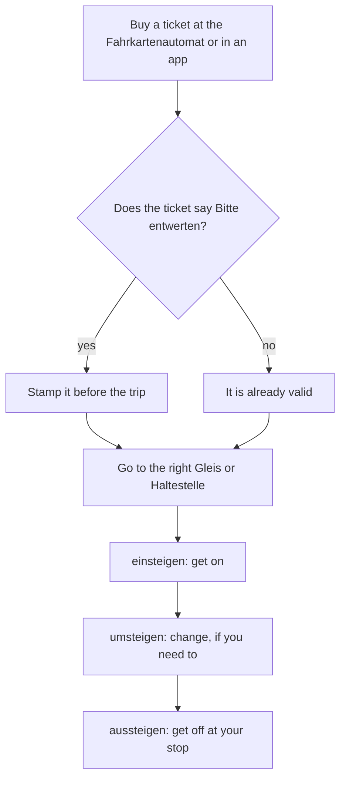

## What this lesson is for

In lesson 18 you bought a ticket at a counter (*Eine Fahrkarte nach Salzburg, bitte*), heard that
you change trains in Munich, and learned to say *mit dem Zug* and *zum Bahnhof*. Real travel in a
German-speaking country also means reading: a departure board that changes every minute, a ticket
machine with a dozen buttons, a sign on a door, and a voice from a loudspeaker that speaks fast.

This honors lesson gives you the tools for that. You'll learn to read a departure board, to buy and
use a local ticket, and to understand short announcements. On the way you meet a new grammar idea,
the **nominal style**: German signs and announcements like nouns made from verbs (*die Abfahrt* from
*abfahren*, *der Ausstieg* from *aussteigen*), and once you see the pattern, many new words explain
themselves.

## Trains and the departure board

German railways use letters for the kind of train. You'll see them on every board and ticket:

| Letters | Name | What it is |
|---|---|---|
| *ICE* | Intercity-Express | fast long-distance train |
| *IC*, *EC* | Intercity, Eurocity | long-distance train (EC: to other countries) |
| *RE* | Regional-Express | regional train with few stops |
| *RB* | Regionalbahn | regional train that stops almost everywhere |
| *S* | S-Bahn | suburban train in and around a city |
| *U* | U-Bahn | underground, subway |

In a station, the big board for trains leaving is headed *Abfahrt* (departures); the one for trains
coming in is *Ankunft* (arrivals). Here is an invented departure board at 8 o'clock in the morning:

The columns:

- *Zeit* — the time the train is planned to leave, always on the 24-hour clock (lesson 11).
- *Zug* — the kind of train and its number.
- *Richtung* — direction: the last stop. *Hbf* is short for *Hauptbahnhof*, main station.
- *Gleis* — the platform (lesson 18).
- *Hinweis* — note. This column is the one to watch.

The three notes you'll see most:

| Note | Meaning |
|---|---|
| *+10* | about 10 minutes late (*10 Minuten Verspätung*) |
| *heute Gleis 8* | today from platform 8 (a platform change) |
| *fällt aus* | is cancelled (*ausfallen* — to be cancelled) |

A train that is cancelled *fällt aus*; a train that is late *hat Verspätung*. Both are good news to
hear early.

### Example 1: Which platform?

You want to go to Munich. Which train do you take, and where?

1. Look in the *Richtung* column for München: *München Hbf*, 08:20.
2. Read the *Zug* column: *ICE 591*, a fast long-distance train.
3. The *Gleis* column says 7, but the *Hinweis* column says *heute Gleis 8*. The note wins.

So you take the ICE at 08:20 from platform 8. If you ask someone, the question is *Fährt der ICE nach
München heute von Gleis 8?* — *Ja, heute von Gleis 8.*

### Example 2: Late or gone?

You want to go to Bonn, and your friend wants to go to Cologne.

- Bonn: *RB 42*, 08:31, *fällt aus*. That train is cancelled, so you need another train (or the
  next RB). Ask at the information desk: *Der Zug nach Bonn fällt aus. Wann fährt der nächste?* (*der
  nächste* — the next one).
- Cologne: *RE 7*, 08:12, *+10*. It still runs, but about 10 minutes late, so it should leave at
  about 08:22. Your friend has time for a coffee.

## Tickets: the machine, the zone and the stamp

For buses, trams, the U-Bahn and the S-Bahn you usually buy a ticket from a machine, *der
Fahrkartenautomat* (at the stop, in the station or sometimes in the bus or tram), or in an app.
Cities and their surrounding areas form one transport network, and the price often depends on the
zone or the number of zones you travel through. The most common tickets:

- *die Einzelfahrkarte* (also *der Einzelfahrschein*) — single ticket, one trip in one direction;
  you may usually change lines (*die Linie* — line, route) on the way.
- *die Tageskarte* — day ticket.
- *das Deutschlandticket* — a monthly subscription ticket, introduced in 2023, for local and
  regional transport in all of Germany: buses, trams, U-Bahn, S-Bahn, RE and RB. It is not valid on
  ICE, IC or EC trains. (The price has gone up since 2023, so check the current one.)

Some paper tickets are not valid until you stamp them in a small machine, *der Entwerter*. The verb
is *entwerten* — to validate, to stamp. A ticket that says *Bitte entwerten* or *Fahrkarte vor
Fahrtantritt entwerten* (validate before starting the journey) has to be stamped before you get on,
or in some buses and trams just after. Tickets from an app, and many tickets printed by the machine,
are already valid. Read the ticket.

Ticket inspectors come round without warning (*die Fahrkartenkontrolle*, *Die Fahrkarten, bitte!*).
In German local transport there are usually no barriers, so you can get on without a ticket, but if
you're caught riding without a valid one (*schwarzfahren*, informal), you pay an extra fare,
usually 60 euros in Germany. An unstamped ticket counts as no ticket.

This chart shows a trip by local train from start to finish:

### Austria and Switzerland

Most of this vocabulary works everywhere, but you'll hear some regional words. In Switzerland a
ticket is often *das Billett*, a platform *der Perron*, and a tram *das Tram*. In
Vienna people call the tram *die Bim*, after the sound of its bell. Standard words like *die
Fahrkarte*, *der Bahnsteig* and *die Straßenbahn* are understood everywhere.

## Signs in the station

Station signs are short. Four you need on day one:

| Sign | Meaning |
|---|---|
| *Eingang* | entrance |
| *Ausgang* | exit, way out |
| *Notausgang* | emergency exit |
| *Vorsicht!* | Caution! Careful! |

*Eingang* and *Ausgang* come from *gehen*: *eingehen*, *ausgehen*, and the noun *der Gang* (a walk,
a passage). (Today the verbs mostly mean other things, for example *ausgehen* — to go out in the
evening, but the nouns keep the old sense: the way in, the way out.) In a big station, *Ausgang* is often followed by a street name or a direction: *Ausgang
Nord*, *Ausgang Hauptstraße*. That's another sign of the nominal style, which comes next.

## The nominal style: nouns made from verbs

Look at the words a station uses: *die Abfahrt*, *die Ankunft*, *der Ausstieg*, *der Eingang*. Each
one is a noun made from a verb you know. Signs, boards and announcements use these nouns instead of
full sentences, because a noun is short and needs no subject or verb ending. This way of writing is
the **nominal style** (*Nominalstil*). You don't need to build these nouns yourself at A1, but if you
know the pattern, you can read them:

| Verb | Noun | Meaning |
|---|---|---|
| *abfahren* | *die Abfahrt* | departure |
| *einfahren* (to pull in) | *die Einfahrt* | arrival of a train at the platform; also a driveway |
| *ankommen* | *die Ankunft* | arrival |
| *aussteigen* | *der Ausstieg* | getting off, the way off |
| *einsteigen* | *der Einstieg* | getting on, the way on |
| *umsteigen* | *der Umstieg* | change (of trains) |
| *ausgehen*, *eingehen* | *der Ausgang*, *der Eingang* | exit, entrance |
| *halten* (to stop) | *der Halt* | stop |

Three families with the same shape:

- *-fahren* → *-fahrt*, feminine: *die Abfahrt, die Einfahrt, die Rückfahrt* (the journey back).
- *-steigen* → *-stieg*, masculine: *der Einstieg, der Ausstieg, der Umstieg*.
- *-gehen* → *-gang*, masculine: *der Eingang, der Ausgang*.

*Ankunft* (from *ankommen*) is the odd one out; learn it as a word. The prefix keeps its meaning in
the noun: *ab* = away, *an* = arriving, *ein* = in, *aus* = out, *um* = changing.

### Example 3: An announcement, word by word

On a regional train you hear:

> Nächster Halt: Hauptbahnhof. Ausstieg in Fahrtrichtung links. Sie haben Anschluss an die S 1 in
> Richtung Flughafen.

Take it apart one piece at a time:

1. *Nächster Halt: Hauptbahnhof.* — Next stop: main station. *Halt* is the noun from *halten*.
2. *Ausstieg in Fahrtrichtung links.* — Get off on the left (in the direction of travel). *Ausstieg*
   is the noun from *aussteigen*, and *die Fahrtrichtung* is a compound: *die Fahrt* (journey) +
   *die Richtung* (direction).
3. *Sie haben Anschluss an die S 1 in Richtung Flughafen.* — You can connect to the S 1 towards the
   airport. *Der Anschluss* is a connection; *in Richtung* + place is how German says "towards".

Not one full sentence until the last line, and you still know exactly what to do: get ready, and get
off on the left.

## A text: Mein erster Tag in Hamburg

> Heute ist mein erster Tag in Hamburg. Am Hauptbahnhof ist es sehr voll. Ich suche den Ausgang,
> aber zuerst brauche ich eine Fahrkarte. Am Fahrkartenautomaten kaufe ich eine Tageskarte. Sie ist
> schon gültig, ich muss sie nicht entwerten. Dann gehe ich zur U-Bahn. Auf der Anzeige steht:
> „U-Bahn Richtung Innenstadt, 2 Minuten." Super! Ich steige ein. In der U-Bahn sagt eine Stimme:
> „Nächster Halt: Rathaus. Ausstieg links." Dort steige ich aus und gehe zu Fuß zum Hafen. Am Abend
> fahre ich mit dem Bus zurück zum Hotel. Der Bus hat zehn Minuten Verspätung, aber das ist kein
> Problem. Ich habe ja eine Tageskarte!

*Today is my first day in Hamburg. The main station is very crowded. I'm looking for the exit, but
first I need a ticket. At the ticket machine I buy a day ticket. It's already valid; I don't have to
stamp it. Then I go to the U-Bahn. The display says: "U-Bahn towards the city centre, 2 minutes."
Great! I get on. In the U-Bahn a voice says: "Next stop: Rathaus (town hall). Exit on the left." I
get off there and walk to the harbour. In the evening I take the bus back to the hotel. The bus is
ten minutes late, but that's no problem. After all, I have a day ticket!*

(*voll* — full, crowded; *gültig* — valid; *die Anzeige* — display; *die Innenstadt* — city centre;
*die Stimme* — voice; *das Rathaus* — town hall; *der Hafen* — harbour; *ja* here means "after all".)

## Pronunciation

- *Abfahrt*, *Ausstieg*, *Einstieg*: as with the verbs, the stress is on the prefix: AB-fahrt,
  AUS-stieg, EIN-stieg.
- *Ankunft*: AN-kunft, in two parts, *an* + *kunft*. In careful speech the first *n* stays a plain
  *n*; in fast speech it often slides towards the *ng* of "sink".
- *Gleis* and *Richtung*: [glaɪs], RICH-tung with the soft *ich* sound.
- *ICE* is read letter by letter the German way: "ee-tsay-ay". *Hbf* is always said in full:
  *Hauptbahnhof*.
- *Vorsicht*: FOR-zicht; *v* sounds like *f*.

## Common mistakes

- Trusting the *Gleis* column over the *Hinweis* column. *heute Gleis 8* beats the 7 printed
  next to it.
- Reading *fällt aus* as "leaves". It means the train is cancelled; *fährt ab* means it leaves.
- Mixing up *die Abfahrt* (departure) and *die Ankunft* (arrival). Think *ab* = away.
- Forgetting the gender of verb nouns: *-fahrt* nouns are feminine (*die Abfahrt*), *-stieg* and
  *-gang* nouns masculine (*der Ausstieg*, *der Ausgang*).
- Getting on with an unstamped ticket that says *Bitte entwerten*. To an inspector that's riding
  without a ticket.
- Saying *nach Richtung Flughafen*. "Towards" is *Richtung Flughafen* or *in Richtung Flughafen*.

## Key points

- Train letters: *ICE*, *IC/EC* (long distance), *RE*, *RB* (regional), *S* (S-Bahn), *U* (U-Bahn).
- Board columns: *Zeit*, *Zug*, *Richtung*, *Gleis*, *Hinweis*. Watch for *+10* (late), *heute
  Gleis 8* (platform change) and *fällt aus* (cancelled).
- Local tickets come from the *Fahrkartenautomat* or an app; some must be stamped (*entwerten*)
  before the trip. Riding without a valid ticket usually costs 60 euros extra in Germany.
- The Deutschlandticket covers local and regional transport in Germany, not ICE, IC or EC trains.
- Nominal style: signs and announcements use nouns made from verbs: *die Abfahrt*, *die Ankunft*,
  *der Ausstieg*, *der Eingang*, *der Halt*.
- *Richtung* + place = towards: *S 1 Richtung Flughafen*.

The words from this lesson are listed below; they join your vocabulary reviews when you complete
the lesson.
