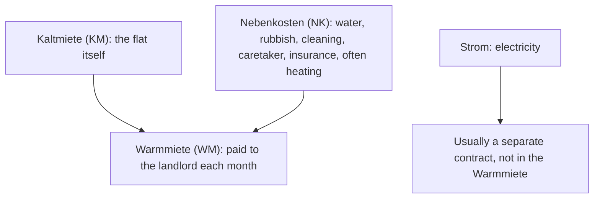

## What this lesson is for

In lesson 19 Mr Okafor viewed a flat on the third floor, asked *Wie hoch ist die Miete?* and heard
*930 Euro warm*. You also learned that a *Drei-Zimmer-Wohnung* doesn't count the kitchen and the
bathroom, and that *im ersten Stock* is one floor up. This honors lesson takes you one step earlier:
finding the flat in the first place.

Flat adverts in German are famous for being hard to read. They pack a lot into a few lines with
abbreviations like *3 ZKB*, *KM* and *2. OG*, and they use long compound nouns like
*Dachgeschosswohnung*. By the end of this lesson you'll be able to read a typical ad, work out what
the flat really costs each month, name every floor of a building, read long ad words from the end,
and ask the right questions on the phone to get a viewing.

## Reading a flat advert

Here is an invented ad, the kind you find on a housing website:

> Helle 3-Zi.-Whg. mit Blk. — 2. OG, 78 m², EBK, ruhige Lage. KM 820 €, NK 210 € (inkl.
> Heizung), Kaution 3 KM. Frei ab 1.4. Besichtigung Sa. 11 Uhr.

Almost every piece is an abbreviation (*die Abkürzung*). These are the ones you'll see again and again:

| Abbreviation | Full form | Meaning |
|---|---|---|
| *Zi.* | *Zimmer* | room(s) |
| *Whg.* | *Wohnung* | flat, apartment |
| *ZKB* | *Zimmer, Küche, Bad* | rooms, kitchen, bathroom (*3 ZKB* = 3 rooms + kitchen + bathroom) |
| *Blk.* | *Balkon* | balcony |
| *EG* | *Erdgeschoss* | ground floor |
| *OG* | *Obergeschoss* | upper floor (*2. OG* = second floor up) |
| *DG* | *Dachgeschoss* | attic floor, top floor under the roof |
| *m²* (or *qm*) | *Quadratmeter* | square metres |
| *EBK* | *Einbauküche* | fitted kitchen |
| *KM* | *Kaltmiete* | rent without bills ("cold rent") |
| *NK* | *Nebenkosten* | additional costs, bills |
| *WM* | *Warmmiete* | rent with bills ("warm rent") |
| *inkl.* | *inklusive* | including |
| *zzgl.* | *zuzüglich* | plus, not including |
| *möbl.* | *möbliert* | furnished |

Other words in the ad: *hell* (bright), *ruhige Lage* (quiet location; *die Lage* — location),
*frei ab 1.4.* (free, available from 1 April; read *ab dem ersten Vierten* or *ab dem ersten
April*), *die Besichtigung* (viewing) and *Sa.* (Samstag). *Ab sofort* means available now.

Two culture notes help with ads in Germany:

- The number of rooms never includes the kitchen, the bathroom or the hallway (*der Flur*), as you
  learned in lesson 19. A *3-Zimmer-Wohnung* might be a living room and two bedrooms.
- Many flats for rent come without a kitchen: no cupboards, no stove, sometimes not even a sink.
  Tenants often buy a kitchen and take it with them when they move. That's why *EBK* (a fitted
  kitchen is included) is worth mentioning in an ad.

## What does it really cost? Kaltmiete, Nebenkosten, Warmmiete

The *Kaltmiete* is the rent for the flat itself. On top of it come the *Nebenkosten*: things like
water, rubbish collection, cleaning of the stairs, the caretaker and the building's insurance, and
often heating. What you pay the landlord every month is the *Warmmiete*. Electricity (*der Strom*)
is usually not part of it: you sign your own contract with an electricity company.

Ads differ in what they put in *NK*. Some include heating (*inkl. Heizung*, as above); others list
heating separately as *HK* (*Heizkosten*). If an ad isn't clear, ask: *Ist die Heizung in den
Nebenkosten?* The *Nebenkosten* are paid in advance as a monthly estimate, and once a year the
landlord sends a statement: you may get money back or have to pay more.

When you move in you also pay a deposit, *die Kaution*, which you get back when you move out if the
flat is in good order. In Germany the law limits the deposit to three months' *Kaltmiete*, and
tenants may pay it in three parts. (Rules in Austria and Switzerland are different.)

### Example 1: The ad in numbers

Back to the ad: *KM 820 €, NK 210 € (inkl. Heizung), Kaution 3 KM*, *78 m²*.

1. Monthly rent: *Warmmiete = Kaltmiete + Nebenkosten* = 820 € + 210 € = **1,030 €** a month,
   plus electricity.
2. Deposit: 3 × 820 € = **2,460 €**, based on the cold rent, not the warm rent.
3. Price per square metre: Germans often compare flats by the cold rent per square metre:
   820 € ÷ 78 m² ≈ **10.51 €** per m². In German you write *10,51 €/m²* with a comma and say
   *zehn Euro einundfünfzig pro Quadratmeter*.
4. Floor: *2. OG* is two floors above the ground floor: the third level of the building, which
   Americans call the third floor and the British the second.

In a conversation: *Die Wohnung kostet 1030 Euro warm. Die Kaution ist 2460 Euro.*

## Floors: from the Keller to the Dachgeschoss

German counts floors from the ground floor, *das Erdgeschoss*, which is floor zero. Ads use *OG*
(*Obergeschoss*); people say *Stock* (lesson 19): *im ersten Stock* = *im 1. OG*.

With *in* + dative (lesson 19): *im Keller*, *im Erdgeschoss*, *im ersten Stock*, *im zweiten
Stock*, *im Dachgeschoss*. In many buildings each flat has its own storage room in the cellar, *der Keller*,
which an ad may mention: *mit Keller*.

## Long words in ads

Flat ads are full of **compound noun**s (lesson 5), and the trick from lesson 5 still works: read
from the end. The last part says what the thing is and gives the gender; the part in front says
what kind.

| Compound | Parts | Meaning |
|---|---|---|
| *die Kaltmiete* | *kalt* + *die Miete* | cold rent |
| *das Dachgeschoss* | *das Dach* (roof) + *das Geschoss* (floor, storey) | attic floor |
| *die Einbauküche* | *einbauen* (to build in) + *die Küche* | fitted kitchen |
| *der Hausschlüssel* | *das Haus* + *der Schlüssel* | house key |
| *die Wohnungstür* | *die Wohnung* + *s* + *die Tür* | flat door |

*Das Haus* is neuter, but *der Hausschlüssel* is masculine, because a house key is a kind of key.
The *s* in *Wohnungstür* is a **linking s**: it joins the parts and adds no meaning.

### Example 2: die Dachgeschosswohnung

1. Find the last part: *Wohnung* (flat). So it's a kind of flat, and feminine: *die
   Dachgeschosswohnung*.
2. What kind of flat? A *Dachgeschoss* one. Take that apart the same way: *Dach* (roof) +
   *Geschoss* (floor): the floor under the roof.
3. Put it together: a flat on the attic floor, often with sloping ceilings and small windows.

The same method opens *die Nebenkostenabrechnung*: last part *die Abrechnung* (statement of
account), in front *Nebenkosten*: the yearly statement of additional costs mentioned above.

## Questions to ask about a flat

Before a viewing, or on the phone, you need a handful of questions. They use only grammar you know:
the verb first for yes/no questions, a question word first for W-questions (lesson 4).

| Question | Meaning |
|---|---|
| *Ist die Wohnung noch frei?* | Is the flat still available? |
| *Ab wann ist die Wohnung frei?* | From when is the flat available? |
| *Wie hoch ist die Kaltmiete?* | How much is the cold rent? |
| *Wie hoch sind die Nebenkosten?* | How much are the additional costs? |
| *Ist die Heizung in den Nebenkosten?* | Is heating included in the additional costs? |
| *Wie groß ist die Wohnung?* | How big is the flat? |
| *Gibt es eine Einbauküche / einen Keller?* | Is there a fitted kitchen / a cellar? |
| *Wann kann ich die Wohnung sehen?* | When can I see the flat? |
| *Darf man Haustiere haben?* | Are pets allowed? (*das Haustier* — pet) |

Two details:

- Rent is *hoch* (high) or *niedrig* (low), so you ask *Wie hoch …?*, not *Wie viel …?*, about a
  rent or costs, as Mr Okafor did in lesson 19. *Was kostet die Wohnung?* is also fine.
- *Nebenkosten* is plural, so the verb is plural too: *Wie hoch sind die Nebenkosten?*

### Example 3: Choosing the right question

You want to know three things: the size, whether a fitted kitchen is included and how much the
bills are.

1. Size is *groß*: *Wie groß ist die Wohnung?* The answer comes in square metres: *78
   Quadratmeter*.
2. "Is there …?" is *Gibt es …?* + accusative. *Die Einbauküche* is feminine, so *eine* doesn't
   change: *Gibt es eine Einbauküche?*
3. Costs are *hoch*, and *Nebenkosten* is plural: *Wie hoch sind die Nebenkosten?*

## Dialogue: Ist die Wohnung noch frei?

Sara Lindqvist calls about the ad.

> Herr Brandt: Brandt, guten Tag.
>
> Sara: Guten Tag, mein Name ist Sara Lindqvist. Ich rufe wegen der Anzeige an: die Drei-Zimmer-Wohnung im zweiten Stock. Ist sie noch frei?
>
> Herr Brandt: Ja, die Wohnung ist noch frei, ab dem ersten April.
>
> Sara: Ist die Heizung in den Nebenkosten?
>
> Herr Brandt: Ja, die Nebenkosten sind 210 Euro mit Heizung. Strom kommt noch dazu.
>
> Sara: Und die Küche? Gibt es eine Einbauküche?
>
> Herr Brandt: Ja, mit Kühlschrank und Herd. Möchten Sie die Wohnung sehen? Die Besichtigung ist am Samstag um 11 Uhr.
>
> Sara: Sehr gern. Wie ist die Adresse, bitte?
>
> Herr Brandt: Lindenstraße 14. Klingeln Sie bitte bei Brandt, im Erdgeschoss.
>
> Sara: Lindenstraße 14, bei Brandt. Vielen Dank, bis Samstag!

*Mr Brandt: Brandt, hello. — Sara: Hello, my name is Sara Lindqvist. I'm calling about the ad: the
three-room flat on the second floor. Is it still available? — Mr Brandt: Yes, the flat is still
available, from the first of April. — Sara: Is the heating included in the additional costs? — Mr
Brandt: Yes, the additional costs are 210 euros with heating. Electricity is extra. — Sara: And the
kitchen? Is there a fitted kitchen? — Mr Brandt: Yes, with a fridge and a cooker. Would you like to
see the flat? The viewing is on Saturday at 11. — Sara: Yes, please. What's the address? — Mr
Brandt: Lindenstraße 14. Please ring at Brandt, on the ground floor. — Sara: Lindenstraße 14, at
Brandt. Thanks a lot, see you on Saturday!*

(*wegen der Anzeige* — about the ad; *noch frei* — still available; *dazukommen* — to come on top;
*der Herd* — cooker, stove; *klingeln* — to ring the bell.) Notice that Mr Brandt answers the phone
with just his surname: that's normal in Germany.

## Pronunciation

- *Quadratmeter*: kva-DRAAT-mee-ter; *qu* is always *kv*.
- *Kaution*: kau-TSYOHN; *-tion* is *tsyohn*, stressed.
- *Erdgeschoss*: ERT-ge-shoss; the *d* at the end of *Erd* sounds like *t*.
- *möbliert*: mö-BLEERT, with *ö* and a long *ie*.
- Compound nouns: stress the first part, *KALT-miete*, *EIN-bauküche*, *DACH-geschoss-wohnung*.

## Common mistakes

- Counting the kitchen as a room. *3 Zimmer* means three rooms plus kitchen and bathroom.
- Comparing an ad's *KM* with another ad's *WM*. Add the *NK* first, then compare warm with warm.
- Working out the deposit from the warm rent. *Kaution 3 KM* means three times the cold rent.
- Taking the gender from the first part of a compound: *das Haus* but *der Hausschlüssel*. The
  last part decides.
- Making the first part plural: two house keys are *zwei Hausschlüssel*, not *zwei Häuserschlüssel*.
  Only the last part shows the plural.
- Reading *2. OG* as "second floor" in the American sense. It's two floors above the ground floor.

## Key points

- Ad abbreviations: *Zi.*, *Whg.*, *ZKB*, *EG/OG/DG*, *m²*, *EBK*, *KM*, *NK*, *WM*, *inkl.*,
  *zzgl.*, *möbl.*
- *Warmmiete = Kaltmiete + Nebenkosten*; electricity usually extra. The *Kaution* (deposit) is at
  most three months' *Kaltmiete* in Germany.
- Floors: *der Keller*, *das Erdgeschoss*, *der erste Stock (1. OG)*, *der zweite Stock*, *das
  Dachgeschoss*; *im ersten Stock*.
- Read a long word from the end: *die Dachgeschosswohnung* is a kind of *Wohnung*, so it's
  feminine.
- Questions: *Ist die Wohnung noch frei? Ab wann …? Wie hoch ist die Miete? Wie hoch sind die
  Nebenkosten? Wie groß …? Gibt es …?*

The words from this lesson are listed below; they join your vocabulary reviews when you complete
the lesson.
