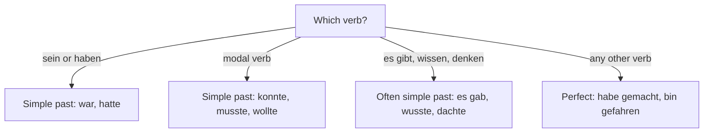

## What this lesson is for

In lessons 21 and 22 you learned the two tools of spoken German for the past: the **perfect
tense** for almost every verb (*Ich habe eingekauft*, *Ich bin gefahren*) and the short
forms *war* and *hatte* for *sein* and *haben*. With those you can say what happened. But a
real story also needs what you *could*, *had to* and *wanted to* do: "I wanted to get up
early, but I couldn't, and I had to wait for the bus." That is what this honors lesson adds.

You learn the **simple past** of the modal verbs (*konnte, musste, wollte, durfte, sollte*,
and *mochte*), a few more simple past forms that Germans like to use in conversation (*es
gab*, *ich wusste*, *ich dachte*), and how to put a whole story together. At the end you read
a longer story that uses everything from this module. This is a step beyond A1: the modal
past forms are usually taught at A2, but they follow exactly the pattern you already know
from *war* and *hatte*.

## The simple past of modal verbs

Why do you need a new form? Try to say "I had to work" with the perfect. You would need
*haben*, a participle and an infinitive: *Ich habe arbeiten müssen*. That is correct German,
but it is heavy, and it puts two infinitives at the end (*arbeiten müssen*), a pattern called
the **double infinitive**. Most speakers avoid it and use the simple past instead: *Ich
musste arbeiten.* For modal verbs, as for *sein* and *haben*, the simple past is the normal
choice in speech as well as in writing.

The forms are built in three steps:

1. Take the infinitive and drop the umlaut: *können* → *konn-*, *müssen* → *muss-*,
   *dürfen* → *durf-*. (*Wollen* and *sollen* have no umlaut to drop.)
2. Add *-te*: *konnte, musste, durfte, wollte, sollte*.
3. Add the person endings you know from *war* and *hatte*: nothing for *ich* and *er/sie/es*,
   *-st* for *du*, *-n* for *wir* and *sie/Sie*, *-t* for *ihr*.

| | können | müssen | wollen | dürfen | sollen |
|---|---|---|---|---|---|
| ich | konnte | musste | wollte | durfte | sollte |
| du | konntest | musstest | wolltest | durftest | solltest |
| er/sie/es | konnte | musste | wollte | durfte | sollte |
| wir | konnten | mussten | wollten | durften | sollten |
| ihr | konntet | musstet | wolltet | durftet | solltet |
| sie/Sie | konnten | mussten | wollten | durften | sollten |

*Mögen* (to like) follows the same idea but also changes *g* to *ch*: *ich mochte, du
mochtest, wir mochten*. *Ich mochte den Film* means "I liked the film".

And *möchte*? It has no past form of its own. To say what you would have liked or wanted in
the past, use *wollte*: *Ich möchte einen Kaffee* (now) → *Ich wollte einen Kaffee* (then).

### The word order doesn't change

The sentence bracket from lesson 14 stays exactly the same. Only the modal changes its form;
the infinitive still goes to the end.

- *Ich kann heute nicht kommen.* → *Ich konnte gestern nicht kommen.* — I couldn't come
  yesterday.
- *Wir müssen lange warten.* → *Wir mussten lange warten.* — We had to wait a long time.
- *Darfst du allein fahren?* → *Durftest du allein fahren?* — Were you allowed to go alone?
- *Er soll um acht da sein.* → *Er sollte um acht da sein.* — He was supposed to be there
  at eight.

### konnte or könnte?

Watch the dots. *Konnte* (no umlaut) is the past: "could, was able to". *Könnte* (with
umlaut) is a different form, the **subjunctive**, which means "could, would be able to" and
is used for polite requests and possibilities. You already know a subjunctive form:
*möchte* is the subjunctive of *mögen*.

- *Ich konnte nicht schlafen.* — I couldn't sleep. (past: it really happened)
- *Könnten Sie mir bitte helfen?* — Could you help me, please? (polite request, now)

The same goes for *musste* (had to) and *müsste* (would have to), *durfte* (was allowed to)
and *dürfte*. For the past, never write the umlaut.

## A few more simple past forms you will hear

Apart from *war*, *hatte* and the modals, spoken German mostly uses the perfect. But a few
other simple past forms are so common that you will hear them all the time:

| simple past | infinitive | example |
|---|---|---|
| es gab | es gibt (lesson 10) | *Es gab keinen Kaffee.* — There was no coffee. |
| ich wusste | wissen | *Das wusste ich nicht.* — I didn't know that. |
| ich dachte | denken | *Ich dachte, du kommst.* — I thought you were coming. |

*Es gab* works like *es gibt*: it is followed by the accusative and is the same for one thing
or many: *Es gab einen Bus und zwei Taxis.* *Wusste* and *dachte* take the same endings as
the modals (*du wusstest, wir dachten*). Notice that after *ich dachte* the next part keeps
normal word order: *Ich dachte, du kommst.*

### Which past form? A rule of thumb

This is a simplification. In writing, especially in books and newspapers, the simple past is
used for many more verbs. And there are regional differences: in the south (southern
Germany, Austria and Switzerland) people use the simple past even less in everyday speech,
and you will often hear *ich bin gewesen* where a northerner says *ich war*. Both are
correct. For your own speaking and short messages, the chart above is a safe guide.

## Putting a story together

A good short story in the past has three parts:

1. The setting. When, where, who: *Letzten Montag …*, *Letztes Jahr im Sommer …* Here
   *war*, *hatte* and the modals do most of the work, because they describe the situation:
   *Ich hatte einen Termin. Ich wollte früh aufstehen.*
2. The events. What happened, one thing after another, mostly in the perfect, linked
   with *zuerst, dann, danach, plötzlich*: *Dann bin ich zur Haltestelle gelaufen.*
3. The end. How it finished and how you felt: *endlich*, *zum Schluss* (in the end):
   *Zum Schluss war alles gut.*

Remember the verb-second rule: when a time word or a linking adverb starts the sentence, the
verb (*bin, habe, war, musste*…) comes straight after it, and the subject follows.

### Example 1: from plan to past

You told a friend on Friday: *Am Samstag will ich wandern, aber ich muss noch arbeiten.* On
Monday you tell her what happened. Change the sentence step by step.

1. Find the verbs: *will* (wollen) and *muss* (müssen) are modals; *wandern* and *arbeiten*
   are infinitives at the end.
2. Modals go into the simple past: *will* → *wollte*, *muss* → *musste*. The subject is
   *ich*, so there is no ending.
3. The infinitives stay where they are, at the end.
4. Change the time word: the Saturday is now in the past, so *am Samstag* is still fine, or
   *letzten Samstag*.

Result: *Am Samstag wollte ich wandern, aber ich musste noch arbeiten.* — On Saturday I
wanted to go hiking, but I still had to work.

### Example 2: giving a reason

Your friend asks: *Warum warst du nicht auf der Party?* (Why weren't you at the party?) You
were ill, so you couldn't come, and you had to stay in bed all day; you slept a lot.

1. "I couldn't come" uses a modal: *Ich konnte nicht kommen.*
2. The reason with *denn* (lesson 23) and *hatte*: *…, denn ich hatte Fieber.*
3. "had to stay in bed" is a modal again, with *bleiben* at the end: *Ich musste im Bett
   bleiben.*
4. "I slept a lot" is an ordinary verb, so it takes the perfect: *Ich habe viel geschlafen.*

Answer: *Ich konnte leider nicht kommen, denn ich hatte Fieber. Ich musste im Bett bleiben
und habe viel geschlafen.* Notice how the forms mix naturally: simple past for the modals
and *hatte*, perfect for *schlafen*.

### Example 3: from notes to a story

Your notes say: *Samstag – Ausflug an den See – Regen! – Café – Kuchen – trotzdem schön.*
(*Trotzdem* means "all the same".) Build three parts.

- Setting: *Letzten Samstag wollten wir einen Ausflug an den See machen.*
- Events: *Zuerst war das Wetter schön, aber dann hat es plötzlich geregnet. Wir konnten
  nicht schwimmen. Deshalb sind wir in ein Café gegangen und haben Kuchen gegessen.*
- End: *Zum Schluss war der Tag doch schön.*

(*Doch* here means "after all"; you met it in lesson 8 as an answer word.) Count the past
forms: two modals (*wollten, konnten*), *war* twice, and three perfects (*hat geregnet*, *sind
gegangen*, *haben gegessen*). That mix is typical of spoken German.

## A story: Ein Montag zum Vergessen

Jonas tells his friend about a very bad Monday. Read it first without the translation.

> Letzten Montag hatte ich um neun Uhr einen Termin bei einer neuen Firma. Ich wollte früh
> aufstehen, aber mein Wecker hat nicht geklingelt. Ich bin erst um halb acht aufgewacht! Ich
> hatte keine Zeit für das Frühstück, und ich konnte nicht einmal duschen.
>
> Ich bin schnell zur Haltestelle gelaufen, aber der Bus war schon weg. Es gab kein Taxi, und
> ich musste zwanzig Minuten warten. Dann hat es auch noch geregnet. Um zehn nach neun war ich
> endlich bei der Firma, nass und müde.
>
> Die Chefin, Frau Wolf, hat gelacht: „Kein Problem, Herr Brandt. Unser Termin ist erst um
> halb zehn. Wir haben Ihnen am Freitag eine E-Mail geschickt.“ Oh nein: Am Wochenende habe
> ich keine E-Mails gelesen.
>
> Zum Schluss war der Tag doch noch gut. Ich habe den Job bekommen!

Translation:

> Last Monday I had an appointment at nine o'clock at a new company. I wanted to get up
> early, but my alarm clock didn't ring. I didn't wake up until half past seven! I had no
> time for breakfast, and I couldn't even shower.
>
> I ran quickly to the bus stop, but the bus had already gone. There was no taxi, and I had
> to wait twenty minutes. Then it rained as well. At ten past nine I was finally at the
> company, wet and tired.
>
> The boss, Ms Wolf, laughed: "No problem, Mr Brandt. Our appointment isn't until half past
> nine. We sent you an e-mail on Friday." Oh no: at the weekend I didn't read any e-mails.
>
> In the end the day turned out well after all. I got the job!

Notes: *ein Montag zum Vergessen* is "a Monday to forget"; *erst* + a time means "not until";
*nicht einmal* is "not even"; *weg* means "gone"; *auch noch* is "as well, on top of that";
*nass* means "wet"; *die Chefin* is a female boss; *der Job* is "the job". The story uses
every past form in this module: *hatte, war* (setting), *wollte, konnte, musste* (modals),
*es gab*, and perfects with *haben* (*hat geklingelt, hat gelacht*) and with *sein* (*bin
aufgewacht, bin gelaufen*).

## Pronunciation

- *konnte, musste, sollte, wollte* all have a short vowel followed by a double consonant:
  KON-te, MUS-te. The final *-e* is a weak "uh", like the *-e* in *habe*.
- *könnte* has the rounded *ö*: round your lips as for "o" and say "e". The difference from
  *konnte* is clear, so say it carefully.
- *Wecker*: short *e*, stress on the first syllable, WE-cker.

## Common mistakes

- Keeping the umlaut. *Ich könnte gestern nicht kommen* is wrong; the past is *Ich konnte
  gestern nicht kommen.* With an umlaut it means something else ("could, would be able to").
- Adding an ending to *ich* or *er*. Not *ich konnt* or *er musstet*, but *ich konnte, er
  musste*.
- Using a participle with a modal. *Ich habe nicht schlafen gekonnt* is wrong. Say *Ich
  konnte nicht schlafen* (or, rarely, *Ich habe nicht schlafen können*).
- Trying to put *möchte* in the past. There is no *möchtete*: use *wollte*.
- Moving the infinitive. The modal changes, the bracket doesn't: *Ich musste gestern lange
  arbeiten*, not *Ich musste arbeiten gestern lange*.
- Forgetting the verb-second rule in a story. *Dann ich bin gelaufen* is wrong; *Dann bin ich
  gelaufen.*

## Key points

- Modal verbs in the past: drop the umlaut, add *-te*: *konnte, musste, durfte, wollte,
  sollte*; *mögen* → *mochte*. Endings as for *war*: *ich/er konnte, du konntest, wir
  konnten, ihr konntet, sie konnten*.
- Germans prefer these forms to the perfect of a modal (*habe … müssen*, the double
  infinitive).
- The sentence bracket stays: modal in position 2, infinitive at the end.
- *Konnte* = could (past); *könnte* = could (would be able to; polite).
- Also common in the simple past: *es gab, ich wusste, ich dachte*.
- A story: setting (*war, hatte*, modals), events (perfect with *zuerst, dann, plötzlich*),
  end (*endlich, zum Schluss*).

The words from this lesson are listed below; they join your vocabulary reviews when you
complete the lesson.
