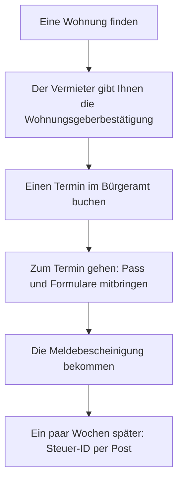

## What this lesson is for

In lesson 15 you met *der Termin*, *der Ausweis* and *das Formular*, and in lesson 23 you filled
in a form and wrote short messages, formal and informal. This honors lesson is about the first
weeks after you arrive in a German-speaking country to live: registering your address, booking an
appointment at the *Amt* (the public office), and reading the formal letters that start to arrive
in your post box.

Official German is famous for its long words and short forms. So the reading point here is
the abbreviations you'll see in letters and on notices (*z. B., ca., ggf.*), and the capital *Ihr*
that tells you a sentence is about you. Everything is about Germany unless it says otherwise; the rules are a
simplified guide, and the details depend on the town.

## Die Anmeldung: registering your address

Everyone who lives in Germany must register their address with the town. This is *die
Anmeldung*, and the verb is *sich anmelden* (to register): *Ich muss mich anmelden.* You have two
weeks after you move in. The office is called *das Bürgeramt*, *das Bürgerbüro* or *das
Einwohnermeldeamt*, depending on the town; in everyday speech people just say *das Amt*.

You usually need:

- your passport (*der Pass*, *der Reisepass*) or ID card (*der Personalausweis*, lesson 15's
  *Ausweis*);
- the *Wohnungsgeberbestätigung*: a short form from your landlord or landlady (*der Vermieter,
  die Vermieterin*) that confirms you've moved in;
- the registration form, *das Anmeldeformular*, filled in and signed.

In most cities you book an appointment online first. At the end you get a *Meldebescheinigung*
(a certificate of registration), which banks, employers and other offices may ask for. When you
leave Germany for good, you deregister: *sich abmelden*.

Austria and Switzerland have the same idea with other names and time limits. In Austria you
register within three days and the form is the *Meldezettel*; in Switzerland the rules depend on
the canton, and you usually have about two weeks.

## After the Anmeldung: the first letters

Once you're registered, letters start to come. Three you'll almost certainly get:

- The tax ID (*die Steuer-ID*, short for *steuerliche Identifikationsnummer*): an
  11-digit number that the federal tax office sends by post a few weeks after your first
  registration. Your employer needs it. Keep the letter.
- The broadcasting fee (*der Rundfunkbeitrag*): every household pays one fee for public
  radio and television, whether or not it has a TV. Flatmates share one fee.
- Health insurance (*die Krankenversicherung*) is required by law, and your insurer sends you
  a card for the doctor.

To open a bank account (*das Konto*) you go to a bank with your passport, and often the
Meldebescheinigung. And one tip that saves a lot of trouble: put your name on the post box
(*der Briefkasten*) and on the doorbell at once, or the post can't be delivered.

The names on the bells and the post boxes are how the post carrier, delivery drivers and your
visitors find you: *Bei wem soll ich klingeln?* — Whose bell should I ring? *Klingeln Sie bei
Brandt!* (*klingeln*: to ring the bell; *die Klingel*: the bell.)

## Reading a letter from the Amt

Formal letters follow the fixed layout you met in lesson 23: the sender at the top, your address,
the place and date, a one-line subject (*der Betreff*), the greeting *Sehr geehrter Herr …* and
the closing *Mit freundlichen Grüßen*. Once you know where each part is, you can find the
important information fast, even if you don't understand every word.

Here is a letter from a Bürgeramt, written for this course:

> Bürgeramt Mitte · Rathausplatz 1 · 12345 Neustadt
>
> Herrn Lukas Brandt, Gartenstraße 8, 12345 Neustadt
>
> Neustadt, 12. Oktober 2026
>
> Ihre Anmeldung: Termin am 20. Oktober
>
> Sehr geehrter Herr Brandt,
>
> vielen Dank für Ihre Online-Anfrage. Ihr Termin ist am Dienstag, 20. Oktober, um 9:30 Uhr im Bürgeramt Mitte, Zimmer 104.
>
> Bitte bringen Sie diese Unterlagen mit: Ihren Reisepass oder Personalausweis, die Wohnungsgeberbestätigung von Ihrem Vermieter und das Anmeldeformular. Bitte füllen Sie das Formular vorher aus und unterschreiben Sie es.
>
> Sie können nicht kommen? Dann sagen Sie den Termin bitte bis zum 19. Oktober ab.
>
> Mit freundlichen Grüßen
>
> Ihr Bürgeramt Mitte

*Bürgeramt Mitte, Town Hall Square 1. To Mr Lukas Brandt. 12 October 2026. Subject: Your
registration: appointment on 20 October. Dear Mr Brandt, thank you for your online request. Your
appointment is on Tuesday 20 October at 9:30 in the Bürgeramt Mitte, room 104. Please bring these
documents: your passport or ID card, the landlord's confirmation from your landlord and the
registration form. Please fill in the form beforehand and sign it. You can't come? Then please
cancel the appointment by 19 October. Yours sincerely, your Bürgeramt Mitte.*

New in passing: *die Anfrage* (request, enquiry), *die Unterlagen* (documents, papers; plural
only), *vorher* (beforehand), *bis zum 19. Oktober* (by 19 October). *Herrn* in the address is
*Herr* with an extra *-n*: addresses always use this form, so copy it.

Formal letters talk to you with *Sie* and the polite imperative (lesson 17): *Bitte bringen Sie
… mit*, *füllen Sie … aus*, *sagen Sie … ab*. All three verbs are separable, so the prefix waits at
the end of the sentence.

### Example 1: Finding the key facts

Before you read every word, scan the letter for four things: who, what, when, what to bring.

1. Who wrote it? The *Absender*: the Bürgeramt Mitte.
2. What is it about? The *Betreff*: *Ihre Anmeldung: Termin am 20. Oktober*. So it's your
   registration appointment.
3. When and where? Look for numbers: *am Dienstag, 20. Oktober, um 9:30 Uhr*, *Zimmer 104*.
4. What must you do? Look for *Bitte* and imperatives: bring the passport, the landlord's form
   and the registration form, filled in and signed. And if you can't come: cancel by the 19th.

That's the whole letter in four lines. The words you didn't know (*Anfrage*, *vorher*) didn't
stop you, because the layout told you where to look.

## Abbreviations in official German

Letters, forms and notices are full of short forms. An **abbreviation** (*die Abkürzung*) is
written with a full stop, and in most cases you read it aloud as the full words: *z. B.* is said
*zum Beispiel*, never "zet be". Only a few are said letter by letter, like *PLZ* (lesson 3) or
*ICE* (the fast train).

| Abbreviation | Full form | Meaning |
|---|---|---|
| *z. B.* | *zum Beispiel* | for example |
| *d. h.* | *das heißt* | that is, i.e. |
| *usw.* | *und so weiter* | and so on, etc. |
| *bzw.* | *beziehungsweise* | or; or rather; respectively |
| *ca.* | *circa* | about, approximately |
| *ggf.* | *gegebenenfalls* | if necessary, if applicable |
| *evtl.* | *eventuell* | possibly, perhaps |
| *u. a.* | *unter anderem* | among other things |
| *Nr.* | *Nummer* | number |
| *Str.* | *Straße* | street |

Watch out for *evtl.*: *eventuell* means "possibly", not "eventually". *Ich komme eventuell
später* means "I may come later", not "I'll come in the end".

The second thing to watch in formal letters is the capital *I*. *Ihr, Ihre, Ihren* with a
capital letter means "your" (formal, from *Sie*, lesson 6); *ihr* with a small letter means "her",
"their", or "you" (several friends). In a letter from an office, the capital forms are always
about you: *Ihre Anmeldung* (your registration), *Ihren Reisepass* (your passport; masculine
accusative, so *-en*).

### Example 2: Decoding a notice

On the door of the Bürgeramt you read:

> Bitte bringen Sie Ihre Unterlagen (z. B. Pass, Mietvertrag usw.) mit. Wartezeit ca. 20 Minuten. Ggf. müssen Sie einen neuen Termin buchen.

Read each short form as its full words, then translate:

1. *z. B.* = *zum Beispiel*; *usw.* = *und so weiter*: "Please bring your documents (for example
   passport, rental contract and so on)." *Der Mietvertrag* is a compound: *die Miete* (rent,
   lesson 19) + *der Vertrag* (contract), so it's masculine.
2. *ca.* = *circa*: "Waiting time about 20 minutes."
3. *Ggf.* = *gegebenenfalls*: "If necessary you'll have to book a new appointment." The modal
   *müssen* is in position 2 after *ggf.*, so *Sie* comes after it (inversion, lesson 12).
4. *Ihre* has a capital *I*: it's your documents, not "her" documents.

## Dialogue: Am Bürgeramt

Lukas is at his appointment.

> Beamtin: Guten Morgen. Nummer 104, Herr Brandt?
>
> Lukas: Ja, guten Morgen. Ich möchte mich anmelden.
>
> Beamtin: Gern. Haben Sie Ihren Pass dabei?
>
> Lukas: Ja, hier, bitte.
>
> Beamtin: Danke. Und die Wohnungsgeberbestätigung?
>
> Lukas: Hier ist sie. Das Formular habe ich auch ausgefüllt.
>
> Beamtin: Sehr gut. Seit wann wohnen Sie in der Gartenstraße?
>
> Lukas: Seit dem 10. Oktober.
>
> Beamtin: Gut. Unterschreiben Sie bitte hier. … So, das ist Ihre Meldebescheinigung. Ihre Steuer-ID bekommen Sie in ein paar Wochen per Post.
>
> Lukas: Vielen Dank! Das ging ja schnell.
>
> Beamtin: Gern geschehen. Auf Wiedersehen!

*Official: Good morning. Number 104, Mr Brandt? — Lukas: Yes, good morning. I'd like to register.
— Official: Of course. Do you have your passport with you? — Lukas: Yes, here you are. — Official:
Thanks. And the landlord's confirmation? — Lukas: Here it is. I've filled in the form too. —
Official: Very good. Since when have you lived in Gartenstraße? — Lukas: Since the 10th of
October. — Official: Good. Please sign here. … There, that's your certificate of registration.
You'll get your tax ID by post in a few weeks. — Lukas: Thanks a lot! That was quick. — Official:
You're welcome. Goodbye!*

*Die Beamtin* (*der Beamte*) is a civil servant. *Dabeihaben* means to have with you. *Das ging
ja schnell* (that was quick) uses *ging*, the simple past of *gehen*; you'll meet more of these
forms in this module's fairy-tale lesson. *Gern geschehen* is a polite "you're welcome". Notice *Seit wann …? — Seit
dem 10. Oktober*: *seit* takes the dative (lesson 18), so the date has *dem* and is read *seit
dem zehnten Oktober*.

## Pronunciation

- *Amt*: short *a*, and the *m* and *t* both sound: "amt".
- *Anmeldung*: AN-mel-dung; the stress is on the separable prefix, as in *anmelden*.
- *Bürgeramt*: BÜR-ger-amt, with a tiny catch in the throat before *amt*.
- *Wohnungsgeberbestätigung*: say it in parts; the main stress is on the first one:
  WOH-nungs-geber-bestätigung.
- *beziehungsweise*: be-TSEE-ungs-vai-ze; *gegebenenfalls*: ge-GAY-be-nen-fals.
- *Personalausweis*: per-so-NAAL-aus-vice.

## Common mistakes

- Missing the two-week deadline for the Anmeldung, or going without the landlord's confirmation.
- Reading *evtl.* as "eventually". *Eventuell* means "possibly".
- Saying abbreviations letter by letter: *z. B.* is read *zum Beispiel*, *usw.* is *und so weiter*.
- Reading *Ihre Anmeldung* as "her registration". With a capital *I*, *Ihr/Ihre* means "your".
- Writing *Herr* in an address on a letter: it's *Herrn Lukas Brandt*. (In the greeting it's *Sehr
  geehrter Herr Brandt*, without the *-n*.)
- Forgetting the name on the post box: the post won't arrive.
- Throwing away the Steuer-ID letter. You'll need the number for every job.

## Key points

- Register your address (*sich anmelden*) at the *Bürgeramt* within two weeks of moving in; bring
  your passport or ID card and the *Wohnungsgeberbestätigung*; book a *Termin* first.
- After the Anmeldung: the *Meldebescheinigung*, then the *Steuer-ID* by post; also the
  *Rundfunkbeitrag* and health insurance.
- Scan a formal letter for who (*Absender*), what (*Betreff*), when (numbers) and what to do
  (*Bitte …*, imperatives).
- Abbreviations are read as full words: *z. B.* (zum Beispiel), *d. h.*, *usw.*, *bzw.*, *ca.*,
  *ggf.*, *evtl.* (possibly!), *u. a.*
- Capital *Ihr/Ihre/Ihren* = your (formal); small *ihr* = her, their, you (plural).
- Put your name on the post box and the doorbell.

The words from this lesson are listed below; they join your vocabulary reviews when you complete
the lesson.
