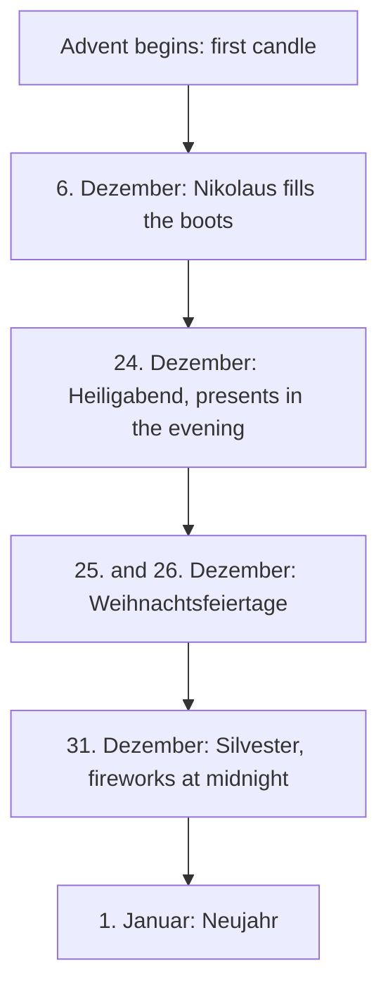

## What this lesson is for

In lesson 16 you learned to say dates (*am dritten Oktober*), months and seasons, and to wish
someone *Herzlichen Glückwunsch zum Geburtstag!* This honors lesson walks through the German
year and its festivals: what people do at Easter, why children carry lanterns in November, what
happens on the 6th of December, and why you mustn't say *Guten Rutsch!* on the 2nd of January.

You'll also learn the small words that go with festivals (*an Ostern, zu Weihnachten, über
Ostern*), the wishes people write in cards and messages, and a longer e-mail about December in
Germany. Everything here is about Germany unless it says otherwise; Austria and Switzerland share
most of the Christian festivals but have their own national days.

## Holidays and festivals

German has two words that English often mixes up:

- *das Fest* (lesson 14) is a celebration or festival: *das Weihnachtsfest*, *das Oktoberfest*,
  *ein Sommerfest*.
- *der Feiertag* is a public holiday: a day when most people don't work, schools are closed and
  most shops are shut. *Morgen ist ein Feiertag.* — Tomorrow is a public holiday.

Some festivals are public holidays and some are not. *Heiligabend* (Christmas Eve) and
*Silvester* (New Year's Eve) are big festivals but normal working days, although many shops close
at lunchtime. Public holidays also differ a little between the 16 German states (*die
Bundesländer*): Bavaria, for example, has more of them than Berlin.

Here is the year at a glance. The names of festivals are written with a capital letter like
other nouns, and most of them are used without an article.

| When | Festival | What people do |
|---|---|---|
| 1 January | *Neujahr* (Feiertag) | sleep late after the night before |
| February or March | *Karneval, Fasching, Fastnacht* | wear costumes, watch parades |
| March or April | *Ostern* (Friday and Monday are Feiertage) | paint and hide eggs |
| 1 May | *der Tag der Arbeit* (Feiertag) | have the day off, go walking, march |
| late September to early October | *das Oktoberfest* in Munich | drink beer in huge tents |
| 3 October | *der Tag der Deutschen Einheit* (Feiertag) | the national day |
| 11 November | *Sankt Martin* | children walk with lanterns |
| four Sundays before Christmas | *der Advent* | light candles, open calendar doors |
| 6 December | *Nikolaus* | children find sweets in their boots |
| 24 December | *Heiligabend* | the family evening, with presents |
| 25 and 26 December | *Weihnachten* (both Feiertage) | eat, visit family |
| 31 December | *Silvester* | parties and fireworks at midnight |

*Der Tag der Deutschen Einheit* (the Day of German Unity) remembers the 3rd of October 1990, when
East and West Germany became one country again. Austria's national day is the 26th of October,
and Switzerland's is the 1st of August.

The *Oktoberfest* in Munich (*München*) is the world's best-known German festival, but it mostly
takes place in September, and it ends on the first Sunday in October (or on the 3rd of October
if that is later). Many towns now have their own smaller *Oktoberfest*.

## Spring: Karneval and Ostern

*Karneval* is the season of costumes and parades before Lent, the Christian time of fasting
before Easter. It has three names, depending on the region: *Karneval* in Cologne and Düsseldorf, *Fasching* in
Bavaria and Austria, and *Fastnacht* or *Fasnacht* in Mainz, the south-west and Switzerland. The big street days come in February or early March and end on
Ash Wednesday (*Aschermittwoch*). In Cologne people shout *Alaaf!*, in Düsseldorf and Mainz
*Helau!* Officially the new carnival season starts on the 11th of November at 11:11.

*Ostern* (Easter) falls on a Sunday between the 22nd of March and the 25th of April. Children
believe the *Osterhase* (Easter bunny) brings coloured eggs, *Ostereier*, and hides them in the
garden. *Karfreitag* (Good Friday) and *Ostermontag* (Easter Monday) are public holidays, so
Easter is a long weekend.

- *An Ostern suchen die Kinder Ostereier im Garten.* — At Easter the children look for Easter
  eggs in the garden.
- *Wir malen die Eier bunt an.* — We paint the eggs in bright colours. (*bunt*: colourful)

## Autumn and winter: Sankt Martin, Advent and Nikolaus

On the evening of the 11th of November, small children walk through the streets with paper
lanterns (*die Laterne*) and sing songs. The custom remembers Saint Martin, a Roman soldier who,
the story says, cut his cloak in two and gave half to a poor man. A *Martinsgans* (roast goose)
is the traditional meal.

*Der Advent* is the time of the four Sundays before Christmas. Families have an *Adventskranz*, a
wreath with four candles (*die Kerze*): on the first Sunday they light one candle (*eine Kerze
anzünden*), on the second Sunday two, and so on. Children open one door of the *Adventskalender*
every morning from the 1st to the 24th of December. Almost every town has a *Weihnachtsmarkt*
(Christmas market) with wooden huts, *Glühwein* (hot spiced wine) and roasted almonds.

On the evening of the 5th of December, children put their boots (*der Stiefel*) outside the door.
In the morning of the 6th, *Nikolaus* has filled them with nuts, oranges and chocolate.

## Christmas and New Year

In German-speaking countries the presents come on the evening of the 24th, *Heiligabend*, not on
the morning of the 25th. In much of the south and west, and in Austria, children are told the
*Christkind* (the "Christ child", often pictured as a young angel) brings them; in the north and east it is more often the
*Weihnachtsmann* (Father Christmas). The map isn't sharp, so take this as a rough rule. Both the
25th and the 26th of December are public holidays: *der erste und der zweite Weihnachtsfeiertag*.

*Silvester* is the 31st of December. People celebrate with friends, and at midnight they go
outside to watch or set off fireworks (*das Feuerwerk*). Many families also watch *Dinner for
One*, a short black-and-white British comedy sketch in English that German television has shown
on New Year's Eve for decades. At midnight everyone says *Frohes neues Jahr!*

## Festival phrases: an, zu, über

Which little word goes before *Ostern* or *Weihnachten*? There are three common choices.

| Phrase | Meaning | Example |
|---|---|---|
| *an Ostern, an Weihnachten* | at Easter, at Christmas (the days themselves) | *An Weihnachten bin ich bei meinen Eltern.* |
| *zu Ostern, zu Weihnachten* | at or for Easter, Christmas | *Was schenkst du deiner Schwester zu Weihnachten?* |
| *über Ostern, über Weihnachten* | over Easter, over Christmas (the whole holiday) | *Über Ostern fahren wir in die Berge.* |

*An* and *zu* both mean "at" here, and both are correct. *An Weihnachten* is more usual in the
south, in Austria and in Switzerland; *zu Weihnachten* in the north. For a present, everybody says
*zu*: *Ich bekomme ein Fahrrad zu Weihnachten* (for Christmas), just as *zum Geburtstag* (for my
birthday). *Silvester* is mostly *an Silvester*.

With a date or a named day you already know the rule from lesson 16: *am* + day. *Am 24.
Dezember*, *am Heiligabend*, *am ersten Advent*, *am Nikolaustag*. And with a month or a season:
*im Dezember*, *im Advent*.

## Wishes for cards and messages

These are **set phrases**: learn them whole. The endings (*frohe, frohes, guten*) follow rules
you'll meet at A2; for now, just copy them exactly.

| Wish | When | English |
|---|---|---|
| *Frohe Weihnachten!* | before and at Christmas | Merry Christmas! |
| *Frohe Ostern!* | before and at Easter | Happy Easter! |
| *Guten Rutsch!* | before New Year only | Have a good New Year! (literally "good slide") |
| *Frohes neues Jahr!* | from midnight, into early January | Happy New Year! |
| *Schöne Feiertage!* | before any holiday | Happy holidays! |
| *Alles Gute!* | birthdays, and almost any occasion | All the best! |

*Guten Rutsch* means "a good slide" into the new year, so it only makes sense before midnight on
the 31st. After that, say *Frohes neues Jahr!* or *Ein gutes neues Jahr!* You'll also hear
*Fröhliche Weihnachten!*, which means the same as *Frohe Weihnachten!*

### Example 1: Writing a Christmas card

You want to write a short card to your German neighbours, the Kellers. Build it from the parts of
a message in lesson 23 (greeting, text, closing) and the wishes above:

> Liebe Familie Keller,
>
> frohe Weihnachten und einen guten Rutsch ins neue Jahr! Danke für die Kekse!
>
> Viele Grüße
>
> Ana

*Dear Keller family, merry Christmas and a happy New Year! Thanks for the biscuits! Best wishes,
Ana.* Notice two things. After the comma in the greeting, the text starts with a small letter
(*frohe*), as in lesson 23. And *Guten Rutsch!* is really short for *Ich wünsche dir einen guten
Rutsch* (I wish you a good slide): the slide is the object of the wish, so it is in the accusative,
and in a longer wish the *einen* often comes back. Copy this whole line as a chunk: *frohe
Weihnachten und einen guten Rutsch!*
(*Die Kekse* are biscuits or cookies.)

### Example 2: Choosing the right preposition

Fill the gaps: *___ Weihnachten schenke ich meinem Bruder ein Buch. ___ 24. Dezember essen wir
Fisch. ___ Ostern fahren wir eine Woche nach Italien.*

1. A present → *zu*: *Zu Weihnachten schenke ich meinem Bruder ein Buch.*
2. A date with a number → *am*: *Am 24. Dezember essen wir Fisch.* (read *am vierundzwanzigsten
   Dezember*)
3. A whole week of holiday → *über*: *Über Ostern fahren wir eine Woche nach Italien.*

Notice the word order too: the time phrase is in position 1, so the verb comes next and the
subject follows it (inversion, lesson 12): *Zu Weihnachten schenke ich …*, not *Zu Weihnachten
ich schenke …*.

## A text: Dezember in Deutschland

Ana is from Brazil and lives in Leipzig. She writes to her friend Tom.

> Hallo Tom,
>
> wie geht es dir? Hier in Leipzig ist es jetzt kalt, aber sehr schön. Im Advent hat die Stadt
> viele Lichter, und auf dem Marktplatz gibt es einen großen Weihnachtsmarkt. Ich trinke dort oft
> einen Glühwein mit meinen Kollegen.
>
> Am 6. Dezember hatte ich eine Überraschung: Meine Nachbarin hat Schokolade in meine
> Stiefel gelegt! Sie hat gesagt: „Das war der Nikolaus!"
>
> Am Heiligabend bin ich bei Familie Keller. Es gibt Kartoffelsalat mit Würstchen, und danach
> bekommen die Kinder ihre Geschenke. Am 25. und 26. Dezember sind alle Geschäfte zu. An Silvester
> feiere ich mit Freunden, und um Mitternacht sehen wir das Feuerwerk.
>
> Frohe Weihnachten und einen guten Rutsch!
>
> Ana

*Hi Tom, how are you? Here in Leipzig it's cold now but very beautiful. In Advent the city is full
of lights, and there's a big Christmas market on the market square. I often drink a mulled wine
there with my colleagues. On the 6th of December I had a surprise: my neighbour put chocolate in
my boots! She said, "That was Nikolaus!" On Christmas Eve I'm at the Kellers'. There's potato
salad with sausages, and after that the children get their presents. On the 25th and 26th of
December all the shops are closed. On New Year's Eve I'm celebrating with friends, and at midnight
we'll watch the fireworks. Merry Christmas and a happy New Year! Ana*

New in passing: *die Überraschung* (surprise), *legen* (to put, lay), *die Mitternacht*
(midnight), *der Kollege* (colleague), *zu* (closed, colloquial). *Kartoffelsalat mit
Würstchen* (potato salad with little sausages) is a very common Christmas Eve meal: simple,
because the evening is for the family and the presents.

## Dialogue: Was machst du an Silvester?

> Jonas: Was machst du an Silvester?
>
> Mia: Ich weiß noch nicht. Und du?
>
> Jonas: Wir machen eine Party bei mir. Möchtest du kommen?
>
> Mia: Gern! Wann fängt die Party an?
>
> Jonas: Um acht Uhr. Um Mitternacht gehen wir alle auf den Balkon und sehen das Feuerwerk.
>
> Mia: Super. Soll ich etwas mitbringen?
>
> Jonas: Vielleicht einen Salat? Und dann sehen wir zusammen „Dinner for One".
>
> Mia: Natürlich! Also, bis Silvester!

*Jonas: What are you doing on New Year's Eve? — Mia: I don't know yet. And you? — Jonas: We're
having a party at my place. Would you like to come? — Mia: I'd love to! When does the party
start? — Jonas: At eight. At midnight we'll all go out on the balcony and watch the fireworks. —
Mia: Great. Shall I bring something? — Jonas: Maybe a salad? And then we'll watch "Dinner for One"
together. — Mia: Of course! So, see you on New Year's Eve!*

*Mitbringen* (to bring along) is separable like *mitkommen*: *Soll ich etwas mitbringen?* —
Shall I bring something?

## Pronunciation

- *Weihnachten*: *ei* as in "eye", then the throaty *ach* sound: VYE-nach-ten.
- *Ostern*: long *o*, stress on the first syllable: OH-stern.
- *Silvester*: stress on the second syllable, sil-VES-ter; the *v* sounds like English *v* here.
- *Feiertag*: FYE-er-tahk; the *g* at the end sounds like *k* (final devoicing, lesson 1).
- *Laterne*: la-TER-ne, stress on the middle.

## Common mistakes

- Saying *Guten Rutsch!* after New Year. It's only for before midnight on the 31st; afterwards
  say *Frohes neues Jahr!*
- Expecting presents on the 25th. In German-speaking families the presents come on the evening of
  the 24th.
- Thinking *Heiligabend* and *Silvester* are public holidays. They're normal working days (many
  shops close early); the Feiertage are the 25th, the 26th and the 1st of January.
- Using *im* with a date: *im 24. Dezember* is wrong. Dates take *am*; months take *im*.
- Adding an article to the festival: say *an Ostern* and *zu Weihnachten*, not *an das Ostern*.
- Confusing *das Fest* (a celebration) with *der Feiertag* (a day off by law).

## Key points

- *Der Feiertag* = public holiday; *das Fest* = celebration. Not every festival is a Feiertag.
- The German year: *Neujahr, Karneval* (or *Fasching, Fastnacht*), *Ostern, Tag der Arbeit,
  Oktoberfest, Tag der Deutschen Einheit* (3 October), *Sankt Martin, Advent, Nikolaus,
  Heiligabend, Weihnachten, Silvester*.
- Presents come on *Heiligabend*, the evening of the 24th.
- *an/zu Weihnachten* = at Christmas; *zu Weihnachten* = for Christmas (presents); *über
  Ostern* = over Easter; *am* + date; *im* + month or *Advent*.
- Wishes: *Frohe Weihnachten! Frohe Ostern! Guten Rutsch!* (before New Year) *Frohes neues Jahr!*
  (after midnight) *Alles Gute!*

The words from this lesson are listed below; they join your vocabulary reviews when you complete
the lesson.
