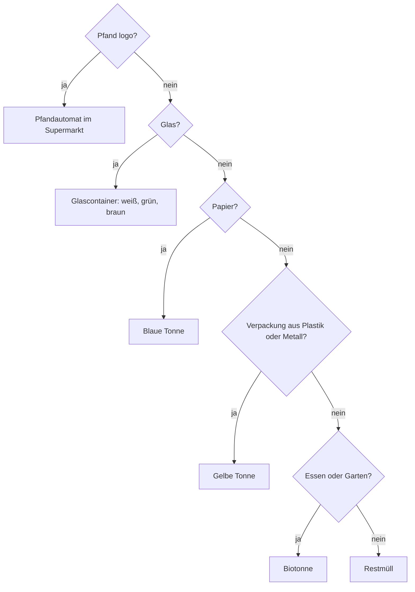

## What this lesson is for

In lesson 15 you learned to talk about rules with *man* and a modal verb (*Hier darf man nicht
rauchen*) and to read short signs like *Rauchen verboten*. In lesson 19 you moved into a flat and
learned to say where things are (*auf dem Tisch, im Bad*). This honors lesson puts the two
together: life in a German block of flats, with its house rules and its famous rubbish bins.

You'll learn to read a real-style *Hausordnung* (house rules), the infinitive used as a command
(*Bitte Tür schließen!*), and the second half of the two-way prepositions, which lesson 19 left
for later: *Wohin?* with the accusative (*Die Flasche kommt in den Glascontainer*).

The customs here are typical for Germany; the exact rules depend on the town and the building.

## Neighbours and the Hausordnung

Most people in German cities rent a flat in a building with several neighbours (*der Nachbar,
die Nachbarin*). They share the stairwell (*das Treppenhaus*), the cellar (*der Keller*), often a
courtyard, and the bins. To keep the peace (*die Ruhe*), almost every building has a *Hausordnung*
hanging in the stairwell. Here is a typical one, written for this course:

> HAUSORDNUNG
>
> 1. Ruhezeiten: Bitte von 22 bis 7 Uhr und von 13 bis 15 Uhr leise sein. Am Sonntag und an Feiertagen ist den ganzen Tag Ruhezeit.
>
> 2. Keine Fahrräder und Kinderwagen im Treppenhaus abstellen.
>
> 3. Im Treppenhaus und im Keller nicht rauchen.
>
> 4. Den Müll bitte richtig trennen.
>
> 5. Die Haustür ab 22 Uhr abschließen.
>
> 6. Auf dem Balkon nur mit einem Elektrogrill grillen.
>
> Vielen Dank! Ihre Hausverwaltung

*House rules. 1. Quiet hours: please be quiet from 10 p.m. to 7 a.m. and from 1 to 3 p.m. On
Sundays and public holidays it's quiet time all day. 2. Don't leave bicycles or prams in the
stairwell. 3. No smoking in the stairwell or the cellar. 4. Please sort your rubbish correctly.
5. Lock the front door from 10 p.m. 6. Barbecues on the balcony with an electric grill only. Many
thanks! Your property management.*

New in passing: *die Ruhezeit* (quiet time), *den ganzen Tag* (all day), *der Kinderwagen*
(pram, stroller), *abstellen* (to put down and leave), *die
Haustür* (front door of the building), *grillen* (to barbecue), *die Hausverwaltung* (the company
that manages the building).

Notice how the rules are written: no *Sie*, no *man*, and the infinitive at the very end.

## Infinitive commands on notices

Notices, instructions and announcements often give an order with just the infinitive, placed at
the end. This is an **infinitive command**. It's impersonal: it talks to nobody in particular, so
it needs no *du* or *Sie*.

| Imperative (lesson 17) | Infinitive command | With man (lesson 15) |
|---|---|---|
| *Schließen Sie bitte die Tür!* | *Bitte Tür schließen!* | *Man muss die Tür schließen.* |
| *Rauchen Sie hier nicht!* | *Hier nicht rauchen!* | *Hier darf man nicht rauchen.* |
| *Steigen Sie bitte ein!* | *Bitte einsteigen!* | *Man soll jetzt einsteigen.* |

How to build one:

1. Start with *bitte* if you like, then everything else in the sentence: the place, the object,
   *nicht*.
2. Put the infinitive last. A separable verb stays joined in one word: *Bitte Tür abschließen!*,
   *Bitte einsteigen!*
3. Leave out the article if you want it to sound like a sign: *Bitte Tür schließen* and *Bitte
   die Tür schließen* are both fine.

You hear them too: on the Berlin U-Bahn a voice says *Zurückbleiben bitte!* (stand back, please)
before the doors close. Recipes are full of them: *Die Kartoffeln waschen und kochen.* — Wash and
boil the potatoes. But don't use them face to face: *Tür schließen!* said to a friend sounds like
an army order. With people, use the imperative and *bitte* (lesson 17).

## Quiet hours and parties

The first rule is about *Ruhezeiten*, which the module 4 honors lesson on clubs and quiet hours
covers in detail: no drilling (*bohren*) or loud music at night or on Sundays. Planning a party?
Put a note in the stairwell first: *Liebe Nachbarn, am Samstag feiern wir eine Party. Es kann ein
bisschen laut werden. Wir bitten um Verständnis!* — Dear neighbours, we're having a party on
Saturday. It may get a bit loud. Thank you for your understanding! (*Wir bitten um Verständnis*,
"we ask for your understanding", is a set phrase on notices.)

## Rubbish: four bins and a bottle bank

Germans sort their rubbish (*den Müll trennen*). The colours below are common, but they vary from
town to town, so check the stickers on the bins.

| Bin | What goes in | Examples |
|---|---|---|
| *die gelbe Tonne* or *der Gelbe Sack* (yellow) | packaging (*die Verpackung*) of plastic and metal | yoghurt pots, tins, plastic wrap, drink cartons |
| *die blaue Tonne*, *die Papiertonne* (blue) | paper and cardboard | newspapers, boxes, envelopes |
| *die Biotonne* (often brown) | food and garden waste | apple cores, vegetable peel, coffee grounds |
| *der Restmüll* (often grey or black) | everything else | old sponges, nappies, broken toys |

Glass doesn't go in any of these. It goes in big street containers, the *Glascontainer*, sorted by
colour: *Weißglas* (clear), *Grünglas* (green) and *Braunglas* (brown). Blue and other colours go
with the green glass. Because they're noisy, glass bins can usually only be used on weekdays
during the day; a sign on the container gives the times.

## Pfand: money back for bottles and cans

Many drinks are sold with a deposit, *das Pfand*: you pay a little extra and get it back when you
return the empty (*leer*) bottle or can. Single-use plastic bottles and drink cans carry a
deposit logo and 25 cents Pfand. Reusable glass and plastic bottles (*Mehrweg*) usually have 8 or
15 cents. In the supermarket you put the empties into a machine, the *Pfandautomat*, which prints a
receipt, the *Pfandbon*. You give it to the cashier at the *Kasse* and the money comes off your
shopping.

Empty bottles standing next to a street bin, not in it, are there on purpose: people who collect
bottles for the deposit can take them easily.

## Wohin? Two-way prepositions with the accusative

In lesson 19 you met nine **two-way prepositions** (*in, an, auf, unter, über, neben, zwischen,
hinter, vor*). With *Wo?* (where something is) they take the dative. With *Wohin?* (where
something goes: movement to a place) they take the accusative.

| | *Wo?* + dative (location) | *Wohin?* + accusative (movement) |
|---|---|---|
| der Sack | *Die Dose ist im (in dem) Gelben Sack.* | *Die Dose kommt in den Gelben Sack.* |
| die Tonne | *Die Zeitung ist in der Papiertonne.* | *Ich werfe die Zeitung in die Papiertonne.* |
| das Treppenhaus | *Das Fahrrad steht im Treppenhaus.* | *Bitte kein Fahrrad ins Treppenhaus stellen!* |
| der Keller | *Die Fahrräder sind im Keller.* | *Wir bringen die Fahrräder in den Keller.* |

Only the article changes: *den* for masculine (lesson 9), *die* and *das* unchanged. *In das* is usually shortened to *ins*, just as *in dem*
becomes *im*. (*Stellen* means to put something somewhere upright, like a bike or a bottle.)

Two verbs help you here: *werfen* (to throw; *du wirfst, er wirft*): *Er wirft die Dose in den
Gelben Sack*; and *kommen in* (to go in, belong in): *Das kommt in die Biotonne.* — That goes in the
organic bin.

The colour adjectives in *die gelbe Tonne*, *den Gelben Sack* have endings you'll study at A2;
learn them as chunks. *Gelber Sack* is often written with a capital G because it's the name of a
thing.

### Example 1: Sorting the kitchen rubbish

After breakfast you have: a yoghurt pot, a newspaper, an apple core, an empty wine bottle (green
glass) and an empty water bottle with a 25-cent Pfand logo. Where does each go?

1. The water bottle has a Pfand logo → back to the shop: *Ich bringe die Flasche in den
   Supermarkt.* That comes first, before you think about glass or plastic.
2. The wine bottle is glass, no Pfand → *Die Weinflasche kommt in den Glascontainer, ins
   Grünglas.*
3. The newspaper is paper → *Die Zeitung kommt in die blaue Tonne.*
4. The yoghurt pot is plastic packaging → *Der Joghurtbecher kommt in die gelbe Tonne.*
5. The apple core is food → *Der Apfelrest kommt in die Biotonne.* (*der Rest*: the rest, leftover)

Each sentence is *Wohin?*, so each bin is accusative: masculine *den Glascontainer, den
Supermarkt*.

### Example 2: Rewriting the house rules

Your neighbour asks what the Hausordnung says. Change each infinitive command into a sentence with
*man* and a modal verb.

1. *Bitte von 22 bis 7 Uhr leise sein.* → *Von 22 bis 7 Uhr muss man leise sein.* (*muss*, because
   it's an obligation)
2. *Im Keller nicht rauchen.* → *Im Keller darf man nicht rauchen.* (*nicht dürfen* = not allowed;
   *nicht müssen* would mean "you don't have to", lesson 15)
3. *Die Haustür ab 22 Uhr abschließen.* → *Ab 22 Uhr muss man die Haustür abschließen.* The
   separable verb is in one piece at the end, because it's an infinitive after a modal.

The time or place phrase comes first, so the modal is in position 2 and *man* follows it.

## Dialogue: Im Treppenhaus

Lukas has just moved in. On the stairs he meets his neighbour, Frau Schmitt.

> Lukas: Guten Tag! Ich bin Lukas Brandt. Ich wohne seit Montag im zweiten Stock.
>
> Frau Schmitt: Ah, der neue Nachbar! Herzlich willkommen. Ich bin Frau Schmitt, ich wohne unten.
>
> Lukas: Freut mich. Sagen Sie, wo sind denn die Mülltonnen?
>
> Frau Schmitt: Im Hof, hinter dem Haus. Papier kommt in die blaue Tonne, Verpackungen in die gelbe.
>
> Lukas: Und die Flaschen?
>
> Frau Schmitt: Die Pfandflaschen bringen Sie in den Supermarkt. Die anderen werfen Sie in den Glascontainer an der Ecke, aber bitte nicht am Sonntag!
>
> Lukas: Ach so. Darf ich am Sonntag bohren? Ich muss noch ein Regal an die Wand hängen.
>
> Frau Schmitt: Lieber nicht. Am Sonntag ist Ruhezeit. Am Samstag ist es kein Problem.
>
> Lukas: Gut, dann mache ich das am Samstag. Vielen Dank!

*Lukas: Hello! I'm Lukas Brandt. I've lived on the second floor since Monday. — Mrs Schmitt: Ah,
the new neighbour! Welcome. I'm Mrs Schmitt, I live downstairs. — Lukas: Nice to meet you. Tell me,
where are the bins? — Mrs Schmitt: In the courtyard, behind the building. Paper goes in the blue
bin, packaging in the yellow one. — Lukas: And bottles? — Mrs Schmitt: You take the deposit
bottles to the supermarket. The others you throw in the bottle bank on the corner, but please not
on Sunday! — Lukas: I see. Am I allowed to drill on Sunday? I still have to hang a shelf on the
wall. — Mrs Schmitt: Better not. Sunday is quiet time. On Saturday it's no problem. — Lukas: Fine,
then I'll do it on Saturday. Thanks a lot!*

*Wohin?* phrases: *in die blaue Tonne, in den Supermarkt, in den Glascontainer, an die Wand*.
*Wo?* phrases: *im zweiten Stock, im Hof, hinter dem Haus, an der Ecke*. New: *hängen* (to hang),
*unten* (downstairs), *der Hof* (courtyard), *lieber nicht* (better not).

## Pronunciation

- *Nachbar*: NACH-bar, with the throaty *ach* sound.
- *Müll*: a short *ü*: say *i* as in *bitte* with tightly rounded lips. Don't say *Mull*.
- *Pfand*: the *pf* is one quick sound; start with *p* and slide into *f*.
- *wirft*: short *i*, and every consonant is said: virft.

## Common mistakes

- Using the dative for movement: *Ich werfe die Dose in der Tonne* is wrong. Throwing goes
  somewhere, so it's *Wohin?*: *in die Tonne*.
- Splitting a separable verb in an infinitive command: *Bitte Tür schließen ab!* is wrong. The
  infinitive stays in one piece: *Bitte Tür abschließen!*
- Using infinitive commands to people: to a friend say *Schließ bitte die Tür!*, not *Tür
  schließen!*
- Putting glass in the yellow bin, or Pfand bottles in the glass container. Pfand bottles go back
  to the shop.
- Saying *Mull* instead of *Müll*: the umlaut matters.

## Key points

- A *Hausordnung* sets the building's rules: quiet hours (*Ruhezeiten*), usually 22 to 6 or 7 Uhr,
  often a midday rest, and quiet all day on Sundays and public holidays.
- Infinitive commands (*Bitte Tür schließen! Nicht rauchen!*) are for notices, announcements and
  recipes: the infinitive goes last, separable verbs stay joined.
- Common bins: *gelb* (packaging), *blau* (paper), *Bio* (food), *Restmüll* (the rest); glass goes
  to the *Glascontainer* by colour; Pfand bottles go back to the shop.
- *Wo?* + dative (*in der Tonne*); *Wohin?* + accusative (*in die Tonne, in den Sack, ins
  Treppenhaus*).

The words from this lesson are listed below; they join your vocabulary reviews when you complete
the lesson.
