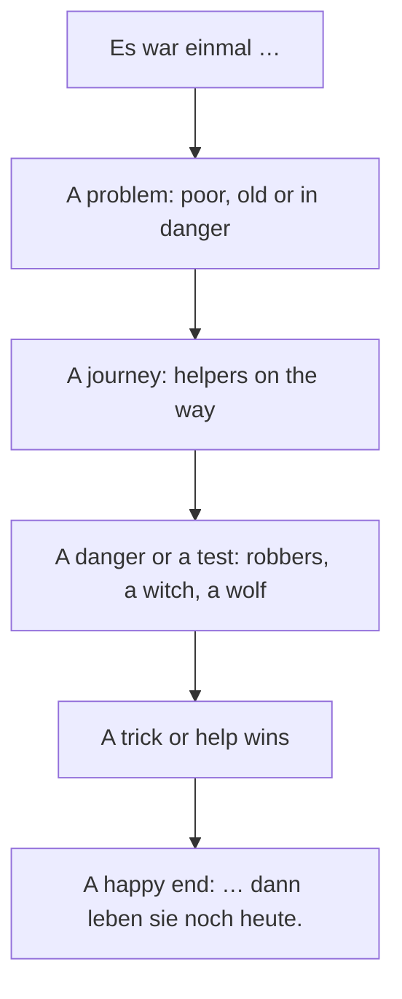

## What this lesson is for

In lessons 21 and 22 you learned to talk about the past with the perfect (*Ich bin nach Bremen
gefahren*) and met *war* and *hatte*, the simple past of *sein* and *haben*. When Germans
*speak* about the past, that's almost all they need. But when they *write* a story, a novel or a
fairy tale, they mostly use the simple past (*Präteritum*) of every verb: *Der Esel lief weg. Er
kam an einen Wald.*

This honors lesson teaches you to recognise those forms, so you can read real stories. You'll
read a German fairy tale, the Brothers Grimm's *Die Bremer Stadtmusikanten* (The Town Musicians of
Bremen), retold in simple German for this course. You won't need to use most of these forms
yourself at A1; the goal is to understand them when you read.

## The Brothers Grimm and their fairy tales

Jacob Grimm (1785–1863) and Wilhelm Grimm (1786–1859) were brothers and scholars of the German
language, born in Hanau, near Frankfurt. In Kassel they collected stories that people told, and
from 1812 they published them as *Kinder- und Hausmärchen* (Children's and Household Tales).
*Hänsel und Gretel*, *Rotkäppchen* (Little Red Riding Hood), *Schneewittchen* (Snow White) and
*Aschenputtel* (Cinderella) all come from this collection. The Grimms kept changing the stories
from one edition to the next; *Die Bremer Stadtmusikanten* first appeared in the second edition,
in 1819.

Today a tourist route, the *Deutsche Märchenstraße* (German Fairy Tale Route), runs about 600
kilometres from Hanau north to Bremen. In Bremen, next to the town hall, stands a bronze statue of
the four animals by the sculptor Gerhard Marcks, set up in 1953. Visitors hold the donkey's front
legs for luck, so they shine like gold.

Many fairy tales follow the same pattern, and knowing it helps you guess what comes next:

The opening *Es war einmal …* means "once upon a time" (literally "there was once"), and many
tales end with *Und wenn sie nicht gestorben sind, dann leben sie noch heute* — "and if they
haven't died, they're still living today", the German "happily ever after".

## The simple past in stories

You know the **simple past** of *sein* and *haben* (*war, hatte*) from lesson 22. Every other verb
has one too. There are two main patterns, matching the weak and strong verbs of the perfect
(lesson 21).

**Weak verbs** add *-te* to the stem. Their past participle ends in *-t*.

| Infinitive | Simple past (er/sie/es) | Perfect |
|---|---|---|
| *sagen* | *sagte* | *hat gesagt* |
| *machen* | *machte* | *hat gemacht* |
| *fragen* | *fragte* | *hat gefragt* |
| *wohnen* | *wohnte* | *hat gewohnt* |
| *arbeiten* | *arbeitete* | *hat gearbeitet* |

Stems ending in *-t* or *-d* add an extra *-e-*, just as in the present (*er arbeitet*): *arbeitete*.

**Strong verbs** change their vowel and add no ending for *ich* and *er/sie/es*. Their past
participle usually ends in *-en*.

| Infinitive | Simple past (er/sie/es) | Perfect |
|---|---|---|
| *gehen* | *ging* | *ist gegangen* |
| *kommen* | *kam* | *ist gekommen* |
| *laufen* | *lief* | *ist gelaufen* |
| *sehen* | *sah* | *hat gesehen* |
| *finden* | *fand* | *hat gefunden* |
| *sitzen* | *saß* | *hat gesessen* |
| *liegen* | *lag* | *hat gelegen* |
| *rufen* | *rief* | *hat gerufen* |
| *schreien* | *schrie* | *hat geschrien* |
| *springen* | *sprang* | *ist gesprungen* |
| *essen* | *aß* | *hat gegessen* |
| *trinken* | *trank* | *hat getrunken* |

For strong verbs there's no rule that gives you the new vowel, so dictionaries and grammar
tables list three forms for each verb: the infinitive, the simple past and the past participle
(*gehen, ging, gegangen*). These are the verb's **principal parts**. Learn them together, like a
noun with its article.

Modal verbs take *-te* and lose their umlaut, as you saw in the module 6 honors lesson: *konnte,
musste, wollte*.

The endings for the other persons are the same as for *war* (lesson 22): *ich ging, du gingst,
er ging, wir gingen, ihr gingt, sie gingen*. In stories you mostly meet *er, sie, es* and *sie*
(plural), so focus on those: *sie gingen*, *sie sagten*.

### How to recognise a simple past form

When you meet an unknown verb form in a story, ask:

1. Does it end in *-te* or *-ten*? Then it's probably a weak verb: take off *-te* and add *-en*
   to find the infinitive (*fragte → fragen*).
2. Is it a short word with a different vowel, and no ending? Then it's probably a strong verb
   (*kam, sah, lief*). Try the vowels you know from the participle or the present: *gesprungen →
   springen → sprang*.
3. Still stuck? Many strong verbs are strong in English too: *drink / drank*, *come / came*,
   *find / found*.

### Example 1: From the simple past to the infinitive

Find the infinitive of each verb in this sentence: *Die Katze saß am Weg und sah die Tiere.*

1. *saß*: short, no ending, vowel *a*. Which verb has an *s* sound and fits "sitting by the
   path"? *sitzen*. The pattern *i → a* is like *trinken → trank*. So *saß* = sat.
2. *sah*: short, no ending. *gesehen*, *sehen*. The vowel *e → a*, as in *essen → aß*. So *sah*
   = saw.
3. Translation: *The cat was sitting by the path and saw the animals.*

## The story: Die Bremer Stadtmusikanten

New words for the story: *der Esel* (donkey), *der Hahn* (rooster), *der Räuber* (robber), *der
Wald* (forest), *das Licht* (light), *die Angst* (fear; *Angst haben*: to be afraid), *der Herr*
(here: master), *traurig* (sad), *weglaufen* (to run away), *bellen* (to bark), *das Gespenst*
(ghost), *die Hexe* (witch).

> Es war einmal ein Esel. Er war alt und konnte nicht mehr schwer arbeiten. Sein Herr wollte ihn nicht mehr haben. Da lief der Esel weg. „Ich gehe nach Bremen", sagte er. „Dort mache ich Musik."
>
> Auf dem Weg fand er einen Hund. Der Hund lag müde an der Straße. „Ich bin alt, und mein Herr will mich nicht mehr", sagte er. „Komm mit nach Bremen!", rief der Esel. „Wir machen zusammen Musik."
>
> Bald sahen sie eine Katze. Sie saß traurig am Weg. Auch sie war alt und konnte keine Mäuse mehr fangen. Die Katze kam mit.
>
> Dann kamen die drei zu einem Bauernhof. Ein Hahn stand auf dem Zaun und rief: „Kikeriki! Morgen kocht die Bäuerin eine Suppe aus mir!" „Komm mit uns!", sagten die Tiere. Und so waren sie zu viert.
>
> Bremen war weit. Am Abend kamen sie in einen Wald. Da sahen sie ein Licht. Es war ein Haus. Der Esel ging zum Fenster und sah hinein. Am Tisch saßen Räuber. Sie aßen und tranken. Die Tiere hatten großen Hunger, und sie machten einen Plan.
>
> Der Esel stand am Fenster. Der Hund sprang auf den Esel, die Katze sprang auf den Hund, und der Hahn flog auf die Katze. Dann machten sie Musik: Der Esel schrie, der Hund bellte, die Katze miaute und der Hahn krähte. Sie fielen durch das Fenster ins Zimmer.
>
> Die Räuber hatten große Angst. „Ein Gespenst!", riefen sie und liefen in den Wald. Die vier Freunde aßen und tranken, und dann gingen sie schlafen.
>
> In der Nacht kam ein Räuber zurück. Im Haus war es dunkel. Die Katze kratzte ihn, der Hund biss ihn ins Bein, der Esel trat ihn, und der Hahn rief: „Kikeriki!" Der Räuber lief zu den anderen zurück. „Im Haus wohnt eine Hexe!", sagte er. Die Räuber kamen nie wieder.
>
> Und die vier Musikanten? Sie fanden das Haus sehr schön und blieben dort. Nach Bremen kamen sie nie.

*Once upon a time there was a donkey. He was old and couldn't do heavy work any more. His master
didn't want him any longer. So the donkey ran away. "I'm going to Bremen," he said. "There I'll
make music." On the way he found a dog. The dog was lying tired by the road. "I'm old, and my
master doesn't want me any more," he said. "Come with me to Bremen!" called the donkey. "We'll
make music together." Soon they saw a cat. She was sitting sadly by the path. She was old too and
couldn't catch mice any more. The cat came along. Then the three came to a farm. A rooster was
standing on the fence and called: "Cock-a-doodle-doo! Tomorrow the farmer's wife is going to make
soup out of me!" "Come with us!" said the animals. And so there were four of them. Bremen was far away. In
the evening they came into a forest. There they saw a light. It was a house. The donkey went to
the window and looked in. Robbers were sitting at the table. They were eating and drinking. The
animals were very hungry, and they made a plan. The donkey stood at the window. The dog jumped
onto the donkey, the cat jumped onto the dog, and the rooster flew onto the cat. Then they made
music: the donkey brayed, the dog barked, the cat miaowed and the rooster crowed. They fell
through the window into the room. The robbers were terrified. "A ghost!" they shouted, and ran
into the forest. The four friends ate and drank, and then they went to sleep. In the night one
robber came back. It was dark in the house. The cat scratched him, the dog bit him in the leg,
the donkey kicked him, and the rooster called "Cock-a-doodle-doo!" The robber ran back to the
others. "A witch lives in the house!" he said. The robbers never came back. And the four
musicians? They liked the house very much and stayed there. They never got to Bremen.*

This retelling is much shorter than the Grimms' version, where the frightened robber describes
each animal as a different monster. Their text is long out of copyright and free to read, but its
German is well above A1, so save it for later.

### Example 2: Following the verbs through a paragraph

Take the paragraph that begins *Der Esel stand am Fenster.* List its verbs and turn each into the
perfect, the way you'd tell the story aloud.

| Simple past | Infinitive | Perfect (spoken) |
|---|---|---|
| *stand* | *stehen* | *hat gestanden* |
| *sprang* | *springen* | *ist gesprungen* |
| *flog* | *fliegen* | *ist geflogen* |
| *machten* | *machen* | *haben gemacht* |
| *schrie* | *schreien* | *hat geschrien* |
| *bellte* | *bellen* | *hat gebellt* |
| *fielen* | *fallen* | *sind gefallen* |

So, told aloud: *Der Hund ist auf den Esel gesprungen, und der Hahn ist auf die Katze geflogen.
Dann haben sie Musik gemacht.* Movement verbs (*springen, fliegen, fallen*) take *sein* in the
perfect, as in lesson 22. *Bellte* and *machten* end in *-te(n)*: weak verbs, like the two animal sounds the table leaves out,
*miaute* (*miauen*) and *krähte* (*krähen*). All the others
change their vowel: strong verbs. (In southern Germany and Austria you'll also hear *ist
gestanden*, lesson 22.)

Notice also *auf den Esel* (accusative, *Wohin?*) but *am Fenster* (dative, *Wo?*), as in the
*Zusammen wohnen* lesson.

## Pronunciation

- *Märchen*: MÄR-chen, with the soft *ch* of *ich*. It's a diminutive (see the next lesson), so it's *das
  Märchen*.
- *Esel*: AY-zel; the *s* between vowels is a soft *z* sound.
- *Räuber*: *äu* sounds like *eu*, "oy": ROY-ber.
- *schrie*: *ie* is a long "ee": shree. *Ging, sang, sprang*: short vowels.
- *Kikeriki*: German roosters say kee-ke-ree-KEE.

## Common mistakes

- Using these forms everywhere when you speak. *Ich ging gestern ins Kino* is correct but sounds
  like a book in most of Germany; in conversation say *Ich bin gestern ins Kino gegangen*. Use the
  simple past freely only for *war, hatte* and the modals.
- Reading *lief* as "left" or *fand* as "fanned": use the principal parts (*laufen, lief,
  gelaufen*) to find the real verb.
- Adding *-te* to a strong verb: *er kommte* or *er gehte* don't exist; it's *kam* and *ging*.
- Expecting an ending on strong verbs with *er/sie/es*: *er kam*, *sie sah*, not *er kamt*.
- Confusing *der Hahn* (rooster) with *das Huhn* (hen, chicken).

## Key points

- Stories, novels and fairy tales are written in the simple past; conversation uses the perfect
  (except *war, hatte* and the modals).
- Weak verbs: stem + *-te* (*sagte, machte*; *arbeitete*). Strong verbs: new vowel, no ending for
  *ich* and *er/sie/es* (*kam, sah, ging, lief*). Modals: *konnte, musste, wollte*.
- Learn strong verbs by their principal parts: *gehen, ging, gegangen*.
- Fairy tales start with *Es war einmal* and often end *… dann leben sie noch heute*.
- *Die Bremer Stadtmusikanten*: donkey, dog, cat and rooster scare robbers out of a house and never
  reach Bremen. The Grimms' *Kinder- und Hausmärchen* appeared from 1812.

The words from this lesson are listed below; they join your vocabulary reviews when you complete
the lesson.
