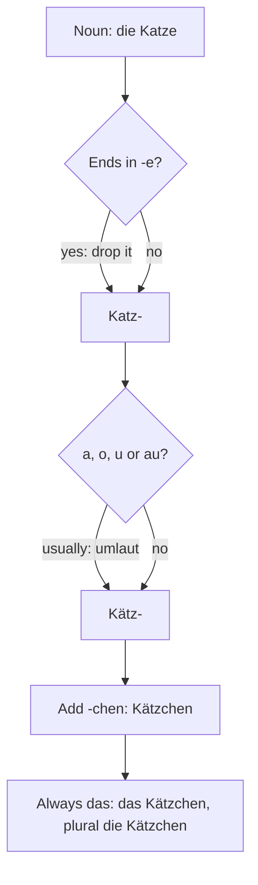

## What this lesson is for

In lesson 12 you met *der Feierabend*, the free time after work, and in lesson 19 the adjective
*gemütlich* (cosy, comfortable). This last honors lesson of the module is about what many people
in Germany do with that free time: an evening in the *Kneipe* (pub), or a weekend in a small rented
garden on the edge of town, the *Kleingarten*.

The grammar point is a family of little words. You already know *das Brötchen* (lesson 9) and *das
Mädchen*, and in the fairy-tale lesson you read *das Märchen*. All three end in *-chen*, and all
three are neuter. Here you'll learn why, and how to make such words yourself.

## Feierabend and Gemütlichkeit

At the end of the working day, colleagues say goodbye with a wish:

- *Schönen Feierabend!* — Have a nice evening! (literally "a nice end of work")
- *Schönes Wochenende!* — Have a nice weekend! (on Friday)
- The answer to both: *Danke, gleichfalls!* — Thanks, you too! (*gleichfalls*: likewise)

*Schönen* and *Schönes* have endings because the whole wish is in the accusative: it's short for
*Ich wünsche Ihnen einen schönen Feierabend* (I wish you a nice evening). Learn the wishes as
chunks.

What makes a Feierabend good? Many Germans would answer with one word: *gemütlich*. The noun is
*die Gemütlichkeit*. It's often called untranslatable, which is an exaggeration, but it does cover
more than "cosiness": warmth, good company, no hurry, and the feeling that you belong. A candle on
the table, a long breakfast on Sunday or friends talking for hours over coffee can all be
*gemütlich*. A useful chunk: *Wir machen es uns gemütlich* — We're making ourselves comfortable.

One classic gemütlich place is *die Kneipe*, a simple pub. Many Kneipen have a *Stammtisch*: a
table kept for a group of regulars who meet there every week, sometimes with a sign on the table
that says so. *Wir haben jeden Donnerstag Stammtisch* — We meet at our regular table every
Thursday. Today the word is also used for any regular meeting: language learners often go to a
*Sprachstammtisch* to practise.

## Der Kleingarten

Most people in German cities live in flats, without a garden (lesson 91). The answer, for many,
is *der Kleingarten*: a small garden you rent in a *Kleingartenanlage*, a group of gardens
with paths, hedges and fences, often near a railway line or on the edge of town. There are about
900,000 of them in Germany. You don't rent one from a landlord but from a club, the
*Kleingartenverein*, so you also become a member, go to meetings and help with jobs everyone
shares.

Another name is *der Schrebergarten*, after Moritz Schreber (1808–1861), a doctor in Leipzig who
wanted city children to play outdoors. In 1864, three years after his death, a club named after
him was founded in Leipzig. It started with a playground; garden plots for families came soon
after, and the idea spread across the country. In Austria the word *Schrebergarten* is common
too; in Switzerland people often say *der Familiengarten*.

A federal law, the *Bundeskleingartengesetz*, sets the main rules. Simplified:

- A garden may be at most 400 square metres.
- It may have a simple hut, *die Laube*, of at most 24 square metres, including a covered seating
  area. You may not live in it.
- Part of the garden must be used to grow fruit and vegetables. Courts have taken this to mean
  roughly a third of the plot; the rest can be lawn, flowers and a place to sit.

Each club also has its own *Gartenordnung* (garden rules) about hedges, water and quiet hours.
In big cities the waiting lists for a garden are often long.

The jobs in the garden have simple verbs: *gießen* (to water: *Ich gieße die Blumen*), *ernten* (to
harvest, pick: *Im Juli ernten wir Erdbeeren*) and *grillen* (to barbecue, lesson 91). The things
you grow: *die Tomate, die Erdbeere* (strawberry), *der Apfel* (lesson 9), *die Blume* (flower).

## The diminutive: -chen and -lein

German makes a "little" version of a noun with an ending: *-chen* or *-lein*. This form is called
the **diminutive**. *Das Haus* is a house; *das Häuschen* is a little house. *Der Baum* is a tree;
*das Bäumchen* is a little tree.

Building one takes three steps:

1. If the noun ends in *-e*, drop it: *die Blume → Blum-*.
2. Most nouns with *a, o, u* or *au* take an umlaut: *Blum- → Blüm-*, *Haus → Häus-*.
3. Add *-chen*: *das Blümchen*, *das Häuschen*.

Two facts make diminutives easy to use:

- **They are always neuter**, whatever the gender of the noun they come from: *der Hund → das
  Hündchen*, *die Katze → das Kätzchen*. This is why *das Mädchen* is neuter even though it means
  a girl (lesson 5).
- **The plural looks the same as the singular**: *ein Brötchen, zwei Brötchen*. Only the article
  changes: *das Brötchen, die Brötchen*.

The ending *-lein* means the same thing. It sounds older or more poetic, and you find it in fairy
tales, songs and southern German: *das Büchlein* (little book), *das Vöglein* (little bird). After
*-ch*, *-lein* is the usual choice, because *Büchchen* is hard to say.

### What diminutives do

A diminutive can simply mean "small": *ein Häuschen im Garten*. But very often it adds a feeling:
something is sweet, dear or harmless. That's why diminutives belong to *Gemütlichkeit*:

- *Trinken wir noch ein Tässchen Kaffee?* — Shall we have another (little) cup of coffee? (*die
  Tasse*: cup)
- *Möchten Sie ein Gläschen Wein?* — Would you like a (little) glass of wine?
- *mein Schätzchen* — my darling (*der Schatz*: treasure)

The little cup isn't smaller than a normal one; the *-chen* makes the offer friendly and relaxed.
Used too much, though, diminutives sound childish or sugary, so use them in friendly offers and
with children and animals, not in a job interview.

### Words that are only diminutives

Some words have *-chen* but no "big" version in everyday German any more. Learn them as normal
words, always with *das*:

| Word | Meaning | Where it comes from |
|---|---|---|
| *das Mädchen* | girl | an old word *Magd* (young woman, maid) |
| *das Märchen* | fairy tale | an old word *Märe* (news, story) |
| *das Brötchen* | bread roll | *das Brot* (bread) |
| *das Kaninchen* | rabbit | there's no *Kanin* today |
| *das Eichhörnchen* | squirrel | *das Eichhorn*, now rare |
| *ein bisschen* | a little | *der Bissen* (a bite) |

Fairy-tale names are full of them: *Rotkäppchen* (Little Red Riding Hood) is the girl with the red
*Käppchen* (little cap, from *die Kappe*), and *Hänsel* and *Gretel* use *-el*, a short form of
the old *-lein*.

### Around the German-speaking countries

Regions have their own little endings, and you'll see them on menus and signs:

| Region | Ending | Examples |
|---|---|---|
| Swabia (south-west Germany) | *-le* | *das Häusle* (little house) |
| Switzerland | *-li* | *das Müesli* (from *Mues*, mash: the origin of *das Müsli*) |
| Bavaria and Austria | *-erl*, *-l* | *das Sackerl* (Austrian for a bag), *das Kipferl* (a crescent-shaped pastry) |

They are all neuter, just like *-chen* and *-lein*. You don't need to make them yourself; just
recognise them.

### Example 1: Making diminutives

Make the diminutive of *der Baum, die Tasse, das Haus* and *der Hund*.

1. *der Baum*: no *-e* to drop; *au* takes an umlaut → *Bäum-*; add *-chen* → *das Bäumchen*.
2. *die Tasse*: drop the *-e* → *Tass-*; *a* → *ä* → *Täss-*; add *-chen* → *das Tässchen*.
3. *das Haus*: *au → äu* → *das Häuschen*. Say it *Häus-chen*: the *s* and the *ch* are separate
   sounds, not *sch*.
4. *der Hund*: *u → ü* → *das Hündchen*.

All four are *das*, though they started as *der, die, das, der*. And the plurals: *die Bäumchen, die
Tässchen, die Häuschen, die Hündchen*.

## Reading: Feierabend im Kleingarten

> Es ist Freitag, fünf Uhr. Endlich Feierabend! Ilse und Kemal fahren mit dem Fahrrad zu ihrem Kleingarten. Der Garten ist nicht groß, aber er hat eine Laube, einen Apfelbaum und drei Beete.
>
> Kemal gießt die Tomaten und die Blumen. Ilse erntet Erdbeeren. Im Garten nebenan sitzt Herr Wolff vor seinem Häuschen und liest die Zeitung. „Na, Frau Berger, möchten Sie ein Gläschen Saft?", fragt er. „Gern!", sagt Ilse.
>
> Am Abend kommen zwei Freunde. Sie grillen Würstchen und essen Kartoffelsalat. Auf dem Zaun sitzt ein Eichhörnchen und schaut zu. Um zehn Uhr sind alle leise, denn ab 22 Uhr ist Ruhezeit, auch im Kleingarten.
>
> „Das war ein schöner Abend. Wirklich gemütlich!", sagt Kemal. Dann fahren sie nach Hause.

*It's Friday, five o'clock. Finally the end of the working day! Ilse and Kemal cycle to their
allotment garden. The garden isn't big, but it has a hut, an apple tree and three beds. Kemal
waters the tomatoes and the flowers. Ilse picks strawberries. In the garden next door Mr Wolff is
sitting in front of his little house reading the newspaper. "Well, Mrs Berger, would you like a
glass of juice?" he asks. "Yes, please!" says Ilse. In the evening two friends come. They grill
sausages and eat potato salad. A squirrel sits on the fence and watches. At ten o'clock everyone
is quiet, because from 10 p.m. it's quiet time, in the allotments too. "That was a lovely evening.
Really cosy!" says Kemal. Then they cycle home.*

New in passing: *nebenan* (next door), *zuschauen* (to watch; separable: *schaut zu*), *das
Würstchen* (sausage), *der Kartoffelsalat* (potato salad).

### Example 2: Finding the diminutives in a text

Find the diminutives in the reading, and for each one give the base word and the article.

1. *Häuschen*: from *das Haus* (*au → äu*). Herr Wolff's *Häuschen* is his *Laube*: a small,
   friendly word for it.
2. *Gläschen*: from *das Glas* (*a → ä*). It's a friendly offer, not a tiny glass.
3. *Würstchen*: from *die Wurst*; usually just means a sausage (often a small one).
4. *Eichhörnchen*: a word that is only a diminutive; it means squirrel, not "small squirrel".

All four are *das*: *das Häuschen, das Gläschen, das Würstchen, das Eichhörnchen*. *Wurst* is
feminine, but *Würstchen* is neuter. Two more words look similar but are not diminutives:
*Kleingarten* (*klein* + *Garten*: a compound, lesson 5) is masculine like *der Garten*, and
*Apfelbaum* is a compound too.

## Pronunciation

- *-chen* always has the soft *ch* of *ich*, even after *a, o, u*: *Häuschen, Brötchen,
  Kaninchen*.
- *s + chen*: *Häus-chen, Gläs-chen, Täss-chen*. Never read *sch* here.
- *Gemütlichkeit*: ge-MÜT-lich-keit; long *ü*, stress on the second syllable.
- *Eichhörnchen*: EICH-hörn-chen, two soft *ch* sounds.
- *gießen*: long *ie*, sharp *ß*: GEE-sen.
- *Laube*: LOU-be, *au* as in "house".

## Common mistakes

- Keeping the old gender: *die Kätzchen* for one kitten, *der Bäumchen*. Every *-chen* and *-lein*
  word is *das*.
- Forgetting the umlaut: *Hundchen, Hauschen*. It's *Hündchen, Häuschen*.
- Adding a plural ending: *zwei Brötchens*. The plural has no ending: *zwei Brötchen*.
- Reading *Häuschen* as *Häu-schen* with *sch*. It's *Häus-chen*.
- Thinking *Kleingarten* is a diminutive: it's a compound, and it's *der*.
- Using diminutives everywhere: they're friendly, but in formal situations they sound childish.
- Calling a Laube a holiday house: you may not live in it.

## Key points

- *Schönen Feierabend! Schönes Wochenende! — Danke, gleichfalls!*
- *Gemütlichkeit*: comfort, warmth, good company and no hurry; *Wir machen es uns gemütlich*.
- A *Stammtisch* is a regulars' table in a *Kneipe*, or any regular meeting.
- A *Kleingarten* (*Schrebergarten*) is rented through a club: at most 400 m², a *Laube* of at most
  24 m², and part of it for fruit and vegetables.
- Diminutive: drop final *-e*, umlaut *a, o, u, au* (usually), add *-chen* or *-lein*.
- Every diminutive is *das*, and its plural looks the same: *das Brötchen, die Brötchen*.
- Diminutives often add a friendly feeling: *ein Tässchen Kaffee*.
- *Mädchen, Märchen, Kaninchen, Eichhörnchen* are words in their own right; regional endings are
  *-le, -li, -erl*.

The words from this lesson are listed below; they join your vocabulary reviews when you complete
the lesson.
