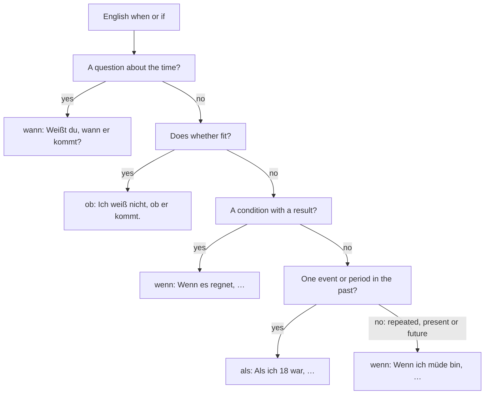

## What this lesson is for

In lesson 3 you learned that *weil* and *dass* send the verb to the end of their clause. This lesson adds four more words that work exactly the same way: *wenn* (if, whenever), *als* (when, for one time in the past), *ob* (whether) and the question words in **indirect questions** (*Weißt du, wann der Zug fährt?*).

The tricky part isn't the word order, which you already know. It's choosing the right word, because English "when" can be *wann*, *wenn* or *als*, and English "if" can be *wenn* or *ob*. By the end of the lesson you'll have a clear rule for each, and you'll be able to talk about plans, problems and decisions: what you'll do if something works out, what you did when something happened, and what you don't know yet.

## wenn: conditions

*wenn* means "if" when it introduces a condition: something that may or may not happen, with a result in the main clause.

- *Wenn das Wetter schön ist, gehen wir schwimmen.* — If the weather is nice, we'll go swimming.
- *Ich komme mit, wenn ich früh genug fertig bin.* — I'll come along if I'm finished early enough.
- *Wenn du Hilfe brauchst, ruf mich an.* — If you need help, call me.

The word order is the one from lesson 3: verb at the end of the *wenn* clause, and if the *wenn* clause comes first, verb, comma, verb: *Wenn das Wetter schön ist, gehen wir …*

Notice that German uses the present tense for both halves, where English often says "will" in the result: *Wenn es klappt, rufe ich dich an.* — If it works out, I'll call you.

You can add *dann* (then) at the start of the main clause for emphasis. It sits in position 1, so the verb still follows straight after: *Wenn du keine Zeit hast, dann machen wir es morgen.*

### falls

*falls* means "in case" or "if (it should happen)". It's a little more careful than *wenn*, for things you don't really expect. The word order is the same:

- *Falls es regnet, nehmen wir den Bus.* — In case it rains, we'll take the bus.
- *Hier ist meine Nummer, falls du Fragen hast.* — Here's my number, in case you have questions.

## wenn and als: "when" in time

*wenn* also means "when" or "whenever" in time, for events that happen again and again, in the present or the past. For one single event or period in the past, German uses *als*.

| | use | example |
|---|---|---|
| *als* | one event or one period in the past | *Als ich 18 war, bin ich nach Berlin gezogen.* |
| *wenn* | something that happens repeatedly (whenever, every time), past or present | *Wenn ich nach Hause komme, koche ich immer zuerst einen Tee.* |
| *wenn* | something in the future | *Wenn ich in Rente bin, reise ich um die Welt.* |

- *Als ich ein Kind war, hatte ich einen Hund.* — When I was a child, I had a dog. (one period of my life)
- *Als wir in Rom ankamen, hat es geregnet.* — When we arrived in Rome, it was raining. (one occasion)
- *Wenn wir Oma besucht haben, gab es immer Kuchen.* — Whenever we visited Grandma, there was always cake. (many times)
- *Immer wenn ich Deutsch spreche, werde ich nervös.* — Every time I speak German, I get nervous.

A memory hook: *als* is for "once, back then". If you can add "every time" or "whenever" in English, use *wenn*.

In an *als* clause, Germans like the simple past, even for verbs that would be in the perfect in conversation: *Als ich ankam*, *Als sie das hörte*. It's the "storytelling" tense from lesson 2.

## wann: the question word

*wann* is the question word "when?" (A1). Use it only in questions, direct or indirect:

- *Wann fängt der Film an?* — When does the film start?
- *Weißt du, wann der Film anfängt?* — Do you know when the film starts?

So the three German "whens":

| English | German | what it does |
|---|---|---|
| When are you coming? | *Wann kommst du?* | asks a question |
| When I was young … | *Als ich jung war, …* | one time in the past |
| When(ever) I'm tired … | *Wenn ich müde bin, …* | repeated, or future |

## Indirect questions with question words

A direct question is the one you actually ask: *Wo ist der Bahnhof?* An indirect question is the same question tucked inside another sentence: *Können Sie mir sagen, wo der Bahnhof ist?* (Can you tell me where the station is?) The question word stays at the front of the clause and works like *weil* or *dass*: the verb goes to the end.

| direct question | indirect question |
|---|---|
| *Wo ist der Bahnhof?* | *Können Sie mir sagen, wo der Bahnhof ist?* |
| *Wann kommt der Bus?* | *Ich weiß nicht, wann der Bus kommt.* |
| *Wie viel kostet das Zimmer?* | *Wissen Sie, wie viel das Zimmer kostet?* |
| *Warum ist er so wütend?* | *Ich verstehe nicht, warum er so wütend ist.* |
| *Was hast du gesagt?* | *Ich habe vergessen, was du gesagt hast.* |

Indirect questions are very useful for being polite. *Wo ist die Toilette?* is fine, but *Können Sie mir sagen, wo die Toilette ist?* is softer, the way you'd ask a stranger. Typical openings:

- *Können Sie mir sagen, …?* — Can you tell me …?
- *Weißt du / Wissen Sie, …?* — Do you know …?
- *Ich weiß nicht, …* — I don't know …
- *Ich möchte wissen, …* — I'd like to know …
- *Ich habe keine Ahnung, …* — I have no idea …

Punctuation: if the whole sentence is a question (*Wissen Sie, …?*), end with a question mark. If it's a statement (*Ich weiß nicht, …*), end with a full stop.

## ob: yes/no questions

A **yes/no question** has no question word: *Kommt er morgen?* To make it indirect, German uses *ob* (whether, if):

| direct | indirect |
|---|---|
| *Kommt er morgen?* | *Ich weiß nicht, ob er morgen kommt.* |
| *Ist die Apotheke heute geöffnet?* | *Weißt du, ob die Apotheke heute geöffnet ist?* |
| *Ist das möglich?* | *Können Sie mir sagen, ob das möglich ist?* |

Here's the big trap for English speakers. English uses "if" for both conditions and indirect questions: "I don't know if he's coming." German keeps them apart:

| English "if" | German | test |
|---|---|---|
| condition: *If he comes, …* | *Wenn er kommt, …* | there's a result: "if …, then …" |
| indirect question: *I don't know if he's coming.* | *Ich weiß nicht, ob er kommt.* | you can say "whether" in English |

The test works every time: if "whether" fits, use *ob*.

Here are all the "when" and "if" words of this lesson in one chart:

## Decisions, plans and problems

The theme words of this lesson help you talk about the future and about choices:

| German | English |
|---|---|
| *entscheiden* / *die Entscheidung* | to decide / decision |
| *vorhaben* | to plan, to intend (separable: *Was hast du vor?*) |
| *planen* | to plan |
| *versuchen* / *der Versuch* | to try / attempt |
| *schaffen* | to manage, to make it |
| *klappen* | to work out (colloquial) |
| *aufgeben* | to give up |
| *erreichen* | to reach, to achieve |
| *ändern* / *die Änderung* | to change / change |
| *die Möglichkeit* | possibility, opportunity |
| *das Ziel* | goal, aim |
| *die Zukunft* | the future |

Some of these turn up in fixed phrases:

- *Was hast du am Wochenende vor?* — What are you doing at the weekend? (*vorhaben* is the normal way to ask about someone's plans.)
- *Hat es geklappt?* — Did it work out?
- *Das schaffst du!* — You can do it!
- *Auf jeden Fall!* — Definitely! In any case!
- *Ich habe mich noch nicht entschieden.* — I haven't decided yet. (reflexive *sich entscheiden*: take it as a chunk.)

When you weigh up the options:

- *Ich überlege noch.* — I'm still thinking about it.
- *Das ist leider unmöglich.* — Unfortunately that's impossible.
- *Das Risiko ist mir zu groß.* — The risk is too big for me.
- *Es gibt eine Änderung: Das Treffen ist erst um drei.* — There's a change: the meeting isn't until three.

*ändern* means to change something, but not to switch one thing for another: that's *wechseln* (lesson 1). *Ich ändere meinen Plan* (I change my plan), but *Ich wechsle die Stelle* (I switch jobs).

## Dialogue: Hamburg oder nicht?

Selin has been offered a job in Hamburg. She talks it over with her friend David.

> David: Und? Hast du dich schon entschieden?
>
> Selin: Nein, noch nicht. Ich weiß wirklich nicht, ob ich die Stelle nehmen soll.
>
> David: Was ist denn das Problem? Das war doch immer dein Ziel.
>
> Selin: Ja, schon. Als ich mit dem Studium fertig war, wollte ich sofort nach Hamburg. Aber jetzt habe ich hier meine Freunde, meine Wohnung, meinen Verein …
>
> David: Kannst du nicht fragen, ob du ein paar Tage pro Woche von zu Hause arbeiten kannst?
>
> Selin: Das habe ich schon versucht. Die Chefin hat gesagt, dass es am Anfang nicht möglich ist. Vielleicht später.
>
> David: Und weißt du schon, wann du anfangen müsstest?
>
> Selin: Am ersten März. Wenn ich zusage, muss ich bis Ende Januar eine Wohnung finden. Das schaffe ich nie!
>
> David: Doch, das schaffst du. Und falls es nicht klappt, kannst du am Anfang bei meinem Bruder wohnen. Er hat ein Gästezimmer.
>
> Selin: Wirklich? Das ändert natürlich viel.
>
> David: Hör mal, so eine Chance kommt nicht jedes Jahr. Wenn du es nicht versuchst, ärgerst du dich in zehn Jahren.
>
> Selin: Du hast recht. Ich rufe sie morgen an. Auf jeden Fall!

In English:

> David: Well? Have you decided yet?
>
> Selin: No, not yet. I really don't know whether I should take the job.
>
> David: So what's the problem? That was always your goal.
>
> Selin: Yes, it was. When I finished my degree, I wanted to go to Hamburg straight away. But now I have my friends here, my flat, my club …
>
> David: Can't you ask whether you can work from home a few days a week?
>
> Selin: I've already tried that. The boss said it isn't possible at the start. Maybe later.
>
> David: And do you know yet when you'd have to start?
>
> Selin: On the first of March. If I say yes, I have to find a flat by the end of January. I'll never manage that!
>
> David: Yes, you will. And in case it doesn't work out, you can stay with my brother at the start. He has a guest room.
>
> Selin: Really? That changes a lot, of course.
>
> David: Listen, a chance like that doesn't come every year. If you don't try, you'll be annoyed with yourself in ten years.
>
> Selin: You're right. I'll call her tomorrow. Definitely!

Spot the clauses: *ob ich die Stelle nehmen soll* and *ob du … arbeiten kannst* are indirect yes/no questions; *wann du anfangen müsstest* is an indirect question with a question word; *Als ich mit dem Studium fertig war* is one time in the past; *Wenn ich zusage* and *Wenn du es nicht versuchst* are conditions; *falls es nicht klappt* is "in case". (*zusagen* = to accept, say yes; *der Verein* = club; *müsstest* = would have to, lesson 15; *sich ärgern* = to be annoyed, lesson 5.)

## Pronunciation

- *wenn* has a short *e* like "pen"; *wann* has a short *a* like "fun". Say them clearly, because they mean different things.
- *ob* ends in a *p* sound: "op".
- *die Entscheidung*: ent-SCHEI-dung; *entscheiden*: ent-SCHEI-den.
- *die Möglichkeit*: MÖG-lich-keit, the *g* sounds like *k*.
- *die Chance* is French: SHAHN-se (or SHANG-se).
- *vorhaben*: VOR-ha-ben, stress on the separable prefix.

## Common mistakes

- *Wenn ich ein Kind war, …* — One period in the past needs *als*: *Als ich ein Kind war, …*
- *Als ich nach Hause komme, …* — *als* is past only. Present and future: *Wenn ich nach Hause komme, …*
- *Ich weiß nicht, wenn er kommt.* — Use *ob* for "whether" (*ob er kommt*) or *wann* for "at what time" (*wann er kommt*). *wenn* never starts an indirect question.
- *Wann ich Zeit habe, komme ich.* — *wann* is only for questions: *Wenn ich Zeit habe, …*
- *Können Sie mir sagen, wo ist der Bahnhof?* — Verb to the end: *wo der Bahnhof ist.*
- *Wenn es regnet, wir bleiben zu Hause.* — Verb, comma, verb: *Wenn es regnet, bleiben wir zu Hause.*
- *Ich ändere die Stelle.* — For switching one thing for another, use *wechseln*.

## Key points

- *wenn* = if (condition) and when/whenever (repeated or future). *falls* = in case.
- *als* = when, for one event or one period in the past. *wann* = when, only in questions.
- Indirect questions keep the question word at the front and send the verb to the end: *Weißt du, wo sie wohnt?*
- Yes/no questions become indirect with *ob*: *Ich weiß nicht, ob er kommt.* If "whether" fits in English, use *ob*.
- All of these follow the *weil/dass* word order: verb at the end; and verb, comma, verb when the clause comes first.
- Plans and decisions: *Was hast du vor? Hat es geklappt? Das schaffst du! Auf jeden Fall!*

The words from this lesson are listed below; they join your vocabulary reviews when you complete the lesson.
