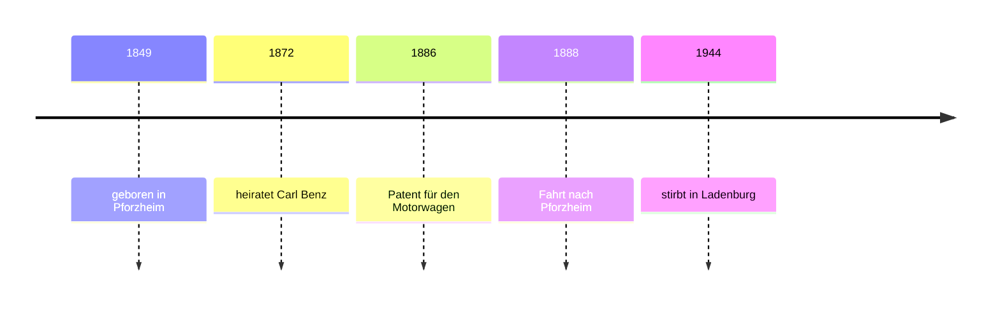

## From your story to someone else's

In lesson 1 you told your own life story in the perfect; in lesson 2 you learned to *recognise* the simple past (*ging, kam, fand*), the tense of written stories. This honors lesson takes the next step: you'll read a longer biography of a real person, build the simple past of any verb from its dictionary entry, and write a short third-person biography, the way an encyclopedia or a museum sign does. You'll also turn a German tabular CV, *der Lebenslauf*, into sentences.

Producing the simple past of all verbs is officially B1 material, so treat this lesson as a head start. You only need the third-person forms (*er, sie, es* and plural *sie*), because those are the forms biographies use.

## Why biographies use the simple past

A biography is a written story about the past, and in German written stories the simple past is the normal tense. You *can* write *Sie hat 1872 geheiratet*, but in a printed biography it sounds like someone chatting. Compare:

| spoken (perfect) | written biography (simple past) |
|---|---|
| *Sie ist in Pforzheim aufgewachsen.* | *Sie wuchs in Pforzheim auf.* |
| *Er hat Medizin studiert.* | *Er studierte Medizin.* |
| *Sie ist 1944 gestorben.* | *Sie starb 1944.* |

*wurde … geboren* is the standard way to give a birth in a biography (*Sie wurde 1849 geboren*), especially for people who have died. (News reports often open with a perfect sentence and then continue in the simple past; a biography sticks to the simple past.)

## The three forms of a verb

Dictionaries and grammar books list a verb with three forms: the infinitive, the simple past and the past participle, for example *fahren – fuhr – gefahren*. These are the verb's **principal parts**. Learn them together, and you can build every tense you know: *er fährt, er fuhr, er ist gefahren*.

### Weak verbs: -te

Weak verbs are completely regular. Take the stem and add *-te* for *er/sie/es*, *-ten* for the plural:

- *heiraten → sie heiratete, sie heirateten*
- *gründen → er gründete*; *arbeiten → sie arbeitete*
- *studieren → er studierte*; *reparieren → sie reparierte*
- *wohnen → sie wohnte*; *leben → er lebte*

Stems ending in *-t* or *-d* (and a few others, like *öffnen → öffnete*) add *-ete*, so you can hear the ending. If you know the participle ends in *-t* without a new vowel (*geheiratet, studiert*), the simple past is *-te*.

### Strong verbs: learn the vowel

Strong verbs change their stem vowel. This vowel change is called **ablaut**, and it's very old: English has it too (*sing – sang – sung, drive – drove – driven*). The vowels aren't random. Most strong verbs fall into a handful of patterns:

| pattern | infinitive – simple past – participle | more verbs like it |
|---|---|---|
| ei → ie → ie | *bleiben – blieb – geblieben* | *schreiben, scheinen* |
| ie → o → o | *fliegen – flog – geflogen* | *ziehen – zog – gezogen* |
| i → a → u | *finden – fand – gefunden* | *trinken, beginnen – begann – begonnen* |
| e → a → o | *sprechen – sprach – gesprochen* | *sterben – starb, helfen – half, nehmen – nahm* |
| e → a → e | *geben – gab – gegeben* | *sehen – sah, lesen – las, essen – aß* |
| a → u → a | *fahren – fuhr – gefahren* | *tragen – trug, wachsen – wuchs* |
| a (au) → ie/i → a (au) | *schlafen – schlief – geschlafen* | *fallen – fiel, halten – hielt, laufen – lief – gelaufen* |

A few very common verbs don't fit a pattern and are simply learned: *gehen – ging – gegangen, kommen – kam – gekommen, stehen – stand – gestanden, sein – war – gewesen, werden – wurde – geworden*. The *er/sie/es* form has no ending at all (*er fuhr, sie starb*); the plural adds *-en* (*sie fuhren, sie starben*).

### Mixed verbs

You know them from lessons 1 and 2: a new vowel *and* *-te*: *bringen – brachte, denken – dachte, kennen – kannte, wissen – wusste, nennen – nannte*.

### Prefixes

An inseparable prefix simply stays: *verlassen → sie verließ*, *bekommen → er bekam*, *erfinden → er erfand*. A separable prefix behaves as it does in the present: in a main clause it goes to the end; in a subordinate clause it joins up again.

- *Sie wuchs in Pforzheim auf.* — She grew up in Pforzheim.
- *1990 zog er nach Wien um.* — In 1990 he moved to Vienna.
- *Als sie in Pforzheim ankam, war es schon dunkel.* — When she arrived in Pforzheim, it was already dark.

### Example 1: building the forms from a dictionary entry

You want to write "She left school at 16 and moved to Hamburg." A dictionary gives you *verlassen – verließ – verlassen* and *umziehen – zog um – umgezogen*.

1. Subject *sie*, third person singular: no ending on a strong simple past, so *verließ* and *zog … um*.
2. Main clause: *zog* in position 2, *um* at the end.
3. Time phrase: *mit 16* (lesson 1).

Result: *Mit 16 verließ sie die Schule und zog nach Hamburg um.* With *und* joining two main clauses, the second one keeps normal order, and its subject can be left out because it's the same person.

## The biography toolkit

These phrases appear in almost every short biography:

| German | English |
|---|---|
| *X wurde am 3. Mai 1849 in … geboren.* | X was born on 3 May 1849 in … |
| *Sie wuchs in … auf.* | She grew up in … |
| *Er besuchte die Schule in … / machte 1990 das Abitur.* | He went to school in … / took his Abitur in 1990. |
| *Sie studierte … / machte eine Ausbildung als …* | She studied … / trained as a … |
| *Er arbeitete als …* | He worked as a … |
| *1872 heiratete sie …* | In 1872 she married … |
| *Sie gründete eine Firma.* | She founded a company. |
| *Er starb 1944 im Alter von 95 Jahren.* | He died in 1944 at the age of 95. |

To move the story forward, use time words in position 1, followed directly by the verb: *Zwei Jahre später zog sie …*, *Kurz danach bekam er …*, *Damals gab es …*, *Ab 1890 arbeitete sie …*. For something that is still true today, switch to the present: *Seit 2025 hat er eine eigene Werkstatt.*

## Text: Bertha Benz und die erste lange Autofahrt

> Bertha Ringer wurde am 3. Mai 1849 in Pforzheim geboren und wuchs dort auf. 1872 heiratete sie den Ingenieur Carl Benz. Carl hatte eine große Idee: einen Wagen mit Motor, ohne Pferde. Aber er hatte kaum Geld. Bertha glaubte an seine Idee und gab das Geld von ihrer Familie für seine kleine Firma.
>
> 1886 bekam Carl ein Patent für seinen „Motorwagen“. Aber nur wenige Menschen interessierten sich für das Auto. Viele fanden es laut und gefährlich. Bertha wollte allen zeigen, dass das Auto auch weite Strecken fahren kann.
>
> Am 5. August 1888 fuhr sie früh am Morgen mit ihren Söhnen Eugen (15) und Richard (13) heimlich los. Carl wusste nichts davon. Ihr Ziel war Pforzheim, wo ihre Mutter lebte, rund 100 Kilometer von Mannheim entfernt. Unterwegs gab es viele Probleme. Tankstellen gab es noch nicht, und der Wagen brauchte Ligroin, eine Art Benzin aus der Apotheke. In Wiesloch kaufte Bertha es in der Stadt-Apotheke und tankte. Heute nennt man diese Apotheke oft „die erste Tankstelle der Welt“.
>
> Eine Leitung war verstopft; Bertha machte sie mit ihrer Hutnadel wieder frei. Ein Schmied reparierte die Kette, und weil die Bremsen aus Holz nicht mehr gut funktionierten, machte ein Schuster Leder auf die Bremsen. Bergauf war der Motor zu schwach, und die Söhne mussten oft schieben.
>
> Am Abend, als es schon dunkel war, kamen sie in Pforzheim an. Bertha schickte Carl ein Telegramm. Ein paar Tage später begann die Rückfahrt nach Mannheim. Nach der Reise hatte Bertha Ideen für Carl: Das Auto brauchte zum Beispiel einen weiteren Gang für die Berge.
>
> Bertha Benz starb am 5. Mai 1944 in Ladenburg, zwei Tage nach ihrem 95. Geburtstag. Heute kann man ihre Strecke auf der „Bertha Benz Memorial Route“ nachfahren.

In English:

> Bertha Ringer was born in Pforzheim on 3 May 1849 and grew up there. In 1872 she married the engineer Carl Benz. Carl had a big idea: a carriage with an engine, without horses. But he had hardly any money. Bertha believed in his idea and gave the money from her family to his small company.
>
> In 1886 Carl got a patent for his "motor car". But only a few people were interested in the car. Many found it loud and dangerous. Bertha wanted to show everyone that the car could travel long distances too.
>
> On 5 August 1888 she set off secretly early in the morning with her sons Eugen (15) and Richard (13). Carl knew nothing about it. Her destination was Pforzheim, where her mother lived, about 100 kilometres from Mannheim. On the way there were many problems. There were no petrol stations yet, and the car needed ligroin, a kind of petrol from the pharmacy. In Wiesloch Bertha bought it at the town pharmacy and filled up. Today this pharmacy is often called "the first petrol station in the world".
>
> A fuel line was blocked; Bertha cleared it with her hatpin. A blacksmith repaired the chain, and because the wooden brakes no longer worked well, a cobbler put leather on the brakes. Uphill the engine was too weak, and the sons often had to push.
>
> In the evening, when it was already dark, they arrived in Pforzheim. Bertha sent Carl a telegram. A few days later the return journey to Mannheim began. After the trip Bertha had ideas for Carl: for example, the car needed an extra gear for the hills.
>
> Bertha Benz died in Ladenburg on 5 May 1944, two days after her 95th birthday. Today you can drive her route on the "Bertha Benz Memorial Route".

Notice the forms: weak *heiratete, kaufte, tankte, reparierte, schickte*; strong *wuchs … auf, gab, fuhr … los, fanden, kamen … an, begann, starb*; mixed *wusste*; and *wurde … geboren, war, hatte, wollte, mussten*. The one present tense, *Heute nennt man …*, is about today. *dass das Auto … fahren kann* keeps the present because it's what Bertha wanted to show in general. (*der Ingenieur* = engineer; *die Strecke* = distance, route; *die Leitung* = pipe, line; *verstopft* = blocked; *die Hutnadel* = hatpin; *der Schmied* = blacksmith; *der Schuster* = cobbler; *das Leder* = leather; *bergauf* = uphill; *schieben* = to push; *der Gang* = gear.)

The story is simplified; popular versions add details (a note on the kitchen table, Carl asleep) that aren't well documented, so they're left out.

### Example 2: from a spoken story to a written biography

In lesson 1 Tomasz told his story in the perfect: *Ich bin 1987 in Breslau geboren. Dort bin ich auch aufgewachsen. Nach dem Abitur habe ich in Krakau Chemie studiert. 2013 habe ich ein Angebot aus Leipzig bekommen und habe meine Heimat verlassen.* Turn it into a newsletter biography.

1. Change the person: *ich → er*, *meine → seine*.
2. Change the tense: *bin geboren → wurde geboren*; *bin aufgewachsen → wuchs auf* (separable: *auf* at the end); *habe studiert → studierte*; *habe bekommen → bekam*; *habe verlassen → verließ*.
3. Join short sentences with *und* where the subject is the same.

Result: *Tomasz Nowak wurde 1987 in Breslau geboren und wuchs dort auch auf. Nach dem Abitur studierte er in Krakau Chemie. 2013 bekam er ein Angebot aus Leipzig und verließ seine Heimat.*

## The German Lebenslauf

In German-speaking countries a job application usually includes a tabular CV: short lines with dates on the left and facts on the right, not full sentences. These are common conventions, not legal rules:

- Newest first: today most people list their current job at the top of each section (*seit 06/2025*), then go back in time.
- Sections such as *Persönliche Daten*, *Berufserfahrung* (work experience), *Ausbildung* (education and training) and *Sprachkenntnisse* (languages), often also *Kenntnisse* (skills) and *Interessen*.
- Dates as month/year: *10/2013 – 05/2025*.
- A photo was standard for a long time. Today it's optional, and many employers no longer expect one.
- A printed CV often ends with place, date and signature.

![A German CV for Tomasz Nowak. At the top the heading Lebenslauf and a photo on the right. Sections: Persönliche Daten (name, date of birth 14.03.1987 in Wrocław, address in Leipzig); Berufserfahrung (since 06/2025 owner of a piano workshop; 10/2013 to 05/2025 chemist at a paint company); Ausbildung (10/2006 to 07/2012 chemistry degree in Kraków; 06/2006 Abitur in Wrocław); Sprachkenntnisse (Polish native language, German very good C1, English good B2). At the bottom: Leipzig, 12.05.2026 and a signature.](images/de2-m1-lebenslauf.svg)

### Example 3: from CV lines to sentences

Turn Tomasz's CV into a short third-person text.

1. *Persönliche Daten* → the birth sentence: *Tomasz Nowak wurde am 14. März 1987 in Wrocław geboren.*
2. *Ausbildung*, oldest first, because a biography tells the story in order: *2006 machte er das Abitur. Von 2006 bis 2012 studierte er Chemie in Krakau.*
3. *Berufserfahrung*: the finished job in the simple past, the current one in the present: *Von 2013 bis 2025 arbeitete er als Chemiker bei einer Firma in Leipzig. Seit Juni 2025 hat er eine eigene Klavierwerkstatt.*

So a CV lists newest first, but a biography tells the story oldest first. With *seit* and something still true, use the present tense, never the simple past.

## Common mistakes

- *Sie aufwuchs in Pforzheim.* — In a main clause the separable prefix goes to the end: *Sie wuchs in Pforzheim auf.*
- *Er studierte von 2006 bis 2012 Chemie und dann er zog nach Leipzig.* — *dann* in position 1 is followed by the verb: *und dann zog er nach Leipzig*.
- *Sie heiratet 1872.* — Without *-te* it's the present. Past: *heiratete*.
- *Er fuhrte, sie gabte.* — Strong verbs take no *-te*: *fuhr, gab*.
- *Seit 2025 arbeitete sie bei Siemens.* — If it's still true, use the present: *Seit 2025 arbeitet sie bei Siemens.*
- Mixing tenses at random: choose the simple past for the whole story and only switch to the present for what is true today.

## Key points

- Biographies, encyclopedias and other written stories use the simple past; *wurde … geboren* and *starb* are the standard birth and death verbs.
- Learn every verb by its principal parts: *fahren – fuhr – gefahren*.
- Weak verbs add *-te* (*heiratete, gründete*); strong verbs change the vowel by ablaut and have no ending for *er/sie/es* (*fuhr, starb*); mixed verbs do both (*wusste*).
- Separable prefixes go to the end of a main clause (*wuchs … auf*) and join up in a subordinate clause (*als sie ankam*).
- A German Lebenslauf is a table, usually newest first; a biography tells the story oldest first.
- For something still true today, use *seit* + present.

The words from this lesson are listed below; they join your vocabulary reviews when you complete the lesson.
