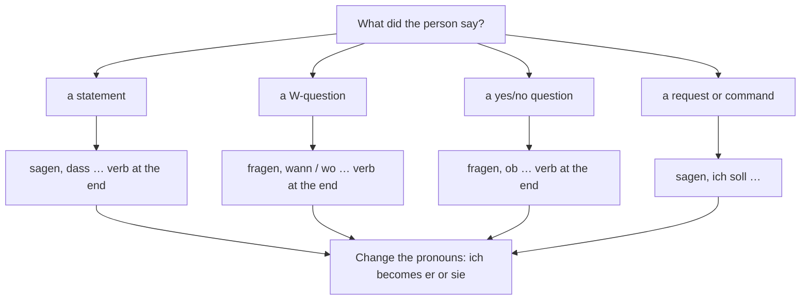

## Putting lessons 3 and 4 to work

In lesson 3 you learned *dass*: *Ich glaube, dass er recht hat.* In lesson 4 you learned indirect questions with question words and *ob*: *Weißt du, ob er kommt?* Put those together and you have one of the most useful skills in daily life: passing on what someone else said or asked. A colleague calls while your boss is out, a neighbour leaves a message for your flatmate, a friend tells you a secret you mustn't repeat.

When you quote someone's exact words, with quotation marks, that's **direct speech**: *Anna sagt: „Ich bin krank.“* When you pass on the content in your own sentence, that's **reported speech**: *Anna sagt, dass sie krank ist.* This lesson shows you the everyday way Germans report statements, questions and requests, the pronoun changes that go with it, and, as a preview, the special verb forms you'll see in newspapers.

German quotation marks look like this: „…“ (low at the start, high at the end). You'll see them in the examples below.

## Reporting a statement

Use a verb of saying (*sagen, erzählen, meinen, schreiben, erklären, antworten*) and *dass*, with the verb at the end. Or, as in lesson 3, leave out *dass* and use main-clause order:

| direct speech | reported speech |
|---|---|
| Lea: „Ich habe keine Zeit.“ | *Lea sagt, dass sie keine Zeit hat.* / *Lea sagt, sie hat keine Zeit.* |
| Tim: „Der Film war super.“ | *Tim hat erzählt, dass der Film super war.* |

### Keep the tense

English usually shifts the tense back when reporting: "Lea said she *had* no time." In everyday German you normally keep the tense the speaker used:

- Lea (yesterday): „Ich habe keine Zeit.“ → *Lea hat gesagt, dass sie keine Zeit hat.* — Lea said she had no time.
- Tim: „Ich komme morgen.“ → *Tim hat gesagt, dass er morgen kommt.* — Tim said he would come tomorrow.

So the reporting verb is in the perfect (*hat gesagt*), but the reported part stays as it was. This is simpler than English, and it's what you'll hear every day.

### Change the point of view

What does change is who is speaking. Pronouns and possessives must fit the new speaker, and so must words like *hier* and *morgen*:

| direct | reported | why |
|---|---|---|
| *ich, mein* | *er/sie, sein/ihr* | the speaker is now "he" or "she" |
| *du, dein* (said to you) | *ich, mein* | you are reporting what was said to you |
| *hier* | *dort, da* | you're somewhere else now |
| *morgen* (said last week) | *am nächsten Tag* | if "tomorrow" is already over |

### Example 1: pronouns step by step

Your friend Lukas texts you: „Ich habe meinen Schlüssel bei dir vergessen. Kannst du ihn morgen mitbringen?“ Your flatmate asks what Lukas wanted.

1. *ich → er*, *meinen → seinen* (Lukas is "he" now).
2. *bei dir → bei mir* (the "you" in his message is you, the one speaking now).
3. *du → ich*, *ihn* (the key) stays *ihn*.
4. The question is a yes/no question, so it needs *ob* (see below); the verb goes to the end.

Result: *Lukas hat geschrieben, dass er seinen Schlüssel bei mir vergessen hat. Er hat gefragt, ob ich ihn morgen mitbringen kann.*

## Reporting a question

This is lesson 4 again, with *fragen* or *wissen wollen* (to want to know) in front.

- A W-question keeps its question word: „Wann fängt der Kurs an?“ → *Sie hat gefragt, wann der Kurs anfängt.*
- A yes/no question takes *ob*: „Hast du Hunger?“ → *Er hat gefragt, ob ich Hunger habe.*
- *wissen wollen* sounds a little more insistent: *Die Polizei wollte wissen, wo ich um zehn war.*

The verb goes to the end, and a separable verb joins up again: *anfängt, mitbringen kann*. A reported question is a statement, so it ends with a full stop, not a question mark.

### Example 2: two questions at once

Your boss calls: „Wann kommt Herr Roth zurück? Hat er den Bericht schon geschickt?“ You leave a note for Herr Roth.

1. First question: W-word *wann*, verb to the end, separable verb joins up: *wann Sie zurückkommen*. (You're writing *to* Herr Roth, so *er* becomes *Sie*.)
2. Second question: yes/no, so *ob*; perfect with the auxiliary last: *ob Sie den Bericht schon geschickt haben*.
3. Link them with *und*.

Result: *Frau Schäfer hat gefragt, wann Sie zurückkommen und ob Sie den Bericht schon geschickt haben.*

## Reporting a request or a command

An imperative can't be reported directly. German uses *sollen* (to be supposed to) instead:

- „Ruf mich an!“ → *Sie hat gesagt, ich soll sie anrufen.* — She said I should call her.
- „Bringen Sie bitte den Ausweis mit!“ → *Der Arzt hat gesagt, dass ich den Ausweis mitbringen soll.*

In speech you'll also hear *sollte* here (*Sie hat gesagt, ich sollte sie anrufen*), with the same meaning. Polite requests in question form are reported like questions: „Kannst du mir helfen?“ → *Er hat gefragt, ob ich ihm helfen kann.*

## Messages: on the phone, on a note, on the mailbox

Passing on messages has its own set phrases:

- *Kann ich etwas ausrichten?* — Can I take a message? (*ausrichten* = to pass on a message)
- *Richten Sie ihr bitte aus, dass ich später komme.* — Please tell her I'll be late.
- *Ich sage es weiter.* — I'll pass it on. (*weitersagen* = to tell others)
- *Sie hat dir auf die Mailbox gesprochen.* — She left you a voicemail.
- *Ich habe dir einen Zettel auf den Tisch gelegt.* — I've left you a note on the table.

And for secrets: *Das ist ein Geheimnis. Versprichst du mir, dass du es nicht weitersagst?* — It's a secret. Do you promise not to tell anyone? *Verrat es niemandem!* — Don't give it away to anyone! (*versprechen – versprach – versprochen*; *verraten – verriet – verraten*; *du verrätst, er verrät*.)

### Example 3: from the mailbox to a note

Your flatmate Mara is out. Her doctor's practice leaves a voicemail: „Guten Tag, hier ist die Praxis Dr. Becker. Frau Klein, Ihr Termin am Donnerstag fällt leider aus. Können Sie am Freitag um zehn kommen? Bitte rufen Sie uns zurück.“ Write Mara a note.

1. Who called: *Die Praxis Dr. Becker hat angerufen.*
2. The statement: *Ihr Termin* (said to Mara) becomes *dein Termin*, since you write *du* to Mara; *fällt aus* (is cancelled) joins up at the end: *dass dein Termin am Donnerstag ausfällt*.
3. The yes/no question: *ob du am Freitag um zehn kommen kannst*.
4. The request: *Du sollst sie zurückrufen.* (*sie* = the people at the practice.)

The note:

> Hallo Mara, die Praxis Dr. Becker hat angerufen. Sie haben gesagt, dass dein Termin am Donnerstag ausfällt. Sie wollen wissen, ob du am Freitag um zehn kommen kannst. Du sollst sie zurückrufen. Jonas

## Text: Das Gerücht im dritten Stock

Germans call the children's game in which a message is whispered from one person to the next *Stille Post* ("silent mail"). At the end, the message is usually quite different. The same thing can happen in an apartment building.

> Am Montag trifft Frau Kühn im Treppenhaus ihren Nachbarn, Herrn Weber. Er sagt: „Ich bin im Mai drei Wochen bei meiner Tochter in Wien. Können Sie meine Blumen gießen?“ Frau Kühn verspricht es gern.
>
> Am Abend erzählt Frau Kühn ihrem Sohn Jonas: „Herr Weber hat gesagt, dass er im Mai zu seiner Tochter nach Wien geht. Er hat gefragt, ob wir seine Blumen gießen können.“
>
> Am Dienstag flüstert Jonas seiner Freundin Mia aus dem zweiten Stock zu: „Herr Weber geht nach Wien! Er hat gesagt, wir sollen seine Blumen nehmen.“
>
> Mia erzählt es ihrer Mutter, und die sagt am Mittwoch zum Hausmeister: „Haben Sie schon gehört? Herr Weber zieht nach Wien. Wissen Sie, ob die Wohnung schon frei ist? Meine Schwester sucht nämlich eine.“
>
> Am Donnerstag klingelt der Hausmeister bei Herrn Weber. Er möchte wissen, wann Herr Weber auszieht und ob er die Wohnung schon zeigen kann.
>
> Herr Weber ist sehr überrascht: „Ausziehen? Wer hat denn gesagt, dass ich ausziehe? Ich mache Urlaub! In drei Wochen bin ich wieder hier.“ Da lacht der Hausmeister: „Na, dann war das wohl nur ein Gerücht.“

In English:

> On Monday Mrs Kühn meets her neighbour, Mr Weber, on the stairs. He says: "I'll be at my daughter's in Vienna for three weeks in May. Could you water my plants?" Mrs Kühn gladly promises.
>
> In the evening Mrs Kühn tells her son Jonas: "Mr Weber said he's going to his daughter's in Vienna in May. He asked whether we could water his plants."
>
> On Tuesday Jonas whispers to his friend Mia from the second floor: "Mr Weber is going to Vienna! He said we should take his plants."
>
> Mia tells her mother, and on Wednesday she says to the caretaker: "Have you heard? Mr Weber is moving to Vienna. Do you know whether the flat is free yet? You see, my sister is looking for one."
>
> On Thursday the caretaker rings Mr Weber's bell. He'd like to know when Mr Weber is moving out and whether he can show the flat yet.
>
> Mr Weber is very surprised: "Moving out? Who said I'm moving out? I'm going on holiday! I'll be back here in three weeks." The caretaker laughs: "Well, then it was probably just a rumour."

Follow the message: each person reports correctly in grammar (*dass er … geht*, *ob wir … gießen können*, *wir sollen … nehmen*, *wann Herr Weber auszieht*), but each one drops a detail: first "three weeks", then "water", then "on holiday". (*das Treppenhaus* = stairwell; *gießen* = to water; *der Hausmeister* = caretaker; *nämlich* = you see, because; *wohl* = probably.)

## Preview: reported speech in the news

Newspapers and the TV news use a special verb form for reported speech, the **Konjunktiv I**. It shows that the reporter is only passing on what someone said, without saying it's true:

- *Der Bürgermeister sagte, die Brücke sei ab Montag gesperrt.* — The mayor said the bridge would be closed from Monday.
- *Die Polizei erklärte, der Fahrer habe keinen Führerschein.* — The police said the driver had no licence.

At A2 you only need to *recognise* it. The common forms are *er/sie/es sei* (from *sein*), *habe* (*haben*), *werde* (*werden*), *könne*, *müsse*, *gebe* (*es gebe* = there is), and for other verbs an *-e* on the *er/sie/es* form: *er komme*. In conversation, use the normal forms you learned above. You'll learn the Konjunktiv I properly at B1.

## Common mistakes

- *Sie hat gesagt, dass ich bin krank.* — Two errors: verb to the end, and change the pronoun: *dass sie krank ist*.
- *Er hat gefragt, wenn ich Zeit habe.* — "If" in a reported question is *ob*: *ob ich Zeit habe*.
- *Sie hat gefragt, wann kommt der Bus.* — Verb to the end: *wann der Bus kommt*.
- *Er hat gesagt: ruf mich an.* — Report a command with *sollen*: *Er hat gesagt, ich soll ihn anrufen.*
- *Sie hat gesagt, dass sie keine Zeit hatte.* when she said „Ich habe keine Zeit.“ — This changes the meaning to "she didn't have time (before)". Keep her tense: *dass sie keine Zeit hat*.
- *Er hat gefragt, ob ich mitkomme?* — A reported question ends with a full stop.
- Forgetting *bei dir → bei mir*: always ask who "I" and "you" are now.

## Key points

- Direct speech quotes the exact words („…“); reported speech retells them in your own sentence.
- Statements: *sagen, dass …* or *sagen* + main clause. W-questions keep the W-word; yes/no questions take *ob*. In all of them the verb goes to the end.
- Commands and instructions: *sollen* (*Sie hat gesagt, ich soll …*).
- In everyday German keep the original tense; change the pronouns, possessives and words like *hier* and *morgen* to fit the new speaker.
- Messages: *Kann ich etwas ausrichten? Ich sage es weiter. Sie hat dir auf die Mailbox gesprochen.*
- News reports use the Konjunktiv I (*sei, habe*); recognise it, but don't use it in conversation.

The words from this lesson are listed below; they join your vocabulary reviews when you complete the lesson.
