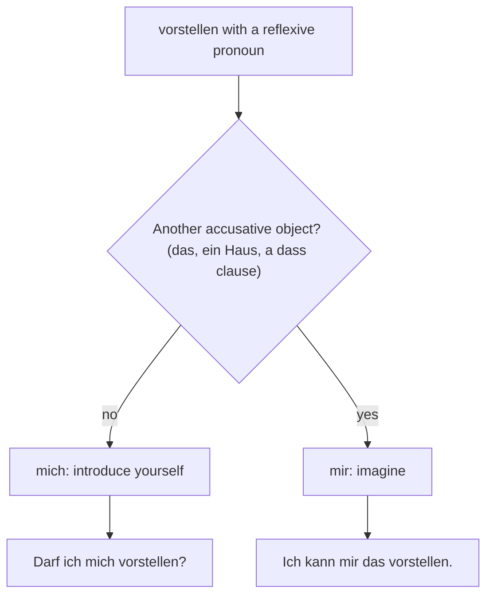

## What this lesson is for

This module gave you two separate tools. In lesson 5 you met the dative reflexive pronoun with body parts and clothes: *Ich putze mir die Zähne. Ich ziehe mir eine Jacke an.* In lesson 7 you learned verbs with two objects, a dative person and an accusative thing: *Ich kaufe meiner Schwester ein Buch.* This honors lesson puts the two together. What happens when the person who gets the thing is the subject itself? *Ich kaufe mir ein Buch.* — I'm buying myself a book.

That small *mir* is everywhere in everyday German, and some very useful verbs only work with it: *sich etwas vorstellen* (to imagine something), *sich etwas merken* (to remember something), *sich etwas ansehen* (to have a look at something), *sich etwas leisten* (to afford something). You will also learn to tell *Darf ich mich vorstellen?* from *Stell dir vor!*, and to say "each other" clearly with *einander*.

## The pattern: a thing for yourself

A **dative reflexive** is a reflexive pronoun in the dative case. You use it when the sentence already has an accusative object (the thing) and the person who receives, wants or experiences that thing is the subject. The sentence has the same shape as a giving sentence from lesson 7, only the dative points back to the subject:

| sentence | who gets the book? |
|---|---|
| *Ich kaufe meinem Bruder ein Buch.* | my brother (dative noun) |
| *Ich kaufe ihm ein Buch.* | him (dative pronoun) |
| *Ich kaufe mir ein Buch.* | me, the subject (dative reflexive) |

The forms are the ones from lesson 5. Only *ich* and *du* have their own dative forms; all the others look like the accusative:

| subject | dative reflexive | example |
|---|---|---|
| *ich* | *mir* | *Ich mache mir einen Tee.* — I'm making myself a tea. |
| *du* | *dir* | *Nimm dir ein Stück Kuchen!* — Help yourself to a piece of cake! |
| *er / sie / es* | *sich* | *Sie kauft sich ein Fahrrad.* — She's buying herself a bike. |
| *wir* | *uns* | *Wir bestellen uns eine Pizza.* — We're ordering (ourselves) a pizza. |
| *ihr* | *euch* | *Holt euch etwas zu trinken!* — Get yourselves something to drink! |
| *sie / Sie* | *sich* | *Nehmen Sie sich bitte einen Stuhl.* — Please take a chair. |

With *kaufen, machen, bestellen, holen, nehmen* the *mir* is optional: *Ich mache einen Tee* is complete, and *Ich mache mir einen Tee* adds "for myself". Germans use it all the time, so copy it.

## Verbs that need mir and dir

For a second group of verbs the dative reflexive is not optional. The meaning lives in the pronoun, and without it the verb means something else or sounds wrong. Learn them as chunks with *sich (Dat) etwas*:

| verb | English | example |
|---|---|---|
| *sich etwas ansehen* | to have a look at | *Ich sehe mir die Wohnung morgen an.* |
| *sich etwas anschauen* | to take a look at (southern, Austrian) | *Schau dir das an!* |
| *sich etwas merken* | to remember, make a note of | *Merk dir die Adresse!* |
| *sich etwas vorstellen* | to imagine | *Ich kann mir das gut vorstellen.* |
| *sich etwas überlegen* | to think something over | *Ich überlege es mir.* |
| *sich etwas wünschen* | to wish for, want (as a present) | *Was wünschst du dir zum Geburtstag?* |
| *sich etwas leisten* | to afford | *Wir können uns kein Auto leisten.* |
| *sich etwas ausdenken* | to make up, invent | *Die Ausrede hat er sich ausgedacht.* |
| *sich etwas gönnen* | to treat yourself to | *Gönn dir mal eine Pause!* |

*sich etwas ansehen* is looking at something on purpose: a flat before you rent it, a film you sit down to watch. *sich etwas merken* keeps something in your memory (*das Gedächtnis*); someone who often forgets is *vergesslich*. *sich etwas leisten* usually comes with *können*: *Das kann ich mir nicht leisten.*

The "something" can also be a whole clause, which you know from lesson 3 and 4. The dative pronoun stays in the main clause:

- *Ich kann mir nicht vorstellen, dass er das gesagt hat.* — I can't imagine that he said that.
- *Hast du dir gemerkt, wann der Zug fährt?* — Did you remember when the train leaves?
- *Ich überlege mir noch, ob ich mitkomme.* — I'm still thinking about whether I'll come along.

## One verb, two meanings: mich or mir?

Some verbs can take either reflexive pronoun, and the case changes the meaning. The most important is *vorstellen*:

- *Darf ich mich vorstellen? Ich heiße Jonas.* — May I introduce myself? My name is Jonas. (accusative: I present myself)
- *Ich kann mir das nicht vorstellen.* — I can't imagine that. (dative: I put a picture in front of myself)

Without a reflexive pronoun, *vorstellen* means to introduce someone else: *Ich stelle dir meine Freundin vor.* — Let me introduce my girlfriend to you. The rule from lesson 5 decides between *mich* and *mir* every time: is there another accusative object? In *Ich stelle mir das vor*, *das* is the accusative object, so the reflexive pronoun must be dative.

A very common exclamation uses the dative: *Stell dir vor!* — Guess what! (literally "imagine"). Friends start news with it: *Stell dir vor, Lena bekommt ein Baby!*

## Word order and the perfect

Everything you learned about two objects in lesson 7 still works, because the dative reflexive is a pronoun.

1. A pronoun comes before a noun: *Ich sehe mir den Film an.*
2. Two pronouns: accusative before dative: *Ich sehe ihn mir an.* — I'll watch it. *Merk es dir!* — Remember it! *Ich überlege es mir.* — I'll think it over.
3. *das* often moves to position 1 for emphasis, and then the rest follows: *Das kann ich mir nicht vorstellen.*

In the perfect, these verbs use *haben* like every reflexive verb, and the pronoun stays straight after *haben*:

- *Ich habe mir ein neues Handy gekauft.* — I've bought myself a new phone.
- *Hast du dir die Wohnung schon angesehen?* — Have you had a look at the flat yet?
- *Das habe ich mir gemerkt.* — I've made a note of that.

Watch the participles: *angesehen, angeschaut, ausgedacht* (separable, *ge* in the middle; *ausgedacht* is a mixed verb like *denken – gedacht*), *gemerkt, gewünscht, geleistet, gegönnt* (regular), *überlegt* (inseparable *über-*, so no *ge-*) and *vorgestellt*.

### Body parts again: accidents

Lesson 5 used the dative reflexive for washing and brushing. It is the same for accidents to your own body. The body part is the accusative object, so the pronoun is dative:

- *Ich habe mir den Arm gebrochen.* — I broke my arm. (*brechen: bricht, hat gebrochen*)
- *Sie hat sich beim Joggen den Fuß verstaucht.* — She sprained her ankle jogging.

Compare *Ich habe mich verletzt* (I hurt myself: no other object, accusative) with *Ich habe mir die Hand verletzt* (I hurt my hand: dative).

## Each other: sich, einander, gegenseitig

In lesson 5 you saw that plural *uns, euch, sich* can mean "each other": *Wir sehen uns morgen.* This works with dative verbs too: *Wir schreiben uns jeden Tag* (we write to each other every day), *Sie helfen sich* (they help each other).

But *sich* can be ambiguous. *Anna und Ben helfen sich* could mean that each one helps himself or herself, or that they help each other. When context doesn't decide, make "each other" clear with:

- *einander* (each other), which never changes: *Sie helfen einander.*
- *sich gegenseitig* (mutually): *Sie helfen sich gegenseitig.*

To stress the reflexive meaning instead, add *selbst*: *Sie waschen sich selbst* (they wash themselves). With a preposition, *einander* joins it as one word, which is very common: *miteinander* (with each other), *voneinander* (from or about each other), *aneinander* (of each other): *Wir sprechen jeden Abend miteinander. Die Zwillinge denken oft aneinander.*

### Example 1: Building a sentence step by step

Task: say "I'm having a look at the new flat tomorrow", then replace the flat with a pronoun.

1. The verb is *sich etwas ansehen*: separable, with a dative reflexive and an accusative thing.
2. Subject *ich*, so the dative reflexive is *mir*. The thing is *die neue Wohnung* (accusative feminine, so the article stays *die*; *neue* is a chunk for now).
3. Position 2 is the conjugated verb *sehe*; the prefix *an* goes to the end; the pronoun *mir* comes before the noun object: *Ich sehe mir morgen die neue Wohnung an.* (The time word *morgen* goes after the short pronoun and before the noun.)
4. Replace *die neue Wohnung* with *sie*. Now there are two pronouns, so the accusative comes first: *Ich sehe sie mir morgen an.*

### Example 2: mich or mir?

Task: complete *Ich habe ___ gestern beim Chef vorgestellt* and *Ich kann ___ gut vorstellen, dass er Erfolg hat.*

1. First sentence: is there another accusative object? *beim Chef* is a preposition phrase, not an object, so no. The pronoun is accusative: *mich*. Meaning: I introduced myself to the boss yesterday.
2. Second sentence: the *dass* clause is what I imagine, so it is the object. The pronoun is dative: *mir*. Meaning: I can well imagine that he'll be successful.
3. Check with the meaning: introducing yourself goes with *mich*; imagining goes with *mir*.

## Reading: Ein Wunsch für Lissabon

> Stell dir vor, nächsten Monat werde ich dreißig! Meine Familie fragt mich schon seit Wochen: „Was wünschst du dir?" Ehrlich gesagt wünsche ich mir nichts für die Wohnung. Ich habe genug Sachen. Ich wünsche mir eine Reise nach Lissabon.
>
> Leider kann ich mir im Moment keine teure Reise leisten. Aber dann hatte mein Bruder Tim eine Idee. „Wir schenken dir den Flug zusammen", hat er gesagt, „und das Hotel suchst du dir selbst aus." Ich konnte es mir zuerst gar nicht vorstellen.
>
> Gestern Abend habe ich mir im Internet Fotos von der Stadt angesehen: die alten gelben Straßenbahnen, die Aussicht über die Dächer, die Cafés. Ich habe mir sofort drei Restaurants gemerkt, oder besser: aufgeschrieben, denn ich bin ziemlich vergesslich.
>
> Nur eine Sache muss ich mir noch überlegen: Fahre ich allein oder mit meiner besten Freundin Sara? Wir kennen uns seit dem Kindergarten und verstehen uns super. Wir haben schon oft miteinander Urlaub gemacht. Vielleicht gönne ich mir einfach beides: zuerst drei Tage allein, dann vier Tage mit Sara.

In English:

> Guess what, next month I'm turning thirty! My family has been asking me for weeks: "What would you like (as a present)?" To be honest, I don't want anything for the flat. I have enough things. What I want is a trip to Lisbon.
>
> Unfortunately I can't afford an expensive trip at the moment. But then my brother Tim had an idea. "We'll all give you the flight together," he said, "and you can choose the hotel yourself." At first I couldn't imagine it at all.
>
> Yesterday evening I looked at photos of the city online: the old yellow trams, the view over the roofs, the cafés. I made a note of three restaurants straight away, or rather: wrote them down, because I'm pretty forgetful.
>
> There's just one thing I still have to think about: do I go alone or with my best friend Sara? We've known each other since kindergarten and get on really well. We've often been on holiday together. Maybe I'll simply treat myself to both: three days alone first, then four days with Sara.

Notes: *ehrlich gesagt* means "to be honest", *aussuchen* "to choose", *die Aussicht* "the view"; *teure, gelben, besten* have adjective endings (module 3). The dative reflexives: *wünschst du dir, wünsche ich mir, kann ich mir … leisten, konnte es mir … vorstellen* (two pronouns: *es* before *mir*), *habe ich mir … angesehen, gemerkt, muss ich mir … überlegen, gönne ich mir*. And the reciprocal ones: *wir kennen uns, verstehen uns, miteinander*.

## Pronunciation

- *merken*: short *e*; the *r* after a vowel is soft, close to "MAIR-ken". *Gedächtnis*: ge-DÄCHT-nis, with the soft *ch* of *ich* (after *ä* the *ch* is always soft).
- *einander*: ein-AN-der, stress on the second syllable; *miteinander*: mit-ein-AN-der.
- *sich verstauchen*: ver-STAU-chen; the *ch* after *au* is the throaty *ch* of *Bauch*.
- *gönnen*: short *ö*; don't confuse it with *können* (to be able to).

## Common mistakes

- Accusative instead of dative: ~~Ich kann mich das nicht vorstellen.~~ → *Ich kann mir das nicht vorstellen.* With another object, the pronoun is dative.
- Leaving out the pronoun: ~~Ich merke die Nummer.~~ → *Ich merke mir die Nummer.* ~~Ich kann kein Auto leisten.~~ → *Ich kann mir kein Auto leisten.*
- English order with two pronouns: ~~Ich sehe mir ihn an.~~ → *Ich sehe ihn mir an.* (accusative first)
- Possessive with body parts: ~~Ich habe meinen Arm gebrochen.~~ is understood, but *Ich habe mir den Arm gebrochen* is what Germans say.
- *sein* in the perfect: ~~Ich bin mir das Bein gebrochen.~~ → *Ich habe mir das Bein gebrochen.*
- *einander* with a pronoun: ~~Sie helfen sich einander.~~ → *Sie helfen einander* or *Sie helfen sich gegenseitig*. Use one or the other, not both.

## Key points

- A dative reflexive (*mir, dir, sich, uns, euch, sich*) points back to the subject when the sentence also has an accusative object: *Ich kaufe mir ein Buch.*
- With *kaufen, machen, bestellen, nehmen* it adds "for myself"; with *sich etwas ansehen, merken, vorstellen, überlegen, wünschen, leisten, ausdenken, gönnen* it is part of the verb.
- *mich* or *mir*: no other accusative object → *mich*; another object → *mir*. *Ich stelle mich vor* (introduce) / *Ich stelle mir das vor* (imagine).
- Two pronouns: accusative first: *Ich sehe ihn mir an. Merk es dir!* Perfect with *haben*: *Ich habe mir das gemerkt.*
- "Each other": *uns, euch, sich*; to make it clear, *einander* or *sich gegenseitig*; with a preposition, *miteinander, voneinander*.

The words from this lesson are listed below; they join your vocabulary reviews when you complete the lesson.
