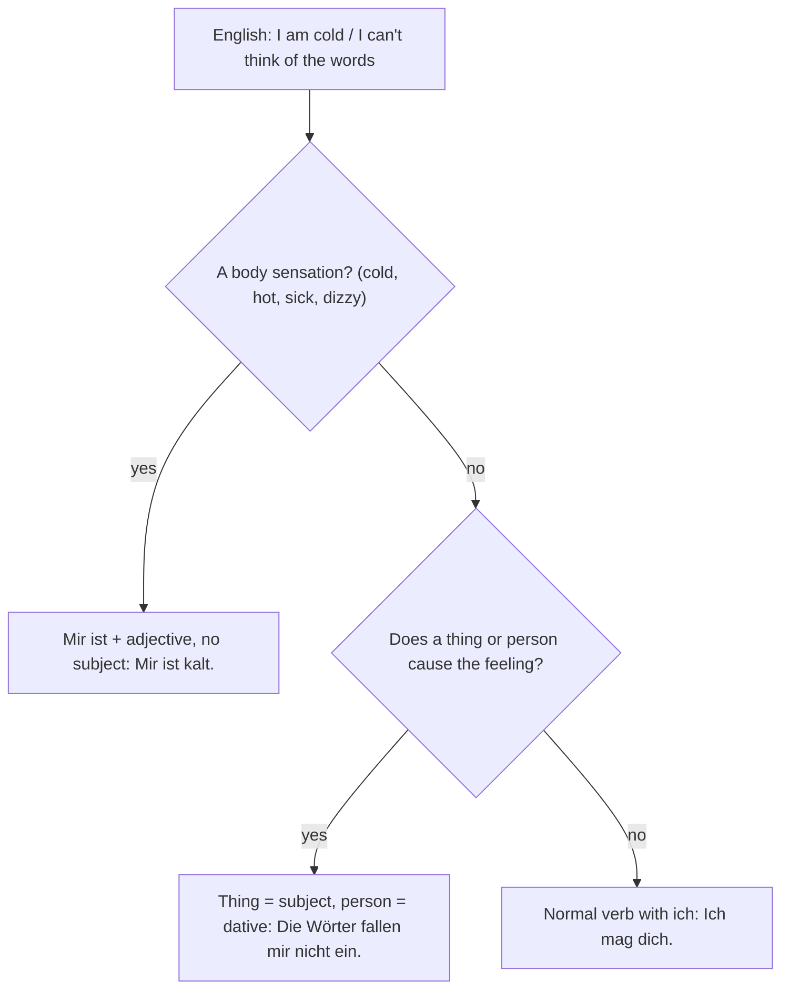

## What this lesson is for

In lesson 7 you met the "upside-down" verbs: *Die Kette gefällt mir*, *Du fehlst mir*. The thing or person that causes the feeling is the subject, and the person who has the feeling is in the dative. In German A1 you also learned the chunk *Mir ist kalt* (I'm cold). This honors lesson shows that these are not odd exceptions but one big pattern, and one of the most German things about German: feelings, sensations and impressions very often put the person in the dative.

You will learn to say how you feel physically (*Mir ist schlecht, mir ist schwindlig*), what matters to you (*Das ist mir wichtig*), what occurs to you, strikes you or seems strange to you (*Mir fällt etwas ein, mir fällt etwas auf, das kommt mir komisch vor*), what is easy or hard for you (*Deutsch fällt mir leicht*), and who you feel sorry for (*Du tust mir leid*). The last part of the lesson is about people again: the many shades between *Ich mag dich* and *Ich liebe dich*.

## The experiencer in the dative

The person who feels or experiences something is called the **experiencer**. In English the experiencer is usually the subject: *I* am cold, *I* like it, *I* miss you. In German the experiencer of many feelings is in the dative, and the subject is either the thing that causes the feeling or nothing at all.

| German | literally | English |
|---|---|---|
| *Mir ist kalt.* | to me is cold | I'm cold. |
| *Die Suppe schmeckt mir.* | the soup tastes good to me | I like the soup. |
| *Du fehlst mir.* | you are missing to me | I miss you. |
| *Das ist mir egal.* | that is all the same to me | I don't mind. |
| *Mir fällt nichts ein.* | to me falls nothing in | I can't think of anything. |

## Mir ist …: how you feel

With adjectives for body sensations, German uses *sein* + dative person, with no subject at all:

| *Mir ist …* | English |
|---|---|
| *Mir ist kalt / warm / heiß.* | I'm cold / warm / hot. |
| *Mir ist schlecht.* | I feel sick. |
| *Mir ist übel.* | I feel sick (a little more formal). |
| *Mir ist schwindlig.* | I feel dizzy. |
| *Mir ist langweilig.* | I'm bored. (informal) |

Change the person by changing the dative: *Ist dir kalt?* (Are you cold?) *Ihm ist schlecht.* (He feels sick.) *Uns ist langweilig.* (We're bored.) The verb is always *ist*, because there is no real subject to agree with.

Why not *Ich bin kalt*? Because with *ich* as the subject, the adjective describes you as a person: *Ich bin kalt* means "I'm a cold person", and *Ich bin langweilig* means "I'm boring". Compare the three ways to talk about boredom: *Ich langweile mich* (lesson 5), *Mir ist langweilig* (everyday, especially with children) and *Der Film ist langweilig* (the film is boring).

### Das ist mir wichtig: what matters to you

A second group has a real subject, usually *das*, *es* or a *dass*-clause, and gives your attitude to it:

- *Das ist mir egal.* — I don't care. / I don't mind.
- *Du bist mir wichtig.* — You matter to me.
- *Ist es dir recht, wenn ich später komme?* — Is it all right with you if I come later?
- *Das ist mir unangenehm.* — That makes me uncomfortable. / I feel awkward about that.
- *Die Wohnung ist uns zu teuer.* — The flat is too expensive for us.

When a *dass*- or *wenn*-clause is the real subject, *es* holds position 1 and the clause follows: *Es ist mir wichtig, dass du ehrlich bist.* — It's important to me that you're honest. If something else comes first, *es* disappears: *Mir ist wichtig, dass du ehrlich bist.*

## Verbs of feeling and thinking with the dative

Here are the most useful dative verbs of this kind beyond lesson 7. In all of them the thing is the subject and the person is dative, so the verb agrees with the thing.

| verb | example | English |
|---|---|---|
| *leidtun* | *Es tut mir leid.* / *Du tust mir leid.* | I'm sorry. / I feel sorry for you. |
| *einfallen* | *Mir fällt sein Name nicht ein.* | I can't think of his name. |
| *auffallen* | *Mir fällt auf, dass du müde bist.* | I notice that you're tired. |
| *vorkommen* | *Das kommt mir komisch vor.* | That seems strange to me. |
| *leichtfallen* | *Deutsch fällt mir leicht.* | I find German easy. |
| *schwerfallen* | *Die Aussprache fällt mir schwer.* | I find the pronunciation hard. |

*leidtun* is the verb inside the phrase *Es tut mir leid*. With a person as the subject it means pity: *Der arme Hund tut mir leid* (I feel sorry for the poor dog). Be careful: *Du tust mir leid* is sympathy, not an apology. To apologise, say *Es tut mir leid* or *Entschuldigung*.

*einfallen* is for an idea or memory that comes into your head (or doesn't): *Mir ist eine Idee eingefallen.* *auffallen* is for something you notice: *Ist dir etwas aufgefallen?* *vorkommen* gives an impression and usually comes with an adjective: *Die Zeit kommt mir sehr lang vor* (the time seems very long to me). *komisch* means "strange, funny-odd" here, not "comic".

All five *-fallen* and *-kommen* verbs are separable, and because *fallen* and *kommen* form the perfect with *sein*, so do they: *Mir ist nichts eingefallen. Das ist mir gleich aufgefallen. Die Prüfung ist mir leichtgefallen.* *leidtun* takes *haben*: *Es hat mir leidgetan.*

Because the thing is the subject, the verb must be plural for a plural thing:

- *Mir fällt das Wort nicht ein.* — I can't think of the word.
- *Mir fallen die Wörter nicht ein.* — I can't think of the words.

### Example 1: Choosing the structure

Task: say "I'm hot", "I don't care" and "I find maths hard".

1. "I'm hot" is a body sensation. No subject, person in the dative, verb *ist*: *Mir ist heiß.* Not *Ich bin heiß*, which in slang means something quite different.
2. "I don't care": the thing I don't care about is the subject, *das*: *Das ist mir egal.*
3. "I find maths hard": *schwerfallen* with the subject *Mathe* (singular): *Mathe fällt mir schwer.* Starting with the person is also fine, as long as the verb still agrees with *Mathe*: *Mir fällt Mathe schwer.*

### Example 2: The perfect, with a plural subject

Task: put *Mir fallen die Namen nicht ein* into the perfect.

1. The subject is *die Namen* (plural), so the auxiliary is plural too.
2. *einfallen* is built on *fallen*, which takes *sein*: so *sind*, not *haben*.
3. The participle of *einfallen* is *eingefallen* (separable, *ge* in the middle), and it goes to the end.
4. Result: *Mir sind die Namen nicht eingefallen.* — I couldn't think of the names. A common slip is ~~Mir habe die Namen nicht eingefallen~~: both the auxiliary and the person are wrong there.

## From Ich mag dich to Ich liebe dich

German has a whole scale for liking people, and the steps matter more than in English, where "I love you" is used quite freely.

The scale is a rough guide, not a rule: families and regions differ. Some points that are fairly safe:

- *Ich hab dich lieb* (from *lieb haben*, also written *liebhaben*) is warm but not romantic: parents and children, grandparents, close friends. In messages it is often shortened to *hdl*.
- *Ich liebe dich* is a big sentence, mostly kept for partners and close family. Saying it to a friend can sound odd.
- *Du gefällst mir* usually means that someone attracts you; *Du bist mir sympathisch* means you find them likeable.
- *Du fehlst mir* (lesson 7) is the warm everyday way to say "I miss you".

Relationships have their own phrases: *Wir sind zusammen* (we're a couple), *Sie hat Schluss gemacht* (she broke up), *mein Schwarm* (my crush), and when you are far from home you have *Heimweh* (homesickness).

## Reading: Die erste Woche in Kanada

Jana, 17, is spending a school year in Canada. She writes to her best friend Melli.

> Liebe Melli,
>
> jetzt bin ich schon eine Woche in Halifax. Meine Gastfamilie ist total nett, und ich mag meine Gastschwester Emily sehr. Trotzdem habe ich manchmal Heimweh. Du fehlst mir, und Mama und Papa fehlen mir auch, aber sag ihnen das bitte nicht!
>
> Die Schule ist anders als bei uns. Mir ist sofort aufgefallen, dass hier alle Schüler zum Mittagessen bleiben. Englisch fällt mir zum Glück leicht, aber in Mathe fallen mir oft die Wörter nicht ein. Gestern hat mich der Lehrer etwas gefragt, und mir ist nichts eingefallen. Das war mir so unangenehm!
>
> Und das Wetter! Mir ist ständig kalt, obwohl es erst September ist. Die Leute hier finden es warm. Das kommt mir echt komisch vor.
>
> Am Wochenende fahren wir ans Meer. Emily sagt, auf dem Boot wird einem schnell schlecht. Mir ist das egal, ich will unbedingt Wale sehen!
>
> Ich hab dich lieb! Schreib mir bald.
>
> Deine Jana

In English:

> Dear Melli,
>
> I've been in Halifax for a week now. My host family is really nice, and I like my host sister Emily a lot. Still, I'm sometimes homesick. I miss you, and I miss Mum and Dad too, but please don't tell them that!
>
> School is different from ours. I noticed straight away that all the students stay for lunch here. Luckily I find English easy, but in maths I often can't think of the words. Yesterday the teacher asked me something and my mind went blank. That was so embarrassing!
>
> And the weather! I'm cold all the time, even though it's only September. People here think it's warm. That seems really strange to me.
>
> At the weekend we're going to the sea. Emily says you get seasick quickly on the boat. I don't care, I really want to see whales!
>
> Love you! Write soon.
>
> Your Jana

Notes: *die Gastfamilie* is the host family; *ständig* means "all the time"; *obwohl* (although) sends the verb to the end like *weil*. *wird einem schlecht* uses *werden* (to become) with *einem*, the dative of *man*: "one gets sick". Count the dative experiencers: *fehlst mir, fehlen mir, mir ist aufgefallen, fällt mir leicht, fallen mir nicht ein, mir ist nichts eingefallen, war mir unangenehm, mir ist kalt, kommt mir komisch vor, mir ist egal*.

## Pronunciation

- *schwindlig*: SCHWIND-lich; the final *-ig* sounds like *ich*. *komisch*: KOH-misch, with a long *o*.
- *übel*: long *ü*, Ü-bel. *Heimweh*: HEIM-weh, the *h* in *weh* is silent.
- *leidtun*: the *d* sounds like *t*: LEIT-tuun.

## Common mistakes

- *Ich bin kalt* for "I'm cold": say *Mir ist kalt*. ~~Ich bin langweilig~~ for "I'm bored": *Mir ist langweilig* or *Ich langweile mich*.
- A subject where there is none: ~~Ich ist kalt~~, ~~Mir bin kalt~~ → *Mir ist kalt.*
- The verb agreeing with the person: ~~Mir fällt die Wörter nicht ein~~ → *Mir fallen die Wörter nicht ein.*
- *haben* with the *-fallen* verbs: ~~Mir hat nichts eingefallen~~ → *Mir ist nichts eingefallen.*
- *Du tust mir leid* as an apology: it means "I feel sorry for you". Apologise with *Es tut mir leid*.
- *Ich liebe dich* to a friend: *Ich hab dich lieb* or *Ich mag dich sehr* fits better.

## Key points

- Many feelings put the person who feels (the experiencer) in the dative.
- Body sensations: *Mir ist kalt / warm / heiß / schlecht / übel / schwindlig / langweilig*, no subject, always *ist*.
- Attitudes: *Das ist mir egal / wichtig / recht / unangenehm*; with a clause, *Es ist mir wichtig, dass …*
- Dative verbs: *leidtun, einfallen, auffallen, vorkommen, leichtfallen, schwerfallen*; the thing is the subject and the verb agrees with it; the *-fallen* and *-kommen* verbs take *sein* in the perfect.
- Liking people: *nett finden → mögen → gern haben → lieb haben → verliebt sein → lieben*, as a rough scale.

The words from this lesson are listed below; they join your vocabulary reviews when you complete the lesson.
