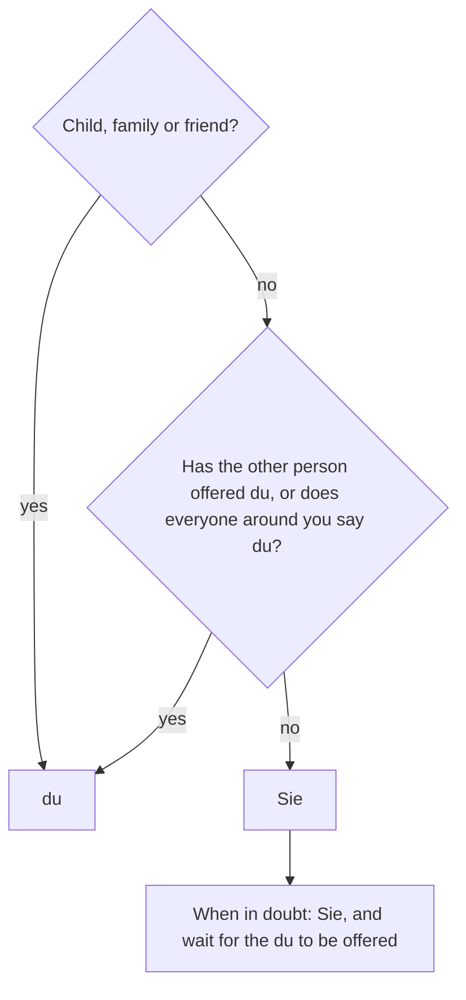

## What this lesson is for

In German A1 you learned a simple rule: *du* for friends, family and children, *Sie* for adults you don't know. This module has been about people and relationships, and every relationship in German comes with that choice. Lesson 6 talked about friends and partners, lesson 8 described colleagues and flatmates, and in each case a German speaker would first have to decide: do we say *du* or *Sie* to each other?

This honors lesson looks closely at that decision. You will review all three German words for "you" (*du, ihr, Sie*) in every case, see who uses which form in everyday life, learn how people switch from *Sie* to *du*, and meet two regional mixtures with funny names, the *Hamburger Sie* and the *Münchner Du*. The habits described here are general tendencies: they differ by region, generation, company and family, and German speakers themselves sometimes aren't sure. That uncertainty is part of the culture, and knowing the polite way out of it is a real skill.

## Three words for "you"

German has three pronouns for "you". Each one is a **form of address**: the way you speak to someone, which shows how close or how formal the relationship is.

| | *du* (one person, informal) | *ihr* (several people, informal) | *Sie* (one or more, formal) |
|---|---|---|---|
| nominative | *du* | *ihr* | *Sie* |
| accusative | *dich* | *euch* | *Sie* |
| dative | *dir* | *euch* | *Ihnen* |
| reflexive | *dich / dir* | *euch* | *sich* |
| possessive | *dein* | *euer* (*eure*) | *Ihr* |
| verb | *du kommst* | *ihr kommt* | *Sie kommen* |
| imperative | *Komm!* | *Kommt!* | *Kommen Sie!* |

Formal *Sie* is the same for one person and for many, and it always takes the verb form of the plural. Its forms are the forms of *sie* (they), only with a capital letter: *Sie, Ihnen, Ihr*. The capital is not decoration: *Wie geht es Ihnen?* means "How are you?", but *Wie geht es ihnen?* means "How are they?". The reflexive pronoun is the one exception: it is *sich*, never capitalised (*Setzen Sie sich!*).

*euer* loses its second *e* when an ending is added: *euer Haus*, but *eure Wohnung, eure Kinder*.

## Who says du, who says Sie?

Here is the picture most German speakers would recognise. It is simplified: real life has many exceptions.

- *du*: family, friends, children (adults say *du* to children, and children learn to say *Sie* to adults such as teachers; adults they don't know usually switch to *Sie* when they are about 15 or 16), fellow students, team-mates in a sports club, most people on social media, and many young people meeting each other.
- *Sie*: adults you don't know, shop staff and customers, officials, doctors and patients, neighbours you don't know well, and in many workplaces, especially with a boss or with customers.
- It depends: colleagues. In many companies, especially young ones and international ones, everyone says *du*, including the boss. In banks, law firms, offices and public authorities *Sie* is still common.

The golden rule for a learner: when in doubt, start with *Sie*. Saying *Sie* to someone who expected *du* is a small, friendly misunderstanding; saying *du* to someone who expected *Sie* can sound rude (*unhöflich*). Austria and Switzerland follow the same basic system, though habits in workplaces and regions vary there as well.

## Switching from Sie to du

Two people who say *Sie* to each other *siezen sich*; two who say *du* *duzen sich*. Moving from one to the other is a small event, and German has a phrase for it: *jemandem das Du anbieten*, to offer someone the *du*.

- *Wollen wir uns nicht duzen?* — Shall we say du to each other?
- *Sollen wir du sagen? Ich bin die Katrin.* — Shall we say du? I'm Katrin.
- *Gern! Ich bin Paul.* — Happy to! I'm Paul.

Traditional etiquette says the older person, or the person in the higher position, offers the *du*. Today many people are more relaxed (*locker*), but it is still safest to let the older person or your boss make the offer. Once you agree on *du*, going back to *Sie* is very unusual and feels like a cold shoulder.

Notice *Ich bin die Katrin*: with a first name, the article is common in everyday speech, especially in southern Germany and Austria. *Ich heiße Katrin* is always correct.

## Names, titles and two regional mixtures

With *Sie*, you normally use *Herr* or *Frau* and the last name (*der Nachname*): *Guten Tag, Frau Yilmaz.* Use *Frau* for every adult woman, married or not; the old word *Fräulein* for a young woman is outdated and can offend. If someone has a doctorate, it is polite, and still common, to include the title (*der Titel*) in formal situations, especially with medical doctors: *Frau Dr. Weber* (said *Frau Doktor Weber*). To a group: *Meine Damen und Herren* (Ladies and gentlemen), or, among friends and colleagues, *Hallo zusammen!*

With *du*, you use the first name or a nickname (*der Spitzname*): *Hallo Tom! Na, Toni?*

Two mixed forms show how flexible the system is:

- the *Hamburger Sie*: *Sie* + first name. *Lena, kommen Sie bitte mal?* You hear it from teachers to older pupils, and in some workplaces.
- the *Münchner Du* (also *Münchener Du*): *du* + last name. *Meier, mach mal das Fenster zu!* It is rarer and sounds very casual, for example among colleagues or in a sports team.

## Writing to someone

In letters, e-mails and messages, *Sie, Ihnen, Ihr* are always capitalised. With *du* and *ihr* you may choose: *Liebe Maria, wie du weißt …* and *wie Du weißt …* are both correct in personal letters (the capital feels a little warmer and more old-fashioned). Just keep the same choice in the whole message.

Openings follow the form of address: *Sehr geehrte Frau Yilmaz* (very formal, with *Sie*), *Liebe Frau Yilmaz* (friendly, still *Sie*), *Liebe Maria / Hallo Maria* (*du*). Lesson 23 practises this for the exam.

### Example 1: From du to Sie

Task: rewrite *Kannst du mir helfen? Dein Koffer steht noch vor deiner Tür. Bring ihn bitte in dein Zimmer!* for a hotel guest you don't know.

1. Subject and verb: *du kannst* → *Sie können*. The question becomes *Können Sie mir helfen?*
2. Possessives: *dein, deiner* → *Ihr, Ihrer*: *Ihr Koffer steht noch vor Ihrer Tür.*
3. Imperative: *Bring!* → *Bringen Sie!* The pronoun *Sie* follows the verb: *Bringen Sie ihn bitte in Ihr Zimmer!*
4. Check the capitals: *Sie, Ihr, Ihrer* all have one. *ihn* (it, the suitcase) does not, because it isn't "you".

Result: *Können Sie mir helfen? Ihr Koffer steht noch vor Ihrer Tür. Bringen Sie ihn bitte in Ihr Zimmer!*

### Example 2: Talking to a group

Task: you are inviting two friends, Ali and Mia. Rewrite *Hast du am Samstag Zeit? Ich lade dich zu meinem Geburtstag ein. Bring deine Gitarre mit!*

1. Two friends: informal plural, so *ihr*. *Hast du* → *Habt ihr*.
2. Accusative *dich* → *euch*: *Ich lade euch … ein.*
3. Possessive *deine* → *eure* (the *e* of *euer* drops before an ending).
4. Imperative: *Bring … mit!* → *Bringt … mit!* (the *ihr* form without the pronoun).

Result: *Habt ihr am Samstag Zeit? Ich lade euch zu meinem Geburtstag ein. Bringt eure Gitarre mit!* (If each brings a guitar: *eure Gitarren*.)

If Ali and Mia were two colleagues you say *Sie* to, it would be *Haben Sie am Samstag Zeit? Ich lade Sie … ein. Bringen Sie Ihre Gitarre mit!*

## Reading: Duzen im Büro?

> Hallo zusammen,
>
> ich habe seit zwei Wochen eine neue Stelle in einer kleinen IT-Firma in Leipzig, und ich habe ein Problem: Ich weiß nie, ob ich du oder Sie sagen soll. In meiner alten Firma war alles sehr förmlich. Dort haben wir uns alle gesiezt, auch nach zehn Jahren. Hier duzen sich alle, sogar der Chef. Am ersten Tag hat er gesagt: „Ich bin der Micha, bei uns ist das Du üblich."
>
> Das finde ich nett, aber gestern war ein Kunde da, ein älterer Herr mit Anzug. Ich habe ihn aus Gewohnheit geduzt: „Möchtest du einen Kaffee?" Er hat mich nur angesehen und gesagt: „Gern. Und für Sie bin ich Herr Doktor Krämer." Mein Gesicht ist ganz rot geworden. Was meint ihr: Wann darf man einen Kunden duzen?
>
> Viele Grüße
>
> Felix

In English:

> Hello everyone,
>
> I've had a new job at a small IT company in Leipzig for two weeks, and I have a problem: I never know whether to say du or Sie. In my old company everything was very formal. We all said Sie to each other there, even after ten years. Here everyone says du, even the boss. On the first day he said: "I'm Micha, we use du here."
>
> I think that's nice, but yesterday a customer came in, an older gentleman in a suit. Out of habit I said du to him: "Would you like a coffee?" He just looked at me and said: "Yes, please. And to you I'm Dr Krämer." I went bright red. What do you think: when can you say du to a customer?
>
> Best wishes,
>
> Felix

Notes: *aus Gewohnheit* means "out of habit"; *ein älterer Herr* is "an older gentleman" (an adjective ending, module 3). *ist rot geworden* is *werden* from lesson 8. The answer to Felix's question, by the rules above: with customers, start with *Sie*, and let the customer offer the *du*.

## Pronunciation

- *Sie* and *sie* sound the same, so in speech only the verb and the context tell you which one is meant: *Kommen Sie?* (are you coming?) vs *Kommen sie?* (are they coming?).
- *duzen*: long *u*, DUU-tsen; *siezen*: long *ie*, ZEE-tsen. The *z* is always "ts".
- *Höflichkeit*: HÖF-lich-keit, long *ö*; *förmlich*: short *ö*, FÖRM-lich.

## Common mistakes

- Mixing forms in one sentence: ~~Können Sie mir dein Handy geben?~~ → *Können Sie mir Ihr Handy geben?*
- Forgetting the capital: ~~Wie geht es ihnen?~~ (how are they?) → *Wie geht es Ihnen?* (how are you?)
- Singular verb with *Sie*: ~~Kommt Sie morgen?~~ → *Kommen Sie morgen?*
- Using *Sie* for a group of friends, or *ihr* for a group of strangers: friends → *Kommt ihr mit?*; strangers → *Kommen Sie mit?*
- Capitalising the reflexive: ~~Setzen Sie Sich.~~ → *Setzen Sie sich.*
- Offering the *du* to your new boss on day one. Wait for the offer, or ask carefully: *Duzen Sie sich hier alle?*

## Key points

- Three forms of address: *du* (one person, informal), *ihr* (several, informal), *Sie* (formal, one or more; capitalised: *Sie, Ihnen, Ihr*, but reflexive *sich*).
- *du*: family, friends, children, many teams and young people. *Sie*: adults you don't know, officials, customers, many workplaces. When in doubt, *Sie*.
- *sich duzen / sich siezen*; *jemandem das Du anbieten*, usually by the older or more senior person.
- *Sie* + *Herr/Frau* + last name; mixed forms: *Hamburger Sie* (Sie + first name), *Münchner Du* (du + last name).
- In letters, *du* may be written *du* or *Du*; *Sie, Ihnen, Ihr* always take a capital.

The words from this lesson are listed below; they join your vocabulary reviews when you complete the lesson.
