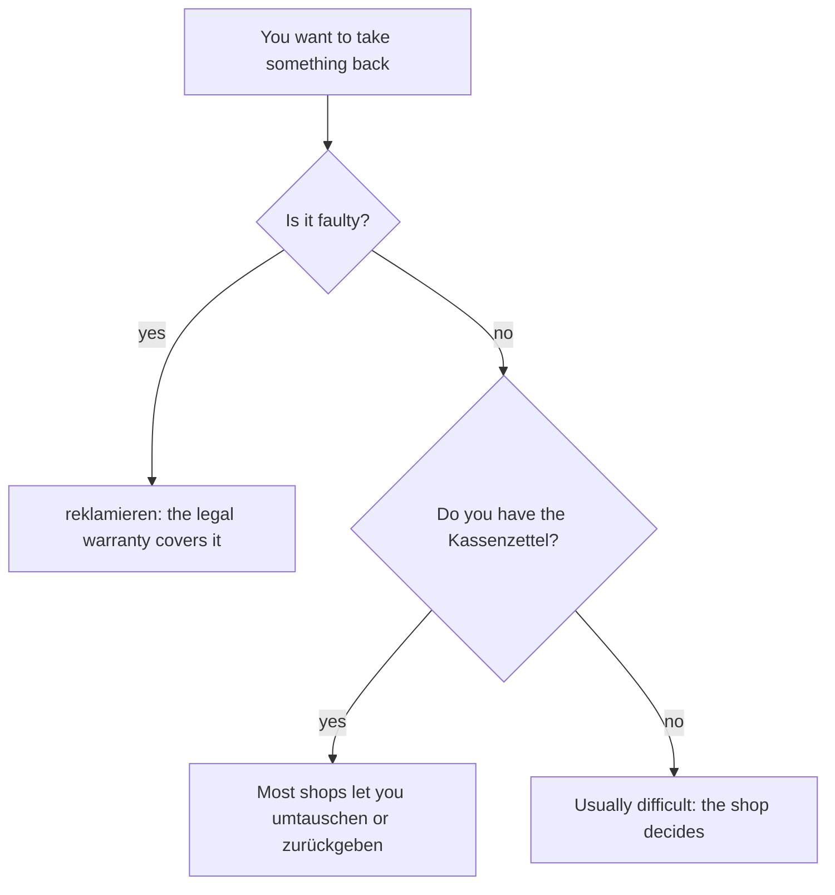

## What this lesson is for

In lesson 9 you put adjectives after *ein, kein* and *mein*: *ein warmer Mantel, meine neuen Schuhe*. Now you'll put them after *der, die, das* and the words that behave like them: *dieser* (this), *welcher* (which), *jeder* (every) and *alle* (all). This table is the easiest of the three, because after these articles the adjective almost never has to signal anything.

You'll also learn to leave the noun out (*Welchen nehmen Sie? – Den blauen.*), to say what something is made of, and to deal with a department store: finding the right floor, paying, and taking something back.

## In the department store

A *Kaufhaus* is a big shop with many *Abteilungen* (departments) on several floors. The ground floor is *das Erdgeschoss*; the floors above it are *der erste Stock, der zweite Stock* and so on, as you know from A1. You go up on the *Rolltreppe* (escalator) or in the *Aufzug* (lift).

| German | English |
|---|---|
| das Kaufhaus | department store |
| die Abteilung | department |
| das Erdgeschoss | ground floor |
| die Rolltreppe | escalator |
| der Aufzug | lift, elevator |
| die Umkleidekabine | changing room |
| der Kunde / die Kundin | customer |
| die Marke | brand |
| der Rabatt | discount |
| reduziert | reduced, on sale |
| günstig | good value, cheap |
| die Tüte | (paper or plastic) bag |
| die Quittung | receipt |
| der Kassenzettel | till receipt |

*günstig* is the polite, positive way to say something is cheap; *billig* (A1) can sound like "cheap and nasty". *Die Jacke ist sehr günstig* is a compliment; *Die Jacke sieht billig aus* is not.

The picture shows a small *Kaufhaus* in cross-section: the *Aufzug* on the left goes to every floor, and the *Rolltreppe* takes you up from the *Erdgeschoss* to the first floor (*der erste Stock*) and on to the second (*der zweite Stock*).

At the till you'll hear *Brauchen Sie eine Tüte?* (Do you need a bag?). Bags cost extra, so many people bring their own.

## Materials: aus + dative

To say what something is made of, use *aus* (from, out of) and the material with no article:

| | |
|---|---|
| das Material — material | das Leder — leather |
| die Baumwolle — cotton | das Holz — wood |
| die Wolle — wool | das Metall — metal |
| das Glas — glass | das Plastik — plastic |

- *Die Tasche ist aus Leder.* — The bag is made of leather.
- *Ich suche einen Pullover aus Baumwolle.* — I'm looking for a cotton jumper.
- *Das Spielzeug ist aus Holz, nicht aus Plastik.* — The toy is made of wood, not plastic.

*Baumwolle* is literally "tree wool". *das Glas* is both the material and a drinking glass: *ein Glas Wasser*.

## The endings after der-words

*der, die, das* and the words that take the same endings — *dieser, jeder, welcher* and, in the plural, *alle* — are called **der-words**. They show gender and case very clearly: in *dieser Rock* the article can only be masculine nominative, and *diesem* can only be masculine or neuter dative. Because the article always gives the signal, the adjective never needs to: it takes only *-e* or *-en*.

| | masculine | feminine | neuter | plural |
|---|---|---|---|---|
| nominative | der neue Rock | die neue Jacke | das neue Kleid | die neuen Schuhe |
| accusative | den neuen Rock | die neue Jacke | das neue Kleid | die neuen Schuhe |
| dative | dem neuen Rock | der neuen Jacke | dem neuen Kleid | den neuen Schuhen |

Look at the five *-e* boxes: masculine nominative, feminine nominative and accusative, neuter nominative and accusative. They are exactly the five boxes that weren't *-en* in lesson 9. Everywhere else, the ending is *-en* again. So the shape is the same in both tables; only the five special boxes differ:

| | masculine nom. | neuter nom./acc. | feminine nom./acc. |
|---|---|---|---|
| after ein-words | ein neuer Rock | ein neues Kleid | eine neue Jacke |
| after der-words | der neue Rock | das neue Kleid | die neue Jacke |

After *ein* the adjective has to show *-er* or *-es*; after *der* and *das* it doesn't, because the article already did.

Examples:

- *Der blaue Pullover ist reduziert.* — The blue jumper is reduced.
- *Ich nehme die schwarze Hose.* — I'll take the black trousers.
- *Kann ich dieses gestreifte Hemd umtauschen?* — Can I exchange this striped shirt?
- *Wir fahren mit dem neuen Aufzug.* — We're taking the new lift.
- *Die Umkleidekabine ist neben der großen Rolltreppe.* — The changing room is next to the big escalator.
- *Jeder neue Kunde bekommt zehn Prozent Rabatt.* — Every new customer gets ten per cent off.
- *Alle reduzierten Jacken sind im zweiten Stock.* — All the reduced jackets are on the second floor.

Note *im zweiten Stock*: *im* is *in dem*, so *zweiten* has the dative ending *-en*. Ordinal numbers like *erste, zweite, dritte* take endings just like any other adjective.

## Asking which one: welcher

*welcher* (which) takes the same endings as *der*: *welcher Rock, welche Jacke, welches Kleid, welche Schuhe*, accusative *welchen Rock*. Any adjective after it takes the der-word endings:

- *Welche rote Jacke meinst du?* — Which red jacket do you mean?
- *In welchem großen Kaufhaus warst du?* — Which big department store were you in?

## Leaving out the noun

When it's clear what you're talking about, German simply drops the noun and keeps the article and the adjective, with the ending unchanged. English adds "one":

- *Welchen Pullover nehmen Sie? – Den blauen.* — Which jumper are you taking? – The blue one.
- *Ich habe zwei Hemden. Das weiße ist neu.* — I have two shirts. The white one is new.
- *Gefällt dir die kurze Hose? – Nein, die lange gefällt mir besser.* — Do you like the short trousers? – No, I like the long ones better.

German goes one step further and makes some adjectives into real nouns, written with a capital letter. These are **adjectival nouns**: they keep their adjective endings.

- *der Kleine / die Kleine* — the little one (a small boy or girl)
- *das Neue* — the new thing, what's new: *Das Neue an dem Laden ist …* — What's new about the shop is …
- *der Bekannte / ein Bekannter* — an acquaintance (you met this in lesson 6)

At A2 you only need to recognise these. Notice that *der Bekannte* but *ein Bekannter* follow the two tables you know.

## Taking things back

Shops in Germany don't have to take back goods that are fine, but most will exchange them if you have the receipt. If something is faulty, you have a right to complain.

| German | English |
|---|---|
| umtauschen | to exchange (for something else) |
| zurückgeben | to give back, to return |
| reklamieren | to complain about (a faulty product) |
| die Garantie | guarantee, warranty |

*umtauschen* and *zurückgeben* are separable: *Ich tausche die Hose um. Ich gebe die Schuhe zurück.* *zurückgeben* has the stem change of *geben*: *er gibt zurück*. *reklamieren* is not separable and has no *ge-* in the perfect: *Ich habe den Toaster reklamiert.*

Which word you need depends on the situation:

## Dialogue: At the customer service desk

> Kundin: Guten Tag. Ich möchte diese graue Jacke umtauschen. Ich habe sie letzte Woche hier gekauft.
>
> Verkäufer: Haben Sie den Kassenzettel noch?
>
> Kundin: Ja, hier ist die Quittung.
>
> Verkäufer: Danke. Was ist denn das Problem mit der Jacke?
>
> Kundin: Der linke Ärmel ist kaputt, sehen Sie? Und die Jacke war nicht billig. Das ist doch eine teure Marke!
>
> Verkäufer: Oh, das tut mir leid. Auf die Jacke haben Sie natürlich Garantie. Möchten Sie das Geld zurück oder eine neue Jacke?
>
> Kundin: Lieber eine neue. Aber haben Sie die Jacke auch in Dunkelgrün? Die graue gefällt meinem Mann nicht so gut.
>
> Verkäufer: Die dunkelgrünen Jacken hängen in der Damenabteilung im ersten Stock, direkt neben der Rolltreppe. Und heute sind alle grünen Modelle reduziert.
>
> Kundin: Super! Dann bekomme ich vielleicht sogar Geld zurück.

In English:

> Customer: Hello. I'd like to exchange this grey jacket. I bought it here last week.
>
> Sales assistant: Do you still have the receipt?
>
> Customer: Yes, here's the receipt.
>
> Sales assistant: Thanks. So what's the problem with the jacket?
>
> Customer: The left sleeve is broken, see? And the jacket wasn't cheap. It's an expensive brand!
>
> Sales assistant: Oh, I'm sorry. The jacket is under guarantee, of course. Would you like your money back or a new jacket?
>
> Customer: A new one, please. But do you have the jacket in dark green as well? My husband doesn't like the grey one so much.
>
> Sales assistant: The dark green jackets are hanging in the women's department on the first floor, right next to the escalator. And today all the green styles are reduced.
>
> Customer: Great! Then maybe I'll even get some money back.

Find the der-word endings: *diese graue Jacke* (feminine accusative, *-e*), *der linke Ärmel* (masculine nominative, *-e*), *die graue* with no noun, *die dunkelgrünen Jacken* (plural, *-en*), *im ersten Stock* (dative, *-en*), *alle grünen Modelle* (plural, *-en*). Compare *eine teure Marke* and *eine neue Jacke*, which follow lesson 9. (*der Ärmel* = sleeve, *die Damenabteilung* = women's department, *das Modell* = model, style, *sogar* = even.)

## Pronunciation

- *Erdgeschoss*: stress on the first part, ERD-ge-schoss; the *o* is short.
- *Rolltreppe*: ROLL-trep-pe, with two short vowels.
- *Umkleidekabine*: UM-klei-de-ka-bi-ne; *ei* as in English "eye".
- *Garantie*: stress on the last syllable, ga-ran-TIE, with a long *ie*.
- *reklamieren*: re-kla-MIE-ren, like all *-ieren* verbs.
- *Leder* has a long *e*: LAY-der. *Wolle* has a short *o*.

## Common mistakes

- *der neuer Rock* — after *der*, no *-er*: *der neue Rock*. The *-er* belongs after *ein*.
- *das schwarzes Kleid* — after *das*, just *-e*: *das schwarze Kleid*.
- *die neue Schuhe* — in the plural after *die*, the ending is *-en*: *die neuen Schuhe*.
- *Ich nehme den blau.* — Keep the ending when you drop the noun: *den blauen*.
- *eine Tasche von Leder* — for materials, use *aus*: *eine Tasche aus Leder*.
- *Ich tausche um die Hose.* — The prefix goes to the end: *Ich tausche die Hose um.*
- *Ich habe den Mantel gereklamiert.* — No *ge-* with *-ieren* verbs: *reklamiert*.

## Key points

- After *der, dieser, jeder, welcher* and *alle*, the adjective ends in *-e* in the five "special" boxes (masculine nominative, feminine and neuter nominative and accusative) and *-en* everywhere else.
- The five special boxes are the same as in lesson 9: there they show *-er/-e/-es*, here only *-e*.
- When the noun is clear, drop it and keep the ending: *Den blauen, bitte.*
- Adjectival nouns keep adjective endings: *der Kleine, ein Bekannter, das Neue*.
- Materials: *aus* + material, no article: *aus Holz, aus Baumwolle*.
- *umtauschen* and *zurückgeben* are separable; *reklamieren* has no *ge-*.

The words from this lesson are listed below; they join your vocabulary reviews when you complete the lesson.
