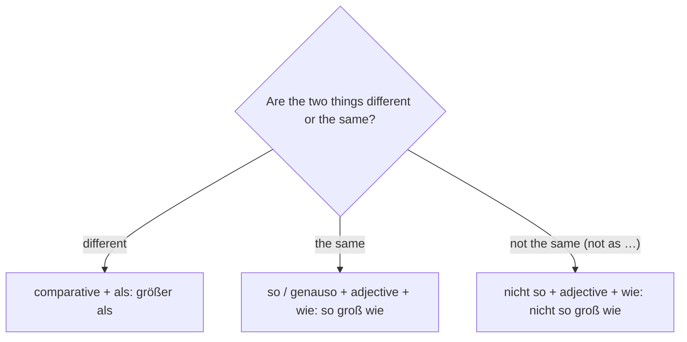

## What this lesson is for

Describing something often means comparing it: the city is louder than the village, the lake is deeper than the river, this is the most beautiful valley in the area. In this lesson you'll learn the **comparative** (*größer* — bigger) and the **superlative** (*am größten, der größte* — the biggest), the short adjectives that add an umlaut, the irregular ones, and the two little words you need to compare: *als* (than) and *wie* (as).

In A1 you met one comparison already: *gern, lieber, am liebsten* (to like, to prefer, to like most). Now you'll see that it belongs to a pattern. And because comparatives and superlatives in front of a noun take the adjective endings from lessons 9 to 11, this lesson is also a review of the whole module.

The theme is town and country: landscapes, regions and where people prefer to live.

## Town and country

| German | English |
|---|---|
| die Großstadt | big city |
| die Hauptstadt | capital (city) |
| der Einwohner | inhabitant, resident |
| die Gegend | area, region |
| die Umgebung | surroundings, the area around a place |
| die Landschaft | landscape, countryside |
| die Grenze | border |
| der Wald | forest, woods |
| die Wiese | meadow |
| das Feld | field |
| der Bauernhof | farm |
| der Hügel | hill |
| das Tal | valley |
| das Ufer | bank, shore |
| die Küste | coast |

The points of the compass are all masculine: *der Norden, der Süden, der Osten, der Westen*. "In the north" is *im Norden*; "to the north" is *nach Norden*. Compound words are common: *Norddeutschland* (northern Germany), *Süddeutschland*, *die Nordsee*.

*die Gegend* and *die Umgebung* are close. *die Gegend* is any area or region: *Das ist eine schöne Gegend.* *die Umgebung* is what surrounds a particular place: *Hamburg und Umgebung* (Hamburg and the surrounding area). *das Ufer* is the edge of a river or lake; the edge of the sea is *die Küste* or, where you swim, *der Strand* (A1).

New adjectives for describing places: *hoch* (high, tall), *tief* (deep), *breit* (wide, broad), *schmal* (narrow), *flach* (flat, shallow), *gefährlich* (dangerous), *sauber* (clean) and *schmutzig* (dirty). *hoch* loses its *c* before an ending: *ein hoher Berg*, *die hohen Häuser*.

## The comparative: -er

To say "bigger", "older", "more interesting", German adds *-er* to the adjective. There is never a separate word for "more", even with long adjectives:

| adjective | comparative |
|---|---|
| klein — small | kleiner — smaller |
| schön — beautiful | schöner — more beautiful |
| schnell — fast | schneller — faster |
| interessant — interesting | interessanter — more interesting |
| gefährlich — dangerous | gefährlicher — more dangerous |

The thing you compare with comes after *als* (than):

- *Das Dorf ist ruhiger als die Stadt.* — The village is quieter than the town.
- *Der Wald ist schöner als der Park.* — The woods are more beautiful than the park.
- *Mein Bruder fährt schneller als ich.* — My brother drives faster than I do.

Adjectives in *-el* and *-er* drop their *e*: *dunkel → dunkler*, *teuer → teurer*.

## Short adjectives add an umlaut

Many common one-syllable adjectives with *a, o* or *u* add an **umlaut** in the comparative and superlative:

| adjective | comparative | superlative |
|---|---|---|
| alt | älter | am ältesten |
| jung | jünger | am jüngsten |
| groß | größer | am größten |
| kurz | kürzer | am kürzesten |
| lang | länger | am längsten |
| warm | wärmer | am wärmsten |
| kalt | kälter | am kältesten |
| arm — poor | ärmer | am ärmsten |
| oft | öfter | am häufigsten (*am öftesten* is rare) |

Not every short adjective does it: *flach → flacher*, *klar → klarer*, *voll → voller*. Adjectives with *au* never do (*laut → lauter*), and neither do longer ones (*sauber → sauberer*). If you aren't sure, the dictionary shows it, and the vocabulary notes in this course do too.

## The superlative: am -sten

The superlative has two forms. After a verb, use *am* + adjective + *-sten*:

- *Im Sommer ist es hier am schönsten.* — It's nicest here in summer.
- *Hier ist der Fluss am breitesten.* — The river is at its widest here.

If the adjective ends in *-d, -t, -s, -ß, -z* or *-sch*, add an *e* so that you can say it: *am ältesten, am breitesten, am kürzesten, am heißesten*. The one big exception is *groß*: *am größten*.

Before a noun, the superlative is an adjective like any other, with *-st-* and then the normal ending. Since a superlative is always "the" one, it almost always follows *der, die, das*, so it uses the der-word endings from lesson 10:

- *der höchste Berg* — the highest mountain
- *die schönste Landschaft* — the most beautiful landscape
- *in der größten Stadt* — in the biggest city (dative, *-en*)
- *die ältesten Einwohner* — the oldest inhabitants (plural, *-en*)

## Comparatives before a noun

A comparative before a noun also takes the normal endings, on top of the *-er*. That gives forms that look strange at first:

- *Wir suchen eine größere Wohnung.* — We're looking for a bigger flat. (*größer* + *-e*)
- *Ich möchte in einem kleineren Dorf wohnen.* — I'd like to live in a smaller village. (*kleiner* + *-en*)
- *Das ist ein schönerer Weg.* — That's a nicer path. (*schöner* + *-er*)

The first *-er* says "more"; the second is the ending from lesson 9. Both are needed.

## The irregular ones

A few very common adjectives have irregular forms. You know the first from A1.

| adjective / adverb | comparative | superlative |
|---|---|---|
| gern — gladly | lieber | am liebsten |
| gut — good | besser | am besten |
| viel — much, a lot | mehr | am meisten |
| hoch — high | höher | am höchsten |
| nah — near | näher | am nächsten |

*mehr* never takes an ending: *mehr Einwohner, mit mehr Zeit*. Its opposite is *weniger* (less, fewer). *am nächsten* also gives you *nächste* (next): *die nächste Stadt* is the nearest town, and *nächste Woche* is next week.

- *Hier ist die Luft besser als in der Stadt.* — The air is better here than in the city.
- *Berlin hat mehr Einwohner als Hamburg.* — Berlin has more inhabitants than Hamburg.
- *Die Zugspitze ist der höchste Berg in Deutschland.* — The Zugspitze is the highest mountain in Germany.

## als and wie

- *als* follows a comparative: *größer als*, *mehr als*, *lieber als*.
- *so … wie* means "as … as", with the plain adjective: *Mein Bruder ist so groß wie ich.* — My brother is as tall as me.
- *genauso … wie* means "just as … as": *Die Luft ist hier genauso sauber wie in den Bergen.* — The air here is just as clean as in the mountains.
- *nicht so … wie* means "not as … as": *Unser Dorf ist nicht so laut wie die Stadt.* — Our village isn't as noisy as the town.

A short way to remember: different → *als*; the same → *wie*.

*immer* + comparative means that something keeps growing: *Die Stadt wird immer größer* (the city keeps getting bigger), *immer mehr Leute* (more and more people). *werden* (to become) is from lesson 8.

## A text: City or country?

> Seit drei Jahren wohnen Miriam und Daniel nicht mehr in der Großstadt, sondern in einem kleinen Dorf im Süden, fünfzig Kilometer von der Grenze zur Schweiz.
>
> „Am Anfang war alles schwieriger“, sagt Miriam. „Der nächste Supermarkt ist acht Kilometer entfernt, und der Bus fährt nur dreimal am Tag. In der Stadt war das Leben bequemer. Aber hier ist die Luft viel sauberer, und die Landschaft ist schöner als auf jeder Postkarte.“
>
> Hinter ihrem Haus beginnt eine große Wiese, dann kommt der Wald. Im Tal fließt ein schmaler Fluss. „Er ist nicht so tief, wie er aussieht“, sagt Daniel, „aber im Frühling ist er gefährlich, wenn der Schnee schmilzt.“
>
> Daniel arbeitet jetzt zu Hause und fährt nur noch einmal pro Woche ins Büro. „Ich verdiene weniger als früher, aber ich habe mehr Zeit. Das ist mir wichtiger.“
>
> Ist das Dorf also der beste Ort zum Leben? „Für uns ja“, lacht Miriam. „Aber unsere Kinder sehen das anders. Sie finden die Stadt am interessantesten.“

In English:

> For three years Miriam and Daniel haven't lived in the big city any more, but in a small village in the south, fifty kilometres from the border with Switzerland.
>
> "At first everything was harder," says Miriam. "The nearest supermarket is eight kilometres away, and the bus only runs three times a day. Life was more comfortable in the city. But here the air is much cleaner, and the countryside is more beautiful than on any postcard."
>
> Behind their house there's a big meadow, then the woods. A narrow river flows through the valley. "It isn't as deep as it looks," says Daniel, "but in spring it's dangerous, when the snow melts."
>
> Daniel works from home now and only goes into the office once a week. "I earn less than before, but I have more time. That's more important to me."
>
> So is the village the best place to live? "For us, yes," laughs Miriam. "But our children see it differently. They find the city the most interesting."

Find the comparisons: *schwieriger, bequemer, sauberer, schöner als, wichtiger* (comparatives); *nicht so tief wie* (equal → *wie*); *weniger als, mehr* (irregular); *der nächste Supermarkt, der beste Ort* (superlative + der-word ending); *am interessantesten* (superlative after the verb). *viel* before a comparative means "much": *viel sauberer*. (*entfernt* = away, *fließen* = to flow, *schmelzen* = to melt, *verdienen* = to earn, *der Ort* = place.)

## Pronunciation

- *höher*: the *h* in the middle is silent; it just keeps the *ö* long: HÖ-er.
- *am nächsten*: soft *ch*, as in *ich*. *näher* has no *ch* at all.
- *Wiese*: long *ie*, soft *s*: VEE-ze.
- *Tal* has a long *a*; *Täler* (valleys) a long *ä*.
- *Ufer*: long *u*, OO-fer. *Hügel*: long *ü*, HÜ-gel.
- *Landschaft, Grenze, Gegend*: the stress is on the first syllable.

## Common mistakes

- *mehr schön* — German adds *-er* even to long adjectives: *schöner*, *interessanter*.
- *größer wie* — after a comparative use *als*: *größer als*. (You'll hear *wie* in casual speech, but it's not standard.)
- *so groß als* — for equality use *wie*: *so groß wie*.
- *gooder / am guten* — *gut, besser, am besten*.
- *der höher Berg* — *hoch* becomes *hoh-* before a noun: *der hohe Berg*, comparative *der höhere Berg*.
- *Wir suchen eine größer Wohnung.* — Comparatives before a noun still need an ending: *eine größere Wohnung*.
- *am ältsten* — after *t*, add an *e*: *am ältesten*.

## Key points

- Comparative: adjective + *-er* (*schneller*), followed by *als*. Equal: *so … wie*.
- Superlative after a verb: *am* + *-sten* (*am schnellsten*); *-esten* after *d, t, s, ß, z, sch*, but *am größten*.
- Many short adjectives add an umlaut: *alt – älter – am ältesten*.
- Irregular: *gut – besser – am besten*, *viel – mehr – am meisten*, *gern – lieber – am liebsten*, *hoch – höher – am höchsten*, *nah – näher – am nächsten*.
- Before a noun, comparatives and superlatives take normal endings: *eine größere Stadt*, *der höchste Berg*.
- *immer* + comparative: *immer mehr, immer größer*.

The words from this lesson are listed below; they join your vocabulary reviews when you complete the lesson.
