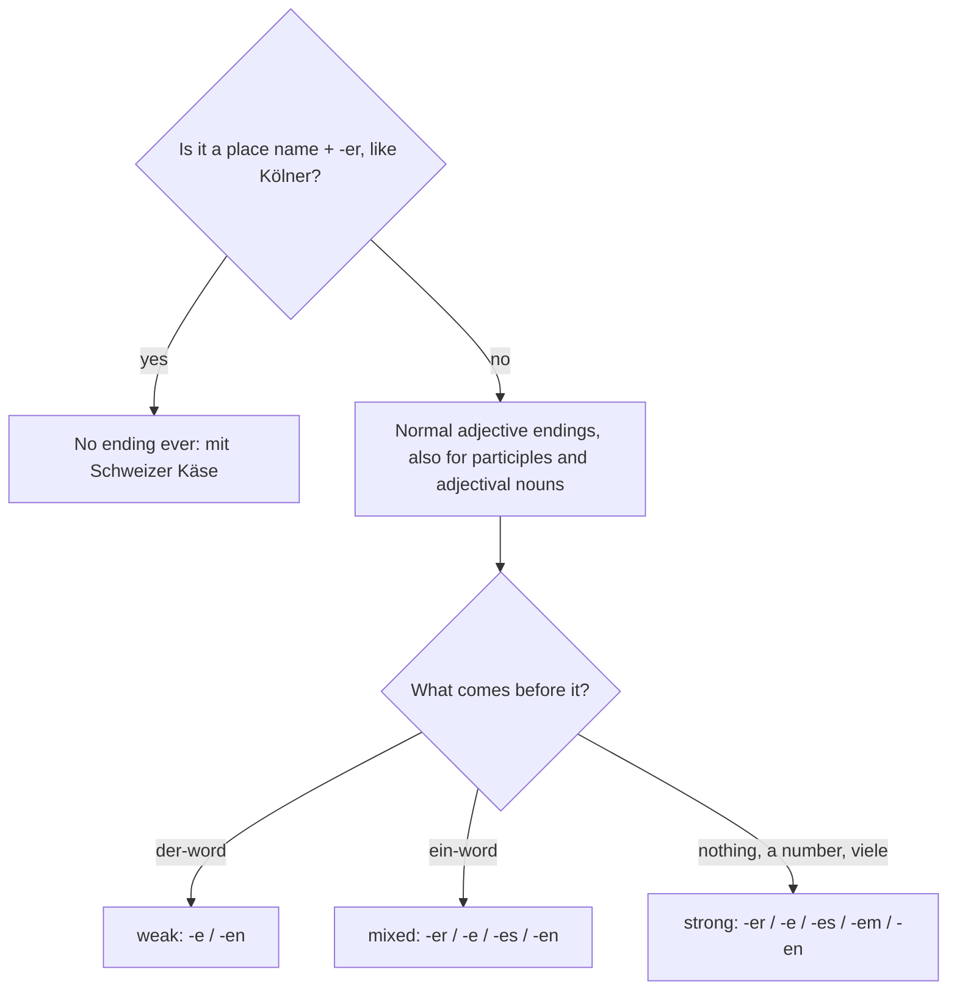

## What this lesson is for

In lessons 9 to 11 you learned the three tables of adjective endings and the one idea behind them: a noun phrase shows its gender and case once, either on the article or on the adjective. That system covers far more than words like *neu* and *rot*. Walk through a German market or read a menu, and you'll see three more kinds of word using the same endings: verbs turned into adjectives (*frisch gepresster Saft, kochendes Wasser*), city names turned into adjectives (*Wiener Schnitzel, Schweizer Käse*), and adjectives turned into nouns (*zwei Erwachsene, ein Deutscher*).

This honors lesson shows how each of them works. You won't need a new table: everything here runs on the tables you already know, plus one surprising exception. You'll also learn the names grammar books use for the three tables, so that you can use any German grammar or dictionary on your own.

## The three tables have names

Most grammar books, in English and in German, call the three tables "declensions":

| the adjective comes after … | what the article does | name | German name |
|---|---|---|---|
| a der-word (*der, dieser, jeder, welcher, alle*) | always gives the signal | **weak declension** | schwache Deklination |
| an ein-word (*ein, kein, mein …*) | sometimes gives the signal | **mixed declension** | gemischte Deklination |
| no article (or a number, *viele, ein paar*) | gives no signal | **strong declension** | starke Deklination |

The names fit the signal idea. "Strong" endings do all the work themselves (*-er, -es, -em*, the letters of *der, das, dem*). "Weak" endings only ever say *-e* or *-en*, because the article has done the work. "Mixed" is a bit of both: strong in the three places where *ein* says nothing, weak everywhere else.

So when a dictionary or grammar says "the adjective takes the strong ending here", it means "use the no-article table". The words have nothing to do with **strong verbs** like *fahren, fuhr, gefahren*: it's the same word used for a different idea.

## Verbs as adjectives: participles

### The past participle: done to it

You know the **past participle** from the perfect tense: *gekocht, gebraten, geöffnet, reduziert*. Put one in front of a noun and it becomes an adjective with ordinary endings:

- *ein gekochtes Ei* — a boiled egg
- *der gebratene Fisch* — the fried fish
- *mit frisch gepresstem Saft* — with freshly squeezed juice
- *alle reduzierten Jacken* — all the reduced jackets

A past participle used like this usually means that something has been done to the noun: the egg has been boiled, the jackets have been reduced. An adverb in front of it, like *frisch* (freshly) or *selbst* (yourself), never takes an ending, because it describes the participle, not the noun: *frisch gebackenes Brot, selbst gemachte Marmelade*.

After *sein*, the participle has no ending, like any adjective: *Das Geschäft ist geöffnet. Die Suppe ist hausgemacht.* You see this on many signs: *Geöffnet* (open), *Geschlossen* (closed), *Frisch gestrichen* (wet paint, literally "freshly painted").

### The present participle: doing it

German has a second participle that English speakers often don't notice. The **present participle** is the infinitive plus *-d*:

| infinitive | present participle | example |
|---|---|---|
| kochen | kochend | *kochendes Wasser* — boiling water |
| lachen | lachend | *die lachenden Kinder* — the laughing children |
| schlafen | schlafend | *ein schlafendes Baby* — a sleeping baby |
| fließen | fließend | *fließendes Wasser* — running water |
| passen | passend | *ein passendes Geschenk* — a suitable present |
| folgen | folgend | *die folgenden Fragen* — the following questions |

It means that the noun is doing something at that moment, like English "-ing". Compare:

- *kochendes Wasser* — boiling water (it is boiling now)
- *gekochtes Wasser* — boiled water (it has been boiled; it may be cold by now)

Unlike English, German does **not** use the present participle to make the progressive tenses: "The water is boiling" is *Das Wasser kocht*, never ~~*Das Wasser ist kochend*~~. In everyday German the present participle mostly stands before a noun. A few have become ordinary words: *fließend* also means "fluent" (*Sie spricht fließend Deutsch*), *passend* means "suitable" or "matching", and *folgend* means "following".

### Example 1: a menu line

A café menu says: *Frisch gepresster Orangensaft*. Why *-er*?

1. Find the noun: *Orangensaft*, which is *der Saft*, masculine.
2. Find the case: on a menu the item stands alone, like a subject, so nominative.
3. Look in front: no article at all, so the strong (no-article) ending: the *-er* of *der*.
4. *frisch* is an adverb describing *gepresst*, so it takes no ending.

On the order you'd say *Ich nehme einen frisch gepressten Orangensaft*: now *einen* gives the signal (masculine accusative), and the participle takes *-en*.

## City names as adjectives: no ending at all

Here is the exception. Take the name of a town and add *-er*, and you get an adjective meaning "from that place": *Berlin → Berliner, Wien → Wiener, Frankfurt → Frankfurter, Köln → Kölner, die Schweiz → Schweizer*. These **place-name adjectives** are special in two ways:

1. They are written with a capital letter.
2. They never take an ending, in any case or gender.

| | example |
|---|---|
| nominative | *Der Kölner Dom ist sehr alt.* — Cologne Cathedral is very old. |
| accusative | *Ich esse ein Wiener Schnitzel.* — I'm eating a Wiener schnitzel. |
| dative | *in der Berliner U-Bahn* — on the Berlin underground |
| no article | *mit Schweizer Käse* — with Swiss cheese |
| plural | *die Frankfurter Würstchen* — the frankfurters |

Compare a normal adjective in the same place: *mit Schweizer Käse* but *mit frischem Käse*; *ein Wiener Schnitzel* but *ein großes Schnitzel*. Some names change a little: *der Schwarzwald → Schwarzwälder Kirschtorte* (Black Forest gateau), *Nürnberg → Nürnberger Würstchen*.

The same *-er* word is also the noun for a person from that place: *Er ist Berliner* (he's from Berlin), *die Wiener* (the people of Vienna). And sometimes it's a food. In much of Germany a jam doughnut is called *ein Berliner*, while in Berlin itself people usually call it *ein Pfannkuchen*, and in the south and in Austria *ein Krapfen*. That's why a popular story says that John F. Kennedy told Berlin "I am a doughnut" when he said *Ich bin ein Berliner* in 1963. The story is a myth: the sentence is correct German, and his audience understood exactly what he meant.

Country adjectives that don't end in *-er* behave normally: *das deutsche Brot, österreichischer Wein, die schweizerische Regierung*. Only the *-er* form is frozen.

## Adjectives as nouns, in all three tables

In lesson 10 you met **adjectival nouns** like *der Bekannte* and *ein Bekannter*. Several very common words for people work the same way. Each one is an adjective with a capital letter, and it takes exactly the ending an adjective would take before an invisible noun such as *Mann*, *Frau* or *Leute*:

| | after a der-word (weak) | after an ein-word (mixed) | no article (strong) |
|---|---|---|---|
| man | der Erwachsene | ein Erwachsener | als Erwachsener (as an adult) |
| woman | die Erwachsene | eine Erwachsene | als Erwachsene |
| plural | die Erwachsenen | meine Verwandten | zwei Erwachsene, viele Deutsche |
| dative plural | mit den Erwachsenen | mit meinen Verwandten | mit zwei Erwachsenen |

The words worth learning now: *der/die Erwachsene* (adult, from *erwachsen*, grown up), *der/die Jugendliche* (young person, teenager), *der/die Verwandte* (relative) and *der/die Deutsche* (German person).

Notice the trap with nationalities. *Deutsche* is an adjectival noun, so it changes: *der Deutsche, ein Deutscher, zwei Deutsche*. But *Österreicher* and *Schweizer* are ordinary nouns: *der Österreicher, ein Österreicher, zwei Österreicher*, with no adjective endings at all. You say *Er ist Deutscher* but *Er ist Österreicher*, and *Sie ist Deutsche* but *Sie ist Österreicherin*.

### Example 2: a ticket price list

A museum sign reads: *Erwachsene 12 €, Jugendliche 8 €, Kinder bis 6 Jahre frei*. Then a family at the desk says: *Zwei Erwachsene und ein Jugendlicher, bitte.*

- *Erwachsene, Jugendliche* on the sign: plural, no article → strong ending *-e*.
- *zwei Erwachsene*: a number doesn't count as an article → still *-e*.
- *ein Jugendlicher*: after *ein*, masculine nominative → mixed ending *-er*. (A teenage girl would be *eine Jugendliche*.)
- The cashier answers: *Das macht 32 Euro für die Erwachsenen und den Jugendlichen.* After *die* and *den*, the weak ending *-en*.

### Example 3: putting all three together

*In der Kölner Altstadt gibt es eine kleine Bäckerei mit frisch gebackenen Brötchen.* (In Cologne's old town there's a little bakery with freshly baked rolls.)

- *Kölner*: place-name adjective, no ending, even in the dative.
- *kleine*: after *eine*, feminine accusative (object of *es gibt*) → *-e*.
- *frisch gebackenen*: *frisch* is an adverb (no ending); *gebacken* is a past participle after *mit* with no article, dative plural → strong *-en*.

## Dialogue: Am Marktstand

> Herr Huber: Guten Morgen! Was darf es sein?
>
> Frau Aydın: Zwei frisch gepresste Orangensäfte, bitte. Und ist die Kartoffelsuppe wirklich hausgemacht?
>
> Herr Huber: Natürlich! Meine Frau kocht sie jeden Freitag nach einem alten Rezept von ihrer Oma.
>
> Frau Aydın: Dann nehme ich eine Suppe. Und für meinen Sohn die gefüllte Paprika.
>
> Herr Huber: Gern. Möchten Sie noch etwas Käse? Der Schweizer Käse ist heute besonders gut.
>
> Frau Aydın: Gern, zweihundert Gramm. Wir haben am Sonntag Besuch, meine Verwandten aus Wien kommen.
>
> Herr Huber: Ah, Wiener! Dann brauchen Sie auch Würstchen. Die Nürnberger sind ganz frisch.
>
> Frau Aydın: Gute Idee. Die Kinder lieben Würstchen. Und die Erwachsenen auch!

In English:

> Mr Huber: Good morning! What can I get you?
>
> Mrs Aydın: Two freshly squeezed orange juices, please. And is the potato soup really homemade?
>
> Mr Huber: Of course! My wife makes it every Friday from an old recipe of her grandma's.
>
> Mrs Aydın: Then I'll have a soup. And the stuffed pepper for my son.
>
> Mr Huber: Certainly. Would you like some cheese too? The Swiss cheese is especially good today.
>
> Mrs Aydın: Yes please, two hundred grams. We've got visitors on Sunday, my relatives from Vienna are coming.
>
> Mr Huber: Ah, Viennese! Then you'll need sausages too. The Nürnberger ones are really fresh.
>
> Mrs Aydın: Good idea. The children love sausages. And so do the adults!

Look at the forms: *zwei frisch gepresste Orangensäfte* (number + strong plural *-e*), *die gefüllte Paprika* (weak *-e*), *der Schweizer Käse* (no ending), *meine Verwandten* (mixed plural *-en*), *die Erwachsenen* (weak plural *-en*). *Wiener* on its own here means people from Vienna. (*hausgemacht* = homemade, *gefüllt* = stuffed, filled, *die Paprika* = pepper, the vegetable.)

## How to work out any ending

## Common mistakes

- *mit Schweizerem Käse* — place-name adjectives never change: *mit Schweizer Käse*.
- *ein schweizer Käse* — they're written with a capital letter: *ein Schweizer Käse*.
- *frischer gepresster Saft* — *frisch* describes the participle, so no ending: *frisch gepresster Saft*.
- *Das Wasser ist kochend.* — for "is boiling" use the verb: *Das Wasser kocht.*
- *zwei Erwachsenen* (as subject or object) — after a number the strong plural is *-e*: *zwei Erwachsene*. It's *-en* only in the dative or after *die, meine*: *mit zwei Erwachsenen, die Erwachsenen*.
- *Er ist ein Deutsche.* — after *ein*, masculine nominative takes *-er*: *Er ist Deutscher* or *ein Deutscher*.
- *zwei Österreichern* as a subject — *Österreicher* is an ordinary noun, plural *die Österreicher*, *-n* only in the dative.
- *gekochtes Wasser* when you mean water that is boiling now — that's *kochendes Wasser*.

## Key points

- Grammar books call the three tables the weak (after der-words), mixed (after ein-words) and strong (no article) declensions.
- Past participles before a noun take normal endings and usually mean "has been done": *ein gekochtes Ei, die reduzierten Jacken*.
- Present participle = infinitive + *-d*, meaning "-ing": *kochendes Wasser, die folgenden Fragen*. It is not used for "is doing".
- An adverb in front of a participle has no ending: *frisch gebackenes Brot*.
- Place-name adjectives in *-er* are capitalized and never change: *der Kölner Dom, mit Schweizer Käse*.
- *Erwachsene, Jugendliche, Verwandte, Deutsche* are adjectival nouns: *ein Erwachsener, zwei Erwachsene, die Erwachsenen*. *Österreicher* and *Schweizer* are ordinary nouns.

The words from this lesson are listed below; they join your vocabulary reviews when you complete the lesson.
