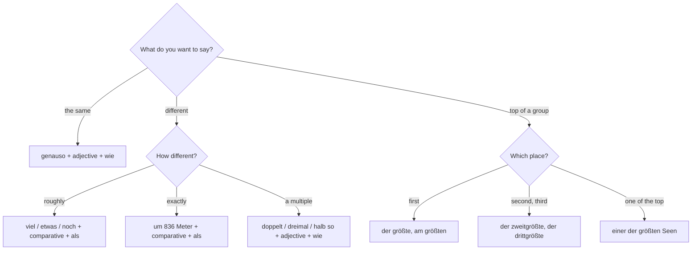

## What this lesson is for

In lesson 12 you learned to say that one thing is *größer als* another, *so groß wie* another, or *am größten*. That's enough for a simple comparison, but real descriptions are more precise. Is the city a little bigger or much bigger? Twice as big? The second-biggest? One of the biggest? This honors lesson gives you the tools for that, and uses them on a real subject: the geography of Germany, Austria and Switzerland, the three main countries where German is spoken.

The numbers in this lesson are real, rounded figures. Areas and heights hardly change; population figures change every year, so treat them as "about" (they're estimates for the mid-2020s).

## Three degrees

Grammar books call the plain form of an adjective the **positive**: *groß, hoch, lang*. With the comparative (*größer*) and the superlative (*am größten*), these are the three degrees of comparison:

| positive | comparative | superlative |
|---|---|---|
| groß | größer | am größten / der größte |
| hoch | höher | am höchsten / der höchste |
| lang | länger | am längsten / der längste |

Everything in this lesson builds on those three forms.

## Much bigger, a little bigger, even bigger

To say how big a difference is, put a word in front of the comparative. These words are **intensifiers**:

| intensifier | meaning | example |
|---|---|---|
| viel | much, far | *Die Schweiz ist viel kleiner als Deutschland.* |
| etwas, ein bisschen, ein wenig | a little, slightly | *Österreich hat etwas mehr Einwohner als die Schweiz.* |
| noch | even | *Der Großglockner ist hoch, aber die Dufourspitze ist noch höher.* |
| immer | more and more | *Die Städte werden immer größer.* |

Two things English speakers get wrong. First, "much" is *viel*, never *sehr*: ~~*sehr größer*~~. *sehr* goes only with the positive: *sehr groß*. Second, *noch* (even) suggests that the first thing is already big: *noch höher* means "higher still".

To give the exact difference, use *um* + the amount: *Der Großglockner ist um 836 Meter höher als die Zugspitze.* (In speech the *um* is often left out.)

With a superlative, *mit Abstand* or *bei Weitem* means "by far": *Berlin ist mit Abstand die größte Stadt Deutschlands.*

## Twice as big, half as big

To multiply, use the *so … wie* pattern from lesson 12 and put the number in front:

- *doppelt so groß wie* — twice as big as (also *zweimal so groß wie*)
- *dreimal so lang wie* — three times as long as
- *halb so groß wie* — half as big as
- *ungefähr neunmal so viele Einwohner wie* — about nine times as many inhabitants as

Note *so viele … wie* for countable things (*Einwohner, Seen*) and *so viel … wie* for amounts (*Wasser, Zeit*).

### Example 1: comparing two countries

Austria has an area of about 83,900 km² and Switzerland about 41,300 km². How do you compare them?

1. Divide: 83,900 ÷ 41,300 ≈ 2.0.
2. Twice as big → *doppelt so groß wie*.
3. The subject is Austria: ***Österreich ist ungefähr doppelt so groß wie die Schweiz.***
4. Turned round: *Die Schweiz ist ungefähr halb so groß wie Österreich.*

But the two countries have almost the same population, about 9.2 million against 9.1 million: *Österreich hat fast genauso viele Einwohner wie die Schweiz* or *Österreich hat nur etwas mehr Einwohner als die Schweiz.* Both sentences are true; they put the weight in different places.

## The second-biggest and one of the biggest

### Ranking with ordinals

To say "the second-biggest" or "the third-longest", join the ordinal number (from A1: *zweite, dritte*) to the superlative as one word, without its ending: *zweit-, dritt-, viert-*:

- *die zweitgrößte Stadt* — the second-biggest city
- *der dritthöchste Berg* — the third-highest mountain
- *Wien ist die zweitgrößte Stadt im deutschsprachigen Raum.* — Vienna is the second-biggest city in the German-speaking world (after Berlin).

The superlative part takes its normal ending: *in der zweitgrößten Stadt*.

### "One of the …"

"One of the biggest cities" is *eine der größten Städte*. Learn it as a chunk:

| the noun is … | "one of the …" |
|---|---|
| masculine | *einer der höchsten Berge* |
| feminine | *eine der größten Städte* |
| neuter | *eines der schönsten Länder* |

*einer/eine/eines* matches the gender of the noun (one mountain, one city), and the noun itself is plural, because you pick one from a group. The *der* in the middle is the genitive plural ("of the"), and the adjective after it ends in *-en*. You'll learn the genitive properly at B1; for now, the chunk is enough:

- *Der Bodensee ist einer der größten Seen in Mitteleuropa.* — Lake Constance is one of the largest lakes in Central Europe.
- *Zürich ist eine der teuersten Städte der Welt.* — Zurich is one of the most expensive cities in the world.

## Most, at least, at most

- *die meisten* + plural noun means "most (of the)": *Die meisten Schweizer sprechen Deutsch.* — Most Swiss people speak German. Don't confuse it with *am meisten* after a verb: *Wer hat am meisten gegessen?* — Who ate the most?
- *mindestens* (at least) and *höchstens* (at most) come from superlatives too: *Die Fahrt dauert mindestens drei Stunden. Der Fluss ist hier höchstens einen Meter tief.*
- *so … wie möglich* means "as … as possible": *Wir fahren so früh wie möglich los.* — We'll set off as early as possible.

## The German-speaking countries in numbers

The chart compares the highest mountain in each of the three countries.

```plot
{"x": [0.3, 3.7], "y": [0, 5000], "bars": [{"x": 1, "height": 2962, "width": 0.6, "label": "Zugspitze 2962 m"}, {"x": 2, "height": 3798, "width": 0.6, "label": "Großglockner 3798 m"}, {"x": 3, "height": 4634, "width": 0.6, "label": "Dufourspitze 4634 m"}], "yLabel": "height in metres", "caption": "The highest mountain in Germany (Zugspitze), Austria (Großglockner) and Switzerland (Dufourspitze)"}
```

| | Deutschland | Österreich | die Schweiz |
|---|---|---|---|
| area (*die Fläche*) | about 357,600 km² | about 83,900 km² | about 41,300 km² |
| population (*die Bevölkerung*) | about 83 million | about 9.2 million | about 9.1 million |
| highest mountain | Zugspitze, 2,962 m | Großglockner, 3,798 m | Dufourspitze, 4,634 m |
| biggest city | Berlin | Wien | Zürich |

### Example 2: from a table to sentences

Use the table to compare Germany with Austria.

- Area: 357,600 ÷ 83,900 ≈ 4.3 → *Deutschland ist mehr als viermal so groß wie Österreich.*
- Population: 83 ÷ 9.2 ≈ 9 → *Deutschland hat ungefähr neunmal so viele Einwohner wie Österreich.*
- Mountains: 3,798 − 2,962 = 836 → *Der höchste Berg Österreichs ist um 836 Meter höher als der höchste Berg Deutschlands.*

Notice *mehr als viermal*: the exact figure is about 4.3, so "more than four times" is accurate, and "five times" would be wrong.

## A text: Drei Länder, drei Rekorde

> Deutschland ist das größte deutschsprachige Land: Es ist mehr als viermal so groß wie Österreich und hat ungefähr neunmal so viele Einwohner. Berlin ist mit Abstand die größte Stadt, Wien die zweitgrößte.
>
> Aber bei den Bergen gewinnt Deutschland nicht. Die Zugspitze an der Grenze zu Österreich ist knapp 3000 Meter hoch. Der Großglockner in Österreich ist viel höher, und die Dufourspitze in der Schweiz ist noch höher: Sie ist über 4600 Meter hoch. Die Schweiz ist zwar das kleinste der drei Länder, aber sie hat die höchsten Berge.
>
> Und das Wasser? Der Rhein ist der längste Fluss in Deutschland. Die Donau ist insgesamt mehr als doppelt so lang wie der Rhein, aber nur ein kürzerer Teil von ihr fließt durch Deutschland. Der Bodensee ist einer der größten Seen in Mitteleuropa, und er gehört drei Ländern: Deutschland, Österreich und der Schweiz. Der Genfersee ist noch etwas größer, aber dort spricht man Französisch.
>
> Übrigens: Viele Menschen denken, dass Bern die Hauptstadt der Schweiz ist. Offiziell hat die Schweiz aber keine Hauptstadt. Bern heißt „Bundesstadt“, und dort arbeiten die Regierung und das Parlament.

In English:

> Germany is the biggest German-speaking country: it's more than four times as big as Austria and has about nine times as many inhabitants. Berlin is by far the biggest city, Vienna the second-biggest.
>
> But with mountains, Germany doesn't win. The Zugspitze, on the border with Austria, is just under 3,000 metres high. The Großglockner in Austria is much higher, and the Dufourspitze in Switzerland is higher still: it's over 4,600 metres high. Switzerland may be the smallest of the three countries, but it has the highest mountains.
>
> And the water? The Rhine is the longest river in Germany. The Danube is more than twice as long as the Rhine in total, but only a shorter part of it flows through Germany. Lake Constance is one of the largest lakes in Central Europe, and it belongs to three countries: Germany, Austria and Switzerland. Lake Geneva is a little bigger still, but there people speak French.
>
> By the way: many people think that Bern is the capital of Switzerland. Officially, though, Switzerland has no capital. Bern is called the "federal city", and that's where the government and parliament work.

Find the tools: *mehr als viermal so groß wie, neunmal so viele* (multiples); *mit Abstand die größte, die zweitgrößte* (ranking); *viel höher, noch höher, noch etwas größer* (intensifiers); *einer der größten Seen* (one of the …); *das kleinste der drei Länder* (superlative with a group); *die meisten Menschen* (most). (*knapp* = just under, *insgesamt* = in total, *zwar … aber* = admittedly … but, *übrigens* = by the way, *deutschsprachig* = German-speaking.)

A note on simplification: "the biggest lake in Germany" is a tricky title. Lake Constance is by far the largest lake that Germany has a share in, but because it is shared, the largest lake lying entirely inside Germany is the Müritz in Mecklenburg, which is much smaller. And the borders inside Lake Constance have never been fully agreed between the three countries.

## How to choose the right tool



## Common mistakes

- *sehr größer* — with a comparative, "much" is *viel*: *viel größer*.
- *zweimal größer als* for "twice as big" — standard German uses *doppelt (zweimal) so groß wie*. You'll hear *zweimal größer*, but it's ambiguous and best avoided.
- *die zweite größte Stadt* — write it as one word with no ending on the ordinal: *die zweitgrößte Stadt*.
- *einer der größte See* — the noun is plural and the adjective ends in *-en*: *einer der größten Seen*.
- *eine der höchsten Berge* — *Berg* is masculine, so *einer der höchsten Berge*.
- *am meisten Schweizer* — before a noun, "most" is *die meisten*: *die meisten Schweizer*.
- *so viel Einwohner wie* — for things you count, *so viele*: *so viele Einwohner wie*.

## Key points

- The three degrees: positive (*groß*), comparative (*größer*), superlative (*am größten*).
- Intensifiers: *viel* (much), *etwas / ein bisschen* (a little), *noch* (even) + comparative; never *sehr* + comparative. Exact difference: *um* + amount.
- Multiples: *doppelt / dreimal / halb so* + adjective + *wie*.
- Ranking: *die zweitgrößte, der dritthöchste* (one word). "One of the": *einer/eine/eines der* + superlative in *-en* + plural noun.
- *die meisten* + noun = most; *mindestens* = at least; *höchstens* = at most; *so … wie möglich* = as … as possible.
- Germany is the biggest German-speaking country; Switzerland has the highest mountains; Bern is the Swiss "federal city", not officially a capital.

The words from this lesson are listed below; they join your vocabulary reviews when you complete the lesson.
