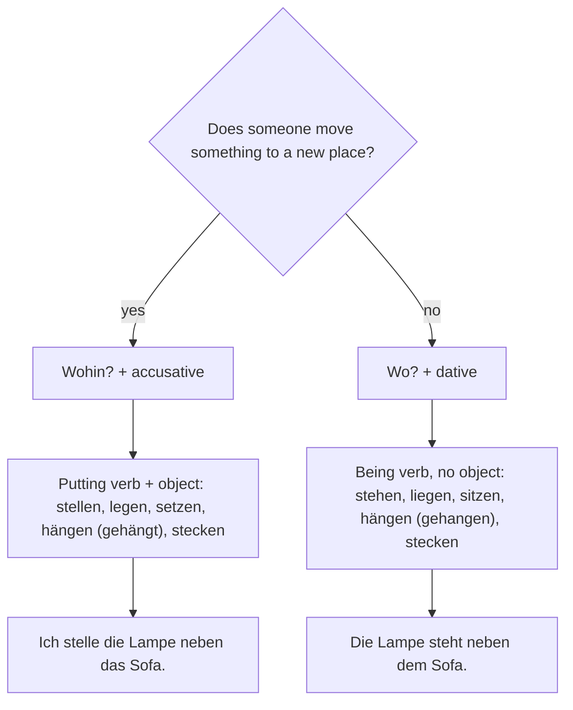

## What this lesson is for

In German A1 (lesson 19) you described a room: *Das Sofa ist im Wohnzimmer. Die Lampe ist über dem Tisch.* You learned that nine prepositions take the dative when they answer *Wo?* (where?). That covers a room that is already finished. But real life is messier: you move into a new flat, carry boxes, put the sofa somewhere, hang pictures on the wall and look for the keys you put down somewhere yesterday.

This lesson adds the second half of the picture. The same nine prepositions take the accusative when something moves to a new place, answering *Wohin?* (where to?). You'll also learn the five pairs of verbs German uses for "put" and "be somewhere" (*stellen/stehen, legen/liegen, setzen/sitzen, hängen/hängen, stecken/stecken*), their perfect forms, and the words you need when you move house: the landlord, the deposit, the boxes and the washing machine.

## Wo? or Wohin? The one question that decides the case

The **two-way prepositions** are *in, an, auf, über, unter, vor, hinter, neben, zwischen*. They are called two-way because they can take two cases. Which one you use depends on a single question:

| Question | Situation | Case | Example |
|---|---|---|---|
| *Wo?* — where? | a position; nothing moves to a new place | **dative** | *Der Karton steht im Flur.* — The box is (standing) in the hall (*der Flur*). |
| *Wohin?* — where to? | movement or a change of place towards a goal | **accusative** | *Ich stelle den Karton in den Flur.* — I'm putting the box into the hall. |

The movement has to be from one place to another. Walking around inside the kitchen is still *Wo?*: *Er läuft in der Küche hin und her* (He walks up and down in the kitchen). Walking into the kitchen is *Wohin?*: *Er läuft in die Küche.*

A memory hook: Accusative = Arrow (both start with A). If you could draw an arrow to a new spot, use the accusative. If you could draw a dot, use the dative.

### The articles

After a two-way preposition, the article simply takes the normal dative or accusative form:

| | masculine | feminine | neuter | plural |
|---|---|---|---|---|
| *Wo?* (dative) | *auf dem Tisch* | *an der Wand* | *im (in dem) Regal* | *in den Kisten* |
| *Wohin?* (accusative) | *auf den Tisch* | *an die Wand* | *ins (in das) Regal* | *in die Kisten* |

Notice that the feminine changes from *der* to *die*, the masculine from *dem* to *den*, and the neuter from *dem* to *das*. Only the plural noun loses the extra dative *-n*: *in den Kisten* (dative) but *in die Kisten* (accusative).

- *Die Bücher liegen auf dem Boden.* — The books are lying on the floor.
- *Leg die Bücher bitte nicht auf den Boden!* — Please don't put the books on the floor!
- *Das Bild hängt über dem Sofa.* — The picture is hanging above the sofa.
- *Wir hängen das Bild über das Sofa.* — We're hanging the picture above the sofa.
- *Die Katze schläft unter dem Bett.* — The cat is sleeping under the bed.
- *Die Katze läuft unter das Bett.* — The cat runs under the bed.

### Contractions

You already know *im* (in dem) and *am* (an dem) for the dative. The accusative has its own short forms with *das*:

| Long form | Short form | Case | Example |
|---|---|---|---|
| *in dem* | *im* | dative | *im Keller* — in the cellar |
| *an dem* | *am* | dative | *am Fenster* — at the window |
| *in das* | *ins* | accusative | *ins Schlafzimmer* — into the bedroom |
| *an das* | *ans* | accusative | *ans Fenster* — to the window |

You will also meet *aufs* (auf das): *aufs Sofa*. It is correct in writing too, just less frequent than *ins* and *ans*.

## Put and be: five verb pairs

English uses "put" for almost everything and "is" for almost every position. German is more precise. It has pairs of verbs: one describes the action of putting something somewhere (*Wohin?* + accusative), the other describes the result, where it now is (*Wo?* + dative).

| Putting (*Wohin?* + accusative) | Being there (*Wo?* + dative) | Used for |
|---|---|---|
| *stellen* — to put (upright) | *stehen* — to stand, be (upright) | things that stand on a base: bottles, furniture, a lamp, books in a row |
| *legen* — to put (flat), lay | *liegen* — to lie, be (flat) | things lying flat: keys, a phone, a carpet, a person in bed |
| *setzen* — to sit (someone) down | *sitzen* — to sit, be sitting | people and animals; *sich setzen* = to sit down |
| *hängen* — to hang (something up) | *hängen* — to hang, be hanging | pictures, curtains, coats, lamps from the ceiling |
| *stecken* — to put (into), stick | *stecken* — to be (inside), be stuck | something inside something tight: a key in a lock, a phone in a pocket |

- *Ich stelle die Flasche in den Kühlschrank.* — I put the bottle in the fridge.
  *Die Flasche steht im Kühlschrank.* — The bottle is in the fridge.
- *Er legt den Teppich ins Wohnzimmer.* — He puts the rug in the living room.
  *Der Teppich liegt im Wohnzimmer.* — The rug is in the living room.
- *Die Mutter setzt das Baby auf den Stuhl.* — The mother sits the baby on the chair.
  *Das Baby sitzt auf dem Stuhl.* — The baby is sitting on the chair.
- *Wir hängen den Vorhang ans Fenster.* — We're hanging the curtain at the window.
  *Der Vorhang hängt am Fenster.* — The curtain is hanging at the window.
- *Sie steckt den Schlüssel in die Tasche.* — She puts the key in her bag.
  *Der Schlüssel steckt in der Tasche.* — The key is in the bag.

How do you know whether something *steht* or *liegt*? Ask how it rests. A book standing on a shelf *steht*; the same book lying flat on the table *liegt*. A plate on the table usually *steht* in German (it rests on its base), and so do cups and glasses. Cities also "lie": *Wien liegt an der Donau* (Vienna lies on the Danube).

### Why there are two verbs: a memory hook

Look at the pairs again. The putting verbs (*stellen, legen, setzen*) all have an *e* and are regular, like *machen*. They always have a **direct object**: you put *something*. The being verbs (*stehen, liegen, sitzen*) have other vowels, are irregular, and never take an object. So: *e* for effort (you do something to an object, and the object goes into the accusative).

*hängen* and *stecken* look the same in both meanings. Only the object, the case after the preposition and the perfect of *hängen* tell them apart. (*stecken* is regular in both meanings: *hat gesteckt*.)

This chart sums up the choice:

### The perfect forms

| Putting (regular) | Perfect | Being (irregular) | Perfect |
|---|---|---|---|
| *stellen* | *hat gestellt* | *stehen* | *hat gestanden* |
| *legen* | *hat gelegt* | *liegen* | *hat gelegen* |
| *setzen* | *hat gesetzt* | *sitzen* | *hat gesessen* |
| *hängen* | *hat gehängt* | *hängen* | *hat gehangen* |
| *stecken* | *hat gesteckt* | *stecken* | *hat gesteckt* |

- *Wohin hast du meine Brille gelegt?* — Where did you put my glasses?
- *Sie hat den ganzen Tag auf dem Balkon gesessen.* — She sat on the balcony all day.
- *Ich habe die Jacke an die Tür gehängt.* — I hung the jacket on the door.
- *Die Jacke hat an der Tür gehangen.* — The jacket was hanging on the door.

In southern Germany, Austria and Switzerland, *stehen, liegen* and *sitzen* form the perfect with *sein*: *Ich bin lange gesessen.* That is correct there; in the rest of Germany people use *haben*, and this course does too.

### Other verbs with Wo? and Wohin?

The same logic works for every verb. Verbs of movement (*gehen, fahren, kommen, laufen, bringen, tragen*) usually answer *Wohin?*; verbs of being or staying (*sein, wohnen, arbeiten, bleiben, warten, schlafen*) answer *Wo?*

- *Wir fahren in die Stadt.* — We're driving into town. / *Wir wohnen in der Stadt.* — We live in town.
- *Bring die Kiste bitte in den Keller.* — Please take the crate down to the cellar. / *Die Kiste bleibt im Keller.* — The crate stays in the cellar.
- *Ich gehe ins Bett.* — I'm going to bed. / *Ich liege im Bett.* — I'm lying in bed.

## Moving house

Moving is a big topic in German everyday life, because most people rent. You know *umziehen* (to move house) from A1. Two new verbs show the direction:

- *einziehen* — to move in: *Wir sind am Samstag in die neue Wohnung eingezogen.* — We moved into the new flat on Saturday. (in + accusative: the arrow goes in)
- *ausziehen* — to move out: *Mein Bruder ist aus der WG ausgezogen.* — My brother has moved out of the shared flat. (aus + dative)

Both are separable and form the perfect with *sein*, like *umziehen*. (*die WG*, short for *Wohngemeinschaft*, is a flat shared by several people.)

The people and the money:

- *der Vermieter* (landlord) rents the flat to *der Mieter* (tenant). You know *mieten* (to rent) and *die Miete* (rent).
- *die Kaution* — the deposit, by law at most three months' rent (without the extra costs): *Die Kaution bekommen Sie zurück, wenn Sie ausziehen.*
- *die Nebenkosten* — the extra costs for heating, water and rubbish collection, paid on top of the rent. An advert might say: *Miete 650 € plus 180 € Nebenkosten.*

Most of the things appear in the dialogue below. A few more: *die Möbel* (furniture) is a plural word: *Die Möbel kommen morgen.* *Die Decke* is both a blanket and the ceiling: *Die Lampe hängt an der Decke.* The dishwasher (*die Spülmaschine*) stands in the kitchen, and *der Müll* (rubbish) goes into the bin outside.

Here is Lena's living room on moving day, with some of the new words:

Describe the picture with *Wo?*: *Die Lampe hängt an der Decke. Der Teppich liegt vor dem Sofa. Der Karton steht neben dem Fenster.*

The jobs: *sauber machen* (to clean), *abwaschen* (to wash up), *staubsaugen* (to vacuum) and, from A1, *aufräumen* (to tidy up) and *putzen* (to clean). *Wenn man auszieht, muss man die Wohnung sauber machen* — When you move out, you have to clean the flat.

## Dialogue: Moving day

Lena is moving into her first flat. Her friend Tarek is helping.

> Tarek: So, das ist der letzte Karton. Wohin soll ich ihn stellen?
>
> Lena: Was steht denn drauf? Ah, „Küche“. Stell ihn bitte neben den Herd.
>
> Tarek: Und die große Kiste mit den Büchern? Die ist wirklich schwer!
>
> Lena: Die kommt ins Wohnzimmer, zwischen das Sofa und den Schreibtisch. Die Bücher stelle ich später ins Regal.
>
> Tarek: Okay. Sag mal, wo ist eigentlich der Teppich? Gestern hat er noch im Flur gelegen.
>
> Lena: Den habe ich schon ins Schlafzimmer gelegt. Und die Vorhänge hängen auch schon am Fenster. Schau!
>
> Tarek: Sehr schön. Und wo sind die Kissen?
>
> Lena: Die liegen in dem blauen Sack auf dem Balkon. Leg sie einfach aufs Sofa.
>
> Tarek: Puh. Darf ich mich jetzt mal kurz setzen?
>
> Lena: Natürlich! Setz dich! Ich hole uns etwas zu trinken. Das Bier steht schon im Kühlschrank.
>
> Tarek: Und wann kommt die Waschmaschine?
>
> Lena: Morgen. Mein Vermieter sagt, sie muss in den Keller. Da unten stehen alle Waschmaschinen.

In English:

> Tarek: Right, that's the last box. Where should I put it?
>
> Lena: What does it say on it? Ah, "kitchen". Put it next to the cooker, please.
>
> Tarek: And the big crate with the books? It's really heavy!
>
> Lena: That goes in the living room, between the sofa and the desk. I'll put the books on the shelf later.
>
> Tarek: OK. Tell me, where's the rug actually? Yesterday it was lying in the hall.
>
> Lena: I've already put it in the bedroom. And the curtains are already hanging at the window. Look!
>
> Tarek: Very nice. And where are the cushions?
>
> Lena: They're in the blue bag on the balcony. Just put them on the sofa.
>
> Tarek: Phew. Can I sit down for a moment now?
>
> Lena: Of course! Sit down! I'll get us something to drink. The beer is already in the fridge.
>
> Tarek: And when is the washing machine coming?
>
> Lena: Tomorrow. My landlord says it has to go in the cellar. All the washing machines are down there.

Look at the pairs: *stell ihn neben den Herd* (accusative, putting) against *Das Bier steht im Kühlschrank* (dative, position). *Er hat im Flur gelegen* is the perfect of *liegen*; *Den habe ich ins Schlafzimmer gelegt* is the perfect of *legen*. (*drauf* = on it, *der Sack* = bag or sack, *Setz dich!* = sit down, *da unten* = down there.)

## Pronunciation

- *Vorhang*: the *v* sounds like *f*: FOR-hang.
- *Teppich* ends in the soft *ch* of *ich*, not in "k".
- *Kaution*: *-tion* is pronounced "tsee-ohn", stressed at the end: kau-TSION.
- *Spülmaschine*: *sch* as in "shoe", stress on the first part: SPÜL-ma-schi-ne.
- *liegen* (long *ie*) and *legen* (long *e*) sound different; so do *sitzen* (short *i*) and *setzen* (short *e*). Say them slowly in pairs.
- *staubsaugen*: *au* twice, like English "ow": STAUB-sau-gen.

## Common mistakes

- *Ich lege das Buch auf dem Tisch.* — Putting is movement: *auf den Tisch*.
- *Das Buch liegt auf den Tisch.* — Lying is position: *auf dem Tisch*.
- *Ich stehe die Flasche in den Kühlschrank.* — *stehen* has no object. For putting, use *stellen*: *Ich stelle die Flasche …*
- *Ich sitze mich.* — To sit down is *sich setzen*: *Ich setze mich.*
- *Ich habe das Bild an die Wand gehangen.* — When you hang something, use the regular perfect: *gehängt*. *gehangen* is only for "was hanging".
- *Ich gehe in das Kino* sounds stiff; Germans say *ins Kino*.
- Using *Wohin?* logic with *aus*, *bei*, *zu* or *nach*. These are dative-only prepositions: *Ich gehe zum Arzt* (not *zu den Arzt*) even though you move.

## Key points

- *in, an, auf, über, unter, vor, hinter, neben, zwischen* take the dative for *Wo?* (position) and the accusative for *Wohin?* (movement to a new place).
- Accusative = arrow, dative = dot.
- Contractions: *im, am* (dative), *ins, ans* (accusative).
- Putting verbs are regular and take an object: *stellen, legen, setzen, hängen (gehängt), stecken* + accusative.
- Being verbs have no object: *stehen (gestanden), liegen (gelegen), sitzen (gesessen), hängen (gehangen)* are irregular; *stecken (gesteckt)* is regular in both meanings. They take the dative.
- *stehen* for things upright, *liegen* for things flat; *sich setzen* = to sit down.
- *einziehen in* + accusative, *ausziehen aus* + dative; both use *sein* in the perfect.

The words from this lesson are listed below; they join your vocabulary reviews when you complete the lesson.
