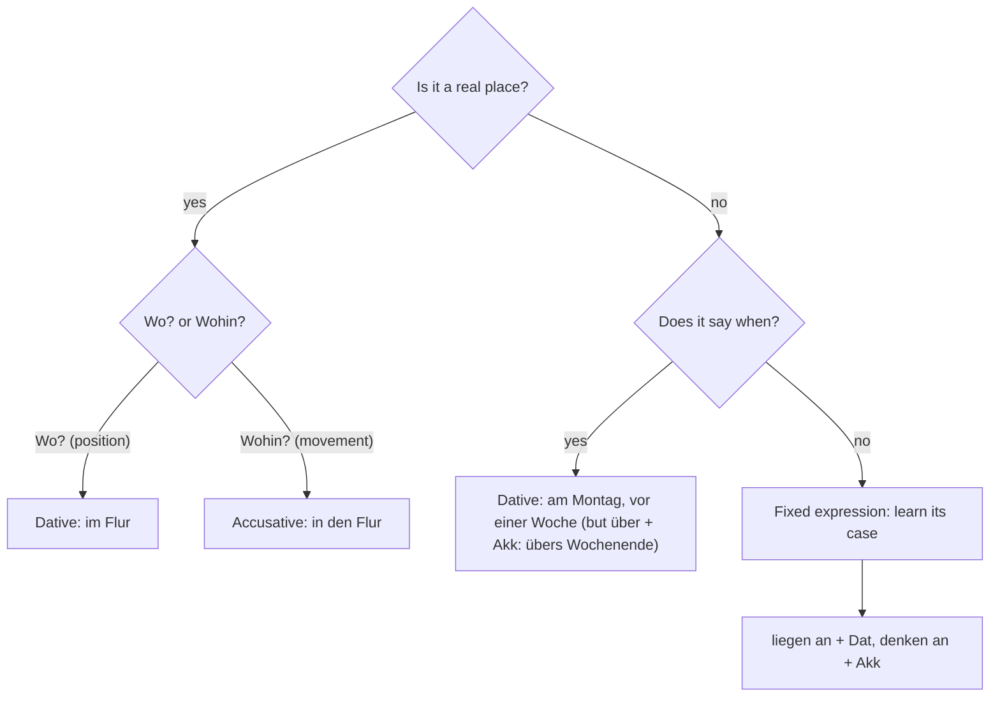

## What this lesson is for

In lesson 13 you learned a clean system: the nine two-way prepositions take the dative for *Wo?* and the accusative for *Wohin?*, and the verbs *stehen, liegen, sitzen, hängen* and *stecken* say where something is. That system works perfectly for boxes, books and sofas.

But Germans use the same words all the time when nothing is anywhere at all. *In der Zeitung steht, dass es morgen regnet* — nothing is standing in the newspaper. *Das liegt am Wetter* — "it lies at the weather" means "it's because of the weather". *Wo steckst du?* asks where a person is, not what is stuck in a pocket. This is the **figurative meaning** of a word: a meaning carried over from the physical one to something abstract.

This honors lesson teaches the most useful of these uses. You'll also learn the key rule that goes with them: once a preposition is used figuratively, the question *Wo? or Wohin?* no longer decides the case. The expression does. That makes these phrases **fixed expressions**, which you learn as whole units, like the verbs with prepositions in lesson 6.

## The big idea: who decides the case?

| | Literal: a real place | Figurative: no real place |
|---|---|---|
| What decides the case? | the question *Wo?* (dative) or *Wohin?* (accusative) | the expression itself: learn it with its case |
| Example | *Das Buch liegt auf dem Tisch.* *Ich lege das Buch auf den Tisch.* | *Das liegt am Wetter.* (always dative) *Ich denke an dich.* (always accusative) |

So when you meet a two-way preposition, first ask: is there a real place here? If yes, use lesson 13. If no, it's a fixed expression, and you need to know its case. One more shortcut: when a two-way preposition says *when* something happens, it almost always takes the dative: *am Montag, im Juli, in der Nacht, vor einer Woche, zwischen den Feiertagen*.

## stehen: written, stuck, into

**Something is written somewhere: *stehen in / auf* + dative.** This is the most common figurative use of all. Texts don't "say" things in German; things *stand* in them.

- *In der Zeitung steht, dass die Mieten steigen.* — It says in the paper that rents are rising.
- *Was steht in dem Brief?* — What does the letter say?
- *Auf dem Schild steht: „Bitte nicht rauchen.“* — The sign says: "Please don't smoke."

You met this in lesson 13 without noticing: *Was steht denn drauf?* — What does it say on it?

**Stuck in traffic: *im Stau stehen*.** *Der Stau* is a traffic jam: *Ich stehe seit einer Stunde im Stau.* — I've been stuck in traffic for an hour.

**Liking something: *stehen auf* + accusative.** In informal speech, *auf etwas stehen* means to be really into something, and *auf jemanden stehen* means to fancy someone. It's colloquial, so keep it for friends:

- *Ich stehe total auf alte Filme.* — I'm really into old films.
- *Ich glaube, Tim steht auf dich.* — I think Tim fancies you.

And remember from lesson 7: *Die Jacke steht dir* means "the jacket suits you", with the person in the dative.

## liegen: the reason behind something

**It's because of …: *liegen an* + dative.** When you want to say what causes a problem, German uses *liegen an*:

- *Das liegt am Wetter.* — That's because of the weather. (*am* = *an dem*)
- *Es liegt nicht an dir, es liegt an mir.* — It's not you, it's me.
- *Woran liegt das?* — Why is that? What's the reason? (*woran* = *an* + what, lesson 6)

The case is always dative, even though nothing is "at" anything. In the past: *Das lag an der Uhrzeit* (*lag* is the simple past of *liegen*), or in the perfect: *Das hat am Stau gelegen.*

**It's up to …: *liegen bei* + dative.** *Die Entscheidung liegt bei dir.* — The decision is up to you. (*bei* is dative anyway.)

**Being good at something: *jemandem liegen*.** *Mathe liegt mir nicht.* — Maths isn't my thing. *Kochen liegt ihr.* — She's good at cooking, it suits her. The person is in the dative, like *gefallen*.

## sitzen, hängen, stecken

- **Clothes that fit: *sitzen*.** *Die Hose sitzt perfekt.* — The trousers fit perfectly. (Compare *passen*, lesson 7: *passen* is about size, *sitzen* about how well it hangs on you.)
- **Being attached to something: *hängen an* + dative.** *Ich hänge an meiner alten Wohnung.* — I'm attached to my old flat. *Er hängt sehr an seiner Oma.* — He's very attached to his grandma. The perfect is *hat gehangen*, as for the being verb (in southern Germany, Austria and Switzerland you'll also hear *ist gehangen*).
- **Where someone is: *stecken*.** *Wo steckst du denn?* — Where on earth are you? *Wo steckt mein Schlüssel?* — Where has my key got to? Also *in Schwierigkeiten stecken* (to be in trouble) and *Wer steckt dahinter?* (who's behind it?).

The picture shows four of these uses:

### Example 1: Literal or figurative?

Decide the case in each sentence.

1. *Der Karton steht ___ Flur.* A real place, position: dative, *im Flur*.
2. *___ Zeitung steht, dass es morgen regnet.* No real place, but *stehen in* for a text always takes the dative: *In der Zeitung*.
3. *Die Verspätung liegt ___ Stau.* A reason, *liegen an* + dative: *am Stau*.
4. *Ich denke oft ___ meine Kindheit.* *denken an* + accusative (lesson 6): *an meine Kindheit*.
5. *Wir fahren ___ Wochenende aufs Land.* A time: dative, *am Wochenende*. (*übers Wochenende*, accusative, is also correct, with a slightly different meaning: for the whole weekend; see below.) And *aufs Land* is a fixed accusative (see below).

## Two-way prepositions in set phrases

Many short phrases with two-way prepositions are frozen. Here are the ones you'll hear most, with their case:

| Phrase | Case | Meaning | Example |
|---|---|---|---|
| *vor allem* | dative | above all, especially | *Ich mag Obst, vor allem Äpfel.* |
| *vor Freude / Angst / Kälte* | dative | with (because of) joy / fear / cold | *Sie hat vor Freude geweint.* |
| *unter uns* | dative | between you and me | *Unter uns: Das Essen war furchtbar.* |
| *in der Nähe* | dative | nearby | *Gibt es hier in der Nähe eine Apotheke?* |
| *im Moment* | dative | at the moment | *Im Moment habe ich keine Zeit.* |
| *auf dem Land* | dative | in the country(side) | *Meine Eltern wohnen auf dem Land.* |
| *aufs Land* | accusative | to the country(side) | *Am Sonntag fahren wir aufs Land.* |
| *auf Deutsch* | accusative | in German | *Wie sagt man das auf Deutsch?* |
| *auf jeden Fall* | accusative | definitely, in any case | *Ich komme auf jeden Fall.* |
| *über* (a topic) | accusative | about | *ein Film über den Krieg* |
| *übers Wochenende* | accusative | over the weekend (for its length) | *Wir fahren übers Wochenende weg.* |

Notice that *vor* in *vor Freude* gives a reason, and that *über* meaning "about" a topic is always accusative, as in *sprechen über* (lesson 6). *über* with a stretch of time (*übers Wochenende, über Nacht*) is the main exception, taking the accusative: it measures how long, rather than saying when.

### Example 2: From English to German

You want to say: "The train was late because of the snow. Above all, the connection was the problem."

- "because of the snow" → a reason, so *liegen an*: *Die Verspätung lag am Schnee.* (*der Schnee*, dative *dem Schnee*, contracted *am*.)
- "above all" → *vor allem*, fixed dative.
- Full answer: *Die Verspätung lag am Schnee. Vor allem der Anschluss war das Problem.*

### Example 3: Asking about a reason and answering

The question word for *liegen an* is *woran*; the answer word is *daran* (lesson 6).

- *Woran liegt es, dass du so müde bist?* — *Ich glaube, es liegt daran, dass ich zu wenig schlafe.*
- Why is that? → *Woran liegt das?* That's the reason → *Daran liegt es.*

Notice how *daran* points forward to a whole *dass* clause: *Es liegt daran, dass …* — It's because …

## Dialogue: Zu spät zum Umzug

Emil is helping his friend Jana move house, but he's very late.

> Jana: Da bist du ja endlich! Wo hast du denn gesteckt? Ich warte seit zwei Stunden!
>
> Emil: Tut mir leid! Ich habe über eine Stunde im Stau gestanden.
>
> Jana: Im Stau? Am Samstagmorgen?
>
> Emil: Ja, im Radio haben sie gesagt, es liegt an einem Unfall auf der Autobahn. Und vor allem: In meiner Straße stand ein Möbelwagen mitten auf der Fahrbahn.
>
> Jana: Na gut. Unter uns: Ich bin auch noch nicht fertig. Ich hänge so an meinen alten Sachen, ich kann nichts wegwerfen.
>
> Emil: Das kenne ich. Was steht denn auf dem Karton da?
>
> Jana: „Erinnerungen“. Der kommt mit, aufs Land, in die neue Wohnung.
>
> Emil: Und die alte Lampe? Die passt doch gar nicht zu dir.
>
> Jana: Ach, Design liegt mir einfach nicht. Die Entscheidung liegt bei dir: Lampe oder keine Lampe?

In English:

> Jana: There you are at last! Where on earth have you been? I've been waiting for two hours!
>
> Emil: Sorry! I was stuck in traffic for over an hour.
>
> Jana: In traffic? On a Saturday morning?
>
> Emil: Yes, on the radio they said it's because of an accident on the motorway. And above all: there was a removal van right in the middle of my street.
>
> Jana: All right. Between you and me: I'm not finished yet either. I'm so attached to my old things, I can't throw anything away.
>
> Emil: I know the feeling. What does it say on that box?
>
> Jana: "Memories". That one's coming along, to the country, to the new flat.
>
> Emil: And the old lamp? It really isn't you.
>
> Jana: Oh, design just isn't my thing. It's up to you: lamp or no lamp?

(*endlich* = at last, *der Unfall* = accident, *der Möbelwagen* = removal van, *die Fahrbahn* = roadway, *fertig* = finished, *wegwerfen* = to throw away, *passen zu* = to go with, suit.) Count the figurative uses: *gesteckt* (the perfect of *stecken* is regular), *im Stau gestanden, liegt an, vor allem, unter uns, hänge an, steht auf, aufs Land, liegt mir, liegt bei*. *im Radio*, like *in der Zeitung*, names the medium the news comes from. Only *auf der Autobahn, in meiner Straße, auf der Fahrbahn* and *in die neue Wohnung* are real places.

## Pronunciation

- *Stau*: *st* at the start of a word is "sht": SHTAU, rhymes with "how".
- *woran* and *daran*: stress on the second part, wo-RAN, da-RAN.
- *vor allem*: two words, but said together with the stress on *al*: for-AL-lem.

## Common mistakes

- *Das liegt an das Wetter.* — *liegen an* always takes the dative: *am Wetter*.
- *In die Zeitung steht …* — *stehen in* (a text) is dative: *In der Zeitung steht …*
- *Es sagt in der Zeitung …* — English word-for-word. German says *In der Zeitung steht …*
- *Ich hänge an meiner Wohnung* in the perfect as *habe … gehängt*. Being attached is the being verb: *Ich habe an der Wohnung gehangen.*
- Using *stehen auf* at work or with strangers. It's colloquial; in neutral German say *Ich mag …* or *Ich interessiere mich für …*
- *über dem Wochenende* (dative) for a stretch of time. With *über*, a stretch of time is accusative: *übers* (*über das*) *Wochenende*.

## Key points

- In a **figurative meaning** there is no real place, so *Wo?/Wohin?* doesn't decide the case: the **fixed expression** does.
- Time expressions with two-way prepositions almost always take the dative (*am Montag, vor einer Woche*); the main exception is *über* + accusative for a stretch (*übers Wochenende*).
- *stehen in* + Dat = be written in; *im Stau stehen* = be stuck in traffic; *stehen auf* + Akk = be into (colloquial).
- *liegen an* + Dat = be because of (*Woran liegt das? – Das liegt am Wetter*); *liegen bei* = be up to; *jemandem liegen* = suit, be good at.
- *sitzen* = fit well; *hängen an* + Dat = be attached to (*gehangen*); *Wo steckst du?* = where are you?
- Set phrases: *vor allem, vor Freude, unter uns, in der Nähe, im Moment, auf dem Land* (Dat); *aufs Land, auf Deutsch, auf jeden Fall, über* + topic (Akk).

The words from this lesson are listed below; they join your vocabulary reviews when you complete the lesson.
