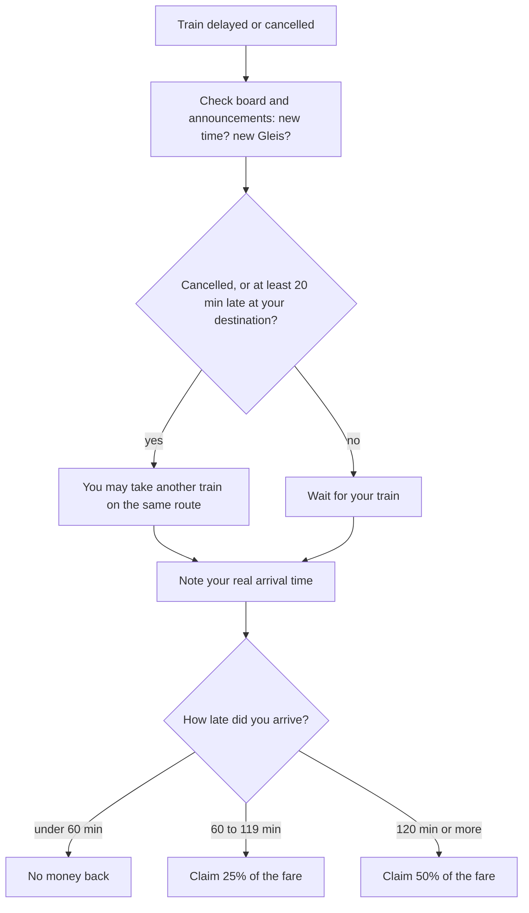

## What this lesson is for

In lesson 14 Jonas booked a room in the Black Forest and Miriam sent a postcard from Lake Constance. Many trips in German-speaking countries start at a station, and the station is full of German you have to understand fast: a departure board that changes while you look at it, and loudspeaker announcements that tell you your train is late, leaving from a different platform, or not coming at all.

This honors lesson trains you for exactly that. You'll learn the kinds of trains and the most famous ticket, read a departure board, decode typical announcements, and work out what to do (and what money you can get back) when the train is late. The grammar is a first look at a new job for *werden*: the **passive**, which announcements use all the time. Understanding announcements is also part of the listening section of the Goethe A2 exam (lesson 24).

## Trains and tickets

Germany's main rail company is the *Deutsche Bahn* (DB), but regional trains are often run by other companies. What matters to you is the type of train, shown before its number:

| Short form | Name | What it is |
|---|---|---|
| *ICE* | *Intercity-Express* | high-speed long-distance train |
| *IC / EC* | *Intercity / Eurocity* | long-distance train (EC = to or from another country) |
| *RE* | *Regional-Express* | regional train with fewer stops |
| *RB* | *Regionalbahn* | regional train that stops almost everywhere |
| *S* | *S-Bahn* | suburban train in and around a city |

ICE, IC and EC are *Fernverkehr* (long-distance transport); everything from RE down is *Nahverkehr* (local and regional transport). That difference matters for the best-known German ticket, the *Deutschlandticket*: a monthly subscription for all local and regional transport in the whole country (buses, trams, U-Bahn, S-Bahn, RB and RE), but not for ICE, IC or EC trains. In 2026 it costs 63 euros a month. (Prices have gone up several times since the ticket started in 2023, so check the current price.)

## Reading a departure board

At the platform, a display shows the next train. Each part has a name worth knowing.

- *das Gleis* (from A1): the track. The platform you stand on is *der Bahnsteig*, but signs and announcements almost always say *Gleis*.
- *die Abfahrt* (from A1): the time the train is planned to leave.
- *der Zug* with its type and number: *ICE 578*.
- *das Ziel*: the destination (*Hamburg-Altona*); *über* lists the main stops on the way. *Hbf* is short for *Hauptbahnhof* (main station).
- *der Hinweis*: a note, often about a delay: *ca. 15 Minuten später* (about 15 minutes later). *ca.* is short for *circa* (about).
- *die Abschnitte A–F*: the sections of the platform. A separate sign shows where each carriage (*der Wagen*) will stop.

## Announcements: the phrases that matter

Announcements follow fixed patterns. You don't have to understand every word, only the key ones: the train, the platform, the time, and what's wrong.

| Announcement | Meaning |
|---|---|
| *Auf Gleis 7 fährt ein: ICE 578 nach Hamburg-Altona.* | Now arriving at platform 7: ICE 578 to Hamburg-Altona. |
| *Vorsicht bei der Einfahrt!* | Stand back, the train is arriving! |
| *… hat voraussichtlich 15 Minuten Verspätung.* | … is expected to be about 15 minutes late. |
| *Grund dafür ist eine Störung am Zug.* | The reason is a problem with the train. |
| *… fällt heute aus.* | … is cancelled today. (*ausfallen*) |
| *Bitte beachten Sie: … fährt heute von Gleis 9 ab.* | Please note: … leaves from platform 9 today. |
| *… fährt heute in umgekehrter Wagenreihung.* | … has its carriages in reverse order today. |
| *Es gibt einen Ersatzverkehr mit Bussen.* | Replacement buses are running. |
| *Ihre Anschlusszüge werden erreicht.* | Your connecting trains will be reached (they'll wait or you'll make it). |

*voraussichtlich* (expected, probably) is the word to listen for: the delay is a forecast, not a promise. *Die Störung* is any kind of problem or fault: *eine Störung am Zug* (with the train), *eine Störung an der Strecke* (on the line; *die Strecke* = route, line). *Der Anschluss* is your connection, the next train you want to catch.

*In umgekehrter Wagenreihung* is famous among travellers in Germany: the train arrives the "wrong way round", so first class and your reserved carriage stop at the other end of the platform. Walk to the new section in time.

### Example 1: Decoding an announcement

You're waiting for the RE 4 to Aachen at 9:12 and hear: *"Bitte beachten Sie: Der RE 4 nach Aachen, planmäßige Abfahrt 9 Uhr 12, fährt heute von Gleis 3 ab. Der Zug hat voraussichtlich zehn Minuten Verspätung."*

Pick out the key words. *RE 4 nach Aachen*: it's your train. *Gleis 3*: you have to change platform. *zehn Minuten Verspätung*: it will leave at about 9:22. (*planmäßig* = scheduled, from *der Plan*.) So: go to platform 3, no need to run.

## Grammar: the passive (to recognize)

You've met *werden* twice: as "to become" (*Er wird Arzt*, lesson 8) and for the future (*Es wird regnen*, lesson 14). Announcements use it in a third way. A form of *werden* + a past participle at the end makes the **passive**: the sentence says what *is done*, not who does it.

| Active (who does it) | Passive (what is done) |
|---|---|
| *Die Bahn stellt den Zug bereit.* — The railway is preparing the train. | *Der Zug wird bereitgestellt.* — The train is being prepared (made ready). |
| *Man repariert die Strecke.* — They're repairing the line. | *Die Strecke wird repariert.* — The line is being repaired. |
| *Wir informieren Sie.* — We'll inform you. | *Sie werden informiert.* — You'll be informed. |

How to tell the three uses apart: look at what stands at the end. An infinitive (*regnen*) means the future; a past participle (*repariert, bereitgestellt*) means the passive; a noun or adjective (*Arzt, müde*) means "become".

- *Der Zug wird in wenigen Minuten bereitgestellt.* — The train is being made ready in a few minutes.
- *Die Fahrgäste werden gebeten, …* — Passengers are asked to … (*der Fahrgast* = passenger)
- *Die Fahrkarten werden kontrolliert.* — Tickets are being checked.

At A2 you only need to recognize the passive. You'll learn to build it in all tenses at B1.

A second pattern you'll hear: *wegen* (because of) with the genitive, as in *wegen einer Störung* or *wegen des Wetters*. In everyday speech many people say *wegen dem Wetter* with the dative; formal announcements use the genitive. Either way, *wegen* tells you the reason.

## When the train is late

Trains in Germany are often late, and passengers have rights (*die Fahrgastrechte*). The basic rules for a normal ticket, simplified:

- If you'll probably reach your destination at least 20 minutes late, you may take a different train on the same route (for a cheap saver ticket that is otherwise tied to one train, too).
- If you arrive at your destination at least 60 minutes late, you get 25% of the fare back; from 120 minutes, 50%. This is called *die Entschädigung* (compensation). The railway *erstattet* (refunds) the money.
- Amounts under 4 euros aren't paid out.
- Since June 2023 there is no compensation when the cause is something truly exceptional, such as extreme weather; a strike by railway staff still counts.

Only the delay at your final destination counts. The Deutschlandticket has its own, narrower rules. Always check the current rules before you travel.

### Example 2: How much money back?

Sara's ticket from Köln to Berlin cost 84 euros. Her ICE arrives in Berlin 75 minutes late. 75 minutes is at least 60 but less than 120, so she gets 25%: 84 € × 0.25 = **21 €**. If the delay had been 130 minutes, she'd get 50%: **42 €**. And on the way back, a 55-minute delay brings nothing: under 60 minutes there's no compensation.

### Example 3: Will I catch my connection?

Paul travels from Frankfurt to a small town. His plan: ICE arrives in Fulda at 10:05, the RB leaves Fulda at 10:14. His *Umsteigezeit* (time to change trains) is 9 minutes. Now the ICE has *voraussichtlich 15 Minuten Verspätung*: it will arrive at about 10:20, six minutes after the RB leaves. So the connection is lost unless the RB waits. Paul listens for *Ihr Anschlusszug wartet* or *Ihre Anschlusszüge werden erreicht*. If he doesn't hear it, he checks the app for the next train: *Ich habe meinen Anschluss verpasst* (*verpassen* = to miss).

## A text: Messages from the platform

Ben is travelling to his sister Clara's wedding. He sends her messages.

> **Ben, 13:58:** Bin am Hauptbahnhof. Mein ICE hat voraussichtlich 20 Minuten Verspätung, wegen einer Störung an der Strecke.
>
> **Clara, 14:01:** Oh nein! Schaffst du den Anschluss in Hannover?
>
> **Ben, 14:03:** Weiß ich noch nicht. Der Zug wird gerade bereitgestellt, aber er fährt heute in umgekehrter Wagenreihung. Ich muss jetzt zum Abschnitt A laufen!
>
> **Ben, 15:40:** Den Anschluss habe ich verpasst. Aber in 30 Minuten fährt ein RE. Ich komme ungefähr um sieben an.
>
> **Clara, 15:42:** Kein Problem, das Essen beginnt erst um acht. Und denk an die Entschädigung!
>
> **Ben, 15:43:** Mache ich. Wenn ich mehr als eine Stunde zu spät bin, bekomme ich 25 Prozent zurück. Davon kaufe ich dir einen Sekt.

In English:

> **Ben, 13:58:** At the main station. My ICE is expected to be 20 minutes late, because of a problem on the line.
>
> **Clara, 14:01:** Oh no! Will you make your connection in Hanover?
>
> **Ben, 14:03:** Don't know yet. The train is being made ready now, but its carriages are in reverse order today. I have to run to section A!
>
> **Ben, 15:40:** I missed the connection. But there's an RE in 30 minutes. I'll arrive at about seven.
>
> **Clara, 15:42:** No problem, dinner doesn't start until eight. And remember the compensation!
>
> **Ben, 15:43:** Will do. If I'm more than an hour late, I get 25 percent back. I'll buy you a sparkling wine with it.

(Text messages often drop *ich*: *Bin am Hauptbahnhof* = *Ich bin …*; *Weiß ich noch nicht* = *Das weiß ich noch nicht*. *der Sekt* = German sparkling wine.)

## Pronunciation

- *voraussichtlich*: for-AUS-sicht-lich; both *ch* are soft, as in *ich*.
- *Gleis*: *ei* like English "eye": GLICE.
- *ICE*: said letter by letter, the German way: ee-tsay-AY.
- *Hauptbahnhof*: HAUPT-bahn-hof; the *h* in *Bahn* is silent (it only makes the *a* long), but the *h* of *-hof* is pronounced.

## Common mistakes

- *Der Zug wird bereitgestellt* read as the future. It's the passive (participle at the end): the train *is being* prepared.
- Confusing *ausfallen* (to be cancelled) with *aussteigen* (to get off). *Der Zug fällt aus* = there is no train.
- Thinking *voraussichtlich 10 Minuten* is a promise. It's a forecast: stay near the platform.
- Waiting in the wrong place after *umgekehrte Wagenreihung*: your carriage is now at the other end.
- Counting the delay of one train instead of the delay at your final destination when claiming money back.

## Key points

- Long-distance trains: ICE, IC, EC; regional: RE, RB, S-Bahn. The Deutschlandticket (63 € a month in 2026) covers only local and regional transport.
- On the board: *Gleis, Abfahrt, Zug, Ziel, über, Hinweis*, platform sections A–F.
- Key announcement words: *voraussichtlich, Verspätung, fällt aus, Störung, Gleiswechsel / fährt von Gleis … ab, umgekehrte Wagenreihung, Ersatzverkehr, Anschluss*.
- *werden* + past participle = the **passive**: *Der Zug wird bereitgestellt.* Infinitive at the end = future; participle = passive.
- At least 60 minutes late at your destination: 25% back; at least 120: 50%; nothing under 4 €.

The words from this lesson are listed below; they join your vocabulary reviews when you complete the lesson.
