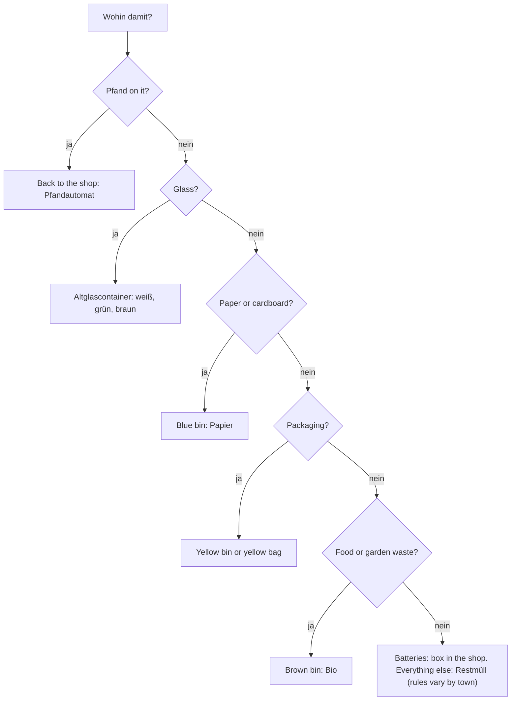

## What this lesson is for

In lesson 16 you learned *die Umwelt*, *den Müll trennen* and *recyceln*, and you read that people in Germany sort their rubbish into several bins. Living there, that one sentence becomes a daily question: *Wohin damit?* — Where does this go? A yoghurt pot, a pizza box, an old battery, an empty bottle: each has its place, and neighbours notice when you get it wrong.

This honors lesson explains the system: the bins, the bottle deposit (*das Pfand*) and what to do with things that fit in no bin. It also puts the grammar of lesson 13 to work in a new setting. Rules about rubbish are full of *Wohin?* (*Das Glas kommt in den Container*) and *Wo?* (*Die Tonnen stehen im Hof*), and of short place words like *rein*, *drin* and *daneben*. You'll finish by reading a notice from a landlord's management company, the kind of authentic text that hangs in every German stairwell.

## The bins

Most households in Germany have three or four bins (*die Tonne*, plural *die Tonnen*) in the courtyard or in front of the house, plus public containers for glass in the street. The basic system:

| Bin | Usual colour | What goes in | Examples |
|---|---|---|---|
| *die Papiertonne* | blue | paper and cardboard (*das Altpapier*) | newspapers, flattened boxes, egg boxes |
| *die gelbe Tonne* or *der gelbe Sack* | yellow | packaging (*die Verpackung*) of plastic, metal or mixed materials | yoghurt pots, tins (*die Dose*), drinks cartons, plastic wrap |
| *die Biotonne* | often brown | food and garden waste (*der Biomüll*) | fruit and vegetable peel, coffee grounds, leaves |
| *die Restmülltonne* | grey or black | everything else (*der Restmüll*) | nappies, vacuum-cleaner bags, broken cups and plates |
| *der Altglascontainer* | in the street | glass jars and bottles without a deposit (*das Altglas*), sorted by colour | jam jars, wine bottles |

Three things surprise newcomers. The yellow bin is for *packaging*, not for all plastic: an old plastic toy is *Restmüll*, but the plastic wrapper of a cucumber is *Verpackung*. Glass is sorted into *Weißglas* (clear), *Grünglas* and *Braunglas*; glass of any other colour, such as blue, goes in with the green. And broken drinking glasses and cups are not *Altglas* but *Restmüll*, because they melt differently.

This is the common system, simplified. Colours, bins and some rules differ from town to town, so check your town's *Abfallkalender* (rubbish calendar), which also tells you on which day each bin is emptied.

Some things belong in no bin at all. *Die Batterie* (battery) goes into a collection box, which every shop that sells batteries must have. Old electrical devices go to a collection point or back to larger shops. And *der Sperrmüll* (bulky rubbish: an old sofa, a mattress) is collected separately: you register it with the town and put it out on the street on the agreed day.

## Grammar: Wohin damit? Wo and wohin in everyday rules

Rubbish rules are lesson 13 grammar in daily use. Throwing, putting and carrying something to a bin is movement, so the two-way preposition takes the accusative:

- *Ich werfe die Dose in die gelbe Tonne.* — I throw the tin into the yellow bin. (*werfen* = to throw; *wegwerfen* = to throw away)
- *Das Glas kommt in den Container.* — The glass goes in the container.
- *Papier gehört in die blaue Tonne.* — Paper belongs in the blue bin.

Notice *gehören in* + accusative. In lesson 7 you learned *gehören* + dative = to belong to someone: *Die Tonne gehört dem Vermieter.* With a two-way preposition it means "to belong in a place", "to go": *Batterien gehören nicht in den Müll.* — Batteries don't go in the rubbish.

Once the rubbish is there, it's a position, so the dative: *Die Tonnen stehen im Hof.* (*der Hof* = courtyard) *Im Restmüll liegen ja Batterien!* — There are batteries in the general waste!

### Short place words: rein, drin, daneben

When the bin is already clear from the conversation, Germans don't repeat it. They use a short place word instead. You saw *drauf* in lesson 13 (*Was steht denn drauf?*) and *rein* and *raus* in lesson 14. Here they come in pairs, one for *Wohin?* and one for *Wo?*:

| Wohin? (movement) | Wo? (position) | Long form |
|---|---|---|
| *Was kommt da rein?* — What goes in there? | *Was ist da drin?* — What's in there? | *hinein* / *darin* |
| *Stell die Kiste da drauf.* — Put the box on top of it. | *Da steht ein Name drauf.* — There's a name on it. | *darauf* |
| *Stell die Flasche daneben.* — Put the bottle next to it. | *Die Flasche steht daneben.* — The bottle is next to it. | *daneben* |
| *Leg die Zeitungen darunter.* — Put the newspapers under it. | *Die Zeitungen liegen darunter.* — The newspapers are underneath. | *darunter* |

*daneben, dahinter, davor, darunter, darüber, dazwischen* look the same in both meanings; the verb (*stellen* or *stehen*) shows which. Only "in" has two clearly different spoken words: *rein* for movement, *drin* for position. These short forms are spoken German; in writing, *hinein* and *darin* are more formal.

### Example 1: Turning a rule into a sentence

Your neighbour asks: *"Wohin mit dem Pizzakarton?"* Think: a pizza box is cardboard, so the paper bin. Movement, so the accusative: *Der kommt in die Papiertonne.* (*die Tonne* is feminine: *in die*.) If it's very greasy, many towns want it in the general waste instead: *Wenn er sehr fettig ist, gehört er in den Restmüll.* And if she asks where the paper bin is: position, dative: *Die steht im Hof, neben der Biotonne.*

## Pfand: the bottle deposit

Many drinks bottles and cans in Germany carry a deposit, *das Pfand*. You pay it when you buy the drink and get it back when you return the empty container (*zurückbringen*, to bring back), usually to a machine in the supermarket, the *Pfandautomat*. The machine prints a receipt (*der Pfandbon*), which you cash at the till or take off your shopping.

There are two kinds:

- *Einweg* (single-use): plastic bottles and cans, marked with the deposit logo. The deposit is 25 cents. The bottle is crushed and recycled. Since 2022 almost all single-use plastic bottles and cans carry it, and since 2024 so do plastic bottles of milk drinks.
- *Mehrweg* (reusable): mostly glass bottles (beer, mineral water) and some thick plastic bottles. They are cleaned and refilled many times. The deposit is usually 8 or 15 cents per bottle, and a crate (*der Kasten*) has its own deposit, often 1.50 euros.

Some people collect bottles from public bins to earn money from the deposit. A well-known campaign asks everyone to put empty deposit bottles next to the bin instead of inside it: *Pfand gehört daneben* — the deposit belongs next to it. Now you can read that slogan: *gehört* + a place, and *daneben* = next to it.

### Example 2: How much Pfand do I get back?

Tim returns 6 single-use bottles, 20 reusable beer bottles at 8 cents and the beer crate (1.50 €).

1. Single-use: 6 × 0.25 € = 1.50 €.
2. Beer bottles: 20 × 0.08 € = 1.60 €.
3. Crate: 1.50 €.
4. Total: 1.50 € + 1.60 € + 1.50 € = **4.60 €**. The machine prints a *Pfandbon* for 4.60 euros.

In German: *Ich bekomme 4,60 Euro Pfand zurück.* (Germans write a comma for decimals: *4,60 €*, said *vier Euro sechzig*.)

## A text: A notice in the stairwell

> **Hausverwaltung Kramer GmbH**
>
> **Liebe Mieterinnen und Mieter,**
>
> leider hatten wir in den letzten Wochen oft Probleme mit dem Müll im Hof. In der Papiertonne lagen Plastikflaschen, und in der gelben Tonne war Biomüll. Deshalb hat die Stadt die Tonnen am Montag nicht geleert. Bitte beachten Sie:
>
> - Kartons bitte flach machen. Sie gehören in die blaue Tonne, nicht daneben.
> - Bananenschalen und Kaffeefilter kommen in die Biotonne, aber bitte ohne Plastiktüte.
> - Batterien gehören nicht in den Hausmüll. Im Supermarkt gibt es eine Sammelbox.
> - Sperrmüll dürfen Sie nicht in den Hof stellen. Melden Sie ihn bei der Stadt an.
>
> Wenn die Tonnen wieder falsch gefüllt sind, müssen wir eine extra Leerung bezahlen. Diese Kosten kommen dann in die Nebenkosten, also zahlen alle Mieter mehr.
>
> Vielen Dank für Ihre Hilfe!

In English:

> **Kramer Property Management Ltd**
>
> **Dear tenants,**
>
> unfortunately we have often had problems with the rubbish in the courtyard in recent weeks. There were plastic bottles in the paper bin and food waste in the yellow bin. That's why the town didn't empty the bins on Monday. Please note:
>
> - Please flatten boxes. They belong in the blue bin, not next to it.
> - Banana skins and coffee filters go in the organic bin, but please without a plastic bag.
> - Batteries don't belong in household rubbish. There is a collection box in the supermarket.
> - You may not put bulky rubbish in the courtyard. Register it with the town.
>
> If the bins are wrongly filled again, we have to pay for an extra emptying. These costs then go into the extra costs, so all tenants pay more.
>
> Thank you for your help!

(*die Hausverwaltung* = property management company; *leeren* = to empty, *die Leerung* = emptying; *flach* = flat; *die Schale* = peel, skin.) Notice the last point of the notice: wrongly sorted rubbish can end up in the *Nebenkosten* from the first honors lesson. Notice too how the text mixes *Wo?* (*In der Papiertonne lagen …*) and *Wohin?* (*… gehören in die blaue Tonne*).

## Pronunciation

- *Pfand*: start with a clear *pf*, lips closed, then a puff: PFAND, not "fand".
- *Tonne*: short *o*, double *n*: TON-ne.
- *Sperrmüll*: SPERR-müll, a rolled or throaty *r* and a rounded *ü*.
- *Batterie*: bat-te-REE, stress on the last syllable, like *Bäckerei*.

## Common mistakes

- *Ich werfe die Flasche in der Tonne.* — Throwing is movement: *in die Tonne*.
- *Die Tonnen stehen in den Hof.* — Standing is position: *im Hof*.
- *Was ist da rein?* — For a position, use *drin*: *Was ist da drin?* *rein* is for movement: *Was kommt da rein?*
- Putting all plastic in the yellow bin. It's for packaging; other plastic things are usually *Restmüll*.
- Throwing a deposit bottle away: that's 8 to 25 cents in the bin. Take it back, or put it *daneben*.

## Key points

- Blue: paper; yellow: packaging; brown: food and garden waste; grey or black: everything else; glass in street containers by colour. Rules vary by town.
- Batteries go to collection boxes in shops; *Sperrmüll* is collected on request.
- Rubbish rules use lesson 13 grammar: *in die Tonne werfen, in den Container kommen, in die blaue Tonne gehören* (accusative); *im Hof stehen, in der Tonne liegen* (dative).
- *gehören in* + accusative = to belong in a place; *gehören* + dative = to belong to someone.
- Spoken place words: *rein* (movement) vs *drin* (position); *drauf, daneben, darunter* for both.
- *Pfand*: Einweg 25 cents; Mehrweg usually 8 or 15 cents per bottle. Return it to the *Pfandautomat* and cash the *Pfandbon*.

The words from this lesson are listed below; they join your vocabulary reviews when you complete the lesson.
