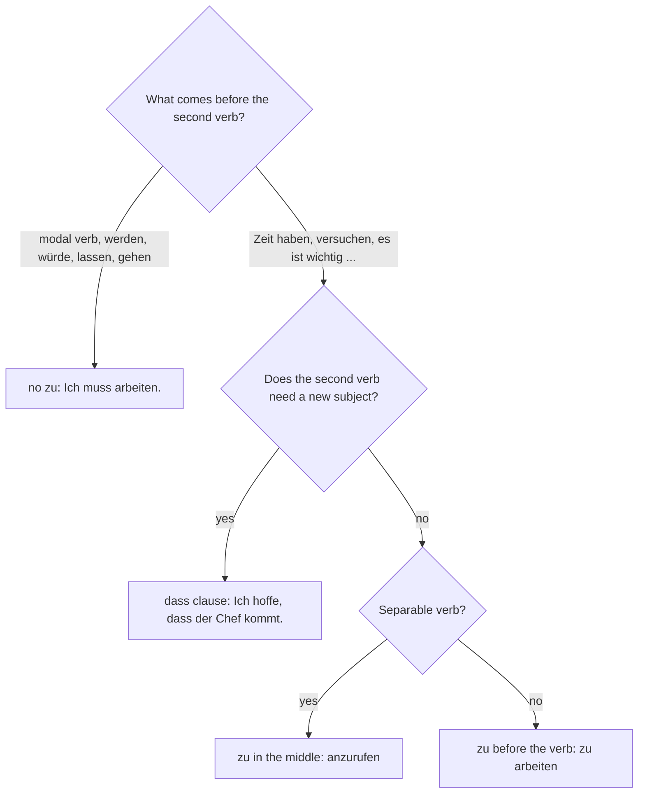

## What this lesson is for

This module is about the places where adult life gets done: work, school, the bank and the town hall, the doctor's office. We start with work. You'll learn the words for colleagues, bosses, job applications, contracts and the daily jobs of an office, and enough phone German to take or leave a message.

The grammar is a pattern you have half-met already. With modal verbs, a second verb goes to the end in its plain form: *Ich muss heute länger arbeiten.* Many other verbs and expressions also send a verb to the end, but they put the little word *zu* in front of it: *Ich habe keine Zeit, länger zu arbeiten.* That is **zu + infinitive**, and it is everywhere in working life: *Vergessen Sie nicht, den Vertrag zu unterschreiben. Es ist wichtig, pünktlich zu sein.*

## Words for working life

| People | Places and things | Doing the job |
|---|---|---|
| *der Kollege / die Kollegin* — colleague | *die Firma* (A1), *der Betrieb* — company, firm | *verdienen* — to earn |
| *der Chef / die Chefin* — boss | *der Arbeitsplatz* — workplace; job | *erledigen* — to get done, deal with |
| *der Mitarbeiter / die Mitarbeiterin* — employee | *die Stelle* — position, job | *drucken* — to print |
| *der Kunde / die Kundin* (lesson 10) — customer | *der Drucker* — printer | *kopieren* — to copy |
| | *der Vertrag* — contract | *kündigen* — to quit; to give notice |
| | *das Gehalt* — salary | *sich krankmelden* — to call in sick |
| | *die Besprechung* — meeting | *aufhören* — to stop |
| | *die Überstunde* — hour of overtime | |

Here are some of these things in an office:

A few notes on these words:

- *der Kollege* ends in *-e* and adds *-n* in every case except the nominative singular: *Ich spreche mit meinem Kollegen.* — I'm talking to my colleague. The feminine is regular: *die Kollegin, die Kolleginnen*.
- *Chef* is pronounced the French way, with *sh*: "shef". In German it means the boss, not a cook (a cook is *der Koch*).
- *die Stelle* is a job opening: *Ich suche eine neue Stelle.* — I'm looking for a new job. *das Gehalt* (plural *die Gehälter*) is a monthly salary, and *die Überstunde* is almost always plural: *viele Überstunden machen*.
- *zuständig für* means responsible for, in charge of: *Wer ist für die Verträge zuständig?* — Who is in charge of the contracts?
- *kündigen* works both ways. *Ich habe gekündigt.* — I quit. *Die Firma hat ihm gekündigt.* — The company gave him notice (fired him). The noun is *die Kündigung*.
- *arbeitslos* — unemployed. *in Teilzeit arbeiten* — to work part-time. Full-time is *Vollzeit*.

### Applying for a job

You apply *for* a job with *um* and *at* a company with *bei*: *Ich bewerbe mich um eine Stelle bei einer Bank.* — I'm applying for a job at a bank. *sich bewerben* is reflexive (lesson 5) and changes its stem: *du bewirbst dich, er bewirbt sich*; perfect *hat sich beworben*. The noun is *die Bewerbung* — the application. If they like it, you're invited to *das Vorstellungsgespräch*, the job interview.

When you're ill, you call your boss in the morning and *meldest dich krank*: *Ich muss mich heute leider krankmelden.* — I'm afraid I have to call in sick today. It's separable: *Er meldet sich krank.*

## zu + infinitive

Compare these two sentences:

- *Ich muss heute den Bericht schreiben.* — I have to write the report today.
- *Ich habe heute keine Zeit, den Bericht zu schreiben.* — I don't have time to write the report today.

In both, the second verb is at the very end. After a modal verb it is a bare infinitive; after *keine Zeit haben* it needs *zu*. English says "time to write the report"; German puts everything else first and *zu* + verb last: *den Bericht zu schreiben*, "the report to write".

The part from the object to the verb (*den Bericht zu schreiben*) is called an **infinitive clause**. It has no subject of its own: the person doing it is the subject of the main sentence.

### Which words take zu?

| Expression | Example |
|---|---|
| *Lust haben* — to feel like | *Ich habe keine Lust, heute Überstunden zu machen.* — I don't feel like doing overtime today. |
| *Zeit haben* — to have time | *Hast du morgen Zeit, mir zu helfen?* — Do you have time to help me tomorrow? |
| *versuchen* — to try | *Ich versuche, alles bis Freitag zu erledigen.* — I'm trying to get everything done by Friday. |
| *vergessen* — to forget | *Er hat vergessen, die Kundin anzurufen.* — He forgot to call the customer. |
| *anfangen* — to start | *Sie fängt an, die Unterlagen zu kopieren.* — She starts copying the documents. |
| *aufhören* — to stop | *Hör bitte auf, so laut zu telefonieren!* — Please stop talking so loudly on the phone! |
| *vorhaben* — to plan | *Ich habe vor, mich zu bewerben.* — I'm planning to apply. |
| *es ist wichtig / schwer / leicht / schön* | *Es ist wichtig, pünktlich zu sein.* — It's important to be on time. |
| *bitten* (lesson 15) | *Der Chef bittet uns, morgen früher zu kommen.* — The boss is asking us to come earlier tomorrow. |

(*die Unterlagen* = documents, papers; plural only.)

### No zu after modals and a few others

Don't add *zu* after modal verbs (*können, müssen, wollen, dürfen, sollen, möchten*), after *werden* or *würde*, or after *gehen* when it means "go and do": *Ich gehe schwimmen.* The same goes for *lassen*, which you'll meet in lesson 19.

- *Ich kann morgen nicht kommen.* — I can't come tomorrow. (no *zu*)
- *Ich versuche, morgen zu kommen.* — I'll try to come tomorrow. (*zu*)

### zu with separable verbs

With a **separable verb**, *zu* goes between the prefix and the verb and the whole thing is written as one word:

| Infinitive | With zu |
|---|---|
| *anrufen* | *anzurufen* |
| *aufstehen* | *aufzustehen* |
| *einkaufen* | *einzukaufen* |
| *mitkommen* | *mitzukommen* |
| *sich krankmelden* | *sich krankzumelden* |

- *Vergiss nicht, den Kunden zurückzurufen!* — Don't forget to call the customer back!
- *Es ist schwer, um fünf Uhr aufzustehen.* — It's hard to get up at five.

Verbs with an inseparable prefix (be-, ver-, er-, ent-, emp-, ge-, zer-) and *-ieren* verbs keep *zu* in front as a separate word: *zu verdienen, zu erledigen, zu bekommen, zu kopieren, zu telefonieren*.

### Reflexive verbs and the comma

The reflexive pronoun stays in the infinitive clause and matches the subject: *Ich habe vor, mich zu bewerben. Hast du vor, dich zu bewerben?*

Put a comma before the infinitive clause; it's required after a noun (*Zeit, Lust*) and after *es ist …*. When *zu* + verb stands completely alone, you will sometimes see it without a comma: *Ich habe keine Lust(,) zu arbeiten.*

### Infinitive clause or dass?

When the two subjects are different, you can't use *zu*; use a *dass* clause (lesson 3):

- *Ich hoffe, morgen früher zu gehen.* — I hope to leave earlier tomorrow. (I hope, I leave)
- *Ich hoffe, dass mein Chef nichts dagegen hat.* — I hope my boss doesn't mind. (I hope, the boss minds)

One refinement: "different subjects" means the second action needs a new subject that isn't in the main clause. With *bitten*, the person asked is already named (*Der Chef bittet uns, morgen früher zu kommen*: *uns* will come), so *zu* is right. This chart sums up when you need *zu* and where it goes:

## On the phone at work

When you pick up a business call, say the company and your full name, not just *Hallo*.

| Situation | German |
|---|---|
| Answering | *Firma Lindner, Sie sprechen mit Eva Roth. Was kann ich für Sie tun?* |
| Introducing yourself | *Guten Tag, mein Name ist Karim Haddad, von der Firma Baumann.* |
| Asking for someone | *Ich hätte gern Herrn Vogel gesprochen.* / *Kann ich bitte Frau Klein sprechen?* |
| The person isn't there | *Er ist gerade in einer Besprechung.* / *Sie ist heute nicht im Haus.* |
| Offering to take a message | *Kann ich etwas ausrichten?* — Can I take a message? |
| Leaving a message | *Könnten Sie ihr bitte sagen, dass ich angerufen habe?* |
| Asking for a call back | *Er soll mich bitte zurückrufen.* |

*Ich hätte gern Herrn Vogel gesprochen* is a fixed, very polite formula for "I'd like to speak to Mr Vogel". Learn it as a set phrase; its grammar (a past form of the Konjunktiv II) belongs to B1, and *Kann ich bitte … sprechen?* says the same thing.

*ausrichten* means to pass on a message. *Ich richte es ihm aus.* — I'll let him know.

## Dialogue: a job interview

Jonas has applied for a job in the office of a printing company. Frau Brandt from the personnel department interviews him.

> Frau Brandt: Guten Tag, Herr Krüger. Schön, dass Sie da sind. Erzählen Sie doch mal: Warum haben Sie sich bei uns beworben?
>
> Jonas: Ich arbeite seit drei Jahren in einem kleinen Betrieb, aber ich möchte gern etwas Neues lernen. Ihre Firma ist größer, und die Stelle klingt sehr interessant.
>
> Frau Brandt: Was gehört an Ihrem jetzigen Arbeitsplatz zu Ihren Aufgaben?
>
> Jonas: Ich bin für die Kunden zuständig. Ich telefoniere viel, schreibe Angebote und erledige die Post. Manchmal muss ich auch Verträge vorbereiten.
>
> Frau Brandt: Bei uns gibt es oft viel zu tun. Ist es für Sie ein Problem, auch mal Überstunden zu machen?
>
> Jonas: Nein, das ist in Ordnung. Ich versuche immer, meine Arbeit pünktlich fertig zu machen.
>
> Frau Brandt: Gut. Haben Sie noch Fragen an uns?
>
> Jonas: Ja. Ist die Stelle in Vollzeit oder in Teilzeit? Und wann kann ich anfangen?
>
> Frau Brandt: Vollzeit, und Sie könnten am ersten März anfangen. Über das Gehalt sprechen wir beim zweiten Gespräch. Wir melden uns nächste Woche bei Ihnen.
>
> Jonas: Vielen Dank. Ich freue mich darauf, von Ihnen zu hören.

In English:

> Ms Brandt: Hello, Mr Krüger. Nice that you're here. So tell me: why did you apply to us?
>
> Jonas: I've been working in a small firm for three years, but I'd like to learn something new. Your company is bigger, and the job sounds very interesting.
>
> Ms Brandt: What are your tasks at your current job?
>
> Jonas: I'm responsible for the customers. I'm on the phone a lot, write quotes and deal with the mail. Sometimes I also have to prepare contracts.
>
> Ms Brandt: There's often a lot to do here. Is it a problem for you to do overtime now and then?
>
> Jonas: No, that's fine. I always try to finish my work on time.
>
> Ms Brandt: Good. Do you have any questions for us?
>
> Jonas: Yes. Is the job full-time or part-time? And when can I start?
>
> Ms Brandt: Full-time, and you could start on the first of March. We'll talk about the salary at the second interview. We'll get in touch with you next week.
>
> Jonas: Thank you very much. I look forward to hearing from you.

Notice *jetzig* (current), *vorbereiten* (to prepare), *sich melden* (to get in touch) and *Ich freue mich darauf, von Ihnen zu hören*: *darauf* points forward to the infinitive clause, a useful line for the end of any application. *Es gibt viel zu tun* (there's a lot to do) is another everyday use of *zu*.

## A message on the phone

> Herr Vogel: Firma Lindner, Vogel am Apparat.
>
> Frau Sommer: Guten Morgen, hier ist Petra Sommer. Kann ich bitte Frau Roth sprechen?
>
> Herr Vogel: Tut mir leid, Frau Roth hat sich heute krankgemeldet. Kann ich etwas ausrichten?
>
> Frau Sommer: Ja, gern. Sie hat versprochen, mir den neuen Vertrag zu schicken, aber ich habe noch nichts bekommen.
>
> Herr Vogel: Einen Moment … Der Vertrag liegt hier auf ihrem Schreibtisch. Ich drucke ihn aus und schicke ihn Ihnen heute noch.
>
> Frau Sommer: Wunderbar, vielen Dank!

In English:

> Mr Vogel: Lindner company, Vogel speaking.
>
> Ms Sommer: Good morning, this is Petra Sommer. May I speak to Ms Roth, please?
>
> Mr Vogel: I'm sorry, Ms Roth called in sick today. Can I take a message?
>
> Ms Sommer: Yes, please. She promised to send me the new contract, but I haven't received anything yet.
>
> Mr Vogel: One moment … The contract is lying here on her desk. I'll print it out and send it to you today.
>
> Ms Sommer: Wonderful, thank you very much!

*am Apparat* means "speaking" on the phone. *versprechen* (to promise) takes *zu* too; *ausdrucken* is to print out.

## Pronunciation

- *Chef*: "shef", with a short *e* (a long *e* in Austria and Bavaria).
- *Kollege*: stress on the middle, ko-LE-ge. *Kollegin*: ko-LE-gin.
- *Gehalt*: stress on the second syllable, ge-HALT; *Gehälter*: ge-HÄL-ter.
- *Vorstellungsgespräch*: stress on the first syllable, VOR-stel-lungs-ge-spräch.
- *Drucker* (printer) has a plain *u*; *drücken* (to press) has *ü*. Don't mix them up.

## Common mistakes

- *Ich habe keine Zeit zu ins Kino gehen.* — *zu* sits directly before the last verb: *Ich habe keine Zeit, ins Kino zu gehen.*
- *Ich muss zu arbeiten.* — No *zu* after modal verbs: *Ich muss arbeiten.*
- *Ich versuche zu anrufen.* / *zu anrufen* — Separable verbs take *zu* in the middle: *anzurufen*.
- *Ich habe vor, sich zu bewerben.* — The reflexive pronoun matches the subject: *mich zu bewerben*.
- *Ich bewerbe mich für eine Stelle.* — Use *um*: *sich um eine Stelle bewerben*. (*bei* for the company.)
- *Ich hoffe, der Chef zu kommen.* — The boss is the one coming, not you, so you need *dass*: *Ich hoffe, dass der Chef kommt.*
- *Er bewerbt sich.* — Stem change: *er bewirbt sich*.

## Key points

- After *Lust/Zeit haben, versuchen, vergessen, anfangen, aufhören, vorhaben, bitten, versprechen* and *es ist wichtig/schwer…*, a second verb goes to the end with *zu*.
- No *zu* after modal verbs, *werden/würde*, *gehen* (+ activity) and *lassen*.
- Separable verbs put *zu* inside: *anzurufen, aufzuhören, krankzumelden*.
- Use a comma before the infinitive clause, especially after *Zeit/Lust* and *es ist …*.
- Two different subjects → *dass*, not *zu*.
- *sich um eine Stelle bewerben*, *bei einer Firma*; *zuständig für*; on the phone: company + full name, *Kann ich etwas ausrichten?*

The words from this lesson are listed below; they join your vocabulary reviews when you complete the lesson.
