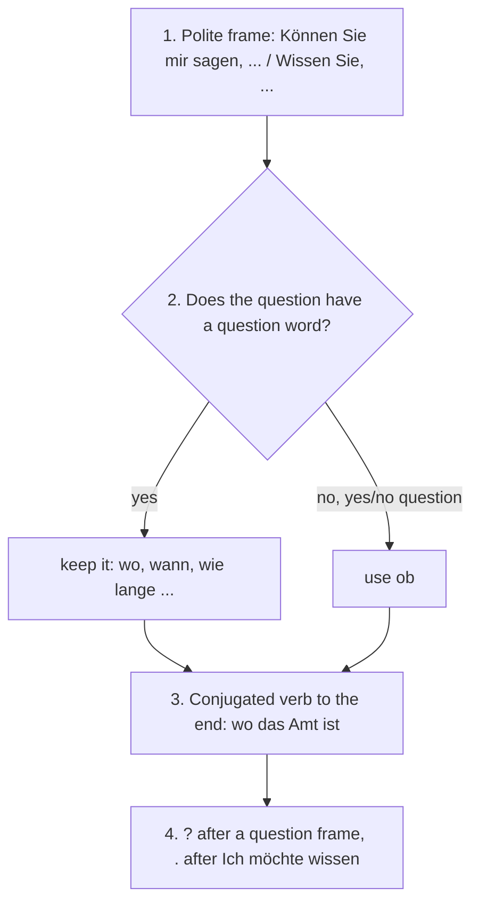

## What this lesson is for

Sooner or later everyone living in a German-speaking country has to open a bank account, register an address, deal with insurance or get something repaired. These conversations are polite, a little formal and full of fixed phrases, and many of them happen on the phone. This lesson gives you the words and the scripts.

The grammar builds on lessons 3, 4 and 15. You'll practise the polite **indirect question** (*Können Sie mir sagen, wo das Bürgeramt ist?*), which is the most useful sentence in any office, and you'll meet a verb that lets other people do the work: *lassen*. *Ich lasse mein Fahrrad reparieren* means you're having your bike repaired, not repairing it yourself.

## At the bank

| German | English |
|---|---|
| *das Konto, die Konten* | account |
| *das Girokonto* | current account, checking account |
| *ein Konto eröffnen* | to open an account |
| *die EC-Karte / die Kreditkarte* | debit card / credit card |
| *der Geldautomat* | cash machine, ATM |
| *Geld abheben* | to withdraw money |
| *Geld einzahlen* | to pay money in |
| *überweisen / die Überweisung* | to transfer / bank transfer |

German life runs on the *Girokonto*: your salary arrives there, and your rent goes out by *Überweisung*. Many Germans still pay cash, so you'll often hear *Ich muss noch schnell Geld abheben.* — I just need to get some cash. The card most people use is still called *EC-Karte* in everyday speech, although its official name has been *Girocard* since 2007 (and many banks now issue Visa or Mastercard debit cards instead).

Watch the verbs:

- *abheben* and *einzahlen* are separable: *Ich hebe 100 Euro ab. Er zahlt das Geld ein.* *abheben* is irregular: *hat abgehoben*.
- *überweisen* is inseparable: *Ich überweise dir das Geld morgen.* — I'll transfer the money to you tomorrow. Perfect: *hat überwiesen*.

## At the office: Amt and Behörde

*die Behörde* is any public authority; *das Amt* (plural *die Ämter*) is a specific office: *das Finanzamt* (tax office), *das Standesamt* (registry office, where civil weddings happen). In big cities, the office for passports and addresses is *das Bürgeramt* (in some towns *Bürgerbüro*).

In Germany, when you move into a new flat you must register your address there within two weeks of moving in: *Sie müssen sich beim Bürgeramt anmelden.* (Austria is stricter: three days.) You met *sich anmelden* in lesson 18 for courses; here it means to register an address. You get a written confirmation on the spot (*die Meldebestätigung*), and if you later need official proof of your address, you can ask for a *Meldebescheinigung*. *die Bescheinigung* is any official certificate or confirmation on paper.

To get anything from an authority, you fill in and submit (*stellen*) *einen Antrag* — an application form, a request: *Ich möchte einen neuen Pass beantragen.* — I'd like to apply for a new passport. *beantragen* is inseparable: *Ich habe einen Pass beantragt.* Compare *sich bewerben* (lesson 17), which is for jobs and places, never for documents.

## Insurance, damage and the police

*die Versicherung* means both insurance and the insurance company. *versichern* is to insure: *Ist das Fahrrad versichert?* — Is the bike insured? Most households in Germany (about 85 percent) have *eine Haftpflichtversicherung*, which pays if you damage someone else's things.

If something happens, you *melden* it — report it: *Ich möchte einen Schaden melden.* — I'd like to report some damage. *der Schaden* (plural *die Schäden*) is damage or a loss. A theft goes to *die Polizei*: *Wir haben den Diebstahl bei der Polizei gemeldet.* — We reported the theft to the police. (*der Diebstahl* = theft.)

Things that are broken go to a repair shop: *die Werkstatt* (plural *die Werkstätten*), for cars and bikes. The repair is *die Reparatur*, and the verb is *reparieren*: *Die Reparatur kostet 80 Euro.*

## Polite indirect questions

A direct question can sound abrupt to a stranger: *Wo ist das Bürgeramt?* Put a polite frame in front and it turns into an indirect question, with the verb at the end, just as you learned in lesson 4:

| Direct | Indirect |
|---|---|
| *Wo ist der Geldautomat?* | *Können Sie mir sagen, wo der Geldautomat ist?* |
| *Wann hat das Amt geöffnet?* | *Wissen Sie, wann das Amt geöffnet hat?* |
| *Wie lange dauert die Reparatur?* | *Könnten Sie mir sagen, wie lange die Reparatur dauert?* |
| *Kann ich hier Geld einzahlen?* | *Ich möchte wissen, ob ich hier Geld einzahlen kann.* |
| *Brauche ich einen Termin?* | *Wissen Sie, ob ich einen Termin brauche?* |

The rules in one list:

- W-questions keep their question word: *wo, wann, wie lange, was, warum…*
- Yes/no questions use *ob* (whether).
- The conjugated verb goes to the end; a separable verb joins up again: *ob ich hier Geld einzahlen kann*, *wann der Zug ankommt*.
- The question mark belongs to the frame: *Wissen Sie, …?* gets one; *Ich möchte wissen, …* gets a full stop.

Here are the same rules as a procedure you can follow every time:

*Könnten Sie …?* from lesson 15 is the most polite frame of all: *Könnten Sie mir bitte sagen, welche Unterlagen ich mitbringen muss?* — Could you please tell me which documents I need to bring?

## lassen: having something done

*lassen* + infinitive means you get someone else to do something. Like a modal verb, it sends a second verb to the end without *zu*:

- *Ich lasse mein Auto in der Werkstatt reparieren.* — I'm having my car repaired at the garage.
- *Wir lassen die Wohnung streichen.* — We're having the flat painted.
- *Sie lässt sich die Haare schneiden.* — She's having her hair cut.

The picture shows the difference between doing it yourself and having it done:

*lassen* changes its stem: *ich lasse, du lässt, er/sie/es lässt, wir lassen, ihr lasst, sie lassen*.

It has two other everyday meanings:

- to let, allow: *Lass mich bitte ausreden!* — Please let me finish (speaking)! *Meine Eltern lassen mich nicht allein reisen.* — My parents don't let me travel alone.
- to leave something somewhere: *Ich habe meinen Schirm im Bus gelassen.* — I left my umbrella on the bus.

In the perfect, when *lassen* has a second verb, you'll see two infinitives at the end: *Ich habe das Fahrrad reparieren lassen.* — I had the bike repaired. Recognize this for now; it's the same pattern modal verbs use in the perfect (*Ich habe arbeiten müssen*).

## On the phone

| Situation | German | English |
|---|---|---|
| Line busy | *Es ist besetzt.* | It's engaged / busy. |
| Being put through | *Einen Moment, ich verbinde Sie.* | One moment, I'll put you through. |
| Wrong department | *Da sind Sie bei mir falsch.* | You've got the wrong person. |
| Calling back | *Kann ich Sie zurückrufen?* | Can I call you back? |
| Answering machine | *Bitte sprechen Sie nach dem Signalton.* | Please speak after the tone. |
| Not hearing well | *Die Verbindung ist schlecht.* | The line is bad. |

*verbinden* (to connect, put through; *hat verbunden*) and *zurückrufen* (separable; *hat zurückgerufen*) are the key verbs. A voicemail box is *die Mailbox* on a mobile; the machine on a landline is *der Anrufbeantworter*, literally "call answerer", often shortened to *AB* (ah-BEH).

### Spelling and numbers

Offices always want your name spelled. You can spell with words: *M wie Martha*. The traditional German spelling alphabet uses first names (*A wie Anton, B wie Berta, C wie Cäsar*) and is still what most people use; since 2022 the official standard (DIN 5009) uses city names instead (*A wie Aachen, B wie Berlin, C wie Chemnitz*). Either is understood.

Phone numbers are read in single digits or in pairs: *0 30 – 45 67 89* is *null drei null, vier fünf, sechs sieben, acht neun* or *null dreißig, fünfundvierzig, siebenundsechzig, neunundachtzig*. On the phone, many people say *zwo* for *zwei* so it isn't confused with *drei*.

### Formal and informal

Everything in this lesson uses *Sie*. Offices, banks and insurance companies write *Sehr geehrte Frau Becker* or *Sehr geehrte Damen und Herren* and end with *Mit freundlichen Grüßen*. Only friends and family get *Liebe Anna* and *Viele Grüße*. Lesson 23 covers letters and e-mails in detail.

## Dialogue: a lost wallet

Sara's wallet was stolen on the tram. She calls her bank.

> Bank: Rheintalbank Freiburg, guten Tag, Sie sprechen mit Herrn Yilmaz.
>
> Sara: Guten Tag, mein Name ist Sara Lindqvist. Man hat mir heute Morgen in der Straßenbahn das Portemonnaie gestohlen. Meine EC-Karte und meine Kreditkarte waren darin.
>
> Bank: Oh, das tut mir leid. Wie schreibt man Ihren Nachnamen?
>
> Sara: L wie Ludwig, I, N wie Nordpol, D wie Dora, Q, V, I, S, T.
>
> Bank: Danke. Ich sperre die Karten sofort. Haben Sie den Diebstahl schon bei der Polizei gemeldet?
>
> Sara: Nein, noch nicht. Können Sie mir sagen, ob ich das unbedingt machen muss?
>
> Bank: Ja, bitte melden Sie ihn. Sie brauchen eine Bescheinigung von der Polizei für Ihre Versicherung.
>
> Sara: Gut. Und wie bekomme ich jetzt Geld? Ich muss morgen die Miete überweisen.
>
> Bank: Überweisungen können Sie online machen. Und mit Ihrem Ausweis können Sie in jeder Filiale Geld abheben. Die neuen Karten schicken wir Ihnen in einer Woche.
>
> Sara: Wissen Sie, was die neuen Karten kosten?
>
> Bank: Das kann ich Ihnen leider nicht sagen. Da verbinde ich Sie mit meiner Kollegin. Einen Moment, bitte … Hm, es ist besetzt. Soll sie Sie zurückrufen?
>
> Sara: Ja, gern. Meine Nummer ist null eins sieben sechs, zwo drei, vier fünf, sechs sieben, acht neun.

In English:

> Bank: Rheintalbank Freiburg, hello, you're speaking to Mr Yilmaz.
>
> Sara: Hello, my name is Sara Lindqvist. Someone stole my wallet on the tram this morning. My debit card and my credit card were in it.
>
> Bank: Oh, I'm sorry. How do you spell your surname?
>
> Sara: L as in Ludwig, I, N as in Nordpol, D as in Dora, Q, V, I, S, T.
>
> Bank: Thank you. I'm blocking the cards immediately. Have you already reported the theft to the police?
>
> Sara: No, not yet. Can you tell me whether I really have to do that?
>
> Bank: Yes, please report it. You need a confirmation from the police for your insurance.
>
> Sara: All right. And how do I get money now? I have to transfer the rent tomorrow.
>
> Bank: You can do transfers online. And with your ID card you can withdraw money at any branch. We'll send you the new cards in a week.
>
> Sara: Do you know what the new cards cost?
>
> Bank: I'm afraid I can't tell you that. I'll put you through to my colleague. One moment, please … Hm, it's busy. Shall she call you back?
>
> Sara: Yes, please. My number is 0176 23 45 67 89.

*sperren* = to block (a card; in Germany you can also block cards at any time on *116 116*); *stehlen* = to steal (*hat gestohlen*); *die Filiale* = branch. *Man hat mir das Portemonnaie gestohlen* is how Germans report a theft when they don't know who did it.

## A message on the answering machine

> Guten Tag, hier ist die Fahrradwerkstatt Kessler. Das ist eine Nachricht für Herrn Becker. Ihr Fahrrad ist fertig, die Reparatur hat 65 Euro gekostet. Sie können es ab morgen um neun Uhr abholen. Wenn Sie Fragen haben, rufen Sie uns bitte unter 0761 – 33 82 14 zurück. Auf Wiederhören!

Hello, this is Kessler bicycle repairs. This is a message for Mr Becker. Your bike is ready; the repair cost 65 euros. You can pick it up from nine o'clock tomorrow. If you have any questions, please call us back on 0761 33 82 14. Goodbye!

*Auf Wiederhören* ("until we hear each other again") is the phone version of *Auf Wiedersehen*.

## Common mistakes

- *Können Sie mir sagen, wo ist die Bank?* — In an indirect question the verb goes to the end: *wo die Bank ist*.
- *Wissen Sie, wenn das Amt offen ist?* — "When" as a question word is *wann*; and "whether" is *ob*, not *wenn*: *Wissen Sie, ob das Amt heute offen ist?*
- *Ich lasse mein Auto zu reparieren.* — No *zu* after *lassen*.
- *Ich habe mein Auto repariert* means you did it yourself. If the garage did it: *Ich habe mein Auto reparieren lassen.*
- *Ich hebe Geld aus.* — The verb is *abheben*: *Ich hebe Geld ab.*
- *Ich bewerbe mich um einen Pass.* — For documents use *beantragen*: *Ich beantrage einen Pass.*
- *Er lasst …* — Stem change: *er lässt*.

## Key points

- Bank: *das Konto, das Girokonto*, *Geld abheben / einzahlen*, *überweisen* (inseparable).
- Offices: *die Behörde, das Amt, das Bürgeramt*; *einen Antrag stellen, etwas beantragen*; *die Bescheinigung*. Register your address with *sich anmelden*.
- *die Versicherung, einen Schaden melden, die Polizei*; *die Werkstatt, die Reparatur*.
- Polite indirect questions: *Können/Könnten Sie mir sagen, wo/wann/ob …* + verb at the end.
- *lassen* + infinitive (no *zu*) = have something done: *Ich lasse das Fahrrad reparieren.* Also: let, and leave behind. *du/er lässt*.
- Phone: *Es ist besetzt. Ich verbinde Sie. Kann ich Sie zurückrufen? Auf Wiederhören!*

The words from this lesson are listed below; they join your vocabulary reviews when you complete the lesson.
