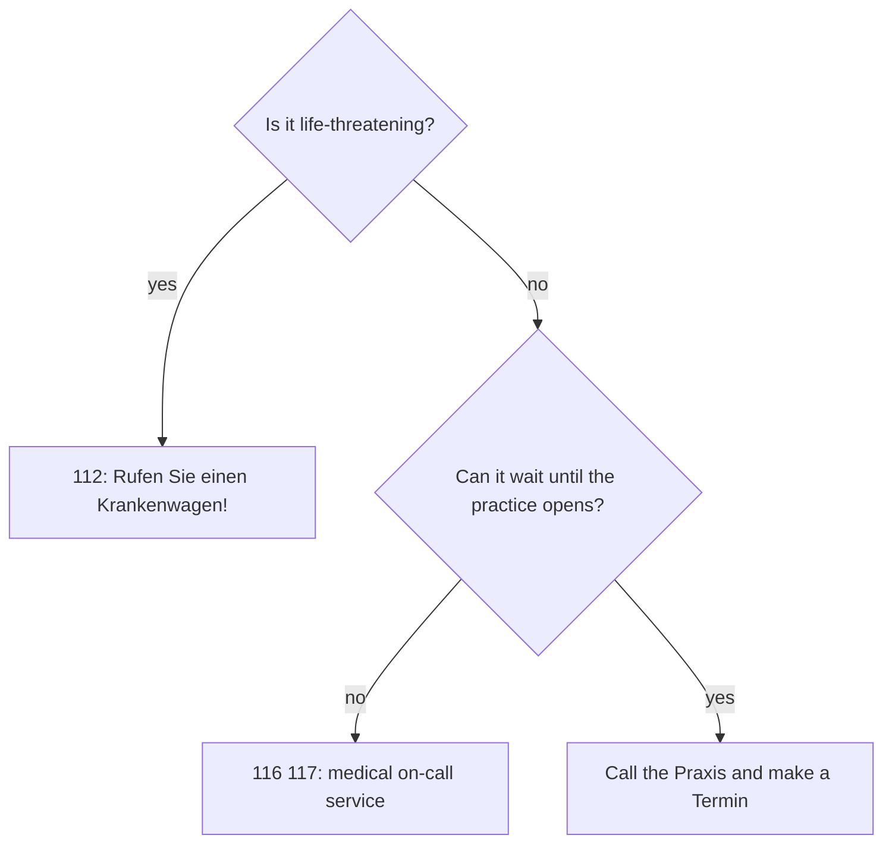

## What this lesson is for

In A1 you learned the body and how to say *Ich habe Kopfschmerzen*. This lesson takes you through a whole visit to the doctor: calling for an appointment, describing what's wrong and for how long, understanding the doctor's questions and instructions, and getting your medicine at the pharmacy. You'll also learn what to do in an emergency.

Three pieces of grammar make this possible:

- *seit* + dative for how long something has been going on: *Ich habe seit drei Tagen Fieber.*
- *sollte* and *müsste* for advice: *Sie sollten ein paar Tage im Bett bleiben.*
- the **imperative** in instructions: *Nehmen Sie die Tabletten dreimal täglich.*

## Illnesses and injuries

| German | English |
|---|---|
| *die Gesundheit* | health |
| *die Krankheit* | illness, disease |
| *die Erkältung* | cold |
| *der Husten* / *husten* | cough / to cough |
| *der Schnupfen* | runny nose, head cold |
| *die Grippe* | flu |
| *die Allergie* | allergy |
| *die Verletzung* / *verletzt* | injury / injured, hurt |
| *die Wunde* / *bluten* | wound / to bleed |
| *niesen* | to sneeze |
| *schwanger* | pregnant |

You *have* most illnesses, with or without an article: *Ich habe eine Erkältung. Ich habe Husten und Schnupfen. Sie hat Grippe.* An allergy is *gegen* something: *Ich habe eine Allergie gegen Nüsse.* — I'm allergic to nuts.

*verletzt* is an adjective: *Mein Knie ist verletzt.* — My knee is hurt. (In lesson 5 you learned the reflexive verb: *Ich habe mich verletzt.*)

When someone sneezes, Germans say *Gesundheit!* — literally "health!" — and the answer is *Danke!*

## At the doctor's

| German | English |
|---|---|
| *der Zahnarzt / die Zahnärztin* | dentist |
| *die Krankenkasse* | health insurance fund |
| *die Versichertenkarte* | health insurance card |
| *untersuchen / die Untersuchung* | to examine / examination |
| *das Pflaster* | plaster, Band-Aid |
| *der Verband* | bandage, dressing |
| *die Spritze* | injection, shot |
| *operieren / die Operation* | to operate / operation |
| *der Notfall* | emergency |
| *der Krankenwagen* | ambulance |

In Germany almost everyone belongs to a *Krankenkasse*. At the reception desk of a *Praxis* you're asked: *Haben Sie Ihre Versichertenkarte dabei?* — Do you have your insurance card with you? (Its official name is *elektronische Gesundheitskarte*, but *Versichertenkarte* and *Krankenkassenkarte* are what people say.)

The doctor gives you *ein Rezept*. You know this word from lesson 11 as a recipe; at the doctor's it means a prescription. You take it to the *Apotheke*. If you can't work, the doctor writes you off sick: *Der Arzt hat mich für drei Tage krankgeschrieben.* That connects to lesson 17: you *melden dich krank* with your boss, and the doctor's note confirms it.

### Emergencies

The emergency number in Germany and Austria and across the EU is *112* (*eins eins zwei*): *Rufen Sie einen Krankenwagen!* — Call an ambulance! When your practice is closed (at night, at the weekend) and it isn't life-threatening but can't wait, Germany has the medical on-call service, *116 117*, which answers around the clock. Hospitals have *die Notaufnahme*, the emergency department.

## seit: how long so far

To say how long something has been going on and still is, German uses *seit* + dative and the **present tense**:

- *Ich habe seit drei Tagen Husten.* — I've had a cough for three days.
- *Sie ist seit einer Woche krank.* — She's been ill for a week.
- *Wir warten seit einer Stunde.* — We've been waiting for an hour.
- *Er wohnt seit 2019 in Wien.* — He has lived in Vienna since 2019.

English uses "have had / have been … for / since"; German keeps the present tense, because the cough is still there. A memory hook: *seit* means it isn't over yet, so the verb stays in the present.

*seit* covers both "for" and "since": *seit drei Tagen* (for three days), *seit Montag, seit gestern, seit dem Unfall* (since Monday, since yesterday, since the accident). The noun after it is dative, so plural nouns add *-n*: *seit zwei Wochen, seit drei Monaten, seit vielen Jahren*.

The questions are *Seit wann …?* (since when) and *Wie lange schon …?* (how long already):

- *Seit wann haben Sie die Schmerzen?* — *Seit gestern Abend.*
- *Wie lange haben Sie schon Fieber?* — *Seit zwei Tagen.*

Compare *vor* (lesson 14), which points to a moment in the past: *Ich habe mich vor drei Tagen erkältet.* — I caught a cold three days ago.

The time line shows the difference: *vor* points back to one finished moment, *seit* covers the whole stretch up to now.

## Advice: sollte and müsste

You met *sollte* in lesson 15. It's the standard way to give advice, from a friend or a doctor:

| | sollen → sollte | müssen → müsste |
|---|---|---|
| ich | sollte | müsste |
| du | solltest | müsstest |
| er / sie / es | sollte | müsste |
| wir | sollten | müssten |
| ihr | solltet | müsstet |
| sie / Sie | sollten | müssten |

- *Du solltest zum Arzt gehen.* — You should go to the doctor.
- *Sie sollten nicht so viel arbeiten.* — You shouldn't work so much.
- *Ihr solltet mehr Wasser trinken.* — You should all drink more water.

*müsste* is the **Konjunktiv II** of *müssen*. It is a little stronger than *sollte* ("really ought to") and often comes with *eigentlich* (actually, really): *Ich müsste eigentlich mehr Sport machen.* — I really ought to do more sport. People use it about themselves to admit something they don't do.

Notice the umlaut: *müsste* has one, *sollte* never does.

## Instructions: the imperative

Doctors, pharmacists and package inserts give instructions in the imperative, usually the *Sie* form with the verb first:

- *Machen Sie bitte den Oberkörper frei.* — Please take off your top. (*der Oberkörper* = upper body)
- *Atmen Sie tief ein. Und wieder aus.* — Breathe in deeply. And out again.
- *Legen Sie sich bitte hier hin.* — Please lie down here.
- *Nehmen Sie die Tabletten dreimal täglich nach dem Essen.* — Take the tablets three times a day after meals.
- *Kommen Sie in einer Woche wieder.* — Come back in a week.

Between friends and in the family, use the *du* form (no *-st*, no *du*): *Bleib im Bett! Trink viel Tee! Nimm eine Tablette! Iss etwas!* Remember the stem-changing verbs: *nehmen → nimm*, *essen → iss*.

## How often?

| German | English |
|---|---|
| *täglich* | daily |
| *wöchentlich* | weekly |
| *monatlich* | monthly |
| *einmal / zweimal / dreimal täglich* | once / twice / three times a day |
| *morgens, mittags, abends* | in the morning(s), at midday, in the evening(s) |
| *alle vier Stunden* | every four hours |
| *vor / nach dem Essen* | before / after meals |

*täglich* and *wöchentlich* are adjectives too: *eine tägliche Tablette*, *die wöchentliche Untersuchung*. *alle* + time + plural means "every": *alle zwei Tage*.

## Dialogue: at the doctor's

Tom has been feeling ill for a few days. He sees Dr. Lehmann.

> Dr. Lehmann: Guten Tag, Herr Fischer. Was fehlt Ihnen denn?
>
> Tom: Ich habe seit vier Tagen Husten und Schnupfen, und seit gestern habe ich auch Fieber. Ich bin total müde.
>
> Dr. Lehmann: Wie hoch ist das Fieber?
>
> Tom: Heute Morgen hatte ich 38,5.
>
> Dr. Lehmann: Hm. Machen Sie bitte den Oberkörper frei, ich möchte Sie untersuchen … Atmen Sie tief ein … und aus. Husten Sie bitte einmal.
>
> Tom: Ist es eine Grippe?
>
> Dr. Lehmann: Nein, zum Glück nicht. Es ist eine starke Erkältung. Haben Sie Allergien gegen Medikamente?
>
> Tom: Nein, ich habe keine Allergien.
>
> Dr. Lehmann: Gut. Ich gebe Ihnen ein Rezept für einen Hustensaft. Nehmen Sie ihn dreimal täglich nach dem Essen. Sie sollten viel trinken und ein paar Tage im Bett bleiben.
>
> Tom: Ich müsste eigentlich morgen arbeiten …
>
> Dr. Lehmann: Das geht nicht. Ich schreibe Sie bis Freitag krank. Wenn das Fieber nicht besser wird, kommen Sie bitte wieder.
>
> Tom: Vielen Dank, Frau Doktor.

In English:

> Dr Lehmann: Hello, Mr Fischer. So what's the matter?
>
> Tom: I've had a cough and a runny nose for four days, and since yesterday I've also had a temperature. I'm completely exhausted.
>
> Dr Lehmann: How high is the temperature?
>
> Tom: This morning it was 38.5.
>
> Dr Lehmann: Hm. Please take off your top, I'd like to examine you … Breathe in deeply … and out. Please cough once.
>
> Tom: Is it flu?
>
> Dr Lehmann: No, luckily not. It's a bad cold. Are you allergic to any medicines?
>
> Tom: No, I don't have any allergies.
>
> Dr Lehmann: Good. I'll give you a prescription for cough syrup. Take it three times a day after meals. You should drink a lot and stay in bed for a few days.
>
> Tom: I'm actually supposed to work tomorrow …
>
> Dr Lehmann: That's not possible. I'm signing you off sick until Friday. If the fever doesn't get better, please come back.
>
> Tom: Thank you very much, doctor.

*Was fehlt Ihnen?* (literally "What is missing to you?") is the classic doctor's question, with the dative verb *fehlen* from lesson 7. Germans give their temperature in degrees Celsius and say *achtunddreißig fünf*. A woman doctor is addressed as *Frau Doktor*, a man as *Herr Doktor*.

## A notice in the waiting room

> Liebe Patientinnen und Patienten, bitte bringen Sie zu jedem Termin Ihre Versichertenkarte mit. Wenn Sie Fieber oder starken Husten haben, melden Sie sich bitte vorher telefonisch an. Bei einem Notfall rufen Sie die 112. Die Praxis ist mittwochs nachmittags geschlossen.

Dear patients, please bring your insurance card to every appointment. If you have a temperature or a bad cough, please let us know by phone in advance. In an emergency, call 112. The practice is closed on Wednesday afternoons.

## Pronunciation

- *Husten*: long *u*, HUU-sten. *husten* (the verb) sounds the same.
- *Schnupfen*: the *pf* is one quick sound, lips closed, then *f*: SCHNUP-fen.
- *Allergie*: stress on the last syllable, al-ler-GIE. The *g* is hard, as in "go".
- *Operation*: o-pe-ra-TSION, the *-tion* is "tsion".
- *niesen*: long *ie*, and the *s* between vowels is voiced like English *z*: NEE-zen.
- *müsste*: short *ü*; don't confuse it with *musste* (had to, past).

## Common mistakes

- *Ich habe Husten seit drei Tagen gehabt.* — German uses the present with *seit*: *Ich habe seit drei Tagen Husten.*
- *seit drei Tage* — Dative plural adds *-n*: *seit drei Tagen*.
- *Ich bin krank für eine Woche* to mean "I've been ill for a week" — use *seit*: *Ich bin seit einer Woche krank.* (*für* is for a planned period: *Ich bin für eine Woche in Berlin.*)
- *Du sollst zum Arzt gehen* is an order someone gave ("you're supposed to"). Advice is *Du solltest zum Arzt gehen.*
- *Nimmst die Tablette!* — The *du* imperative drops *-st*: *Nimm die Tablette!*
- *Ich habe eine Allergie für Katzen.* — Use *gegen*: *eine Allergie gegen Katzen*.
- *Mein Arm ist verletzen.* — After *sein* use the adjective: *Mein Arm ist verletzt.*

## Key points

- *seit* + dative + present tense for something that started in the past and is still going on: *Ich habe seit drei Tagen Fieber.* Questions: *Seit wann …? Wie lange schon …?*
- Advice: *Du solltest / Sie sollten …*; stronger or self-critical: *Ich müsste eigentlich …*
- Instructions use the imperative: *Nehmen Sie …*, *Atmen Sie ein*; with friends *Bleib im Bett! Nimm …!*
- Frequency: *täglich, wöchentlich, dreimal täglich, alle vier Stunden*.
- *Was fehlt Ihnen? Ich habe eine Erkältung / Husten / Schnupfen / Grippe.* *Gesundheit!* after a sneeze.
- Bring the *Versichertenkarte*; the doctor writes *ein Rezept* and may sign you off sick. Emergency: *112*.

The words from this lesson are listed below; they join your vocabulary reviews when you complete the lesson.
