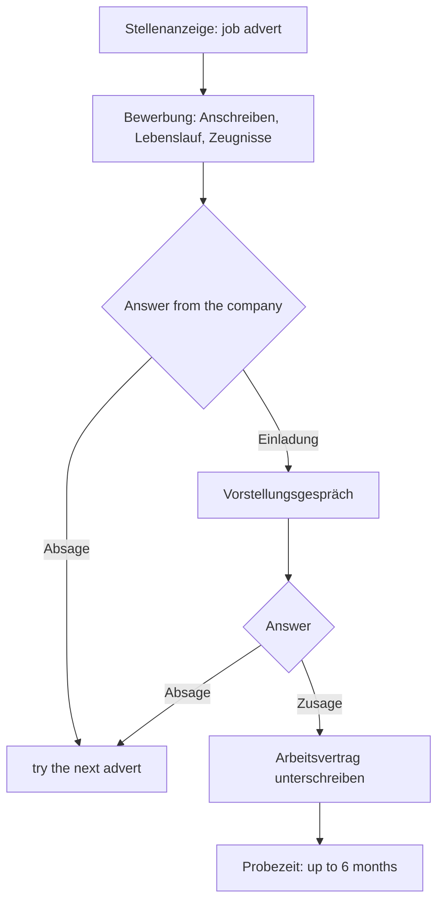

## From the interview back to the paperwork

In lesson 17 Jonas sat in a job interview, *das Vorstellungsgespräch*. But before anyone in Germany, Austria or Switzerland gets that invitation, they send a set of documents, and those documents follow rules that surprise many newcomers. A German CV looks different from an American résumé. The cover letter has a fixed shape. And when you leave a job, your employer writes you a reference, *das Arbeitszeugnis*, in a polite, positive language whose real meaning sits between the lines.

This honors lesson walks you through all three. Along the way you'll learn a new way of writing that German uses everywhere in work and official life: packing information into nouns instead of verbs, the **nominal style**.

## What goes into an application

A complete application (*die Bewerbung*, from lesson 17) is usually sent by e-mail as one PDF file or uploaded to a company's website. Traditionally it contains:

- *das Anschreiben* — the cover letter, one page;
- *der Lebenslauf* — the CV (lesson 1), one or two pages;
- *die Zeugnisse* — copies of certificates: your last school certificate, your final exam from an *Ausbildung* or university, and the *Arbeitszeugnisse* from earlier jobs.

German employers expect these papers (*die Unterlagen*). An application with a CV only can look incomplete, although more and more companies, especially large ones and start-ups, now accept a CV alone or an online form.

The process then runs like this:

Two answers you hope for and fear: *die Zusage* (yes, the job is yours) and *die Absage*. You know *die Absage* from A1 as a cancellation; in applications it's the rejection: *Leider müssen wir Ihnen eine Absage erteilen.* — Unfortunately we have to turn you down. If the company hires you, it *stellt dich ein*: *Die Firma hat drei neue Mitarbeiter eingestellt.* — The company has hired three new employees. *einstellen* is separable. The contract is *der Arbeitsvertrag*, and most jobs start with *die Probezeit*, a probation period of up to six months during which either side can end the job with two weeks' notice.

## The German CV

A German *Lebenslauf* is a table: dates on the left, facts on the right, no full sentences. The usual sections are:

| Section | What goes there |
|---|---|
| *Persönliche Daten* | name, address, phone, e-mail; often date of birth |
| *Berufserfahrung* | jobs, newest first |
| *Ausbildung* | school, apprenticeship, university, newest first |
| *Kenntnisse* | *Sprachkenntnisse* (languages), computer skills |
| *Ort, Datum, Unterschrift* | place, date and signature at the bottom |

Three things that are different from an English-language résumé:

- **The photo.** Many Germans still put a professional photo in the top right corner. Since the General Equal Treatment Act of 2006 (*AGG*), which forbids discrimination in hiring, employers no longer ask for one, and many applicants leave it out. Both are normal; a holiday snapshot is not.
- **Gaps.** Germans expect a CV without unexplained gaps. If you spent a year travelling or looking after a child, write it in: *2022–2023 Elternzeit* (parental leave).
- **Signature.** The handwritten signature with place and date is traditional; in an e-mail application it's now optional.

*die Berufserfahrung* is work experience (*der Beruf* + *die Erfahrung*); *die Sprachkenntnisse* (plural) are language skills. Levels are often given with the CEFR letters you know: *Englisch: gut (B2)*.

## The nominal style

Look at the right-hand column of a CV: *Kundenbetreuung, Erstellung von Angeboten, Organisation von Besprechungen*. There are no verbs, only nouns. This is the nominal style: the action is turned into a noun, and the object follows with *von* (or in the genitive).

| Verb style (how you'd say it) | Nominal style (how a CV says it) |
|---|---|
| *Ich habe Kunden betreut.* | *Betreuung von Kunden* / *Kundenbetreuung* |
| *Ich habe Angebote geschrieben.* | *Erstellung von Angeboten* |
| *Ich habe Besprechungen organisiert.* | *Organisation von Besprechungen* |
| *Ich habe die Post erledigt.* | *Bearbeitung der Post* |

Most of these nouns end in *-ung* and are feminine: *betreuen → die Betreuung, bearbeiten → die Bearbeitung, erstellen → die Erstellung* (*erstellen* = to draw up, produce). Verbs in *-ieren* make nouns in *-ation*: *organisieren → die Organisation, präsentieren → die Präsentation*. They are feminine too.

In a CV the nominal style saves space and sounds professional. In a conversation it sounds stiff: in the interview you say *Ich habe die Kunden betreut*, not *Meine Tätigkeit war die Betreuung der Kunden*. You'll meet the nominal style again in official letters (honors lesson 3 of this module).

### Example 1: from your own words to a CV line

Jonas (lesson 17) wants to describe his current job in his CV. He writes down what he does, then turns each verb into a noun:

1. *Ich bin für die Kunden zuständig.* → the key verb is *betreuen* (to look after): *Betreuung der Kunden*, shorter *Kundenbetreuung*.
2. *Ich schreibe Angebote.* → "write" becomes the more formal *erstellen*: *Erstellung von Angeboten*.
3. *Ich bereite Verträge vor.* → *vorbereiten → die Vorbereitung*: *Vorbereitung von Verträgen*.

His CV line: *seit 03/2023 · Kaufmännischer Mitarbeiter, Druckerei Krause, Kassel · Kundenbetreuung, Erstellung von Angeboten, Vorbereitung von Verträgen*. Notice *von* + dative plural: *von Angeboten, von Verträgen*, with the plural dative *-n*.

## The cover letter

The *Anschreiben* is a formal letter of one page. Its parts always come in the same order: your address, the company's address, the date, a bold subject line (*Bewerbung als …*), the greeting, three or four short paragraphs, the closing, your signature, and a list of what's enclosed (*Anlagen*). The text answers three questions: why this job, why you, and when you can start.

Here is a model. Lena, whose CV you saw above, applies for a new job.

> Bewerbung als Kauffrau für Büromanagement – Ihre Stellenanzeige vom 2. Februar 2026
>
> Sehr geehrte Frau Albers,
>
> hiermit bewerbe ich mich um die Stelle als Kauffrau für Büromanagement in Ihrem Team.
>
> Seit 2019 arbeite ich bei der Druckerei Weber in Leipzig. Zu meinen Aufgaben gehören die Betreuung von Kunden, die Erstellung von Angeboten und die Organisation von Terminen. Ich arbeite sorgfältig und gern im Team.
>
> Ihre Firma arbeitet international, und ich möchte meine Englischkenntnisse im Beruf verbessern. Deshalb interessiert mich diese Stelle besonders.
>
> Ich kann ab dem 1. Mai bei Ihnen anfangen. Über eine Einladung zu einem Vorstellungsgespräch würde ich mich sehr freuen.
>
> Mit freundlichen Grüßen
>
> Lena Hoffmann
>
> Anlagen: Lebenslauf, Zeugnisse

In English:

> Application for the position of office management clerk – your job advertisement of 2 February 2026
>
> Dear Ms Albers,
>
> I am hereby applying for the position of office management clerk in your team.
>
> Since 2019 I have been working at the Weber printing company in Leipzig. My tasks include looking after customers, preparing quotes and organizing appointments. I work carefully and enjoy working in a team.
>
> Your company works internationally, and I would like to improve my English at work. That's why this job interests me in particular.
>
> I can start with you from 1 May. I would be very pleased to be invited to an interview.
>
> Yours sincerely,
>
> Lena Hoffmann
>
> Enclosures: CV, certificates

Notes on the language:

- *hiermit* = hereby. *Hiermit bewerbe ich mich um …* is the classic first line. Many advisers now recommend a more personal opening, but it's never wrong.
- *Seit 2019 arbeite ich …*: *seit* + present tense, as in lesson 20.
- *Zu meinen Aufgaben gehören …* lists tasks in the nominal style. The verb *gehören* is plural because the subject is the list.
- *sorgfältig* = careful, thorough. Other qualities employers like: *zuverlässig* (reliable), *motiviert*, *pünktlich*, *teamfähig* (good at teamwork).
- *Über eine Einladung … würde ich mich sehr freuen* is the standard closing line: *sich freuen über* (lesson 6) + Konjunktiv II (lesson 15) for politeness.
- No comma after *Mit freundlichen Grüßen*, and the text after *Sehr geehrte Frau Albers,* starts with a small letter (lesson 23).

### Example 2: building the last paragraph

Say you want to write: "I'm looking forward to meeting you." The verb is *sich freuen auf* + accusative. The thing you look forward to is an action, so you use a da-word that points forward to a zu-infinitive (lessons 6 and 17):

1. *Ich freue mich auf* + something → the something is "meeting you", an action.
2. Replace *auf* + action with *darauf* and put the action after a comma: *Ich freue mich darauf, …*
3. The action as zu + infinitive at the end: *Sie kennenzulernen* (*kennenlernen* is separable, so *zu* goes in the middle).

Result: *Ich freue mich darauf, Sie kennenzulernen.* With a noun instead, you don't need *darauf*: *Ich freue mich auf das Gespräch mit Ihnen.*

## The Arbeitszeugnis: reading between the lines

In Germany every employee who leaves a job has a legal right to a written reference, *das Arbeitszeugnis*. A simple one only states the job and how long it lasted; on request, the employer must write a qualified one that also judges performance and behaviour. Austria (*Dienstzeugnis*) and Switzerland have similar rules.

German courts say a reference must be true but also benevolent, so it shouldn't make it harder for you to find a new job. The result is a style in which almost every sentence sounds positive, and the real grade is shown by small differences. The law forbids secret codes, but some fixed formulas are so widely known that HR departments read them like school grades. The most famous is the sentence about satisfaction (*die Zufriedenheit*). This scale is the one usually quoted in advice books; it's a convention, not a law, and individual writers vary:

| Formula | Usually read as |
|---|---|
| *stets zu unserer vollsten Zufriedenheit* | sehr gut (1) |
| *stets zu unserer vollen Zufriedenheit* | gut (2) |
| *zu unserer vollen Zufriedenheit* | befriedigend (3) |
| *zu unserer Zufriedenheit* | ausreichend (4) |
| *im Großen und Ganzen zu unserer Zufriedenheit* | mangelhaft (5) |

*stets* means always (a formal *immer*). Two small words carry the grade: *stets* and the form of *voll*. The top form *vollsten* is a superlative of *voll*, which logically can't be "fuller than full"; grammar books call it incorrect, yet in references it's the standard top grade. It's a good example of how a convention can be stronger than a rule.

Other phrases that sound kind but aren't:

- *Er war stets bemüht, die Aufgaben zu erledigen.* — He always made an effort to get the tasks done. Read: he tried, but didn't succeed.
- *Sie hat sich im Rahmen ihrer Fähigkeiten eingesetzt.* — She did her best within her abilities. Read: her abilities were limited.

The last sentence matters too. A good reference ends with thanks, regret and good wishes: *Wir bedauern ihr Ausscheiden sehr, danken ihr für die stets sehr gute Zusammenarbeit und wünschen ihr für die Zukunft alles Gute.* (*bedauern* = to regret; *das Ausscheiden* = leaving). In 2012 Germany's Federal Labour Court ruled that employees have no legal right to this closing sentence, but readers still notice when it's missing.

### Example 3: grading a reference

Read the sentence: *Frau Neumann erledigte die ihr übertragenen Aufgaben zu unserer vollen Zufriedenheit.* (*übertragen* = assigned; *erledigte* is the simple past of *erledigen*.)

1. Find the formula: *zu unserer vollen Zufriedenheit*.
2. Check for *stets*: it's missing.
3. Check the form of *voll*: *vollen*, not *vollsten*.
4. Compare with the table: no *stets* + *vollen* = befriedigend (3), a solid but average grade.

If the sentence had been *stets zu unserer vollsten Zufriedenheit*, the grade would be the top one.

## Common mistakes

- *Ich bewerbe mich für die Stelle.* — Use *um*: *Ich bewerbe mich um die Stelle* (lesson 17); *als* + job title: *als Kauffrau*.
- Writing the CV in full sentences (*Ich habe drei Jahre bei Weber gearbeitet.*) — a German CV uses dates and noun phrases: *2019–2022 Druckerei Weber*.
- Mixing up *die Zusage* (a yes) and *die Absage* (a no). *zu* agrees, *ab* says no.
- *Die Betreuung von Kunde* — after *von* the noun is dative, and plurals add *-n*: *von Kunden, von Verträgen*.
- *Ich freue mich, Sie kennenzulernen* usually means "I'm pleased to meet you", said when you meet. For the future meeting use *darauf*: *Ich freue mich darauf, Sie kennenzulernen.*
- Taking every friendly reference sentence at face value. *Er war stets bemüht* sounds nice and is a bad grade.

## Key points

- An application: *Anschreiben* (one page), *Lebenslauf* (table, newest first, no gaps), *Zeugnisse*. The answer is a *Zusage* or an *Absage*; a company *stellt* new staff *ein*.
- The nominal style turns actions into nouns: *Kunden betreuen → Kundenbetreuung, Angebote erstellen → Erstellung von Angeboten*. *-ung* and *-ation* nouns are feminine. Use it in CVs and formal writing, not in conversation.
- Cover letter phrases: *Hiermit bewerbe ich mich um …*, *Zu meinen Aufgaben gehören …*, *Über eine Einladung zu einem Vorstellungsgespräch würde ich mich sehr freuen.*
- The *Arbeitszeugnis* sounds positive throughout; the grade hides in formulas: *stets zu unserer vollsten Zufriedenheit* is the best, *stets bemüht* is a warning sign. This scale is a widely used convention, not law.

The words from this lesson are listed below; they join your vocabulary reviews when you complete the lesson.
