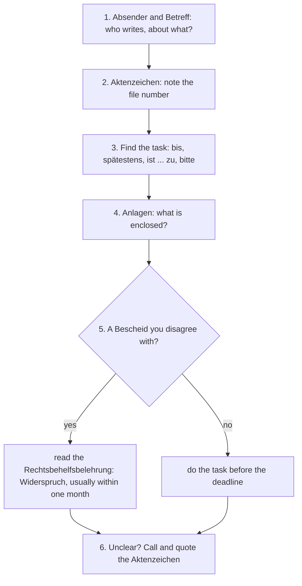

## When the Amt writes back

In lesson 19 you went to the *Bürgeramt*, filled in an *Antrag* and asked for a *Bescheinigung*. A few weeks later, a letter arrives. Germans have a name for the language in it: *Amtsdeutsch* ("office German"), and even native speakers joke about it. Sentences are long, verbs hide inside nouns, and the important part (what you must do, and by when) can sit in the middle of the third paragraph.

This honors lesson teaches you to read such letters calmly and in a fixed order. You'll learn the standard layout of a German business letter, the abbreviations that fill it, and two grammar patterns: the **nominal style** from honors lesson 1, now in longer sentences, and **sein + zu + infinitive**, the official way to say "must".

## The parts of an official letter

Business and official letters in Germany follow a standard layout (the DIN 5008 standard), so every part has its place:

| Part | German | What it tells you |
|---|---|---|
| sender | *der Absender* | who writes: here the *Bürgeramt* of the town |
| address | *die Anschrift* | you, in the address field |
| reference block | *das Aktenzeichen, das Datum* | the file number of your case, the person handling it (*der Sachbearbeiter, die Sachbearbeiterin*), the date |
| subject line | *der Betreff* | what it's about, in bold, without the word "Betreff" |
| greeting | *die Anrede* | *Sehr geehrter Herr Costa,* |
| text | | what happened, what you must do, by when |
| closing | *Mit freundlichen Grüßen* | often with *Im Auftrag* (*i. A.*) before the signature: the person signs on behalf of the office |
| enclosures | *die Anlage(n)* | papers that come with the letter |

*das Aktenzeichen* (*Az.*) is the file number. Always quote it when you write back or phone: *Mein Aktenzeichen ist 32-04/0457.* Without it, your letter may take weeks to reach the right desk.

A short word for any official letter is *das Schreiben*: *Ihr Schreiben vom 12. Februar* — your letter of 12 February. It's the verb *schreiben* used as a noun, so it's neuter and capitalized.

## Kinds of letters

- *der Bescheid* — an official decision about your case: a tax assessment, a decision on an application. *Ich habe einen Bescheid vom Finanzamt bekommen.* A *Bescheid* is legally binding unless you object in time.
- *die Mahnung* — a reminder that a payment is overdue: *Das ist die zweite Mahnung!* The amount is *der Betrag*, and a bill that must be paid is *fällig* (due): *Der Betrag ist am 15. März fällig.*
- a letter asking for documents, like the one above: something is missing, please send it.

At the end of every *Bescheid* there's a paragraph called *die Rechtsbehelfsbelehrung*: information on how you can challenge the decision. Usually you can lodge an objection, *der Widerspruch*, within one month. Some decisions go straight to court instead, and the paragraph tells you which applies. Read it closely and keep the envelope: the deadline counts from when the letter is treated as delivered, not from the day you open it.

## Reading a letter in a fixed order

## sein + zu + infinitive: "must be done"

Official letters rarely say *Sie müssen*. They say:

- *Der Betrag ist bis zum 15. März zu zahlen.* — The amount is to be paid by 15 March. = You must pay it by then.
- *Das Formular ist vollständig auszufüllen.* — The form is to be filled in completely.
- *Die Unterlagen sind dem Antrag beizufügen.* — The documents are to be enclosed with the application.

The pattern is *sein* + *zu* + infinitive at the end, the same *zu* + infinitive as in lesson 17, with separable verbs taking *zu* in the middle (*auszufüllen, beizufügen*). The subject is the thing that must be dealt with, and the person who has to act isn't mentioned, just as in the passive (honors lesson 2). It usually means "must be done", and with a negative "must not": *Die Frist ist unbedingt einzuhalten.* — The deadline must be kept. *Diese Regel ist nicht zu ändern.* can also mean "can't be changed"; context decides.

A close relative uses *haben*, with a person as the subject: *Sie haben die Unterlagen bis zum 26. Februar vorzulegen.* — You have to present the documents by 26 February. *haben* + *zu* = *müssen*, in a strict tone.

### Example 1: what must Daniel do?

Read the letter in the picture: *Bitte reichen Sie diese bis zum 26.02.2026 beim Bürgeramt ein. Das Formular ist diesem Schreiben beigefügt.*

1. The task: *Bitte reichen Sie … ein* — *einreichen* (separable) = to hand in, submit. What? *diese* = *die Wohnungsgeberbestätigung*, the confirmation from the landlord that he moved in (required for registering an address in Germany).
2. The deadline: *bis zum 26.02.2026*. From the letter's date (12 February) that's two weeks.
3. Where: *beim Bürgeramt*.
4. Help: *Das Formular ist diesem Schreiben beigefügt.* — The form is enclosed with this letter (*beifügen* = to enclose; *beigefügt* here is like an adjective after *sein*). The *Anlage* line confirms it.

In plain words: get the landlord to fill in and sign the enclosed form, and take it to the Bürgeramt by 26 February.

## The nominal style in long sentences

In honors lesson 1 you saw the nominal style in a CV: *Kundenbetreuung, Erstellung von Angeboten*. Official letters build whole sentences this way, with prepositions + nouns where everyday German would use a clause with a verb:

| Amtsdeutsch (nouns) | Everyday German (verbs) |
|---|---|
| *nach Eingang Ihrer Zahlung* | *wenn Ihre Zahlung angekommen ist* — when your payment has arrived |
| *zur Bearbeitung Ihres Antrags* | *damit wir Ihren Antrag bearbeiten können* — so that we can process your application |
| *bei Nichtzahlung* | *wenn Sie nicht zahlen* — if you don't pay |
| *vor Ablauf der Frist* | *bevor die Frist endet* — before the deadline runs out |

Notice the genitives (*Ihrer Zahlung, Ihres Antrags, der Frist*): official German uses the genitive, which you've learned to recognize in lesson 18. The trick for reading is always the same: find the noun made from a verb (*Eingang ← eingehen*, to arrive; *Bearbeitung ← bearbeiten*; *Zahlung ← zahlen*; *Ablauf ← ablaufen*, to run out) and ask "who does what?".

### Example 2: unpacking a sentence

*Zur weiteren Bearbeitung Ihres Antrags benötigen wir eine Kopie Ihres Mietvertrags.*

1. The main clause: *… benötigen wir eine Kopie …* — we need a copy (*benötigen* = *brauchen*, more formal).
2. The noun from a verb: *Bearbeitung ← bearbeiten* (to process). Who processes? *wir*, the office. What? *Ihren Antrag* (*Ihres Antrags* is genitive).
3. *zur* (*zu der*) + action = in order to: *damit wir Ihren Antrag weiter bearbeiten können*.
4. *eine Kopie Ihres Mietvertrags*: a copy of your rental contract (genitive again: *der Mietvertrag → des Mietvertrags*).

Everyday version: *Wir brauchen eine Kopie von Ihrem Mietvertrag, damit wir Ihren Antrag weiter bearbeiten können.* What do you do? Send a copy of your rental contract.

## Abbreviations

German letters and forms are full of abbreviations (*die Abkürzung*). Most end in a point, and those made from several words have a small space after each point (*z. B.*, *d. h.*):

| Abbreviation | Full form | English |
|---|---|---|
| *z. B.* | *zum Beispiel* | e.g. |
| *d. h.* | *das heißt* | i.e. |
| *bzw.* | *beziehungsweise* | or (rather); respectively |
| *ggf.* | *gegebenenfalls* | if necessary, if applicable |
| *u. a.* | *unter anderem* | among other things |
| *usw.* | *und so weiter* | etc. |
| *i. A.* | *im Auftrag* | on behalf of (before a signature) |
| *Az.* | *Aktenzeichen* | file number |
| *Nr.* | *Nummer* | no. |
| *PLZ* | *Postleitzahl* | postcode, ZIP code |
| *Anl.* | *Anlage* | enclosure |

Read them aloud in full: *z. B.* is "zum Beispiel", not "zett-beh". Only a few are said as letters: *PLZ* (peh-ell-zett), *AU*, *EC-Karte*.

### Example 3: a reminder with numbers

> Mahnung – Az. 7-1180/26
>
> Sehr geehrte Frau Lindqvist,
>
> leider haben wir für die Müllgebühren 2026 noch keine Zahlung erhalten. Der Betrag von 96,00 Euro war am 15.01.2026 fällig. Zusätzlich berechnen wir eine Mahngebühr von 5,00 Euro. Der Gesamtbetrag ist bis zum 15.02.2026 auf das unten genannte Konto zu überweisen. Bei Nichtzahlung müssen wir weitere Schritte einleiten.

1. What kind of letter? *Mahnung* in the subject: a payment reminder.
2. What for? *die Müllgebühren 2026*, the town's fee for collecting rubbish (*der Müll*, lesson 13).
3. How much? 96.00 euros + a reminder fee (*die Mahngebühr*) of 5.00 euros = *der Gesamtbetrag* (total) of 101.00 euros. German writes the decimal comma: *96,00 Euro*.
4. By when, and how? *ist bis zum 15.02.2026 … zu überweisen* = must be transferred by 15 February.
5. What if not? *Bei Nichtzahlung* = if you don't pay, *weitere Schritte* (further steps) follow.

In plain words: transfer 101 euros by 15 February, quoting the file number.

## Common mistakes

- Reading *ist … zu zahlen* as "is closed" or "is too": *zu* + infinitive at the end means "must be paid".
- Missing the deadline because it hides in a noun: *vor Ablauf der Frist*, *nach Erhalt dieses Schreibens* (after receiving this letter) are deadlines too.
- Writing back without the *Aktenzeichen*.
- Ignoring a *Bescheid* you think is wrong. Once the deadline in the *Rechtsbehelfsbelehrung* has passed, the decision normally becomes final, even if it was wrong.
- Saying the abbreviations letter by letter: *z. B.* is "zum Beispiel", *usw.* "und so weiter".
- Thinking *Im Auftrag* is a name. *i. A. Brenner* means Ms Brenner signs on behalf of her office.

## Key points

- Official letters follow a fixed layout: *Absender, Anschrift, Aktenzeichen* and *Datum, Betreff* (bold, without the word), *Anrede*, text, *Mit freundlichen Grüßen*, *i. A.* + signature, *Anlagen*.
- *der Bescheid* is a binding decision; *der Widerspruch* is the objection, usually within one month (the *Rechtsbehelfsbelehrung* says how). *die Mahnung* is a payment reminder; a payment is *fällig* on a date.
- Read in order: who and what, file number, task and deadline, enclosures, your rights.
- *sein* + *zu* + infinitive = must be done: *Der Betrag ist bis zum 15. März zu zahlen.* *haben* + *zu* = must: *Sie haben … vorzulegen.*
- Unpack the nominal style by turning the noun back into a verb: *nach Eingang Ihrer Zahlung = wenn Ihre Zahlung angekommen ist.*
- Say abbreviations in full: *z. B., d. h., bzw., ggf., u. a., usw.*

The words from this lesson are listed below; they join your vocabulary reviews when you complete the lesson.
