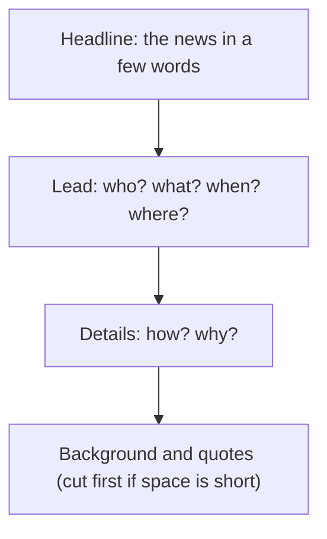

## What this lesson is for

In lesson 21 you learned the words for screens and media (*die Nachrichten, der Artikel, der Bericht, die Sendung*) and how to build relative clauses. This honors lesson puts both to work on the kind of German you meet every day once you start reading real texts: the news. News German has its own habits. Headlines leave out verbs and articles, reports are written in the simple past, journalists say where every fact comes from, and long relative clauses pack in details. None of this needs new grammar beyond A2, but it does need a few keys. With them, a short news report (*die Meldung*) stops being a wall of words and becomes something you can read for its facts.

You will learn the parts of a news page, how to turn a headline into a normal sentence, the simple past forms reports use, three ways to say who says so (*laut*, *sollen* and quotes), relative clauses with prepositions, and how to check a story before you believe it.

## Where the news comes from

In Germany, Austria and Switzerland, most people get their news from a mix of television, radio, newspapers and the internet. Some names you will see:

- *die Tagesschau* is the main evening news of ARD, the association of German public broadcasters, every day at 20 Uhr. It has been on air since 1952 and is the best-known news programme in Germany. ZDF, the second public channel, has *heute*. Austria's public broadcaster is ORF, Switzerland's German-language one is SRF.
- A broadcaster or channel is *der Sender*; the people watching are *die Zuschauer*; the people reading a paper are *die Leser* (*der Leser, die Leserin*).
- A daily paper comes out (*erscheint*) every morning; most also have a website with current (*aktuelle*) news all day.

For learners there are news services in simpler German. Deutsche Welle publishes *Langsam gesprochene Nachrichten*, real news read slowly, with the text to read along. Deutschlandfunk's *nachrichtenleicht* gives the week's news in short, simple sentences. Both are free online.

The journalists (*der Journalist, die Journalistin*) who write the news report (*berichten*) on a few big areas: politics (*die Politik*) and the government (*die Regierung*), the economy (*die Wirtschaft*), local events, sport, culture and the weather forecast (*die Wettervorhersage*).

## The parts of a news page

Every article in a paper or on a news website has the same parts:

- *die Schlagzeile*: the headline, the news in a few words, in big letters.
- *der Vorspann*: the lead, one or two bold sentences under the headline that give the main facts.
- *das Foto* and *die Bildunterschrift*: the photo and its caption.
- *der Text*: the body of the article, with details, background and quotes.

News reports are built so that you can stop reading at any point and still have the most important facts. Journalists call the key facts the W-questions: *wer? was? wann? wo?* come first, *wie? warum?* follow, and background comes last.

## Headline German: the nominal style

Headlines save space. They use the **nominal style**: instead of a verb, they use the noun made from it, and they leave out articles and the verb *sein*. Many German nouns come from verbs, and you can often see the verb inside:

| verb | noun | in a headline |
|---|---|---|
| eröffnen (to open) | die Eröffnung | *Eröffnung im Mai* |
| streiken (to strike) | der Streik | *Streik bei der Bahn* |
| wählen (to elect, to vote) | die Wahl | *Wahl in Hamburg: Ergebnis am Abend* |
| verletzen (to injure) | die Verletzung (injury); der/die Verletzte (injured person) | *Unfall auf der A8: zwei Verletzte* |

Typical headline habits:

- No article, no *sein*: *Neue Brücke fertig* means *Die neue Brücke ist fertig.*
- A colon instead of a sentence. The part before the colon is the topic, the part after it is the news: *Unfall auf der A8: zwei Verletzte* — Accident on the A8: two injured.
- Present tense for the past. *Feuerwehr rettet Katze vom Dach* reports something that already happened: the fire brigade rescued a cat from a roof.
- Numbers as figures: *12 Millionen für neue Brücke*.

### Example 1: from headline to sentence

Headline: *Streik bei der Bahn: Tausende Pendler warten*

1. Find the topic before the colon: *Streik bei der Bahn*. *der Streik* is the noun from *streiken*, so the full idea is *Die Bahn streikt* or *Es gibt einen Streik bei der Bahn* (*die Bahn* = the railway).
2. The news after the colon has a verb already: *Tausende Pendler warten* — thousands of commuters are waiting (*der Pendler* = commuter).
3. Put it together, adding articles and a link: *Es gibt einen Streik bei der Bahn, deshalb warten Tausende Pendler.* — There's a rail strike, so thousands of commuters are waiting.

## Reports are written in the simple past

Spoken German tells the past with the perfect (lesson 1). Written reports use the **simple past** for most verbs (lesson 2), so a news text is full of forms you have learned to recognize:

| infinitive | simple past (er/sie/es) | meaning |
|---|---|---|
| sein | war | was |
| haben | hatte | had |
| geben (es gibt) | gab (es gab) | there was / were |
| kommen | kam | came |
| sagen | sagte | said |
| berichten | berichtete | reported |
| mitteilen | teilte … mit | announced, informed |
| stattfinden | fand … statt | took place |
| beginnen | begann | began |

Two patterns cover almost everything: weak verbs add *-te* (*sagte, berichtete, plante*), strong verbs change their vowel (*kommen – kam, finden – fand, beginnen – begann*). Separable verbs split as in the present: *Die Polizei teilte am Montag mit, dass …* — The police announced on Monday that …

You will also meet the **passive**, which B1 teaches in full: *werden* + a past participle, used when it doesn't matter who did something. For now, just recognize it: *Zwei Menschen wurden verletzt.* — Two people were injured. *Die Brücke wurde 1950 gebaut.* — The bridge was built in 1950.

## Who says so? laut, sollen and quotes

Good journalists tell you where each fact comes from: the source (*die Quelle*). Three tools do this.

*laut* + dative means "according to": *laut einer Umfrage* — according to a survey (*die Umfrage*); *laut dem Wetterdienst* — according to the weather service. A name or a noun without an article stays as it is: *laut Polizei*, *laut Tagesschau*. (In formal writing you will also see *laut* with the genitive, *laut eines Berichts*; both are used.) This *laut* is a preposition and has nothing to do with the adjective *laut* (loud).

The **hearsay** use of *sollen* means "is said to, is supposed to": the writer passes on what others say without promising it is true. *Das neue Handy soll 900 Euro kosten.* — The new phone is said to cost 900 euros. *Der Fahrer soll zu schnell gewesen sein* is the same idea about the past (just recognize it). Compare *Du sollst um acht Uhr hier sein* (you are supposed to be here at eight: an instruction). In news, *soll* almost always means "reportedly".

Quotes go in German quotation marks, low at the start and high at the end: „Wir sind sehr zufrieden“, sagte die Bürgermeisterin. After the quote, the verb comes first and then the speaker, because the quote fills position 1: *„…“, sagte sie* (not *sie sagte*).

## Relative clauses with prepositions

News sentences describe a lot in one go, and lesson 21's relative clauses help. Two extra patterns are very common in reports.

First, a preposition before the relative pronoun. The preposition decides the case, and the noun before the comma decides the gender, so: gender looks back, case comes from the preposition.

- *die Brücke, über die täglich 8.000 Autos fahren* — the bridge over which 8,000 cars drive every day (*über* + accusative: movement across).
- *die Firma, bei der er seit zehn Jahren arbeitet* — the company he has worked for for ten years (*bei* + dative, feminine: *der*).
- *der Streik, über den alle sprechen* — the strike everybody is talking about (*sprechen über* + accusative, masculine: *den*).
- *die Kinder, mit denen die Polizei sprach* — the children the police spoke with (*mit* + dative plural: *denen*).

English often puts the preposition at the end ("the company he works for"). German never does: the preposition always comes first, right after the comma.

Second, *wo* for places. For a place, you can use *in dem / in der* or simply *wo*: *die Stadt, in der der Unfall passierte* = *die Stadt, wo der Unfall passierte* — the town where the accident happened. Used like this, *wo* is a **relative adverb**. With a city or country name, *wo* is the normal choice: *in Hamburg, wo die Wahl stattfand*.

### Example 2: joining two sentences with a preposition

Sentences: *Das ist die Brücke. Über die Brücke fahren täglich 8.000 Autos.*

1. Which noun is repeated? *die Brücke* — feminine.
2. What is its job in the second sentence? It follows *über*, which here takes the accusative (movement across). Feminine accusative: *die*.
3. Move the preposition and pronoun to the front of the second clause: *über die*.
4. Send the verb to the end: *über die täglich 8.000 Autos fahren*.
5. Result: *Das ist die Brücke, über die täglich 8.000 Autos fahren.*

Sentences: *Herr Kaya ist der Mann. Die Polizei hat mit dem Mann gesprochen.*

1. Repeated noun: *der Mann* — masculine.
2. Job: after *mit*, always dative. Masculine dative: *dem*.
3. *mit dem*, verb to the end (auxiliary last): *mit dem die Polizei gesprochen hat*.
4. Result: *Herr Kaya ist der Mann, mit dem die Polizei gesprochen hat.*

## Reading: a short report

> Feuer in Bäckerei: Feuerwehr rettet zwei Menschen
>
> *Am Sonntagmorgen brannte es in einer Bäckerei in der Altstadt von Tübingen. Zwei Menschen wurden leicht verletzt.*
>
> Das Feuer begann laut Feuerwehr gegen 5 Uhr in der Backstube, wo zu dieser Zeit schon zwei Mitarbeiter arbeiteten. Eine Nachbarin, die den Rauch sah, rief sofort die Feuerwehr. Die Feuerwehrleute holten die beiden Männer aus dem Haus und brachten sie ins Krankenhaus. Ein Kabel, das zu heiß war, soll das Feuer verursacht haben. Die Polizei prüft das noch. Die Bäckerei, in der es seit 1890 Brot und Brezeln gibt, bleibt mindestens zwei Wochen geschlossen. „Wir sind froh, dass niemand schwer verletzt ist“, sagte die Besitzerin.

Translation: Fire in bakery: fire brigade rescues two people. *On Sunday morning a fire broke out in a bakery in Tübingen's old town. Two people were slightly injured.* According to the fire brigade, the fire started at about 5 am in the bakehouse, where two employees were already working at that time. A neighbour who saw the smoke called the fire brigade at once. The firefighters got the two men out of the building and took them to hospital. A cable that got too hot is said to have caused the fire. The police are still checking this. The bakery, which has sold bread and pretzels since 1890, will stay closed for at least two weeks. "We're glad that nobody was badly hurt," said the owner.

Words: *brennen – brannte* = to burn (*es brannte* = there was a fire), *die Backstube* = bakehouse, *der Rauch* = smoke, *verursachen* = to cause, *der Besitzer, die Besitzerin* = owner, *die Feuerwehr* = fire brigade, *die Feuerwehrleute* = firefighters. The text is invented, but it is written the way local news really is.

### Example 3: reading for the W-questions

Read the lead and the first sentences, and answer the W-questions in short notes:

- *Was?* Ein Feuer in einer Bäckerei (*Feuer in Bäckerei*, *brannte es*).
- *Wann?* Am Sonntagmorgen, gegen 5 Uhr.
- *Wo?* In der Altstadt von Tübingen, in der Backstube.
- *Wer?* Zwei Mitarbeiter, leicht verletzt; eine Nachbarin rief die Feuerwehr.
- *Warum?* Vielleicht ein heißes Kabel. *soll … verursacht haben* is hearsay: it isn't certain yet, and *Die Polizei prüft das noch* confirms it.

The quote at the end adds feeling, not facts: the pyramid at work.

## Checking the news

Not everything that looks like news is true. Before you share a story, check it (*prüfen*): Who is the source? Is it current (*aktuell*), or an old story shared again? Do other papers and broadcasters report it too? Does the headline match the text? And watch the hearsay words: *soll*, *angeblich* (allegedly) and *laut* + an unnamed source tell you that a fact has not been confirmed.

## Pronunciation

- *Schlagzeile*: SCHLAG-zei-le, with *ei* as in "eye".
- *Journalist*: jour-na-LIST. The *J* is said like the *s* in "measure", as in French; the stress is at the end.
- *Regierung*: re-GIE-rung, long *ie*.
- *Feuerwehr*: FEU-er-wehr; *eu* sounds like "oy".

## Common mistakes

- Reading *soll* in a report as an order. *Der Minister soll krank sein* means he is said to be ill, not that he should be.
- Taking *laut* as "loud": *laut Polizei* is "according to the police".
- Putting the preposition at the end, as in English: *die Firma, die er bei arbeitet* → *die Firma, bei der er arbeitet*.
- Taking the case from the noun instead of the preposition: *mit die Kinder* → *mit denen*: *mit* always takes the dative.
- *„…“, sie sagte* → *„…“, sagte sie*: after a quote, the verb comes first.
- Translating a headline word for word. Rebuild it as a sentence: add the article and turn the noun back into a verb.

## Key points

- News pages have *die Schlagzeile*, *der Vorspann*, *das Foto*, *die Bildunterschrift* and *der Text*; the most important facts come first.
- Headlines use the nominal style: nouns instead of verbs, no articles, no *sein*, a colon, present tense for past events.
- Reports use the simple past: *war, hatte, gab, kam, sagte, teilte mit, fand statt*. Recognize the passive: *wurden verletzt*.
- Sources: *laut* + dative (*laut einer Umfrage, laut Polizei*); hearsay *soll* (*soll 900 Euro kosten*); quotes with *„…“, sagte sie*.
- Relative clauses with a preposition: the preposition goes first and decides the case (*über die, bei der, mit denen*); for places, *wo*.
- Before you share a story: source, date, other media, headline vs text.

The words from this lesson are listed below; they join your vocabulary reviews when you complete the lesson.
