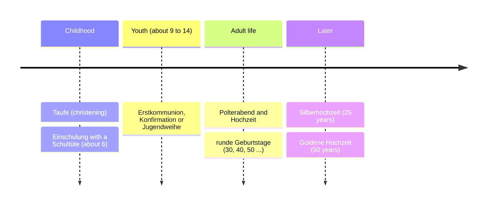

## What this lesson is for

Lesson 22 followed the festive year: Advent, Christmas, Silvester, Karneval, Easter. This honors lesson follows a life instead. Families in the German-speaking countries mark its big steps with their own customs: a paper cone of sweets on the first school day, smashed plates before a wedding, cake that the birthday person brings to work. Knowing them helps you understand what people are doing, and saying the right thing at the right moment is a big part of sounding at home in a language.

You will also learn why so many wishes end in *-en* or *-es* (*Herzlichen Glückwunsch, Herzliches Beileid*): it is the grammar of lesson 11 hiding inside a set phrase. And you will practise writing short cards, happy and sad.

The customs below are common, not universal: they vary by region, religion and family, and many people skip them. Where something is mainly found in one region, the lesson says so.

## Celebrations through a life

- *die Taufe* is a christening (baptism), usually a church service followed by a family lunch.
- Catholic children celebrate their *Erstkommunion* at about nine; Protestant teenagers their *Konfirmation* at about fourteen. The *Jugendweihe* is a non-religious coming-of-age ceremony at about fourteen, mostly in eastern Germany. All three come with a family party and presents, often money.

## The first day of school: Einschulung

In Germany children usually start school at about six. The first day, *die Einschulung*, is a family occasion: there is often a short ceremony at the school, photos, and lunch or cake with grandparents afterwards. Every new pupil carries *eine Schultüte*, a large decorated paper cone filled with sweets, small toys and school things such as pens. The custom began in Saxony and Thuringia in the early 1800s; in parts of eastern Germany the cone is still called *Zuckertüte*. Parents or grandparents usually prepare it, and some families make it together with the child.

## Birthdays: three rules

Birthdays (lesson 22 gave you *Alles Gute zum Geburtstag!*) come with some unwritten rules that surprise visitors:

1. Don't congratulate early. Many Germans think it brings bad luck to wish someone a happy birthday before the day. Afterwards is fine: *Alles Gute nachträglich!* — Belated happy birthday! Some people *feiern rein*: they start the party the evening before and celebrate into the birthday at midnight.
2. The birthday person invites. If you celebrate with friends in a restaurant, the person whose birthday it is often pays, and at work it is common to bring a cake for colleagues.
3. Round birthdays matter. A *runder Geburtstag* (30, 40, 50 …) gets a bigger party. In Bremen there is a well-known custom for people who turn 30 and are not married: men sweep the steps of the cathedral and women clean door handles at the town hall until someone sets them free with a kiss.

## Weddings: Standesamt, Polterabend and more

In Germany, Austria and Switzerland, only a civil ceremony makes a marriage legally valid. The couple marry at *das Standesamt*, the registry office, in a short ceremony (*die Trauung*) with family and witnesses. A church wedding is optional and usually comes after the civil one, on the same day or later. On the day, the couple are *das Brautpaar*: *die Braut* (bride) and *der Bräutigam* (groom).

Before the wedding come two parties:

- *der Junggesellenabschied* (often just *JGA*): the hen or stag party. Friends of the bride or groom take them through town, often in costumes, sometimes selling small things to strangers for fun.
- *der Polterabend*: an evening party, a few days or the night before the wedding, at the couple's or their parents' home. Guests bring old plates, cups and other china and smash it on the ground. The pieces (*die Scherben*, singular *die Scherbe*) bring luck, as the saying goes: *Scherben bringen Glück.* Then the couple sweep everything up together, a first test of working as a team. Glass and mirrors are traditionally left out, because broken glass is said to bring bad luck.

Marriage (*die Ehe*) has its anniversaries (*das Jubiläum*, plural *die Jubiläen*): *die Silberhochzeit* after 25 years, *die Goldene Hochzeit* after 50. Firms and clubs celebrate a *Jubiläum* too: *Unsere Firma hat 100-jähriges Jubiläum.*

When people move into a new flat, they may hold *eine Einweihungsparty* (a housewarming). A traditional present is bread and salt, *Brot und Salz*, so that the household never lacks the basics.

## Sad occasions

When someone dies (*der Tod*), there is *eine Beerdigung* (a funeral), and people write cards with a black border. The key phrase is *Herzliches Beileid* (sincere condolences), or more formally *Mein aufrichtiges Beileid*. A condolence card is short and calm:

*In stiller Anteilnahme* (in silent sympathy) is a usual closing for condolences. *Wir denken an euch* — we're thinking of you.

## Why wishes end in -en: the hidden verb

Look at the endings: *Herzlichen Glückwunsch!*, *Guten Rutsch!*, *Schönes Wochenende!*, *Gute Besserung!*, *Frohe Ostern!*, *Herzliches Beileid!* Each wish is an **ellipsis**: a sentence with words left out because everyone knows them. The missing part is *Ich wünsche dir / Ihnen …*, and what you wish someone is the direct object, so the wish is accusative. There is no article, so the adjective takes the strong (signal) ending, as in lesson 11:

| wish | noun | full sentence (rarely said) |
|---|---|---|
| *Herzlichen Glückwunsch!* | der Glückwunsch (masc.) | *Ich spreche dir meinen herzlichen Glückwunsch aus.* |
| *Guten Rutsch!* | der Rutsch (masc.) | *Ich wünsche dir einen guten Rutsch.* |
| *Gute Besserung!* | die Besserung (fem.) | *Ich wünsche Ihnen gute Besserung.* |
| *Schönes Wochenende!* | das Wochenende (neut.) | *Ich wünsche euch ein schönes Wochenende.* |
| *Herzliches Beileid!* | das Beileid (neut.) | *Ich spreche Ihnen mein herzliches Beileid aus.* |
| *Frohe Ostern!* | Ostern (here plural) | *Wir wünschen euch frohe Ostern.* |

Only the masculine shows the accusative clearly: *-en*, not *-er*. That is why *Herzlicher Glückwunsch* is wrong as a wish, though you can see it in a sentence where it is the subject: *Ein herzlicher Glückwunsch kam von der Chefin.*

Two more patterns: *Alles Gute!* has *-e* because after *alles* an adjective-noun takes *-e* (like *alles Neue*), and *Viel Glück! Viel Spaß! Viel Erfolg!* use *viel* without an ending before a singular noun.

The occasion follows with *zu* + dative: *zum Geburtstag, zur Hochzeit, zum Jubiläum*. With an ordinal or adjective, add the ending after *zum* (lesson 22): *zum 40. Geburtstag* (read *zum vierzigsten Geburtstag*), *zum neuen Job*, *zur Goldenen Hochzeit*.

### Example 1: a birthday card for a colleague

Situation: your colleague Herr Schulz turns 50. You say *Sie* to him.

1. Opening: semi-formal, *Lieber Herr Schulz,* (lesson 23).
2. Wish: *Herzlichen Glückwunsch zum 50. Geburtstag!* (masculine accusative *-en*; *zum fünfzigsten*).
3. A personal line: *Vielen Dank für die gute Zusammenarbeit!* (*die Zusammenarbeit* = cooperation.)
4. A second wish: *Alles Gute, viel Glück und vor allem Gesundheit!*
5. Closing: *Herzliche Grüße, Ihre Mia Berger.*

### Example 2: congratulations to a couple

Situation: your friends Lena and Tom are getting married. You say *ihr* to them.

1. *Liebe Lena, lieber Tom,* — one adjective per name, *Liebe* for her, *lieber* for him (small *l* after the comma).
2. *Herzliche Glückwünsche zur Hochzeit!* — plural *Glückwünsche*, so *-e*; *zur* because *die Hochzeit* is feminine.
3. *Wir wünschen euch alles Liebe für eure gemeinsame Zukunft.* — *euch* (dative, to you two), *eure* (your).
4. *Eure Sara und Jan*

### Example 3: a condolence card

Situation: the father of your neighbour, Frau Öztürk, has died.

1. *Liebe Frau Öztürk,*
2. *es tut uns sehr leid, dass Ihr Vater gestorben ist.* — the *dass*-clause from lesson 23, verb at the end.
3. *Wir sind in Gedanken bei Ihnen und Ihrer Familie.* — We are thinking of you and your family.
4. *In stiller Anteilnahme, Familie Becker*

Keep it short, avoid jokes and exclamation marks, and don't say *Herzlichen Glückwunsch* by mistake: *Herzliches Beileid* is the phrase.

## Reading: a wedding weekend

Mara writes to her English friend Kate about her cousin's wedding.

> Liebe Kate,
>
> letztes Wochenende hat meine Cousine Julia geheiratet, und es war wunderbar! Am Freitag war der Polterabend im Garten von Julias Eltern. Fast hundert Gäste kamen, und jeder hatte alte Teller oder Tassen dabei. Wir haben alles auf den Boden geworfen, und am Ende mussten Julia und Max die Scherben zusammen wegfegen. Das hat zwei Stunden gedauert!
>
> Am Samstagvormittag war die Trauung auf dem Standesamt. Das ging ganz schnell, nur zwanzig Minuten. Danach gab es Sekt vor dem Rathaus, und alle haben das Brautpaar mit Reis beworfen. Am Nachmittag waren wir in der Kirche, und am Abend haben wir bis drei Uhr morgens gefeiert. Julias Opa hat eine Rede gehalten, bei der alle geweint haben. Er und Oma feiern nächstes Jahr übrigens Goldene Hochzeit!
>
> Wie war die Hochzeit deiner Schwester? Schreib mir bald!
>
> Liebe Grüße
>
> Mara

Translation: Dear Kate, last weekend my cousin Julia got married, and it was wonderful! On Friday the Polterabend was in the garden of Julia's parents. Almost a hundred guests came, and everyone had brought old plates or cups. We threw everything on the ground, and at the end Julia and Max had to sweep up the pieces together. It took two hours! On Saturday morning the ceremony was at the registry office. That was very quick, only twenty minutes. Afterwards there was sparkling wine in front of the town hall, and everyone threw rice at the bride and groom. In the afternoon we were in church, and in the evening we partied until three in the morning. Julia's grandpa gave a speech during which everyone cried. By the way, he and Grandma are celebrating their golden wedding next year! How was your sister's wedding? Write soon! Love, Mara

Notice the mix of tenses: Mara writes the perfect (*hat geheiratet, haben geworfen*) as in speech, but uses the simple past for *war, kamen, hatte, mussten, gab* (lessons 1 and 2). *Julias Eltern* and *Julias Opa* are names with *-s* (lesson 18). *bei der alle geweint haben* is a relative clause with a preposition: during which. New words: *wegfegen* = to sweep away, *bewerfen* = to throw at, *die Rede* = speech, *weinen* = to cry.

## Pronunciation

- *Bräutigam*: BRÄU-ti-gam; *äu* sounds like "oy".
- *Polterabend*: POL-ter-a-bend, stress on the first syllable.
- *Jubiläum*: ju-bi-LÄ-um, four syllables; the *J* is like English "y".
- *Beileid*: BEI-leid; both *ei* like "eye".
- *Schultüte*: SCHUL-tü-te, long *u* and long *ü*.

## Common mistakes

- *Herzlicher Glückwunsch!* → *Herzlichen Glückwunsch!* The wish is accusative.
- *Frohe Geburtstag!* → *Alles Gute zum Geburtstag!* or *Herzlichen Glückwunsch zum Geburtstag!* (*Geburtstag* is masculine; *Frohen Geburtstag!* exists but is less common.)
- Congratulating before the birthday. Wait for the day, or say *nachträglich* afterwards.
- *zum vierzigste Geburtstag* → *zum vierzigsten Geburtstag*.
- Thinking a church wedding alone is legally valid. In all three countries, the Standesamt is what counts.
- *Herzlichen Glückwunsch* on a condolence card. The phrase for a death is *Herzliches Beileid*.

## Key points

- Life events: *die Taufe, die Einschulung* (with *die Schultüte*), *die Konfirmation, die Hochzeit, die Beerdigung*; anniversaries are *Jubiläen*: *Silberhochzeit* (25), *Goldene Hochzeit* (50).
- Weddings: legally only at *das Standesamt*; *der Polterabend* with *Scherben* for luck; *der Junggesellenabschied*; *das Brautpaar* = *die Braut* + *der Bräutigam*.
- Birthdays: never early; the birthday person often invites or brings cake; *runde Geburtstage* are big.
- Wishes are an ellipsis of *Ich wünsche dir …*: accusative, no article, strong endings: *Herzlichen Glückwunsch, Guten Rutsch, Schönes Wochenende, Herzliches Beileid*; *Alles Gute*; *Viel Glück*.
- Occasion with *zu* + dative: *zum 50. Geburtstag, zur Hochzeit*.

The words from this lesson are listed below; they join your vocabulary reviews when you complete the lesson.
