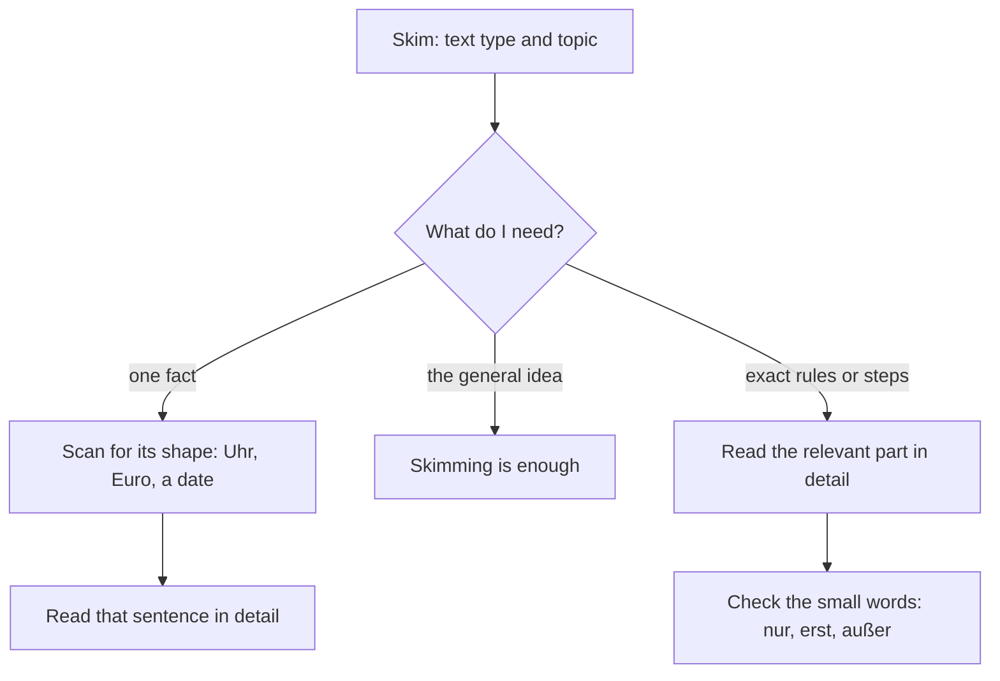

## What this lesson is for

In lesson 24 you met the Lesen part of the Goethe-Zertifikat A2 and a few tips: read the task first, guess unknown words, watch the small words. This honors module turns those tips into real skills, because reading and listening are how you'll keep learning German after this course, from notices and newspapers to stories and poems.

This first lesson is about *how* you read. A good reader doesn't read a timetable the way they read a letter from a friend. You'll learn three ways of reading, how to recognise the type of a text in a second, how small words like *erst* and *außer* can turn an answer upside down, and how a short newspaper report is built. All the texts are everyday German at A2 level, with a few new words glossed as you go.

## Three ways to read

Before you read anything, ask: what do I need from this text? The answer decides how you read it.

| way of reading | German name | question it answers | speed | typical text |
|---|---|---|---|---|
| **skimming** | *globales Lesen* | What is this about? Who is it for? | very fast | a newspaper page, a notice board, a website |
| **scanning** | *selektives Lesen* | When? Where? How much? | fast, eyes jump | a timetable, an ad, an information board |
| **detailed reading** | *detailliertes Lesen* | What exactly does it say? | slow, every word | rules, instructions, a contract, an e-mail with a request |

Skimming means letting your eyes run over the headline (*die Überschrift*), the first sentence of each paragraph and anything in large or bold print. You don't stop at unknown words. After ten seconds you should know the topic and the **text type**: notice, ad, e-mail, report.

Scanning means hunting for one piece of information. You know what it looks like before you find it: a time has a colon or the word *Uhr*, a price has *Euro* or €, a date has a month or a dot (*14.5.*). Your eyes jump until they see the shape, and then you read only that sentence.

Detailed reading means reading every word of the part that matters, including the small ones. You do this last, and only where the task needs it. Most exam questions need one or two sentences read in detail, not the whole text.

The main idea (*die Hauptsache*) is this: switch between the three. Skim first to know what you have, scan to find the right place, and read that place in detail. Here is the decision as a chart:

## Text types and their clues

Every text type has a typical look and typical phrases. If you know them, you can skim much faster. These are the short texts you'll see most often in German-speaking countries:

| text type | where you see it | typical clues |
|---|---|---|
| *der Aushang* (notice) | in a block of flats, at work, at school | a sender at the top (*Hausverwaltung*, *die Schulleitung*), *An alle …*, a date and time |
| *das Plakat* (poster) | on walls, at bus stops | large letters, an event, a date, *Eintritt frei* |
| *die Anzeige* (small ad) | on a notice board, in a newspaper, online | *Zu verkaufen*, *Suche …*, *Biete …*, a price, a contact |
| *der Zettel* (note, slip of paper) | on a door, a car, a fridge | handwritten style, short sentences, often a request |
| *die Infotafel* (information board) | in a department store, hospital, office building | floors or rooms and what's there, few full sentences |
| *die Meldung* (short news report) | in a newspaper or news app | a headline, a place name at the start, the past tense |

A **text type** is a kind of text with its own purpose and form. Knowing the type tells you what to expect: a notice from the building management contains a rule or a change, a small ad contains something offered or wanted, a lost-pet note asks for help and often offers a reward (*die Belohnung*).

Here is a notice board (*das Schwarze Brett*, literally "the black board") in the entrance of a block of flats in Germany:

![A notice board in a block of flats with four texts. Top left, a notice: Hausverwaltung Berger. An alle Mieterinnen und Mieter: Am Dienstag, 14. Mai, gibt es von 8 bis 12 Uhr kein Wasser. Grund: Reparatur im Keller. Vielen Dank! Top right, a poster: Sommerfest im Hof, Samstag, 18. Mai, ab 16 Uhr, Musik, Grill, Spiele für Kinder, Salat oder Kuchen mitbringen! Bottom left, a small ad with tear-off strips: Zu verkaufen: Kinderfahrrad, blau, gut erhalten, 40 Euro, Familie Yilmaz, 2. Stock. Bottom right, a note: Katze entlaufen! Mia, grau mit weißen Pfoten, seit Montag nicht zu Hause. Wer hat sie gesehen? Belohnung: 50 Euro. Bitte bei Jonas klingeln, Erdgeschoss links.](images/de2-h1-board.svg)

New words on the board: *die Mieterin / der Mieter* (tenant), *der Keller* (cellar, basement), *der Hof* (courtyard), *gut erhalten* (in good condition), *entlaufen* (run away, of an animal), *die Pfote* (paw), *klingeln* (to ring the bell), *das Erdgeschoss* (ground floor).

### Example 1: Skimming the board

Give yourself ten seconds. What are the four texts, and who wrote them?

1. Top left: a sender at the top (*Hausverwaltung Berger*) and *An alle Mieterinnen und Mieter*. It's an *Aushang* from the property management to all tenants. Topic: water.
2. Top right: huge letters, an event, a day and a time. It's a *Plakat* for a summer party.
3. Bottom left: *Zu verkaufen*, a price and strips to tear off. It's an *Anzeige*: someone is selling something.
4. Bottom right: an exclamation, a description of an animal and *Belohnung*. It's a *Zettel* about a lost cat.

Notice that you didn't need *Keller* or *Pfoten* to answer. Skimming works with the words you know.

### Example 2: Scanning for facts

Now find the answers as fast as you can. For each one, decide first what shape the answer has.

1. *Wann gibt es kein Wasser?* You're looking for a day and times. Scan the notice for a date: *Am Dienstag, 14. Mai, von 8 bis 12 Uhr.*
2. *Was soll man zum Fest mitbringen?* Look for *mitbringen*: *Salat oder Kuchen.*
3. *Wie viel kostet das Fahrrad?* Look for *Euro*: *40 Euro.*
4. *Wo kann man sich melden, wenn man die Katze findet?* Look for a place in the building: *bei Jonas, Erdgeschoss links.*

Each answer needed one line. The rest of the text was the haystack around the needle.

## Detailed reading: the small words

In the exam and in life, the trap is rarely a difficult word. It's a small one that changes the meaning. When a question is about rules, times or conditions, read these words slowly:

| word | meaning | example | what it means |
|---|---|---|---|
| *nur* | only | *Nur mit Termin.* | without an appointment: no |
| *erst* | not until, only (later than you'd expect) | *Der Laden öffnet erst um 10.* | at 9 it's still closed |
| *schon* | already | *Wir öffnen schon um 7.* | earlier than you'd expect |
| *noch nicht* | not yet | *Die Tickets gibt es noch nicht.* | they'll come later |
| *nicht mehr* | no longer | *Es gibt keine Tickets mehr.* | sold out (*ausverkauft*) |
| *außer* | except | *täglich außer sonntags* | Sunday is closed |
| *ab* | from (onwards) | *ab 18 Jahren* | 17-year-olds can't |
| *bis spätestens* | by … at the latest | *bis spätestens Freitag* | Saturday is too late |
| *ohne* | without | *Eintritt ohne Anmeldung* | you can just come |

*erst* and *nur* both sometimes translate as "only", which is why learners confuse them. *nur* limits an amount (*nur zwei Tickets*: no more than two). *erst* says something happens later than expected (*erst um 10*: not before 10). *Ich habe erst zwei Kapitel gelesen* means "I've only read two chapters so far", and more will come.

## Reading a news report

Newspaper reports have a fixed shape. The headline gives the topic in a few words, often without a verb. The **lead**, the first sentence or paragraph, answers the most important W-questions: *Wer? Was? Wann? Wo?* The later paragraphs add details, quotes and the *Warum?* So if you only have time for one paragraph, read the first one. Reports use the simple past for what people said (*sagte*, *erklärte*) and the present or perfect for the news itself.

> Neustadt: Bibliothek verleiht jetzt auch Werkzeug
>
> Eine Bohrmaschine, ein Zelt oder eine Nähmaschine: In der Stadtbibliothek Neustadt kann man seit Montag nicht nur Bücher leihen, sondern auch Dinge für den Alltag. Die neue „Bibliothek der Dinge“ hat schon 120 Gegenstände. Bald sollen es 200 sein.
>
> Die Idee hatte die Bibliothekarin Sabine Roth. „Viele Leute kaufen eine Bohrmaschine und benutzen sie nur zehn Minuten im Jahr“, sagte sie bei der Eröffnung. „Das kostet Geld und ist schlecht für die Umwelt.“
>
> Das Leihen ist kostenlos. Man braucht nur einen Bibliotheksausweis. Er kostet für Erwachsene 12 Euro im Jahr, für Kinder und Jugendliche unter 18 nichts. Die Dinge darf man zwei Wochen behalten. Elektrische Geräte bekommt man aber erst ab 18 Jahren.
>
> Die Bibliothek sucht noch Spenden: Wer gut erhaltene Dinge zu Hause hat, kann sie montags bis freitags von 10 bis 18 Uhr vorbeibringen. Kleidung und Möbel nimmt sie nicht an.

Neustadt: Library now lends tools too. A drill, a tent or a sewing machine: since Monday you can borrow not only books but also things for everyday life at Neustadt city library. The new "Library of Things" already has 120 items. Soon there are to be 200. The idea came from the librarian Sabine Roth. "Many people buy a drill and use it for only ten minutes a year," she said at the opening. "That costs money and is bad for the environment." Borrowing is free. All you need is a library card. It costs adults 12 euros a year and nothing for children and young people under 18. You may keep the things for two weeks. But you only get electrical appliances from the age of 18. The library is still looking for donations: anyone who has things in good condition at home can drop them off Monday to Friday from 10 am to 6 pm. It doesn't accept clothes or furniture.

(*verleihen* to lend out, *das Werkzeug* tools, *die Bohrmaschine* drill, *der Gegenstand* object, item, *die Eröffnung* opening, *der Ausweis* card, ID, *das Gerät* appliance, device, *die Spende* donation, *vorbeibringen* to drop off.)

The lead answers *Was?* (you can borrow things), *Wo?* (Neustadt city library) and *Wann?* (since Monday). The second paragraph gives *Wer?* and *Warum?*; the third and fourth give the rules, and that's where the small words live: *nur*, *erst ab 18*, *nicht*.

### Example 3: True or false?

Read the report in detail and decide: *richtig* or *falsch*?

1. *Ein 16-jähriger Schüler kann eine elektrische Bohrmaschine leihen.* The third paragraph says *Elektrische Geräte bekommt man aber erst ab 18 Jahren.* He's 16: *falsch*. A reader who only saw *kostenlos* and *unter 18 nichts* would say *richtig*.
2. *Ein Bibliotheksausweis ist für alle kostenlos.* Only for under-18s; adults pay 12 Euro: *falsch*.
3. *Man kann ein altes Sofa spenden.* *Möbel nimmt sie nicht an*, and a sofa is furniture: *falsch*.
4. *Die Bibliothek hat im Moment mehr als 100 Gegenstände.* *schon 120*: *richtig*. The 200 is a plan (*Bald sollen es 200 sein*), not a fact yet.

Every answer came from one sentence, and in three of the four a small word decided it.

## Common mistakes

- Reading every text from the first word to the last at the same speed. Skim first; you'll often find you need only one line.
- Stopping at the first unknown word. Mark it and read on; the next sentence often explains it.
- Matching words instead of meaning. If the question says *Bohrmaschine* and the text says *Bohrmaschine*, check the sentence around it: it may say *erst ab 18*.
- Confusing *erst* and *nur*: *erst um 10* is a time limit (not before 10), *nur zehn Minuten* is an amount.
- Ignoring *außer*: *täglich außer montags* means closed on Mondays, not open on Mondays.
- Taking a plan for a fact. *sollen*, *bald* and *geplant* describe the future.

## Key points

- Three ways to read: **skimming** for the topic and type, **scanning** for one fact, **detailed reading** for exact rules.
- Skim, scan, then read the right place in detail.
- Know the text types: *Aushang*, *Plakat*, *Anzeige*, *Zettel*, *Infotafel*, *Meldung*; each has typical clues.
- Small words decide answers: *nur, erst, schon, noch nicht, nicht mehr, außer, ab, bis spätestens, ohne*.
- A news report puts the most important facts in the **lead**; quotes and details follow.

The words from this lesson are listed below; they join your vocabulary reviews when you complete the lesson.
