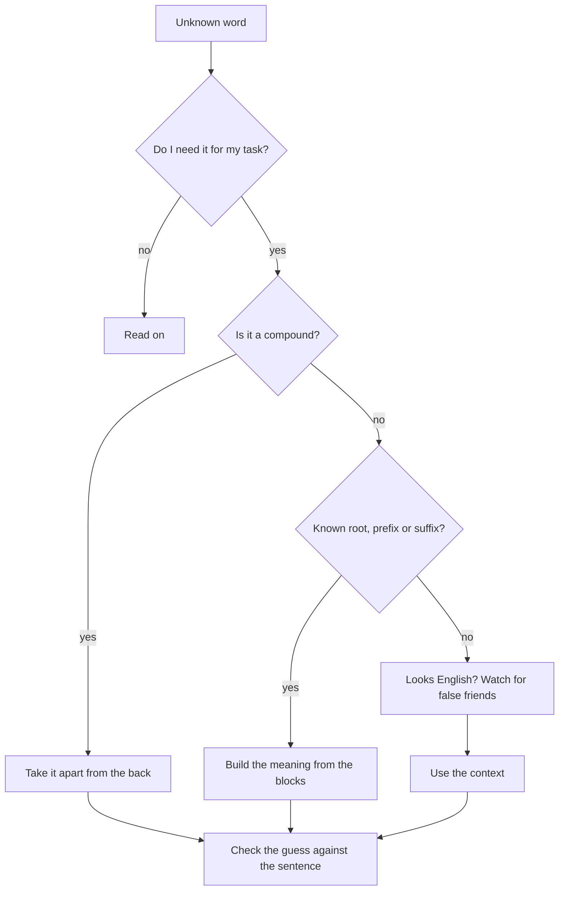

## What this lesson is for

In the last lesson you learned to read past unknown words. But sometimes the unknown word *is* the answer, and you have no dictionary in the exam. The good news: German is a building-block language. Most long words are made of short words you already know, and the same endings and beginnings come back again and again. Once you see the blocks, a word like *Wohnungsschlüssel* stops being scary.

This lesson gives you four tools for working out what a word means: taking compounds apart, recognising word families and their endings, spotting international words (and the false friends among them), and using the context. At the end you'll see how to find the right form in a dictionary (*das Wörterbuch*) when you do look a word up. In A1 lesson 5 you learned that endings like *-ung* and *-heit* tell you a noun's gender; here they help you with its meaning.

## Tool 1: take compounds apart

German writes compound nouns as one word, where English often uses two (*die Haustür*, front door) or a phrase (*der Wohnungsschlüssel*, the key to the flat). The trick is to read them from the back. The last part, the **head word**, says what the thing is. Everything in front of it is a **modifier**: it says what kind.

- *der Schlüssel* is a key, so *der Wohnungsschlüssel* is a key, the one for the flat (*die Wohnung*).
- *der Hausschuh*: a shoe (*Schuh*) for the house, a slipper, not a kind of house.
- *das Schuhhaus*: a house for shoes, a shoe shop. Same blocks, opposite order, different thing.

Three rules follow from this:

1. The head word gives the gender. *die Wohnung* + *der Schlüssel* = *der Wohnungsschlüssel*. *das Haus* + *die Tür* = *die Haustür*.
2. The head word gives the plural. *die Wohnungsschlüssel*, *die Haustüren*. Only the last part changes.
3. Modifiers can be nouns, verbs or adjectives. A verb drops its infinitive ending, sometimes keeping an *-e-*: *der Schreibtisch* (a table for writing: desk), *das Wartezimmer* (waiting room). An adjective keeps its plain form: *die Großstadt* (big city), *das Kleingeld* (small change).

Between the parts you'll often see a small linking sound: *-s-* (*Wohnungsschlüssel*, *Geburtstag*), *-n-* or *-en-* (*Sonnenbrille*, *Straßenbahn*), *-e-* (*Hundeleine*, dog lead). It carries no meaning; just ignore it when you take the word apart. After *-ung*, *-heit* and *-keit* it's practically always *-s-*.

Long compounds work the same way, one block at a time, from the back: *der Haustürschlüssel* → *Schlüssel* for the *Haustür* → the key to the front door. *die Kinderarztpraxis* → *Praxis* (practice, surgery) of the *Kinderarzt* (children's doctor) → a paediatric practice.

### Example 1: Decoding compounds

Work out the meaning and the article of each word.

1. *Fahrradschloss*. Head: *Schloss*, here a lock (*das Schloss*). Modifier: *das Fahrrad*. A bike lock: *das Fahrradschloss*.
2. *Wochenmarkt*. Head: *der Markt*. Modifier: *die Woche*, with *-n-*. A market held every week: *der Wochenmarkt*.
3. *Mülltrennung*. Head: *die Trennung* (from *trennen*, to separate). Modifier: *der Müll*. Separating rubbish for recycling: *die Mülltrennung*. You met *trennen* in lesson 16.
4. *Esszimmer*. Head: *das Zimmer*. Modifier: the verb *essen* without *-en*. A room for eating, a dining room: *das Esszimmer*.

## Tool 2: word families and endings

A **word family** is a group of words built on the same root. If you know one member, you can often guess the others:

| root | family members |
|---|---|
| *fahren* (to go, drive) | *die Fahrt* (journey), *der Fahrer* (driver), *die Abfahrt* (departure), *das Fahrrad* (bicycle), *die Fahrkarte* (ticket) |
| *sicher* (safe, sure) | *die Sicherheit* (safety, security), *unsicher* (unsure, unsafe), *versichern* (to insure), *die Versicherung* (insurance) |
| *bekannt* (known) | *unbekannt* (unknown), *der/die Bekannte* (acquaintance), *kennen* (to know a person) |

The building blocks at the front and back of words are a **prefix** and a **suffix**. Each one adds a fairly regular meaning:

| block | meaning | examples |
|---|---|---|
| *-er* | a person or a machine that does it | *der Fahrer*, *der Drucker* (printer), *der Lautsprecher* (loudspeaker) |
| *-ung* | the action or its result | *die Lösung* (solution), *die Trennung*, *die Wohnung* |
| *-heit*, *-keit* | a quality, from an adjective | *die Sicherheit*, *die Sauberkeit* (cleanliness), *die Freundlichkeit* (friendliness) |
| *-lich*, *-ig* | makes adjectives | *freundlich*, *sonnig*, *wolkig* |
| *-bar* | can be done | *essbar* (edible), *trinkbar*, *machbar* (doable) |
| *-los* | without | *arbeitslos*, *kostenlos* (free of charge), *sprachlos* (speechless) |
| *un-* | the opposite (*das Gegenteil*) | *unbekannt*, *unfreundlich*, *unmöglich* |

These are tendencies, not laws. *die Kleinigkeit* comes from *klein* and means "a small thing, a trifle", which fits the pattern. But *unheimlich* doesn't mean "not homely": it means "creepy", and in speech also "incredibly" (*unheimlich nett*). Use the blocks to make a guess, then check the guess against the sentence.

### Example 2: Guessing from the blocks

A hotel review: *Die Sauberkeit im Zimmer war super, aber die Freundlichkeit an der Rezeption war leider nicht so groß. Das Frühstück war fast unbezahlbar.*

1. *Sauberkeit*: *sauber* (clean) + *-keit* (the quality) = cleanliness. The room was very clean.
2. *Freundlichkeit*: *freundlich* + *-keit* = friendliness. The staff weren't very friendly.
3. *unbezahlbar*: *un-* (not) + *bezahlen* (to pay) + *-bar* (can be done) = "not payable", unaffordable. Breakfast was very expensive.

You knew none of the three words, and you understood the whole review.

## Tool 3: international words and false friends

Many German words look like English ones because they *are* related or borrowed: *das Hotel*, *die Information*, *der Computer*, *die Musik*, *der Garten*. Trust them, usually. But a **false friend** is a German word that looks like an English word and means something different. These are worth learning by heart:

| German | means | not |
|---|---|---|
| *das Gift* | poison | a gift (that's *das Geschenk*) |
| *bekommen* | to get, receive | to become (that's *werden*) |
| *also* | so, therefore | also (that's *auch*) |
| *aktuell* | current, up to date | actual (that's *tatsächlich*) |
| *eventuell* | possibly, maybe | eventually (that's *irgendwann*, *schließlich*) |
| *der Chef* | the boss | a chef (that's *der Koch*) |
| *sensibel* | sensitive | sensible (that's *vernünftig*) |
| *das Handy* | mobile phone | handy (that's *praktisch*) |

*das Handy* is a German invention that sounds English; English speakers don't use it for a phone.

## Tool 4: the context

When the blocks don't help, the sentences around a word usually do. Ask: what kind of word is it (noun, verb, adjective)? What would make sense here? Is there an example, a contrast or an explanation nearby?

> *Im Flur steht eine alte Kommode. Sie hat vier Schubladen. In der obersten liegen unsere Mützen und Schals, in der untersten die Schuhcreme.*

*Schublade* has an article and a plural, so it's a noun. A *Kommode* has four of them, and things lie *in* them, at the top and at the bottom. A *Kommode* is a chest of drawers; *die Schublade* is a drawer. The **context** (*der Zusammenhang*), the text around a word, often gives you more than any one block. A word you can guess (*erraten*) from the context is one you'll remember, too.

Here is the whole method as a chart:

### Example 3: Context in a notice

*Achtung: Der Aufzug ist defekt. Bitte benutzen Sie die Treppe. Die Reparatur dauert voraussichtlich bis Freitag.*

1. *defekt*: an international word (defective). The lift doesn't work; that's why you should take the stairs.
2. *voraussichtlich* is long, but it sits before *bis Freitag* in a sentence about how long a repair will take. A good guess: "probably, expected". That's right: it means "expected, according to current plans". You didn't need it to understand the notice, and that's the point of the first question in the chart: often you can skip it.

## When you do look a word up

A dictionary lists the basic form, not the form you see in the text. Work back to it first:

- Verbs: find the infinitive. *Er kauft heute ein* → *einkaufen* (put the separable prefix back). *gefunden* → *finden*. *fand* → *finden* (look in the list of strong verbs).
- Nouns: find the singular. *Bäume* → *der Baum*; *Häuser* → *das Haus*. A plural with an umlaut may have none in the singular.
- Adjectives: drop the ending. *mit einem neuen Rad* → *neu*. *größer, am größten* → *groß*.
- Compounds: if the whole word isn't there, look up the head word, then the modifier.

## Common mistakes

- Reading a compound from the front. *der Hausschuh* is a shoe, *das Schuhhaus* is a shop.
- Taking the gender from the first part: *das Haus* + *die Tür* is *die Haustür*, not *das*.
- Trusting every English look-alike. *Gift*, *also*, *eventuell* and *bekommen* mean something else.
- Treating *-bar* or *un-* as automatic. Check the guess: *unheimlich* isn't "not homely".
- Looking up a verb in the form you saw. *kauft … ein* is under *einkaufen*; *ging* is under *gehen*.
- Looking up every word. Ask first whether you need it.

## Key points

- Read compounds from the back: the **head word** says what it is and gives the gender and plural; the **modifier** says what kind. Ignore linking *-s-*, *-n-*, *-e-*.
- A **word family** shares a root: *fahren, die Fahrt, der Fahrer, die Abfahrt*.
- Common blocks: *-er* (person, machine), *-ung* (action), *-heit/-keit* (quality), *-bar* (can be done), *-los* (without), *un-* (opposite).
- Learn the **false friends**: *Gift, bekommen, also, aktuell, eventuell, Chef, sensibel, Handy*.
- Use the **context**, and check every guess against the sentence.
- Before you use a dictionary, find the infinitive, the singular or the plain adjective.

The words from this lesson are listed below; they join your vocabulary reviews when you complete the lesson.
