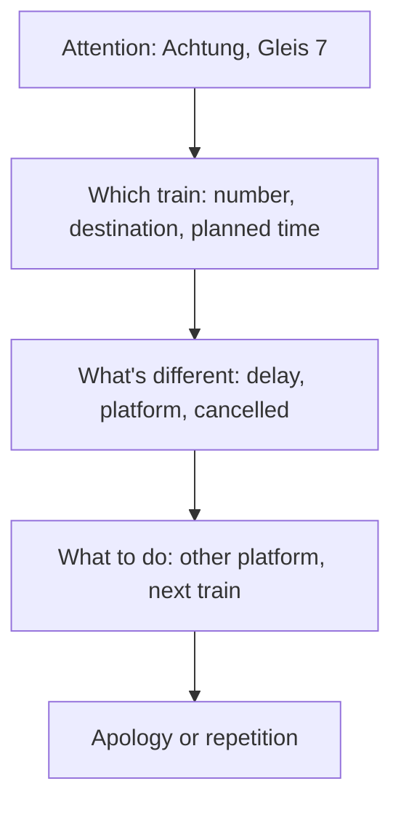

## What this lesson is for

Reading lets you go back; listening doesn't. In lesson 19 you learned phone phrases and read a message from a bike workshop, and lesson 24 gave you first tips for the Hören part of the exam. This lesson goes further: it shows how spoken German differs from the German in your textbook, how announcements at stations and in shops are built, and how to take quick notes so you don't lose a time or a number.

You can't hear sound in this lesson, so the listening texts are written as transcripts, the way people actually speak them. Read them aloud, or let the app read them to you, and try to hear them in your head. The questions at the end use transcripts too.

## Spoken German is not written German

In relaxed speech, Germans shorten and swallow sounds, just as English speakers say "gonna" and "wanna". These **reductions** are normal, not lazy or wrong, and you'll hear them from teachers, news presenters off air and your neighbours alike. In writing they appear only in chat messages and in dialogue in books.

| written | spoken | example |
|---|---|---|
| *ich habe* | *ich hab* | *Ich hab keine Zeit.* |
| *haben wir* | *ham wir* | *Ham wir noch Milch?* |
| *es gibt*, *gibt es* | *'s gibt*, *gibt's* | *Was gibt's heute?* |
| *ist* | *is* | *Das is nich so schlimm.* |
| *nicht* | *nich*; in the south and Austria *net* | *Ich weiß nich.* |
| *ein, eine, einen* | *'n, 'ne, 'nen* | *Hast du 'nen Stift?* |
| *einmal* | *mal* | *Komm mal her!* |
| *gerade* | *grad* | *Ich bin grad im Bus.* |
| *etwas*, *so etwas* | *was*, *so was* | *Ich hab was vergessen.* |
| *vor dem*, *für das* | *vorm*, *fürs* | *Wir treffen uns vorm Kino.* |
| *nein* | *nee* | *Nee, lieber morgen.* |

Two tips. First, reductions mostly hit the small, predictable words: pronouns, articles, *haben*, *sein*, *nicht*. The nouns and numbers, which carry the information, stay clear. Second, don't copy reductions into your exam writing; use them in speech when they come naturally.

## The little words that fill speech

Spoken German is full of short words that add a feeling, not a fact. A **modal particle** is a small unstressed word like *ja*, *doch*, *mal*, *halt* or *eben* that shows the speaker's attitude:

- *ja*: as we both know. *Das ist ja teuer!* — Wow, that's expensive (as you can see).
- *doch*: contradiction or urging. *Komm doch mit!* — Oh, come on, come along!
- *mal*: softens a request. *Kannst du mal helfen?* — Could you give me a hand?
- *halt*, *eben*: that's just how it is. *Der Bus fährt halt nur stündlich.* — The bus only runs once an hour, there's nothing you can do. *halt* is more southern, *eben* more northern; both are common everywhere.
- *denn*: friendly interest in a question. *Was machst du denn hier?* — So what are you doing here?

A **filler word** gives the speaker time to think: *also* (well, so), *na ja* (well…, oh well), *ähm*, *tja*, *sozusagen* (so to speak). And a **tag question** at the end asks for agreement, like English "right?": *ne?* in the north, *gell?* or *gelt?* in the south and Austria, *oder?* almost everywhere and especially in Switzerland, *nicht wahr?* in careful speech.

When you listen, you can usually let these words fly past. *Na ja, also, das war halt so, ne?* contains no information at all. When you speak, one or two (*mal*, *halt*, *na ja*) make you sound natural.

## Changes and corrections

Speakers change their minds while talking, and the exam loves this. The rule: the last version counts.

- *Wir treffen uns um sieben, nee, warte, um halb acht.* → 7:30.
- *Der Zug fährt nicht von Gleis 4, sondern von Gleis 6.* → platform 6.
- *Ich komme am Dienstag, ach nein, am Mittwoch hab ich ja Zeit.* → Wednesday.

Listen for the signal words *nein*, *nee*, *ach*, *warte*, *Moment*, *also doch*, *sondern*, *nicht … sondern*.

## Announcements: a fixed pattern

Announcements over the loudspeaker (*der Lautsprecher*) at stations, airports and in shops follow a pattern. If you know it, you know when to listen hardest.

Here is a departures board (*die Abfahrtstafel*) and three announcements that go with it.

> Achtung an Gleis 7: Der ICE 578 nach Hamburg-Altona, planmäßige Abfahrt 14 Uhr 12, hat heute circa 15 Minuten Verspätung. Wir bitten um Entschuldigung.
>
> Information zur S 2 in Richtung Flughafen, Abfahrt 14 Uhr 20: Die S-Bahn fährt heute von Gleis 2. Ich wiederhole: Die S 2 fährt heute von Gleis 2.
>
> Eine Information für Reisende nach Bonn: Die RB 48, Abfahrt 14 Uhr 31, fällt heute aus. Die nächste Verbindung nach Bonn ist um 15 Uhr 31.

Attention, platform 7: The ICE 578 to Hamburg-Altona, scheduled departure 14:12, is running about 15 minutes late today. We apologise. — Information about the S 2 towards the airport, departure 14:20: The S-Bahn leaves from platform 2 today. I repeat: the S 2 leaves from platform 2 today. — Information for passengers to Bonn: The RB 48, departure 14:31, is cancelled today. The next connection to Bonn is at 15:31.

New words: *planmäßig* (scheduled, as planned), *circa* or *ca.* (about), *die Richtung* (direction), *Reisende* (travellers), *ausfallen* (to be cancelled; *fällt aus*), *die Verbindung* (connection). The trains: *der ICE* (high-speed train), *der RE* (regional express), *die RB* (regional train), *die S-Bahn* (suburban train). Notice *die RB* and *die S 2*: the gender comes from *die Bahn*.

On the platform and at the train doors you'll also hear *Vorsicht bei der Einfahrt* (careful, a train is coming in), *Bitte einsteigen!* (please get on) and, in Berlin's U-Bahn, *Zurückbleiben, bitte!* (please stand back: the doors are closing). In a supermarket ten minutes before closing: *Liebe Kundinnen und Kunden, unser Markt schließt in zehn Minuten. Bitte kommen Sie zu den Kassen.*

### Example 1: Matching announcements to the board

What changes for each traveller?

1. Anna wants the ICE to Hamburg. The announcement starts with her platform (*Gleis 7*) and her train. What's different: *15 Minuten Verspätung*. She stays at platform 7 and leaves at about 14:27.
2. Ben is going to the airport. *S 2 … fährt heute von Gleis 2*: he must go from platform 1 to platform 2. The announcement repeats it, which tells you it's important.
3. Clara is going to Bonn on the 14:31. *fällt heute aus*: her train is cancelled; the next one is at 15:31. She has an hour to wait.

Each time, the useful part came after the train was named. That's when to listen hardest.

## Voice messages and notes

A voice message (*die Sprachnachricht*, or on the phone *die Mailbox*) is fast and informal, and you may hear it only once or twice. Don't try to write sentences. Listen (*zuhören*) and note (*notieren*) only keywords, *Stichworte*: nouns, numbers, times, places. Before you listen, write the questions *wer? was? wann? wo?* on your paper and fill them in.

> Hey Sara, ich bin's, Timo. Du, wegen Samstag: Wir treffen uns um sieben, nee, warte, um halb acht, weil Lena erst um sieben von der Arbeit kommt. Treffpunkt ist vorm Kino, nicht am Bahnhof, ja? Und kannst du vielleicht 'n bisschen Geld fürs Essen mitbringen? Ich hab grad keins. Na ja, ruf mich einfach zurück, ne? Tschüss!

Hi Sara, it's me, Timo. About Saturday: we're meeting at seven, no, wait, at half past seven, because Lena doesn't get back from work until seven. The meeting point is in front of the cinema, not at the station, OK? And could you maybe bring a bit of money for food? I haven't got any right now. Well, just call me back, OK? Bye!

### Example 2: Taking notes

Sara's notes, in *Stichworte*:

| question | note |
|---|---|
| wer? | Timo, Lena, ich |
| wann? | Sa, 19:30 (nicht 19:00!) |
| wo? | vor Kino (nicht Bahnhof) |
| was mitbringen? | Geld fürs Essen |
| was tun? | Timo zurückrufen |

Notice what she left out: *Du, wegen*, *na ja*, *ne?*, *einfach*, the reason why Lena is late. And notice the two traps she marked: a correction (*sieben, nee … halb acht*) and a contrast (*vorm Kino, nicht am Bahnhof*).

## Numbers when you listen

Numbers are where listeners lose points. Three traps:

- German says the units before the tens: *vierundsechzig* is 64. Write the 4 first, leave a space in front of it, then write the 6 into the space.
- *-zehn* or *-zig*? *siebzehn* is 17, *siebzig* is 70; *fünfzehn* 15, *fünfzig* 50. Listen for the end of the word.
- Times: announcements use the 24-hour clock (*vierzehn Uhr zwölf* = 14:12). In conversation, *halb drei* means 2:30, half *to* three, not half past.

### Example 3: Writing numbers as you hear them

1. *Die Telefonnummer ist null eins fünf zwo, achtundvierzig, dreiundsiebzig.* Digits first: 0 1 5 2, then pairs, units first: *acht-und-vierzig* → 48, *drei-und-siebzig* → 73. Note: 0152 48 73. *zwo* is *zwei*, said on the phone so it isn't confused with *drei*.
2. *Der Bus fährt um Viertel vor fünf.* A quarter to five: 4:45, or 16:45 in the afternoon.
3. *Das kostet siebzehn fünfzig.* Prices are said like this without *Euro*: 17,50 €. Listen for *-zehn*: not 70,50.

## Practising on your own

Listening improves only by listening. Some ways that work at A2:

- Listen twice: first without the text, for the gist, then with the transcript to check what you missed. Then listen once more without it.
- Read transcripts aloud, including the reductions. Saying *ham wir* yourself makes it easier to hear.
- Use learner material with transcripts, for example Deutsche Welle's free courses such as *Nicos Weg* (on the reading list) or its slowly spoken news. Offers change, so check what's currently available.
- Put the radio or a podcast on while you cook. Understanding only the topic is a good start.

## Common mistakes

- Trying to understand every word. Listen for nouns, numbers and the signal words for changes.
- Writing down the first time you hear. *um sieben, nee, um halb acht*: the last version counts.
- Hearing *siebzig* for *siebzehn*, or writing 46 for *sechsundvierzig*. Units come first.
- Reading *halb drei* as 3:30. It's 2:30.
- Mistaking a modal particle for information. *Das ist halt so* adds no new fact.
- Stopping when you miss a word. The answer often comes a moment later, so keep listening.

## Key points

- Spoken German uses **reductions**: *hab, ham, is, nich, 'n, 'nen, mal, grad, vorm, fürs*.
- A **modal particle** (*ja, doch, mal, halt, eben, denn*) adds attitude, not facts; a **filler word** (*also, na ja, ähm*) buys time; a **tag question** (*ne?, gell?, oder?*) asks for agreement.
- After a correction, the last version counts: listen for *nee, warte, Moment, sondern*.
- Announcements: attention → which train → what's different → what to do. Listen hardest after the train is named.
- Take notes in *Stichworte*: *wer, was, wann, wo*.
- Numbers: units before tens; *-zehn* vs *-zig*; *halb drei* = 2:30.

The words from this lesson are listed below; they join your vocabulary reviews when you complete the lesson.
