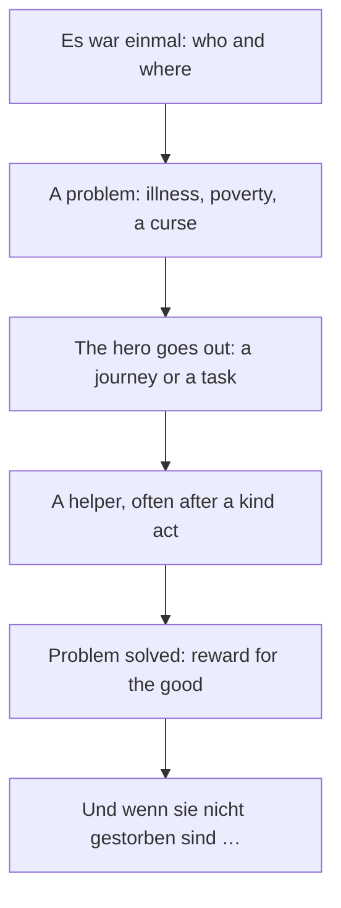

## What this lesson is for

In lesson 2 you learned to *recognise* the simple past, and you read the first lines of a fairy tale. This last lesson of the module puts everything together: you'll read a whole fairy tale (*das Märchen*), learn more simple past forms you'll meet in every story, and then read one of the most famous poems in the German language, written by Johann Wolfgang von Goethe more than 240 years ago. It has only 24 words, and by the end of the lesson you'll understand every one of them.

You'll use all the tools from this module: skimming for the shape of the story, guessing words from their blocks and context, and the small words that change meaning. Reading literature at A2 is slow work, and that's fine. Understanding a real poem in German is one of the best rewards of learning a language.

## How stories are told

Stories are told by a **narrator**, the voice that tells them, and in German the narrator uses the simple past (*Präteritum*). The speech of the characters, in quotation marks, uses the tenses of conversation: present and perfect. So in one paragraph you'll see *Sie nahm den Vogel* (narrator) next to *Du hast mir geholfen* (a character speaking).

Some words that move a story forward:

| word | meaning |
|---|---|
| *Es war einmal …* | Once upon a time there was … |
| *eines Tages* | one day |
| *plötzlich* | suddenly |
| *da* | then, at that moment (in stories) |
| *dann*, *danach* | then, after that |
| *zum Glück*, *leider* | luckily, unfortunately |
| *am Ende* | in the end |
| *Und wenn sie nicht gestorben sind, dann leben sie noch heute.* | the traditional last line: and if they haven't died, they're still alive today |

German fairy tales are best known from the collection of the brothers Jacob and Wilhelm Grimm, *Kinder- und Hausmärchen*, whose first volume appeared in 1812. Tales like *Rotkäppchen* (Little Red Riding Hood), *Hänsel und Gretel*, *Aschenputtel* (Cinderella) and *Die Sterntaler*, where stars (*die Sterne*) fall from the sky as coins for a poor girl, are still read aloud (*vorgelesen*) to children today. The same figures come back again and again: *der König*, *die Prinzessin*, *die Hexe* (witch), *der Wolf*, talking animals, and often a hidden *Schatz* (treasure). The numbers three and seven are everywhere: three brothers, three tries, seven years.

Most tales follow a path like this:

## More simple past forms

Lesson 2 listed the most common strong verbs (*ging, kam, sah, gab, fand* …). Stories add these. Remember: strong verbs change their vowel and have no ending in the *ich* and *er/sie/es* forms.

| simple past | infinitive | meaning |
|---|---|---|
| *hieß* | *heißen* | was called |
| *trug* | *tragen* | carried, wore |
| *flog* | *fliegen* | flew |
| *sang* | *singen* | sang |
| *grub* | *graben* | dug |
| *half* | *helfen* | helped |
| *rief* | *rufen* | called, shouted |
| *fiel* | *fallen* | fell |
| *schlief* | *schlafen* | slept |
| *hielt* | *halten* | held, stopped |
| *zog* | *ziehen* | pulled, moved |
| *schwieg* | *schweigen* | was silent |

A tip for unknown forms: say the form aloud and think of verbs you know with the same consonants. *grub* has *g-r-b*: *graben*. *schwieg* has *schw-g*: *schweigen*. Weak verbs are easy because they keep their stem: *flüsterte* is *flüstern* (to whisper), *pflegte* is *pflegen* (to look after, nurse).

## A fairy tale: Lina und der Vogel

> Es war einmal ein armes Mädchen, das hieß Lina. Sie wohnte mit ihrem Vater in einer kleinen Hütte am Rand von einem großen Wald. Eines Tages wurde der Vater krank, und es gab kein Geld für einen Arzt.
>
> Da ging Lina in den Wald. Sie wollte Holz sammeln und es auf dem Markt verkaufen. Plötzlich hörte sie eine leise Stimme. Unter einem Baum saß ein kleiner Vogel. Er konnte nicht fliegen, denn sein Flügel war verletzt. „Hilf mir!“, flüsterte er. Lina nahm den Vogel, trug ihn nach Hause und pflegte ihn sieben Tage lang.
>
> Am achten Tag war der Flügel wieder gesund. Der Vogel flog auf das Dach und sang: „Du hast mir geholfen, jetzt helfe ich dir. Grab unter dem alten Baum!“ Lina lief in den Wald und grub unter dem Baum. Dort fand sie einen Schatz: eine Kiste voll Gold.
>
> Mit dem Gold bezahlte sie den Arzt, und der Vater wurde wieder gesund. Den Rest gab Lina den armen Leuten im Dorf. Der kleine Vogel aber kam jeden Morgen und sang vor ihrem Fenster. Und wenn sie nicht gestorben sind, dann leben sie noch heute.

Once upon a time there was a poor girl called Lina. She lived with her father in a little hut at the edge of a big forest. One day her father fell ill, and there was no money for a doctor. So Lina went into the forest. She wanted to collect wood and sell it at the market. Suddenly she heard a quiet voice. Under a tree sat a little bird. It couldn't fly, because its wing was injured. "Help me!" it whispered. Lina took the bird, carried it home and looked after it for seven days. On the eighth day the wing was healed. The bird flew onto the roof and sang: "You helped me, now I'll help you. Dig under the old tree!" Lina ran into the forest and dug under the tree. There she found a treasure: a chest full of gold. With the gold she paid the doctor, and her father got well again. Lina gave the rest to the poor people in the village. But the little bird came every morning and sang outside her window. And if they haven't died, they're still alive today.

(*die Stimme* voice, *der Flügel* wing, *pflegen* to nurse, *graben* to dig, *das Dach* roof.)

### Example 1: Finding the infinitives

Find the infinitive of each verb from the story.

1. *hieß*: an *ie* form, like *schlief* from *schlafen*. With *h-ß*: *heißen*.
2. *trug ihn nach Hause*: *tr-g*, and it's about carrying a bird: *tragen*.
3. *flog auf das Dach*: *fl-g*, a bird: *fliegen*. Not *fliehen* (to flee), which is *floh*.
4. *grub unter dem Baum*: the bird said *Grab!* a moment before, the imperative of *graben*. Here the context hands you the answer.
5. *wurde wieder gesund*: *werden*, from lesson 2. *wurde* + adjective means "became, got".

### Example 2: The story's path

Match the story to the chart above.

1. *Es war einmal*: a poor girl, her father, a hut by the forest.
2. Problem: the father is ill and there's no money.
3. The hero goes out: Lina goes into the forest to collect wood.
4. Helper after a kind act: Lina nurses the bird for seven days; the bird tells her where to dig.
5. Reward: the treasure pays the doctor, and Lina shares the rest. The kindness is rewarded twice: with the gold and with the bird's song every morning.
6. The traditional last line.

Knowing the path helps you predict. When the bird appears, you can guess it will help her later.

## A poem: Goethe's Wandrers Nachtlied

Goethe (1749–1832) is Germany's most famous writer (*der Dichter*). By most accounts he wrote this short poem (*das Gedicht*) in pencil on the wooden wall of a hut on the Kickelhahn, a hill near Ilmenau in Thuringia, in September 1780. It was first printed in 1815, under the title *Ein Gleiches* ("another of the same kind"), because it followed an earlier poem called *Wandrers Nachtlied*. Today it's usually called *Wandrers Nachtlied* or *Wandrers Nachtlied II*, "The Wanderer's Night Song". Franz Schubert and many other composers set it to music.

> Über allen Gipfeln
>
> Ist Ruh,
>
> In allen Wipfeln
>
> Spürest du
>
> Kaum einen Hauch;
>
> Die Vögelein schweigen im Walde.
>
> Warte nur, balde
>
> Ruhest du auch.

Over all the hilltops / it is still, / in all the treetops / you feel / hardly a breath of air; / the little birds are silent in the forest. / Just wait, soon / you too will rest. (This is a plain translation, not a poem.)

The poem moves from far to near: from the mountain tops, down to the treetops, to the birds in the forest, and finally to *du*, the wanderer, perhaps the reader. Each step is quieter than the last. Many readers hear in the last two lines not only sleep after a long day but also death, the last rest. That is an interpretation, and the poem never says it; part of its power is that it leaves the question open.

### Old forms in the poem

Poems often use older or shortened forms to fit the rhythm and the rhyme. Here are the ones in this poem, with modern German:

| in the poem | modern German | why |
|---|---|---|
| *Ruh* | *Ruhe* (calm, quiet) | a shortened form; it rhymes with *du* |
| *Spürest du* | *spürst du* (you feel) | an older ending, *-est* |
| *Vögelein* | *kleine Vögel* (little birds) | *-lein*, an old form of *-chen* |
| *im Walde* | *im Wald* | an old dative ending *-e* |
| *balde* | *bald* (soon) | an older form; it rhymes with *Walde* |
| *Ruhest du auch* | *ruhst du auch* (you will rest too) | older ending; the present used for the future |

*Vögelein* is a **diminutive**, a form that makes something small or dear. German makes diminutives with *-chen* or *-lein* and usually an umlaut: *der Vogel* → *das Vögelchen* or *das Vögelein* (also *Vöglein*), *das Buch* → *das Büchlein*. Every diminutive is neuter. Printed versions of the poem differ slightly in this word (*Vögel*, *Vöglein*, *Vögelein*); this lesson follows the 1815 printing.

The lines (*die Zeilen*) rhyme in four pairs, but the pairs are not next to each other: *Gipfeln* and *Wipfeln*, *Ruh* and *du*, *Hauch* and *auch*, *Walde* and *balde*. A **rhyme** (*der Reim*) is two words whose endings sound the same from the last stressed vowel on. The **rhyme scheme** labels the pattern with letters: lines 1–4 are *abab* (Gipfeln, Ruh, Wipfeln, du), lines 5–8 are *cddc* (Hauch, Walde, balde, auch). Notice also that every line starts with a capital letter. That was the rule in poems of Goethe's time, not a sign of nouns.

### Example 3: Reading the poem in modern German

Rewrite lines 4–8 in everyday German.

1. *Spürest du kaum einen Hauch* → *Du spürst kaum einen Hauch.* (*kaum* = hardly; *der Hauch* = breath, a breath of wind.) Poems can put the verb first without making a question.
2. *Die Vögelein schweigen im Walde* → *Die kleinen Vögel sind still im Wald.* (*schweigen* = to be silent.)
3. *Warte nur, balde ruhest du auch* → *Warte nur, bald ruhst du auch.* *nur* here softens the imperative: "just wait". German often uses the present for the future when a time word like *bald* is there.

## Reading aloud

Poems are made to be heard. When you read one aloud (*vorlesen*), pause at the end of a line only where there's punctuation, and stress the rhyme words. In this poem, read slowly, and let the last line be the quietest. Do the same with the fairy tale: read it to someone, or record yourself. Reading aloud trains your eyes, your mouth and your ears at the same time.

## Common mistakes

- Thinking the narrator's simple past means something different from the perfect. *Sie nahm den Vogel* and *Sie hat den Vogel genommen* mean the same; the first is story style.
- Mixing up similar forms: *flog* (*fliegen*, flew) and *floh* (*fliehen*, fled); *hielt* (*halten*) and *hieß* (*heißen*).
- Reading *Ist Ruh* or *Spürest du* as questions. Poems change word order freely; check the punctuation.
- Treating every capital letter in a poem as a noun. In older poems each line starts with a capital.
- Taking *Ruh*, *balde* and *spürest* as mistakes. They're poetic forms; don't use them in your e-mails.
- Saying *der Vögelein*. Diminutives are always neuter: *das Vögelein*.

## Key points

- The **narrator** tells a story in the simple past; characters speak in the present and perfect.
- Fairy tales: *Es war einmal …*, a problem, a journey, a helper, a reward, *Und wenn sie nicht gestorben sind …*
- Work out strong past forms from their consonants and the context: *grub* → *graben*, *flog* → *fliegen*.
- Goethe's *Wandrers Nachtlied* (written 1780, printed 1815): from the summits to the treetops to the birds to *du*.
- Poems use old and short forms: *Ruh, spürest, im Walde, balde*.
- A **diminutive** (*-chen, -lein*) is small or dear, and always neuter.
- A **rhyme scheme** labels rhyming lines with letters: *abab cddc*.

The words from this lesson are listed below; they join your vocabulary reviews when you complete the lesson.
